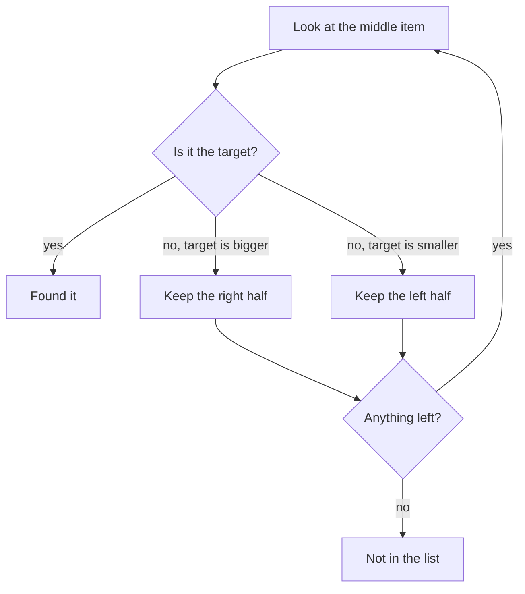

> **In one sentence:** An algorithm is an exact, finite list of steps that solves a problem. Two algorithms for the same problem can need very different numbers of steps.

## Why should I care?

Imagine you want to find one name in a list of a million names. You could look at every name, one by one. Or, if the list is in order, you could do it with at most 20 looks. Both ways are algorithms.

This page uses [[loops|loops]] and [[lists-and-dictionaries|lists]].

## Analogy

Think of finding a word in a dictionary in alphabetical order, such as an English dictionary. You do not read it from the first page. You open it near the middle. Is your word before or after that page? You keep only that half, and open it near its middle again.

**Where the analogy breaks down:** on a dictionary page, you see many words at once. Binary search looks at one item at a time, and always the middle one (rounded down).

## How it actually works

### What an algorithm is

Wikipedia defines an **algorithm** as a finite sequence of instructions that are exact, as in mathematics. Finite means the list of steps has an end. MDN Web Docs, a website that documents web technologies, says it lets a problem be solved "by humans or machines".

So an algorithm is the method, and a program is one way to write it down. The examples below show the same algorithms in [[javascript|JavaScript]], [[python|Python]] and [[go-language|Go]]. You only need to read one tab.

### Linear search: look at every item

A **search** finds where a value is in a list. **Linear search** checks each item in order, until it finds a match or reaches the end. Wikipedia says it "makes at most n comparisons", where n is the number of items.

<!-- tabs -->

### JavaScript

```js
const numbers = [3, 8, 15, 21, 30, 42, 57];
const target = 57;
let foundAt = -1; // -1 means "not found yet". No index is -1.
let checks = 0;   // How many items we have looked at.

for (let i = 0; i < numbers.length; i++) {
  checks = checks + 1;
  if (numbers[i] === target) {
    foundAt = i;  // Found it: remember the index...
    break;        // ...and stop looking.
  }
}

console.log(foundAt); // Shows: 6
console.log(checks);  // Shows: 7
```

The loop goes through every index, from 0 to the last one. `break` ends the loop as soon as the item matches.

### Python

`range(len(numbers))` gives each index of the list, from 0 to the last one. A Python index can be negative, counting from the end, so `numbers[-1]` is the last item. This code never reads `numbers[-1]`: it uses -1 only as a sign for "not found yet". `break` ends the loop as soon as the item matches. Python compares with `==`.

```python
numbers = [3, 8, 15, 21, 30, 42, 57]
target = 57
found_at = -1  # Here, -1 means "not found yet".
checks = 0     # How many items we have looked at.

for i in range(len(numbers)):
    checks = checks + 1
    if numbers[i] == target:
        found_at = i  # Found it: remember the index...
        break         # ...and stop looking.

print(found_at)  # Shows: 6
print(checks)    # Shows: 7
```

### Go

The loop goes through every index, from 0 to the last one. `break` ends the loop as soon as the item matches. Go compares with `==`. `package main` and `func main()` mark where the program starts. `import "fmt"` brings in `fmt`, a package for printing, and `fmt.Println` shows a value.

```go
package main

import "fmt"

func main() {
	numbers := []int{3, 8, 15, 21, 30, 42, 57}
	target := 57
	foundAt := -1 // -1 means "not found yet". No index is -1.
	checks := 0   // How many items we have looked at.

	for i := 0; i < len(numbers); i++ {
		checks = checks + 1
		if numbers[i] == target {
			foundAt = i // Found it: remember the index...
			break       // ...and stop looking.
		}
	}

	fmt.Println(foundAt) // Shows: 6
	fmt.Println(checks)  // Shows: 7
}
```

<!-- /tabs -->

57 is the last of 7 items, so it took 7 checks.

### Binary search: halve a sorted list

A list is **sorted** when its items are in order, such as smallest number first. **Binary search** works only on a sorted list. Wikipedia says it "compares the target value to the middle element". If they do not match, the half where the target cannot be is dropped, and the search goes on in the other half. Wikipedia says that if nothing is left, "the target is not in the array" (an array is a list).



<!-- tabs -->

### JavaScript

`low` and `high` are the first and last index that could still hold the target. `Math.floor()` rounds a number down to a whole number, so `middle` is always an index.

```js
const numbers = [3, 8, 15, 21, 30, 42, 57]; // Sorted, smallest first.
const target = 57;
let low = 0;                   // The first index that is still possible.
let high = numbers.length - 1; // The last index that is still possible.
let middle = 0;
let foundAt = -1;
let checks = 0;

while (low <= high) {
  middle = Math.floor((low + high) / 2); // The index halfway between.
  checks = checks + 1;
  if (numbers[middle] === target) {
    foundAt = middle;         // Found it.
    break;
  } else if (numbers[middle] < target) {
    low = middle + 1;         // The target is bigger: keep the right half.
  } else {
    high = middle - 1;        // The target is smaller: keep the left half.
  }
}

console.log(foundAt); // Shows: 6
console.log(checks);  // Shows: 3
```

### Python

`low` and `high` are the first and last index that could still hold the target. `//` divides and rounds down to a whole number, so `middle` is always an index. Python's glossary calls this floor division. `elif` is short for "else if".

```python
numbers = [3, 8, 15, 21, 30, 42, 57]  # Sorted, smallest first.
target = 57
low = 0                  # The first index that is still possible.
high = len(numbers) - 1  # The last index that is still possible.
found_at = -1
checks = 0

while low <= high:
    middle = (low + high) // 2  # The index halfway between.
    checks = checks + 1
    if numbers[middle] == target:
        found_at = middle       # Found it.
        break
    elif numbers[middle] < target:
        low = middle + 1        # The target is bigger: keep the right half.
    else:
        high = middle - 1       # The target is smaller: keep the left half.

print(found_at)  # Shows: 6
print(checks)    # Shows: 3
```

### Go

`low` and `high` are the first and last index that could still hold the target. When Go divides two whole numbers with `/`, it drops the part after the decimal point, so `middle` is always an index. A `for` with only a condition repeats as long as the condition is true.

```go
package main

import "fmt"

func main() {
	numbers := []int{3, 8, 15, 21, 30, 42, 57} // Sorted, smallest first.
	target := 57
	low := 0                 // The first index that is still possible.
	high := len(numbers) - 1 // The last index that is still possible.
	foundAt := -1
	checks := 0

	for low <= high {
		middle := (low + high) / 2 // The index halfway between.
		checks = checks + 1
		if numbers[middle] == target {
			foundAt = middle // Found it.
			break
		} else if numbers[middle] < target {
			low = middle + 1 // The target is bigger: keep the right half.
		} else {
			high = middle - 1 // The target is smaller: keep the left half.
		}
	}

	fmt.Println(foundAt) // Shows: 6
	fmt.Println(checks)  // Shows: 3
}
```

<!-- /tabs -->

Here are the three rounds:

| Round | Indexes left | Middle | Item there | Result |
|---|---|---|---|---|
| 1 | 0–6 | 3 | 21 | 57 is bigger |
| 2 | 4–6 | 5 | 42 | 57 is bigger |
| 3 | 6 | 6 | 57 | Found |

### More items, more steps

Linear search can need one check for each item. Wikipedia gives a formula for the most checks binary search can need. The table uses it:

| Items in the list | Linear search, at most | Binary search, at most |
|---|---|---|
| 7 | 7 | 3 |
| 1,000 | 1,000 | 10 |
| 1,000,000 | 1,000,000 | 20 |

Wikipedia says binary search "is faster than linear search except for small arrays".

### Sorting

Binary search needs a sorted list. Wikipedia says a **sorting algorithm** "puts elements of a list into an order", and that there are "a large number" of them. Python's documentation says Python uses one called Timsort.

Each of the three languages on this page comes with a sort.

<!-- tabs -->

### JavaScript

`.sort()` sorts an array and changes that array. MDN says that by default, it converts the items to strings and compares those. As text, `"100"` comes before `"21"`, because 1 comes before 2.

```js
const numbers = [30, 4, 100, 21];
numbers.sort();
console.log(numbers); // The order is now: 100, 21, 30, 4

numbers.sort((a, b) => a - b);
console.log(numbers); // The order is now: 4, 21, 30, 100
```

To sort numbers by size, give `.sort()` a **compare function**. MDN says a **function** is "a set of statements that performs a task or calculates a value". `(a, b) => a - b` takes two items, `a` and `b`, and gives back `a - b`. MDN says a negative result puts `a` first, and a positive result puts `a` after `b`.

### Python

`sorted()` gives back a new sorted list and leaves the old list as it was. The method `.sort()` sorts the list itself. Numbers end up in order of size, as in the examples in Python's documentation.

```python
numbers = [30, 4, 100, 21]

print(sorted(numbers))  # Shows: [4, 21, 30, 100]
print(numbers)          # Shows: [30, 4, 100, 21]

numbers.sort()
print(numbers)          # Shows: [4, 21, 30, 100]
```

Python's documentation says its sorts are "guaranteed to be stable": items that compare equal keep their original order.

### Go

The `slices` package has `slices.Sort`, which sorts a slice from smallest to largest. It also has `slices.BinarySearch`, a binary search you do not have to write. It gives back two values: the index, and `true` or `false` for whether the target is there. If the target is missing, the index is where it would go. The `import` line brings in two packages, `fmt` and `slices`, grouped in round brackets. Its documentation says "The slice must be sorted in increasing order."

```go
package main

import (
	"fmt"
	"slices"
)

func main() {
	numbers := []int{30, 4, 100, 21}

	slices.Sort(numbers)
	fmt.Println(numbers) // Shows: [4 21 30 100]

	// A binary search that Go provides. The slice must be sorted.
	index, found := slices.BinarySearch(numbers, 30)
	fmt.Println(index, found) // Shows: 2 true
}
```

<!-- /tabs -->

## How it came to be

The MacTutor history site says Abu Ja'far Muhammad ibn Musa Al-Khwarizmi was born about 780 and died about 850. He was a scholar at the House of Wisdom in Baghdad. MacTutor says: "The word algorithm derives from his name." Wikipedia says the Latin form "algoritmi" is the Latinization of his name.

Binary search is much newer than the word: Wikipedia says it was first mentioned in 1946.

## 🧪 Try it in your browser

These steps use JavaScript, because the browser's console runs it. In JavaScript, a list is called an **array**.

- `const` and `let` create variables. `plain[0]` reads the item at index 0, and `.length` gives the number of items.
- `.sort()` sorts an array. By default, it compares the items as text.
- `(a, b) => a - b` is a **compare function**: a small function (a set of statements that calculates a value) that `.sort()` uses to compare two items, `a` and `b`. Its result, `a` minus `b`, makes the sort put numbers in order of size.
- `console.log()` shows a value. `;` separates commands.
- In a `for` line, `( )` hold the start, the condition and the step. `===` checks whether two values are equal, and `break` ends the loop.

You need a computer with Chrome, Edge or Firefox.

**Safety rule:** only type code in the console that you understand or that comes from a source you trust. Never paste anything a stranger sends you. The lines below only create, sort and search arrays, and show numbers.

1. Open [example.com](https://example.com).
   **What you should see:** a short page of text.
2. Open the **console**:
   - **Windows:** press `Ctrl` + `Shift` + `J` (in Firefox: `Ctrl` + `Shift` + `K`)
   - **Mac:** press `Cmd` + `Option` + `J` (in Firefox: `Cmd` + `Option` + `K`)
3. Click the line where you can type, below any messages. **Type** this line yourself (some browsers may block pasting at first), then press `Enter`. The browser may show suggestions, and the line may look different while you type. Keep typing.

   ```
   const plain = [30, 4, 100, 21]; plain.sort(); console.log(plain[0]);
   ```

   **What you should see:** `100`, the first item after the sort. The items were compared as text, and as text, 100 starts with 1, which comes before 2, 3 and 4. The console may also show `undefined`.
4. Sort by size with a compare function:

   ```
   const byNumber = [30, 4, 100, 21]; byNumber.sort((a, b) => a - b); console.log(byNumber[0]);
   ```

   **What you should see:** `4`, the smallest number. The console may also show `undefined`.
5. Count the checks of a linear search for 21:

   ```
   const list = [3, 8, 15, 21, 30, 42, 57]; let checks = 0; for (let i = 0; i < list.length; i++) { checks = checks + 1; if (list[i] === 21) { break; } } console.log(checks);
   ```

   **What you should see:** `4`, because 21 is the fourth item. The console may also show `undefined`.

If you see an error message, look for a typo. Then click your browser's reload button and start again from step 3.

## Common misunderstandings

- **"An algorithm is a piece of code."** No. It is the method, and MDN says humans can follow it too. Code is one way to write it down.
- **"Binary search works on any list."** No. On a list that is not sorted, dropping a half can drop the target.
- **"A sort always puts numbers in order of size."** Not in JavaScript: by default, its sort compares numbers as text.

## Recap

- An algorithm is an exact, finite list of steps that solves a problem. The same algorithm can be written in many languages, such as the three on this page.
- Linear search checks every item. Binary search halves a sorted list each round, so it needs far fewer checks on a large list.
- Each of these languages comes with a sort. In JavaScript, give `.sort()` a compare function to sort numbers by size.

## Sources

- Wikipedia, Algorithm: https://en.wikipedia.org/wiki/Algorithm
- MDN Web Docs, Algorithm (glossary): https://developer.mozilla.org/en-US/docs/Glossary/Algorithm
- MacTutor History of Mathematics, Abu Ja'far Muhammad ibn Musa Al-Khwarizmi: https://mathshistory.st-andrews.ac.uk/Biographies/Al-Khwarizmi/
- Wikipedia, Dictionary: https://en.wikipedia.org/wiki/Dictionary
- Wikipedia, Linear search: https://en.wikipedia.org/wiki/Linear_search
- Wikipedia, Binary search: https://en.wikipedia.org/wiki/Binary_search
- Wikipedia, Sorting algorithm: https://en.wikipedia.org/wiki/Sorting_algorithm
- MDN Web Docs, Array.prototype.sort(): https://developer.mozilla.org/en-US/docs/Web/JavaScript/Reference/Global_Objects/Array/sort
- MDN Web Docs, Arrow function expressions: https://developer.mozilla.org/en-US/docs/Web/JavaScript/Reference/Functions/Arrow_functions
- MDN Web Docs, Math.floor(): https://developer.mozilla.org/en-US/docs/Web/JavaScript/Reference/Global_Objects/Math/floor
- MDN Web Docs, Array: length: https://developer.mozilla.org/en-US/docs/Web/JavaScript/Reference/Global_Objects/Array/length
- MDN Web Docs, for: https://developer.mozilla.org/en-US/docs/Web/JavaScript/Reference/Statements/for
- MDN Web Docs, break: https://developer.mozilla.org/en-US/docs/Web/JavaScript/Reference/Statements/break
- MDN Web Docs, Strict equality (===): https://developer.mozilla.org/en-US/docs/Web/JavaScript/Reference/Operators/Strict_equality
- MDN Web Docs, const: https://developer.mozilla.org/en-US/docs/Web/JavaScript/Reference/Statements/const
- MDN Web Docs, console.log(): https://developer.mozilla.org/en-US/docs/Web/API/console/log_static
- MDN Web Docs, eval(): https://developer.mozilla.org/en-US/docs/Web/JavaScript/Reference/Global_Objects/eval
- MDN Web Docs, About MDN: https://developer.mozilla.org/en-US/about
- Python documentation, Sorting Techniques: https://docs.python.org/3/howto/sorting.html
- Python documentation, Built-in Functions: https://docs.python.org/3/library/functions.html
- Python Tutorial, An Informal Introduction to Python: https://docs.python.org/3/tutorial/introduction.html
- Python documentation, Glossary: https://docs.python.org/3/glossary.html
- Python Tutorial, More Control Flow Tools: https://docs.python.org/3/tutorial/controlflow.html
- MDN Web Docs, Functions: https://developer.mozilla.org/en-US/docs/Web/JavaScript/Guide/Functions
- Go Packages, fmt: https://pkg.go.dev/fmt
- Go Packages, slices: https://pkg.go.dev/slices
- The Go Programming Language Specification: https://go.dev/ref/spec
- Microsoft Edge DevTools, Run JavaScript in the Console: https://learn.microsoft.com/en-us/microsoft-edge/devtools/console/console-javascript
- Chrome for Developers, Open Chrome DevTools: https://developer.chrome.com/docs/devtools/open
- Microsoft Edge DevTools, Keyboard shortcuts: https://learn.microsoft.com/en-us/microsoft-edge/devtools/shortcuts/
- Firefox DevTools User Docs, Web Console: https://firefox-source-docs.mozilla.org/devtools-user/web_console/index.html
- Chrome for Developers, What are self-XSS attacks?: https://developer.chrome.com/blog/self-xss
- Example Domain: https://example.com
