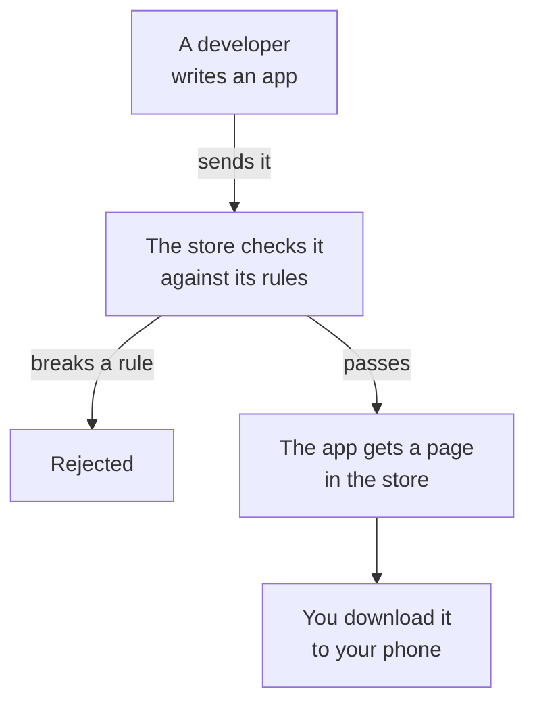

> **In one sentence:** An app is a program, and an app store is a place where you find and download apps and their updates; the main official store is usually run by the company behind the operating system, and it checks apps against its rules first.

## Why should I care?

On a smartphone, you can get apps from an **app store**. On an iPhone it is Apple's **App Store**. On Android phones, Google runs a store called **Google Play**.

Apps can ask to see your photos, your contacts and where you are. So it helps to know who checked them. As a programmer, you may one day send your own app to a store.

## Analogy

Think of a **market** with a manager. Before a seller can open a stall, the manager checks the goods against a rule book. Each product has a label, written by the seller, not the manager. The sellers are the **developers** (the people and companies who write apps), the manager is the company that runs the store, and you are the shopper.

**Where the analogy breaks down:** a market manager checks a product once, and it stays the same. An app can change. An **update** is a newer version of the same app, with fixes or new features. An update goes back to the store, and the store checks it again.

## How it actually works

### An app is a program

As you saw in [[software]], an **app** is another word for a program. A phone app is written for a phone's [[operating-system|operating system]], such as iOS or Android.

### The journey of an app

1. **A developer sends the app.** Apple asks for privacy information with it: what data the app collects.
2. **The store checks it.** Apple's App Review Guidelines say "every app is reviewed by experts". Apple also scans each app for [[malware]]: software written to do harm. In 2015, Google wrote that it had begun "reviewing apps before they are published on Google Play".
3. **The store can say no.** Apple writes that it will reject apps whose content or behavior it believes is "over the line": not acceptable. Google tells developers that an app can be "rejected, removed, or suspended": refused, or taken off the store.
4. **The app gets a store page.** It shows a description, pictures and privacy information.
5. **You download it** from the store page onto your phone. In 2008, Apple said you could download apps "wirelessly": over Wi-Fi or the mobile network, without a cable.

### Permissions: the app must ask

A **permission** is the right to use something private, such as your camera, microphone, location or contacts. The app must ask for it, and you choose whether to give it. On Android, Google's guide for developers says that the operating system shows this question, not the app.

On Android, you can allow it, or choose "Don't allow", says Google's help. Apple's iPhone guide says that the first time an app wants information from another app, such as Contacts or Photos, "you receive a request with an explanation." Both say you can change your answer later in settings.

**CISA** is a US government agency for cyber-security: keeping computers and data safe. It advises you to read the permissions an app asks for, and to check whether they fit what the app does. Apple's rules give an example: an app that posts photos must not require the microphone before it lets you upload (send) photos.

### Privacy information on the store page

Each store page has a privacy section, **App Privacy** (Apple) or **Data safety** (Google), listing kinds of data an app may collect.

The **developer** fills it in, not the store. Google's help says the section is "based on information declared by app developers": what the developers say. Apple tells developers: "You're responsible for keeping your responses accurate and up to date."

### Updates come through the store

An update takes the same path through the store. Apple says it reviews "all apps, app updates" and more. Google tells developers that changes are published "as soon as they're reviewed and approved by Google". Google's help says updating "improves app security". (More in [[software-updates]].)

### Not the only way in

Apple says that "in some markets" (some parts of the world), developers can also offer iPhone apps from other app stores and from their own websites.

CISA advises limiting downloads to "official app stores": the store of the company that made your device, or of its operating system. It also warns that harmful apps sometimes get past the checks of good stores.

## How it came to be

Apple opened the App Store in July 2008. Apple said it would "offer over 500 native applications from hundreds of companies around the world".

Google opened **Android Market** on October 22, 2008, with "over 50 apps". At first, apps were not checked before they went live. Google wrote that apps "can be made available to users without further validation or approval": no further check. By 2015, as you saw above, that had changed.

## 🧪 Try it in your browser

You will read a store page's privacy section, in Chrome, Edge or Firefox, without signing in. If a box about cookies or signing in appears, close it. Only look: do not click **Install** or **Get**.

1. Open the App Store page of Apple's own **Apple Support** app: https://apps.apple.com/us/app/apple-support/id1130498044
2. Scroll down to the heading **App Privacy**.
3. Below it, find groups such as **Data Linked to You**.
4. Now open the Google Play page of Google's own **Google Maps** app: https://play.google.com/store/apps/details?id=com.google.android.apps.maps
5. Scroll down to the heading **Data safety**. You do not need to click **See details**.

**What you should see:** on both pages, kinds of data the app may collect. Google's page also says: "The developer provided this information and may update it over time." The lists change over time.

**On your phone (if you have one):** look at permissions without changing them.

- **Android:** Google's help says to open **Settings**, tap **Apps**, pick an app, then tap **Permissions**.
- **iPhone:** Apple's guide says to go to **Settings**, then **Privacy & Security**, and tap a category such as **Calendars**.

Menu names may differ a little.

## Common misunderstandings

- **"If it is in the official store, it is safe."** Stores check apps, but CISA warns that harmful apps sometimes get through.
- **"The store wrote the privacy section."** No. The developer fills it in. Google's help says that even a security review by an outside organization "does not verify the accuracy and completeness" of the Data safety section.
- **"Saying no will break my phone."** Google's help says that with "Don't allow", the app "cannot use the permission". You can change it later.

## Recap

- An app is a program. An app store is where you get apps and updates; the main one is usually run by the company behind the operating system.
- Developers send apps and updates to the store. The store checks them against its rules and can reject them, but a check is not a promise that an app is safe.
- Apps must ask for permission to use private things such as your camera or location. The store page shows privacy information, written by the developer.

## Sources

- Apple Newsroom, iPhone 3G on Sale Tomorrow (July 10, 2008): https://www.apple.com/newsroom/2008/07/10iPhone-3G-on-Sale-Tomorrow/
- Apple Developer, App Review Guidelines: https://developer.apple.com/app-store/review/guidelines/
- Apple Developer, App Review: https://developer.apple.com/distribute/app-review/
- Apple Developer, App privacy details on the App Store: https://developer.apple.com/app-store/app-privacy-details/
- Apple iPhone User Guide, Control access to information in apps on iPhone: https://support.apple.com/en-us/guide/iphone/iph251e92810/ios
- Android Developers Blog, Android Market now available for users (October 22, 2008): https://android-developers.googleblog.com/2008/10/android-market-now-available-for-users.html
- Android Developers Blog, Creating Better User Experiences on Google Play (March 17, 2015): https://android-developers.googleblog.com/2015/03/creating-better-user-experiences-on.html
- Play Console Help, Control when app changes are reviewed and published: https://support.google.com/googleplay/android-developer/answer/9859654?hl=en
- Google Play, Developer Program Policy: https://play.google/developer-content-policy/
- Google Play Help, Learn about the Data safety section on Google Play: https://support.google.com/googleplay/answer/11416267?hl=en
- Google Play Help, Update Android apps: https://support.google.com/googleplay/answer/113412?hl=en
- Android Help, Change app permissions on your Android phone: https://support.google.com/android/answer/9431959?hl=en
- Android Developers, Permissions on Android: https://developer.android.com/guide/topics/permissions/overview
- CISA, Privacy and Mobile Device Apps: https://www.cisa.gov/news-events/news/privacy-and-mobile-device-apps
- Wikipedia, Mobile app (general background reference): https://en.wikipedia.org/wiki/Mobile_app
