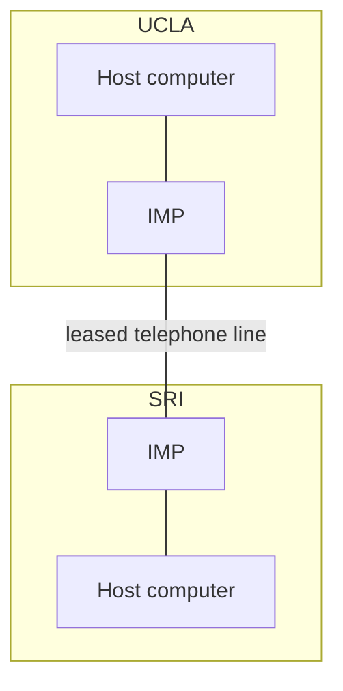

> **In one sentence:** ARPANET was an early computer network that used packets, paid for by a research agency of the U.S. Department of Defense, and it sent its first message on October 29, 1969.

## The world before

In [[telegraph-and-telephone]] you saw a quote from the Computer History Museum: "Until the 1960s, computers mostly used phone and telegraph equipment to communicate." The same museum explains a weakness of telephone lines: a signal travels over one particular path, and "when nothing is being said, the line is wasted".

A history written by several of the people who built the ARPANET and the internet says: "A major initial motivation for both the ARPANET and the Internet was resource sharing." **Resource sharing** means letting many people use the same computers, programs and data.

In the 1960s, researchers such as Paul Baran and Donald Davies worked on a new way to send data: cut it into small pieces, called [[packets]], that travel on their own and share the lines.

You do not need to remember all the names in this story.

## What happened

### The plan (1966–1968)

**ARPA**, the Advanced Research Projects Agency, was part of the U.S. Department of Defense. (Today it is called DARPA.) In 1966, Larry Roberts left MIT (the Massachusetts Institute of Technology) to start ARPA's network project. Roberts published his plan for the "ARPANET" in 1967.

In 1967, at a conference of ARPA researchers, Wesley Clark suggested putting special machines in front of the big computers, to run the network. These machines were called **Interface Message Processors**, or **IMPs**. (An **interface** is the meeting point between two things.) The IMP shown in the Computer History Museum is a large box with a small computer (a minicomputer) inside.

In December 1968, a team led by Frank Heart at the company Bolt Beranek and Newman (BBN) won the contract to build the IMPs. A contract is an agreement to do a job for pay. The IMPs received packets and passed them on, one step closer to the receiver. Today, [[router|routers]] do this job. The Computer History Museum says the IMPs grew into today's routers.

### The first four sites (1969)

In September 1969, BBN installed the first IMP at UCLA, a university in Los Angeles. Leonard Kleinrock's laboratory at UCLA became the first **node**: the first connected site on the network. One month later, the Stanford Research Institute (SRI) was connected too.

On **October 29, 1969**, the team at UCLA tried to **log in** to the SRI computer: to start using it from UCLA, over the network. Kleinrock's website says that they sent "l" and "o", "and then the system crashed!" The Computer History Museum adds: "the next attempt works!"

Two more sites joined: the University of California, Santa Barbara, and the University of Utah. So by the end of 1969, four **host** computers were connected. (A host is one of the big computers that used the network, not an IMP.)

The IMPs at different sites were joined by **leased telephone lines**: telephone lines rented for the network. So the ARPANET used the same kind of lines as the telephone network. The new part was how it used them: it sent packets over them, as you saw in [[packets]].

### Growth (1970–1990)

The Computer History Museum says that the ARPANET had 14 nodes at the start of 1971, and that by 1975 its map showed 61 nodes.

Computers that talk to each other must agree on the form of the data. A **protocol** is a system of rules that define how data is exchanged between computers. In December 1970, a group of researchers finished the first protocol for ARPANET host computers to talk to each other. It was called the **Network Control Protocol (NCP)**.

Ray Tomlinson at BBN made the ARPANET's first program for network email. Sources differ on the year: Lemelson-MIT's page about Tomlinson says 1971, the Computer History Museum lists it under 1972, and the Internet Society history says he wrote the basic email send and read software in March 1972. He used the **@** sign to separate the person's name from the computer's name: "user@host". Email addresses still use this form today.

In October 1972, Bob Kahn organized the first public demonstration of the ARPANET, at a conference called ICCC.

The ARPANET was one network. Around 1973, Bob Kahn started work on joining it to other networks, such as a radio-based network called PRnet. With Vint Cerf, he designed a new protocol, which grew into [[tcp-ip|TCP/IP]], a group of protocols. On **January 1, 1983**, the ARPANET switched from NCP to TCP/IP. All host computers had to change at the same time.

## Why it mattered

The Computer History Museum calls the ARPANET "the first large-scale experiment in general-purpose computer networking": the first big test of a computer network for many kinds of uses. The museum says the 1972 demonstrations showed that packet switching could work in practice.

Some of its ideas are still with you today. Email addresses with the @ sign started there. The IMPs grew into today's routers. And DARPA says that by January 1983, so many networks were connected to each other that the ARPANET had grown into the internet. The internet kept growing. Only the original ARPANET network was formally shut down, in 1990.

**A common myth:** many people believe the ARPANET was built to survive a nuclear war. The Internet Society history calls this a "false rumor". It says this was never true of the ARPANET. Paul Baran, whom you met in the packets story, worked at a group called RAND. The same history says a RAND paper from 1964 was about networks for "secure voice in the military": protected voice calls. Only that separate RAND study thought about nuclear war.

## 🔍 See it for yourself

1. Open the Computer History Museum page [Interface Message Processor (IMP)](https://www.computerhistory.org/revolution/networking/19/407/2086). **What you should see:** a photo of a large box. This is one of the first IMPs. Its text says it was "the interface between the ARPANET (a predecessor to the Internet) and a computer connected to the network". A predecessor is something that came before.
2. Open Leonard Kleinrock's page [The Day the Infant Internet Uttered its First Words](https://www.lk.cs.ucla.edu/internet_first_words.html). (The title means "the day the baby internet said its first words".) **What you should see:** scroll down to find pictures of a page from the UCLA IMP log book. A log book is a notebook where the team wrote down what happened. One picture shows the entry for October 29, 1969 highlighted. The writing may be hard to read, so do not worry if you cannot read every word.

## Recap

- ARPANET was a computer network paid for by ARPA, a research agency of the U.S. Department of Defense. A major early goal was resource sharing.
- On October 29, 1969, UCLA sent the first message to SRI over it: "lo", then a crash. By the end of 1969, four sites were connected through IMPs, machines that passed packets on.
- The ARPANET gave us network email with the @ sign. On January 1, 1983, it switched to TCP/IP, and it grew into the internet.

## Sources

- Internet Society, A Brief History of the Internet: https://www.internetsociety.org/internet/history-internet/brief-history-internet/
- Computer History Museum, Internet History, 1960s: https://www.computerhistory.org/internethistory/1960s/
- Computer History Museum, Internet History, 1970s: https://www.computerhistory.org/internethistory/1970s/
- Computer History Museum, Revolution: Connecting Over Phone Lines: https://www.computerhistory.org/revolution/networking/19/371
- Computer History Museum, Revolution: Connections: Global Networks: https://www.computerhistory.org/revolution/networking/19/374
- Computer History Museum, Revolution: Networking Takes Off: https://www.computerhistory.org/revolution/networking/19/407
- Computer History Museum, Revolution: Interface Message Processor (IMP): https://www.computerhistory.org/revolution/networking/19/407/2086
- DARPA, ARPANET: https://www.darpa.mil/news/features/arpanet
- Leonard Kleinrock, The Day the Infant Internet Uttered its First Words: https://www.lk.cs.ucla.edu/internet_first_words.html
- Lemelson-MIT, Ray Tomlinson: https://lemelson.mit.edu/resources/ray-tomlinson
- MDN Web Docs, Protocol (glossary): https://developer.mozilla.org/en-US/docs/Glossary/Protocol
- Wikipedia, ARPANET (general background reference): https://en.wikipedia.org/wiki/ARPANET
