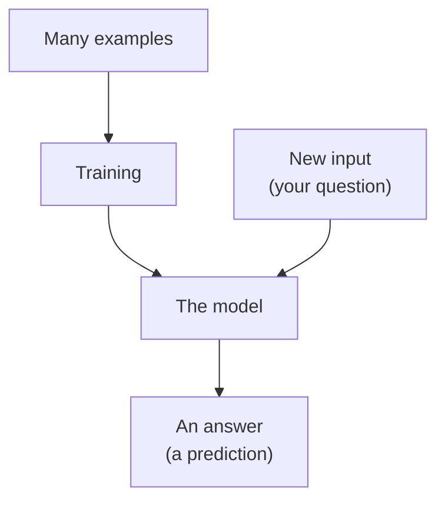

> **In one sentence:** Artificial intelligence (AI) means programs that do tasks we connect with human thinking; in machine learning, a part of AI, a program called a model is trained on many examples, and chatbots use large language models that predict text one piece at a time.

## Why should I care?

You may have used a **chatbot**: a program that you "chat" with by typing, and that writes answers back. Google's machine learning course gives two less visible examples of AI: deciding whether an email is spam (unwanted mail), and whether a photo contains a cat.

AI can sound like magic, but it is [[software]]: programs, made by people and run on computers. Knowing how it works helps you know when not to trust it.

## Analogy

Think of the **word suggestions** above the keyboard on many phones. Google's phone keyboard, for example, shows suggestions at the top of the keyboard, and they can include the next word.

A chatbot does something similar, at a much larger scale. Google's course describes large language models as "essentially autocomplete mechanisms". **Autocomplete** means finishing your text for you.

**Where the analogy breaks down:** on a phone, the keyboard suggests and you choose. A chatbot writes whole answers by itself, one piece after another. Also, research by Anthropic, a company that makes a chatbot, found that its model can "plan what it will say many words ahead". So it writes one piece at a time, but it does not only look at the next word.

## How it actually works

### What counts as AI

MIT Sloan, a business school, describes AI as "the capability of a machine to imitate intelligent human behavior".

### Two ways to make a program "smart"

**1. Rules written by people.** Normal programming "requires creating detailed instructions for the computer to follow", as MIT Sloan puts it, like a recipe. But exact rules for "this photo shows a person" are very hard to write.

**2. Machine learning.** MIT Sloan calls machine learning "a subfield of artificial intelligence". It credits AI pioneer Arthur Samuel, in the 1950s, with describing it as giving computers "the ability to learn without explicitly being programmed": without people writing every rule. Instead, the program finds **patterns**, things that repeat, in many examples.

Google's course defines machine learning as "the process of training a piece of software, called a model, to make useful predictions". So a **model** is software too. Google's course calls a model's answers **predictions**, even when they are not about the future. One kind of model learns "after seeing lots of data with the correct answers": for example, many emails, each marked "spam" or "not spam".

### Training, then using

Google's course shows the two stages with weather. First, people give a model "enormous amounts of weather data", and it learns the relationship between weather patterns and rain. Later, they "give the model the current weather data, and it would predict the amount of rain".



The International Energy Agency (IEA) says that training and deploying AI models (putting them to use) takes place in large data centers that use a lot of electricity. So your question to a chatbot usually travels over the internet to [[server|servers]] in data centers, like other [[cloud-computing|cloud]] services.

### Chatbots and large language models

A chatbot is the same idea. The examples are text, your question is the input, and the answer is predicted text.

Many chatbots are built on a **large language model** (LLM). IBM says developers "can use pretrained models to build chatbots": models that were already trained. An LLM learns from a huge amount of text. Google's course says a language model estimates how likely a **token** is at a place in a text, for example which one comes next. A token "could be a word, a subword (a subset of a word), or even a single character".

### Why AI can be confidently wrong

Google's course says: "LLMs hallucinate, meaning their predictions often contain mistakes." To **hallucinate** here means to make up information.

A 2025 research paper explains one cause. Language models "sometimes guess when uncertain", and give "plausible yet incorrect statements" instead of saying they are not sure. (**Plausible** means it sounds believable.) The authors say training and testing often reward a guess more than "I don't know".

Anthropic's documentation says ways to reduce this "don't eliminate them entirely. Always validate critical information": always check important information. This site does that too. Its topics "are written with AI and checked against the sources listed at the end of each one".

## How it came to be

In 1956, a summer meeting called the Dartmouth Summer Research Project on Artificial Intelligence took place at Dartmouth College. Dartmouth says the meeting was organized by John McCarthy, and calls it "the birth of this field of research".

## 🧪 Try it in your browser

You will build a tiny "next word" guesser in your browser's **console** (see [[browser-devtools]]).

**Safety rule:** only type code in the console that comes from a source you trust. Never paste code that a stranger sends you. This code is safe: it only works on text inside your own browser tab. You do not need to understand every symbol; the steps say what each line does.

1. In Chrome, Edge or Firefox, open any ordinary web page, for example `https://example.com`.
2. Open the console:
   - **Windows:** press `Ctrl` + `Shift` + `J` (in Firefox: `Ctrl` + `Shift` + `K`)
   - **Mac:** press `Cmd` + `Option` + `J` (in Firefox: `Cmd` + `Option` + `K`)
3. Click the empty line at the bottom. **Type** this line yourself (some browsers block pasting in the console), then press `Enter`. It splits a sentence into a list of words. Between the last two quote marks, there is one space:

   ```
   let words = "the cat sat on the mat and the cat ate the fish".split(" ")
   ```

   You will see `undefined`. That is normal: it means "done, nothing to show".
4. Type this line and press `Enter`. It keeps every word that comes right after "the". `=>` is `=` then `>`, and `===` is three equals signs:

   ```
   words.filter((w, i) => words[i - 1] === "the")
   ```

   If the browser adds a bracket or a quote mark by itself, make sure the line still looks exactly like the one above.
   **What you should see:** a list of 4 words: `cat`, `mat`, `cat`, `fish`. It may look like `(4) ['cat', 'mat', 'cat', 'fish']` or `Array(4) [ "cat", "mat", "cat", "fish" ]`. Both are fine.
   If you see red text, reload the page and start again from step 2.
5. Count: "cat" comes 2 times, the others once. To guess the word after "the", you would pick "cat".
6. Close the tab when you are done.

**What happened:** the list is a very small "model" made from one sentence. A real language model is much more complex. Notice: the list does not know what is true. It only shows what came next.

**On a phone:** open a notes app and type "the". Look at the words the keyboard suggests. Each tap adds one word, and new suggestions appear.

## Common misunderstandings

- **"If it sounds sure, it is right."** No. Language models can give "plausible yet incorrect statements". Check important facts in a trusted source.
- **"The chatbot lives inside my phone."** Usually not. Large AI models are trained and run in data centers.

## Recap

- AI means programs that do tasks we connect with human thinking.
- Machine learning trains a model on many examples. After training, the model makes predictions about new input.
- A chatbot's large language model predicts text piece by piece. It can be wrong while sounding sure, so check important facts.

## Sources

- MIT Sloan, Machine learning, explained: https://mitsloan.mit.edu/ideas-made-to-matter/machine-learning-explained
- IBM Think, What are large language models (LLMs)?: https://www.ibm.com/think/topics/large-language-models
- Google for Developers, What is ML?: https://developers.google.com/machine-learning/intro-to-ml/what-is-ml
- Google Machine Learning Crash Course, Introduction to Large Language Models: https://developers.google.com/machine-learning/crash-course/llm
- Google Machine Learning Crash Course, What's a large language model?: https://developers.google.com/machine-learning/crash-course/llm/transformers
- Anthropic, Tracing the thoughts of a large language model: https://www.anthropic.com/research/tracing-thoughts-language-model
- Kalai and others, Why Language Models Hallucinate (2025): https://arxiv.org/abs/2509.04664
- Claude Docs, Reduce hallucinations: https://platform.claude.com/docs/en/test-and-evaluate/strengthen-guardrails/reduce-hallucinations
- IEA, Energy and AI, Executive summary: https://www.iea.org/reports/energy-and-ai/executive-summary
- Dartmouth, Artificial Intelligence (AI) Coined at Dartmouth: https://home.dartmouth.edu/about/artificial-intelligence-ai-coined-dartmouth
- Gboard Help, Get word suggestions & fix mistakes: https://support.google.com/gboard/answer/7068415?hl=en
- Programmer's Bible source code, site footer: https://github.com/adityaokke/programmersbible/blob/main/src/layouts/Base.astro
- MDN Web Docs, String.prototype.split(): https://developer.mozilla.org/en-US/docs/Web/JavaScript/Reference/Global_Objects/String/split
- MDN Web Docs, Array.prototype.filter(): https://developer.mozilla.org/en-US/docs/Web/JavaScript/Reference/Global_Objects/Array/filter
- Chrome for Developers, Open Chrome DevTools: https://developer.chrome.com/docs/devtools/open
- Microsoft Edge DevTools, Keyboard shortcuts: https://learn.microsoft.com/en-us/microsoft-edge/devtools/shortcuts/
- Firefox DevTools User Docs, Web Console: https://firefox-source-docs.mozilla.org/devtools-user/web_console/index.html
- Chrome for Developers, Self-XSS protection: https://developer.chrome.com/blog/self-xss
