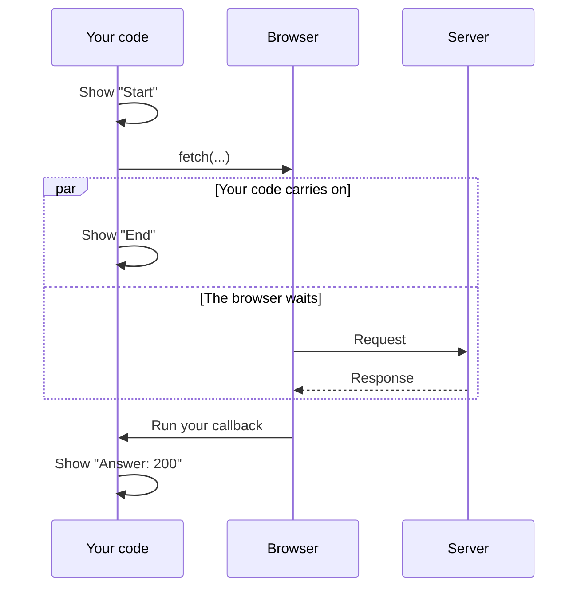

> **In one sentence:** Asynchronous code starts slow work, carries on with its next lines, and handles the result later, instead of stopping to wait.

## Why should I care?

In [[callbacks|Callbacks]], your code carried on while a `setTimeout` timer ran.

A request to a [[server]] can take a long time. MDN Web Docs, a website that documents web technologies, says that many browser functions "can potentially take a long time". If JavaScript in a page stopped to wait for such work, it could do nothing else until the work ended.

## Analogy

Go back to the library help desk from [[client-and-server|Client and Server]]. You ask for a book that is kept in a storeroom, and the librarian goes to get it.

You could stand at the desk and do nothing until the librarian comes back. That is like **synchronous** code. Or you could sit down and read something else. When the librarian calls your name, you go and take the book. That is like **asynchronous** code. The librarian's trip is the slow work, and what you plan to do with the book is the callback.

**Where the analogy breaks down:** you can decide what to do when your name is called. Code cannot make up something new then. It can only do what you wrote in the callback before the work started. Also, the librarian in this story always comes back, but a request to a server can fail.

## How it actually works

### Synchronous code waits

Code that runs line by line, each line waiting for the one before, is **synchronous**. MDN says the browser "waits for the line to finish its work before going on to the next line".

```js
// A stand-in for slow work: keep the program busy for about 3 seconds.
function keepBusy() {
  const end = Date.now() + 3000; // the time 3 seconds from now
  while (Date.now() < end) {
    // Nothing to do here. The loop keeps checking the time.
  }
  console.log("Job done");
}

console.log("Start");
keepBusy(); // the next line waits until keepBusy has finished
console.log("End");
```

`Date.now()` gives the current time as a number of milliseconds. The loop repeats until three seconds have passed. This program shows:

```
Start
Job done
End
```

`keepBusy` is only a stand-in, so that you can see a wait. Your own code stays busy the whole time. Waiting for a server does not keep your code busy like this.

### Blocking

Code that stops other code from running until it finishes is said to **block**. MDN's slow synchronous example does a long calculation. While it runs, MDN says, "you can't type anything, click anything, or do anything else". (This is simplified. A later topic explains why one slow function stops everything.)

Synchronous code is not a mistake. The trouble comes when one line takes a long time.

### Asynchronous code carries on

MDN says asynchronous programming lets your program "start a potentially long-running task". The program can still respond to other events, such as a click or a key press, "rather than having to wait until that task has finished". The pattern has three parts:

1. Start the slow work.
2. Carry on with the next lines.
3. Handle the result later, for example in a callback.

During `setTimeout` or `fetch`, the browser does the waiting, not your code. So your code can carry on. MDN says that to reach the outside world, code needs "environment-specific mechanisms provided by the host environment". In a page, these mechanisms come from the browser. MDN adds that while a `fetch` request waits, a program "can still process other things like user input".

MDN calls `setTimeout` "an asynchronous function, meaning that it returns immediately after scheduling the callback function or code to run".

```js
console.log("Start");

// Start a timer, and give the browser a callback for later.
setTimeout(() => {
  console.log("Timer done");
}, 3000);

console.log("End"); // this does not wait for the timer
```

This shows `Start`, then `End`, and about three seconds later, `Timer done`.

### Waiting on a server

The browser provides `fetch` for requests to a server. MDN says `fetch` "starts the process of fetching a resource from the network". Here, a resource is something you ask for by its URL, such as an image.

```js
console.log("Start");

// Ask the server for its page. The callback runs when the answer arrives.
fetch("https://example.com/").then((response) => {
  console.log("Answer: " + response.status);
});

console.log("End"); // this does not wait for the server
```

On `https://example.com/`, this code shows:

```
Start
End
Answer: 200
```

`.then` takes a callback, and the callback receives the server's response as its argument. `response.status` is a number in that response. MDN gives `200` "for success" as an example.

(This is simplified. `.then` is called on what `fetch` gives back, which is called a promise. The callback can run when the response begins to arrive, and the page's content may arrive a little later. A later topic explains promises, and what to do when a request fails.)

The callback is written above the last line, but it runs after it. In asynchronous code, the order of the lines is not always the order of running.

The box marked `par` holds two things that go on side by side, in no fixed order.



## How it came to be

Wikipedia's article on Ajax says that in the early-to-mid 1990s, most websites were complete HTML pages. "Each user action required a complete new page to be loaded from the server."

The article says the term **Ajax** was publicly used on 18 February 2005, by Jesse James Garrett. It stands for Asynchronous JavaScript and XML. (XML is a language for describing data.) With Ajax, MDN says, a page's code makes asynchronous requests and updates parts of the page "without requiring a full page load".

## 🧪 Try it in your browser

You need a computer with Chrome, Edge or Firefox. You will use example.com because its own text says it is for documentation examples. Step 5 asks that same site's server for its page.

**Safety rule:** only type code in the console that you understand or that comes from a source you trust. Never paste anything a stranger sends you. The lines below create a function, keep the page busy for about three seconds, and show text in the console. They also ask example.com for its page.

1. Open [example.com](https://example.com/).
   **What you should see:** a short page.
2. Open the **console**:
   - **Windows:** press `Ctrl` + `Shift` + `J` (in Firefox: `Ctrl` + `Shift` + `K`)
   - **Mac:** press `Cmd` + `Option` + `J` (in Firefox: `Cmd` + `Option` + `K`)
3. Ignore any messages already there. Click the line where you can type, below any messages. **Type** this line yourself (some browsers may block pasting at first), then press `Enter`. The browser may show suggestions, and the line may look different while you type. Keep typing.

   ```
   function keepBusy() { const end = Date.now() + 3000; while (Date.now() < end) { } console.log("Job done") }
   ```

   **What you should see:** the console may show `undefined`. That is normal.
4. Run `keepBusy` the synchronous way. Type this line, press `Enter`, and wait:

   ```
   console.log("Start"); keepBusy(); console.log("End")
   ```

   **What you should see:** `Start`, `Job done` and `End`, in that order. `End` comes about three seconds after you press `Enter`. The console may also show `undefined`.
5. Now ask a server. Type this line and press `Enter`:

   ```
   console.log("Start"); fetch("https://example.com/").then((response) => console.log("Answer: " + response.status)); console.log("End")
   ```

   **What you should see:** `Start`, then `End`. The console may also show `undefined`. Then `Answer: 200` appears, when the answer arrives. `200` means the request succeeded. If you see no `Answer` line, check that you are online and still on example.com.

**If something goes wrong:** for an error message, look for a typo. If `Enter` gives a new line and no answer, a bracket is probably still open. In both cases, reload the page, delete anything left on the typing line, and start again from step 3.

## Common misunderstandings

- **"Using a callback makes code asynchronous."** No. MDN says a callback may be called in two ways, synchronous and asynchronous. In Callbacks, `doTwice` called its callback immediately, before `doTwice` itself ended.
- **"The line after `fetch` can use the answer."** Not in this code. Those lines run before the callback does, so the code that needs the answer goes inside the callback.

## Recap

- Synchronous code waits for each line to finish. Code that stops other code until it finishes is said to block.
- Asynchronous code starts slow work, carries on, and handles the result later, for example in a callback.
- `setTimeout` and `fetch` are asynchronous, so the lines after them run before their callbacks.

## Sources

- MDN Web Docs, Introducing asynchronous JavaScript: https://developer.mozilla.org/en-US/docs/Learn_web_development/Extensions/Async_JS/Introducing
- MDN Web Docs, Callback function (glossary): https://developer.mozilla.org/en-US/docs/Glossary/Callback_function
- MDN Web Docs, Window.setTimeout(): https://developer.mozilla.org/en-US/docs/Web/API/Window/setTimeout
- MDN Web Docs, Window.fetch(): https://developer.mozilla.org/en-US/docs/Web/API/Window/fetch
- MDN Web Docs, Using the Fetch API: https://developer.mozilla.org/en-US/docs/Web/API/Fetch_API/Using_Fetch
- MDN Web Docs, Promise.prototype.then(): https://developer.mozilla.org/en-US/docs/Web/JavaScript/Reference/Global_Objects/Promise/then
- MDN Web Docs, JavaScript execution model: https://developer.mozilla.org/en-US/docs/Web/JavaScript/Reference/Execution_model
- WHATWG HTML Standard, Timers: https://html.spec.whatwg.org/multipage/timers-and-user-prompts.html
- WHATWG Fetch Standard: https://fetch.spec.whatwg.org/
- MDN Web Docs, Response.status: https://developer.mozilla.org/en-US/docs/Web/API/Response/status
- MDN Web Docs, 200 OK: https://developer.mozilla.org/en-US/docs/Web/HTTP/Reference/Status/200
- MDN Web Docs, Date.now(): https://developer.mozilla.org/en-US/docs/Web/JavaScript/Reference/Global_Objects/Date/now
- MDN Web Docs, console.log(): https://developer.mozilla.org/en-US/docs/Web/API/console/log_static
- MDN Web Docs, Ajax (glossary): https://developer.mozilla.org/en-US/docs/Glossary/AJAX
- MDN Web Docs, XML (glossary): https://developer.mozilla.org/en-US/docs/Glossary/XML
- MDN Web Docs, About MDN: https://developer.mozilla.org/en-US/about
- Wikipedia, Ajax (programming): https://en.wikipedia.org/wiki/Ajax_(programming)
- Example Domain: https://example.com/
- Chrome for Developers, Open Chrome DevTools: https://developer.chrome.com/docs/devtools/open
- Chrome for Developers, Run JavaScript in the Console: https://developer.chrome.com/docs/devtools/console/javascript
- Microsoft Edge DevTools, Keyboard shortcuts: https://learn.microsoft.com/en-us/microsoft-edge/devtools/shortcuts/
- Microsoft Edge DevTools, Run JavaScript in the Console: https://learn.microsoft.com/en-us/microsoft-edge/devtools/console/console-javascript
- Firefox DevTools User Docs, Web Console: https://firefox-source-docs.mozilla.org/devtools-user/web_console/index.html
- Firefox DevTools User Docs, The JavaScript input interpreter: https://firefox-source-docs.mozilla.org/devtools-user/web_console/the_command_line_interpreter/index.html
- Chrome for Developers, What are self-XSS attacks?: https://developer.chrome.com/blog/self-xss
