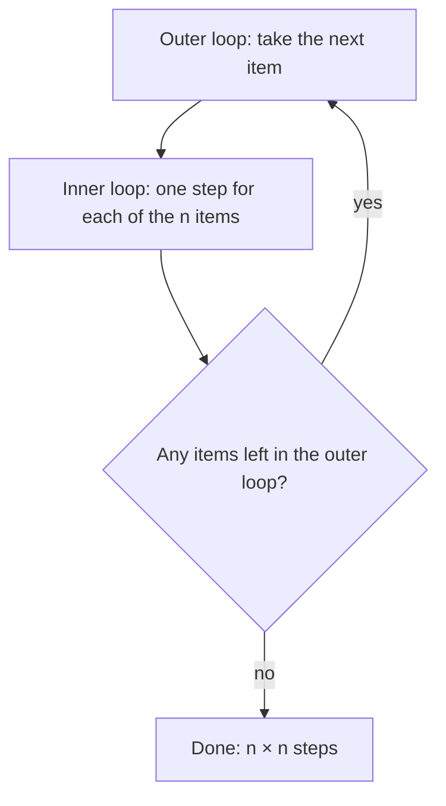

> **In one sentence:** Big O notation describes how the number of steps an algorithm needs grows as its input grows. It counts steps, not seconds.

## Why should I care?

In [[algorithms|Algorithms]], linear search needed up to 1,000,000 checks on 1,000,000 items, and binary search at most 20.

Big O is a short way to say how fast the work grows.

## Analogy

At a party, the host greets each guest, like one loop. Every guest shakes hands with every other guest, like a loop inside a loop. Twice the guests means twice the greetings, but about four times the handshakes, because each guest meets twice as many people.

**Where the analogy breaks down:** at a party, many people shake hands at the same moment, and nobody shakes their own hand. The loops on this page do one step at a time. They count each pair twice (i with j, and j with i) and each item with itself, so a party has fewer than half as many handshakes.

## How it actually works

### Count steps, not seconds

The **input** is the data an algorithm works on. Its size is usually written **n**: for a list, the number of items. Wikipedia says analysis of algorithms relates "the size of an algorithm's input to the number of steps it takes". A **step** is one small action, such as one check in a search.

Why not seconds? In an imagined example on Wikipedia, a fast computer runs linear search, and a much slower one binary search. With 1,000 items, the fast computer wins. With 16,000,000 items, the slow one is more than 10 times faster, because its algorithm grows much more slowly.

### The common shapes

Big O is the letter O with brackets. Inside the brackets is how the steps grow with n. Wikipedia says Big O "only provides an upper bound on the growth rate": an upper limit on how fast the steps grow. Four common shapes:

- **O(1), constant:** the steps do not change with n. Wikipedia says reading one item of an array (a list) at a known index takes "a single operation".
- **O(log n), logarithmic:** the steps grow by about one each time n doubles. Here, log n is about how many times you can halve n before one item is left. Binary search is like this.
- **O(n), linear:** the steps grow at the same rate as n, as in linear search.
- **O(n²), quadratic:** n² ("n squared") means n times n, as in a loop inside a loop.

The table shows the **worst case**: the most steps each can need. For linear search, that is when the target is the last item or is not in the list at all. Halve 10, rounding down: 5, 2, 1. That is 3 halvings. Wikipedia's formula for binary search's worst case gives one more than the halvings: 4.

| Items (n) | O(1): read one item | O(log n): binary search (halvings + 1) | O(n): linear search | O(n²): every item with every item |
|---|---|---|---|---|
| 10 | 1 | 4 | 10 | 100 |
| 100 | 1 | 7 | 100 | 10,000 |
| 1,000 | 1 | 10 | 1,000 | 1,000,000 |

### A loop inside a loop

The programs below count steps. For each size n, one loop adds 1 per item. A loop inside a loop adds 1 per pair: every item with every item, itself included. You only need to read one tab.



<!-- tabs -->

### JavaScript

`const` and `let` create variables. `console.log()` shows its values in order.

```js
const sizes = [10, 100, 1000]; // Three list sizes to try.

for (let s = 0; s < sizes.length; s++) {
  const n = sizes[s]; // The number of items this time.

  // One loop: one step for each item.
  let oneLoop = 0;
  for (let i = 0; i < n; i++) {
    oneLoop = oneLoop + 1;
  }

  // A loop inside a loop: one step for each pair of items.
  let loopInLoop = 0;
  for (let i = 0; i < n; i++) {
    for (let j = 0; j < n; j++) {
      loopInLoop = loopInLoop + 1;
    }
  }

  console.log(n, oneLoop, loopInLoop); // Show all three numbers.
}
```

### Python

`for n in sizes:` gives `n` each item of the list, in order. `range(n)` gives n numbers, from 0 up to n minus 1. Python marks a block with indentation (spaces at the start of a line), so the inner loop's block is indented further. `print()` shows the values you give it on one line, with a space between them.

```python
sizes = [10, 100, 1000]  # Three list sizes to try.

for n in sizes:  # n is the number of items this time.
    # One loop: one step for each item.
    one_loop = 0
    for i in range(n):
        one_loop = one_loop + 1

    # A loop inside a loop: one step for each pair of items.
    loop_in_loop = 0
    for i in range(n):
        for j in range(n):
            loop_in_loop = loop_in_loop + 1

    print(n, one_loop, loop_in_loop)  # Show all three numbers.
```

### Go

`package main` and `func main()` mark where the program starts. `import "fmt"` brings in `fmt`, a package for printing. `:=` creates a variable and gives it a value. `[]int{10, 100, 1000}` is a slice (Go's list) of whole numbers, and `len(sizes)` gives its number of items. `fmt.Println` shows its values on one line, with spaces between them.

```go
package main

import "fmt"

func main() {
	sizes := []int{10, 100, 1000} // Three list sizes to try.

	for s := 0; s < len(sizes); s++ {
		n := sizes[s] // The number of items this time.

		// One loop: one step for each item.
		oneLoop := 0
		for i := 0; i < n; i++ {
			oneLoop = oneLoop + 1
		}

		// A loop inside a loop: one step for each pair of items.
		loopInLoop := 0
		for i := 0; i < n; i++ {
			for j := 0; j < n; j++ {
				loopInLoop = loopInLoop + 1
			}
		}

		fmt.Println(n, oneLoop, loopInLoop) // Show all three numbers.
	}
}
```

<!-- /tabs -->

Each program shows:

```
10 10 100
100 100 10000
1000 1000 1000000
```

On each line: n, then the steps of one loop (O(n)), then the steps of the loop inside a loop (O(n²)). When n grows 10 times, the second number grows 10 times, and the third grows 100 times.

### What Big O leaves out

Wikipedia says time complexity is commonly given for the worst case.

Big O also drops parts that do not change the shape. Wikipedia calls this "omitting constant factors and lower order terms":

- A **constant factor** is a fixed number that multiplies n. 3 steps for each item is 3n steps. The 3 is dropped, so 3n is O(n).
- A **lower order term** is a part that grows more slowly. One loop, then a loop inside a loop, is n + n² steps. With n = 1,000, that is 1,001,000 steps, and 1,000,000 come from n². The n is dropped, so this is O(n²).

This is a simplification: Wikipedia also says that "in practical applications constant factors are important".

## How it came to be

Big O belongs to a family of notations. Wikipedia says the German mathematicians Paul Bachmann and Edmund Landau invented them. Bachmann proposed it in 1894, in his book *Analytische Zahlentheorie* ("analytic number theory"). Landau extended it in 1909. The O first stood for "order of" ("Ordnung").

Wikipedia says that "In the 1970s, big O was popularized in computer science by Donald Knuth".

## 🧪 Try it in your browser

These steps use JavaScript, because the browser's console runs it.

- `let` creates a variable. In a `for` line, `( )` hold the start, the condition and the step. `i++` adds 1 to `i`. `{ }` hold the block that repeats.
- `console.log()` shows a value, and `;` separates commands.

You need a computer with Chrome, Edge or Firefox.

**Safety rule:** only type code in the console that you understand or that comes from a source you trust. Never paste anything a stranger sends you. The lines below only create variables, count, and show numbers.

1. Open [example.com](https://example.com).
   **What you should see:** a short page of text.
2. Open the **console**:
   - **Windows:** press `Ctrl` + `Shift` + `J` (in Firefox: `Ctrl` + `Shift` + `K`)
   - **Mac:** press `Cmd` + `Option` + `J` (in Firefox: `Cmd` + `Option` + `K`)
3. Click the line where you can type, below any messages. **Type** this line yourself (some browsers may block pasting at first), then press `Enter`. The browser may show suggestions, and the line may look different while you type. Keep typing.

   ```
   let pairs = 0; for (let i = 0; i < 1000; i++) { for (let j = 0; j < 1000; j++) { pairs = pairs + 1; } } console.log(pairs);
   ```

   Type carefully: the line is long.

   **What you should see:** `1000000`, which is 1,000 times 1,000. The console may also show `undefined`.
4. Double the size to 2,000:

   ```
   let morePairs = 0; for (let i = 0; i < 2000; i++) { for (let j = 0; j < 2000; j++) { morePairs = morePairs + 1; } } console.log(morePairs);
   ```

   **What you should see:** `4000000`. Twice the items gave four times the steps. The console may also show `undefined`.

If you see an error message, look for a typo. Then click your browser's reload button and start again from step 3.

## Common misunderstandings

- **"Big O tells you how many seconds code takes."** No. It describes how the steps grow with n, and the same steps take different times on different computers.
- **"O(1) means one step."** No. It means the steps do not change when n grows. There can be 1 step or 50.
- **"An O(log n) algorithm is always faster than an O(n) one."** No. Wikipedia says binary search "is faster than linear search except for small arrays".

## Recap

- Big O describes how the number of steps (not seconds) grows as the input grows.
- O(1) does not grow, O(log n) grows slowly, O(n) grows with n, and O(n²) grows with n times n, as in a loop inside a loop.
- Big O gives an upper limit on how the steps grow, commonly for the worst case. It drops constant factors and smaller parts. That is a simplification: on small inputs, those parts can matter.

## Sources

- Wikipedia, Big O notation: https://en.wikipedia.org/wiki/Big_O_notation
- Wikipedia, Time complexity: https://en.wikipedia.org/wiki/Time_complexity
- Wikipedia, Analysis of algorithms: https://en.wikipedia.org/wiki/Analysis_of_algorithms
- Wikipedia, Binary logarithm: https://en.wikipedia.org/wiki/Binary_logarithm
- Wikipedia, Linear search: https://en.wikipedia.org/wiki/Linear_search
- Wikipedia, Binary search: https://en.wikipedia.org/wiki/Binary_search
- MDN Web Docs, const: https://developer.mozilla.org/en-US/docs/Web/JavaScript/Reference/Statements/const
- MDN Web Docs, let: https://developer.mozilla.org/en-US/docs/Web/JavaScript/Reference/Statements/let
- MDN Web Docs, for: https://developer.mozilla.org/en-US/docs/Web/JavaScript/Reference/Statements/for
- MDN Web Docs, Array: length: https://developer.mozilla.org/en-US/docs/Web/JavaScript/Reference/Global_Objects/Array/length
- MDN Web Docs, console.log(): https://developer.mozilla.org/en-US/docs/Web/API/console/log_static
- MDN Web Docs, eval(): https://developer.mozilla.org/en-US/docs/Web/JavaScript/Reference/Global_Objects/eval
- Python Tutorial, More Control Flow Tools: https://docs.python.org/3/tutorial/controlflow.html
- Python Tutorial, An Informal Introduction to Python: https://docs.python.org/3/tutorial/introduction.html
- Python documentation, Built-in Functions: https://docs.python.org/3/library/functions.html
- The Go Programming Language Specification: https://go.dev/ref/spec
- Go Packages, fmt: https://pkg.go.dev/fmt
- Microsoft Edge DevTools, Run JavaScript in the Console: https://learn.microsoft.com/en-us/microsoft-edge/devtools/console/console-javascript
- Chrome for Developers, Open Chrome DevTools: https://developer.chrome.com/docs/devtools/open
- Microsoft Edge DevTools, Keyboard shortcuts: https://learn.microsoft.com/en-us/microsoft-edge/devtools/shortcuts/
- Firefox DevTools User Docs, Web Console: https://firefox-source-docs.mozilla.org/devtools-user/web_console/index.html
- Chrome for Developers, What are self-XSS attacks?: https://developer.chrome.com/blog/self-xss
- Example Domain: https://example.com
