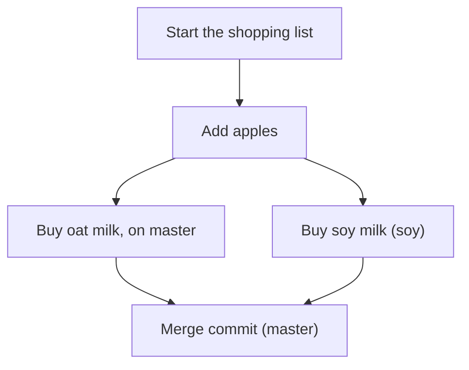

> **In one sentence:** A branch is a name that points to one commit and moves forward each time you commit on it, so you can work on something separately and later merge it back.

## Why should I care?

In [[git|Git]], you saved your project as commits: snapshots, each with a message and an ID.

Suppose you want to try an idea that might fail. Or a friend wants to change the project at the same time. GitHub's documentation says branches let you fix bugs or try new ideas in a separate area of your repository. You work on a branch "in isolation from changes that other people are making".

When the work is ready, you **merge** it: you join it back into the main line.

## Analogy

Think of a bookmark with a name written on it. It marks one page. In Git, the page is a commit. Each time you commit on that branch, Git moves the bookmark to the new commit.

**Where the analogy breaks down:** a book has one line of pages. Git's history can split into two lines and join again.

## How it actually works

### A branch is a name for a commit

The Pro Git book says a branch in Git is "a lightweight movable pointer" to one commit. "Every time you commit, the `master` branch pointer moves forward automatically."

Git also keeps a special pointer, **HEAD**, that points to the branch you are on.

### The default branch: master or main

A new repository starts with one branch. Git's documentation says its default name is "currently `master`, but this will change to `main` when Git 3.0 is released", a future version. The name "can be customized", so your Git may print `main`. GitHub names the default branch `main` in new repositories.

Pro Git says master "is exactly like any other branch": it is only the first branch's name.

### Make a branch and work on it

A new example: Mira's repository has one file, `list.txt`, a shopping list with two lines, `bread` and `milk`, in one commit. She types commands in a [[command-line|terminal]]. Lines that start with $ are commands; you would not type the $. The other lines are Git's answers. You only need to read them: Git does not need to be installed for this page.

```
$ git branch
* master
```

`git branch` with nothing after it lists the branches. The `*` marks the branch you are on.

```
$ git branch fruit
$ git branch
  fruit
* master
```

`git branch fruit` makes a new branch named `fruit`. It points to the same commit as `master`. Pro Git says this command "didn't switch to that branch": Mira is still on `master`.

```
$ git switch fruit
Switched to branch 'fruit'
```

`git switch fruit` moves Mira to the `fruit` branch. The files in her project folder change to match that branch. Pro Git says `git switch` works "From Git version 2.23 onwards". Pro Git also uses `git checkout fruit` for this.

Mira adds a third line, `apples`, to the file. Then she commits, as in the Git page:

```
$ git add list.txt
$ git commit -m "Add apples"
[fruit d3f9b59] Add apples
 1 file changed, 1 insertion(+)
```

The output shows the branch and the new commit's short ID; yours will differ. Now `fruit` points to the new commit, and `master` still points to the old one.

### Merging: fast-forward

Mira switches back to `master`, and `list.txt` changes to match: only `bread` and `milk` again. To bring the apples in, she merges:

```
$ git switch master
Switched to branch 'master'
$ git merge fruit
Updating 247cb27..d3f9b59
Fast-forward
 list.txt | 1 +
 1 file changed, 1 insertion(+)
```

`git merge fruit` joins the work on `fruit` into the branch you are on. Nothing new happened on `master` since `fruit` split off, so Git moves the `master` name forward to the newest commit. Pro Git calls this a **fast-forward**: there is "no divergent work", no work that went in different directions. No new commit is made.

The `Updating` line shows the commit `master` pointed to before and after. (This `..` is not the parent folder.)

### Merging: a merge commit

Next, Mira makes a branch named `soy`, the same way: `git branch soy`, then `git switch soy`. There she changes `milk` to `soy milk` and commits. Then she switches back to `master`, changes `milk` to `oat milk`, and commits there too. Now each branch has a commit that the other lacks: the history "has diverged", as Pro Git says.



So a fast-forward is not possible. Git makes a **merge commit**, a new commit that is "special in that it has more than one parent". Each commit records its parent: the commit that came directly before it.

If the two branches changed different parts of the files, Git makes the merge commit by itself. It first opens a text editor, a program for writing text, with a message you can keep or change. Pro Git shows this default message: `Merge branch 'iss53'`, where `iss53` is the branch's name.

### When both branches change the same line: a conflict

Here, both branches changed the same line in different ways:

```
$ git merge soy
Auto-merging list.txt
CONFLICT (content): Merge conflict in list.txt
Automatic merge failed; fix conflicts and then commit the result.
```

Git tried to combine the two versions of `list.txt` and could not. This is a **merge conflict**. Pro Git says it happens when "you changed the same part of the same file differently in the two branches". Git stops and lets you decide. Mira opens `list.txt` and sees:

```
bread
<<<<<<< HEAD
oat milk
=======
soy milk
>>>>>>> soy
apples
```

Git added the marker lines `<<<<<<<`, `=======` and `>>>>>>>`. The part above `=======` is the version from `HEAD`, the branch Mira is on. The part below is the version from `soy`.

You choose the result by hand: one side, the other, or a mix. Mira wants both kinds of milk, so she edits the file and removes the three marker lines:

```
bread
oat milk
soy milk
apples
```

Staging the fixed file with `git add` marks the conflict as solved. Then `git commit` makes the merge commit:

```
$ git add list.txt
$ git commit -m "Merge soy: buy both kinds of milk"
[master 2384297] Merge soy: buy both kinds of milk
```

`--oneline` and `--graph` below are options: words starting with `--` that change what a command shows. `git log --oneline --graph` shows each commit on one line, with a text drawing of the history on the left:

```
$ git log --oneline --graph
*   2384297 Merge soy: buy both kinds of milk
|\
| * 9ecd101 Buy soy milk
* | b3d50c7 Buy oat milk
|/
* d3f9b59 Add apples
* 247cb27 Start the shopping list
```

Each `*` is a commit. The lines show the history splitting and joining again.

## How it came to be

Pro Git says Git was built in 2005 by the Linux development community, "and in particular Linus Torvalds, the creator of Linux". One of its goals was "Strong support for non-linear development (thousands of parallel branches)": many lines of work going on at the same time.

## 🧪 Try it in your browser

GitHub is a website that shows Git repositories. The pages below belong to a public repository, so anyone can view them. They may look different from this description.

1. Open [github.com/git/git/branches](https://github.com/git/git/branches). This repository holds Git's own source code.
   **What you should see:** a list of branches. The page names `master` as the default branch.
2. Open [github.com/git/git/commits/master](https://github.com/git/git/commits/master).
   **What you should see:** a list of commits on `master`. Look for titles that start with `Merge branch`. That is how Git's default message for a merge commit starts, so these are most likely merge commits.

## Common misunderstandings

- **"A new branch copies all my files."** No. Pro Git says a branch is "a simple file" holding the ID of one commit. Making or deleting a branch is quick, and the file is tiny.
- **"A merge conflict means Git broke my work."** No. Git "has paused the process while you resolve the conflict". You can also stop: `git merge --abort` tries to put things back as they were before the merge. Git's documentation says this works best if you commit your changes before you merge.

## Recap

- A branch is a name that points to one commit, and it moves forward each time you commit on it.
- `git branch` makes or lists branches, `git switch` moves you to one, and `git merge` joins another branch into yours.
- A merge is a fast-forward or makes a merge commit. In a conflict, you fix the file by hand, then `git add` and `git commit`.

## Sources

- Pro Git, 3.1 Git Branching: Branches in a Nutshell: https://git-scm.com/book/en/v2/Git-Branching-Branches-in-a-Nutshell
- Pro Git, 3.2 Git Branching: Basic Branching and Merging: https://git-scm.com/book/en/v2/Git-Branching-Basic-Branching-and-Merging
- Pro Git, 1.2 Getting Started: A Short History of Git: https://git-scm.com/book/en/v2/Getting-Started-A-Short-History-of-Git
- Pro Git, 2.2 Git Basics: Recording Changes to the Repository: https://git-scm.com/book/en/v2/Git-Basics-Recording-Changes-to-the-Repository
- Git documentation, git-branch: https://git-scm.com/docs/git-branch
- Git documentation, git-switch: https://git-scm.com/docs/git-switch
- Git documentation, git-merge: https://git-scm.com/docs/git-merge
- Git documentation, git-init: https://git-scm.com/docs/git-init
- Git documentation, git-log: https://git-scm.com/docs/git-log
- GitHub Docs, About branches: https://docs.github.com/en/pull-requests/collaborating-with-pull-requests/proposing-changes-to-your-work-with-pull-requests/about-branches
- GitHub Docs, Viewing branches in your repository: https://docs.github.com/en/repositories/configuring-branches-and-merges-in-your-repository/managing-branches-in-your-repository/viewing-branches-in-your-repository
- GitHub Docs, About repositories: https://docs.github.com/en/repositories/creating-and-managing-repositories/about-repositories
- GitHub, git/git repository: https://github.com/git/git
- GitHub, git/git branches: https://github.com/git/git/branches
- GitHub, git/git commits on master: https://github.com/git/git/commits/master
