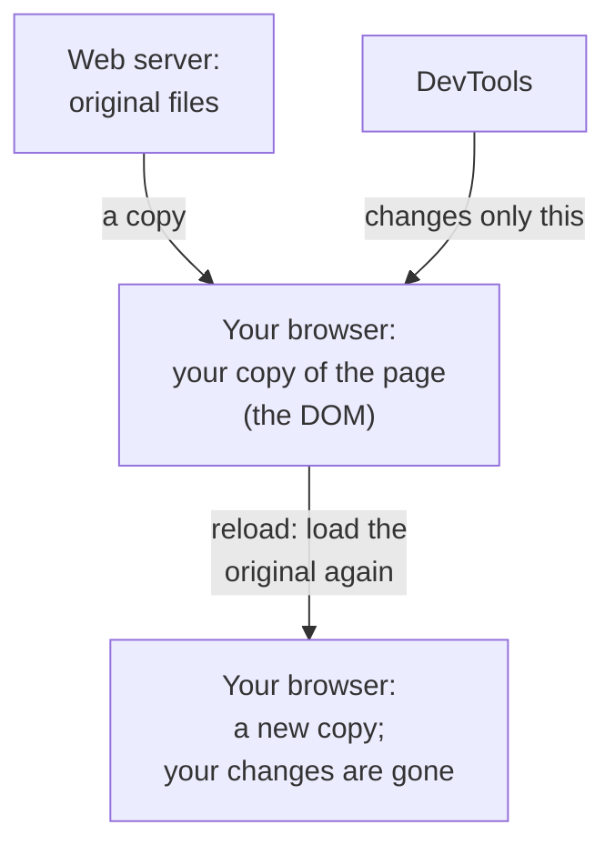

> **In one sentence:** Browser DevTools (developer tools) are a set of tools built into your browser that let you look inside any web page: its HTML, the messages it logs, and the files it downloads, and even change your own copy of it.

## Why should I care?

If you followed the earlier pages of this course, you may have opened a **Console** or a **Network** tab already. Both are parts of DevTools.

Chrome, Edge and Firefox all have DevTools built in. When you build your own website later in this course, DevTools is where you will look when something does not work.

## Analogy

Imagine you **photocopy a page from a library book**. You can study your copy and write on it. The book in the library does not change. If you make a new photocopy, it is clean again.

In [[web-browser|Web Browser]], you learned that your browser builds the page from files the server sends. DevTools works on that copy in your browser. You can study it and change it. The website on the server stays the same.

**Where the analogy breaks down:** a photocopy never changes by itself. A web page can contain JavaScript code that changes the page while you look at it. Also, DevTools shows more than the page: it shows the requests your browser sends and the files that come back.

## How it actually works

DevTools opens as a panel next to the page. It has several **tabs** (also called panels). Each tab is one tool. Here are three main ones.

### Elements: the parts of the page

When the browser reads a page's HTML, it builds a **map of all the parts of the page**: headings, paragraphs, pictures, links. Each part is called an **element**. The map is called the **DOM** (Document Object Model), or the **DOM tree**: like a tree, big parts split into smaller parts. (You do not need to remember the long name.) The browser then uses the DOM, together with the CSS, to draw the page.

The **Elements** tab (in Firefox: **Inspector**) shows this DOM tree. You can click any element to see and change its HTML and CSS.

### Console: messages and commands

The **Console** has "2 main uses", says Chrome's documentation: "viewing logged messages and running JavaScript". Pages can write messages there: this is called **logging**. The browser also reports errors there, such as code that did not work. You can also type a command in JavaScript (the programming language of web pages), press `Enter`, and see the answer.

### Network: the files the page loads

The **Network** tab lists the requests your browser sends and the files that come back. Each row is one file, such as an HTML page or a picture. Chrome's documentation says DevTools "only logs network activity while it's open". So open DevTools first, then load the page.

### Your changes stay on your computer

MDN says you can change the page in DevTools, "but you cannot save your changes." When you reload, the browser builds the page again from the original files. (Chrome has a feature, called local overrides, that can keep some changes on your own computer. But it "doesn't save changes made in the DOM tree of the Elements panel", says Chrome's documentation.)

## How it came to be

In January 2006, the first version of **Firebug**, a tool for the Firefox browser, was released. Mozilla, the organization that makes Firefox, says it let programmers "inspect, edit, and debug code right in the Firefox browser". (To debug means to find and fix mistakes in code.)

In 2017, Mozilla announced that Firebug would stop working in version 57 of Firefox. Mozilla said that everything Firebug could do was now in the developer tools built into Firefox.

## 🧪 Try it in your browser

You need a computer with Chrome, Edge or Firefox. These steps change only your own copy of a page.

1. Open this early CERN web page: [info.cern.ch/hypertext/WWW/TheProject.html](https://info.cern.ch/hypertext/WWW/TheProject.html).
   **What you should see:** a big heading, **World Wide Web**, and text with links.
2. Right-click the heading (on a Mac, you can also hold `Control` and click). Choose **Inspect**. (Some versions of Firefox call it **Inspect Element**.)
   **What you should see:** DevTools opens with the **Elements** tab (Firefox: **Inspector**). One line is highlighted. It contains `h1` (in small or capital letters) and the words **World Wide Web**. `h1` marks the highest-level heading on a page.
3. In that line, double-click the words **World Wide Web**. Type your name and press `Enter`.
   **What you should see:** the heading on the page now shows your name. (Made a mistake? Step 4 undoes it.)
4. Reload the page. In Chrome and Edge, press `Ctrl` + `R` (Mac: `Cmd` + `R`). In Firefox, click the address bar and press `Enter`.
   **What you should see:** the heading says **World Wide Web** again. Your change was only in your copy.
5. Open the Console. In Chrome and Edge, press `Ctrl` + `Shift` + `J` (Mac: `Cmd` + `Option` + `J`). In Firefox, press `Ctrl` + `Shift` + `K` (Mac: `Cmd` + `Option` + `K`). DevTools switches to the **Console** tab.
6. Click the input line at the bottom of the Console (other messages may appear above it). Type `document.title` and press `Enter`. (Type it yourself: your browser may block pasting into the Console at first.)
   **What you should see:** `The World Wide Web project`, inside quotation marks. This is the page's title: the name shown on the browser tab.
7. Click the **Network** tab. (In Edge, if you do not see it, click the **More tools** button and choose **Network**.) Reload the page, as in step 4.
   **What you should see:** a list with at least one row, named `TheProject.html`. Each row is one file the browser asked for.
8. Close DevTools: click the **X** (Close) button at the top of the DevTools panel.

**Safety rule:** only type commands in the Console that you understand, or that come from a source you trust. Chrome warns about an attack that tricks you into "copying and pasting malicious code into your browser's DevTools Console". (Malicious means made to cause harm.) Never paste code that a stranger sends you.

**Other ways to open DevTools:** on Windows and Linux, press `F12` or `Ctrl` + `Shift` + `I`. On a Mac, press `Cmd` + `Option` + `I`. These open the tab you used last.

## Common misunderstandings

- **"I changed the website with Inspect, so I hacked it."** No. You changed only your own copy, in your own browser. Nobody else sees it.
- **"The Elements tab shows the HTML file the server sent."** Not exactly. It shows the DOM: the page as it is now. Chrome's documentation explains: "When JavaScript adds, removes, or edits nodes, the DOM becomes different than the HTML." (A node is one part of the DOM tree, such as an element or a piece of text.)

## Recap

- DevTools is a set of tools built into Chrome, Edge and Firefox. Open it with `F12` or `Ctrl` + `Shift` + `I` (Mac: `Cmd` + `Option` + `I`), or right-click and **Inspect**.
- **Elements** (Firefox: **Inspector**) shows the page's DOM, **Console** shows messages and runs JavaScript, and **Network** lists the files the page loads while DevTools is open.
- Changes you make in DevTools affect only your copy of the page. Normally, when you reload, they are gone.

## Sources

- Chrome for Developers, Chrome DevTools (overview): https://developer.chrome.com/docs/devtools/overview
- Chrome for Developers, Open Chrome DevTools: https://developer.chrome.com/docs/devtools/open
- Chrome for Developers, Get started viewing and changing the DOM: https://developer.chrome.com/docs/devtools/dom
- Chrome for Developers, Override web content and HTTP response headers locally: https://developer.chrome.com/docs/devtools/overrides
- MDN Web Docs, How browsers load websites: https://developer.mozilla.org/en-US/docs/Learn_web_development/Getting_started/Web_standards/How_browsers_load_websites
- MDN Web Docs, Populating the page: how browsers work: https://developer.mozilla.org/en-US/docs/Web/Performance/Guides/How_browsers_work
- Chrome for Developers, Console overview: https://developer.chrome.com/docs/devtools/console
- Chrome for Developers, Inspect network activity: https://developer.chrome.com/docs/devtools/network
- Chrome for Developers, What are self-XSS attacks?: https://developer.chrome.com/blog/self-xss
- Microsoft Edge DevTools, Overview of DevTools: https://learn.microsoft.com/en-us/microsoft-edge/devtools/overview
- Microsoft Edge DevTools, Keyboard shortcuts: https://learn.microsoft.com/en-us/microsoft-edge/devtools/shortcuts/
- Firefox DevTools User Docs: https://firefox-source-docs.mozilla.org/devtools-user/index.html
- Firefox DevTools User Docs, Keyboard shortcuts: https://firefox-source-docs.mozilla.org/devtools-user/keyboard_shortcuts/index.html
- Firefox DevTools User Docs, Open the Inspector: https://firefox-source-docs.mozilla.org/devtools-user/page_inspector/how_to/open_the_inspector/index.html
- Firefox DevTools User Docs, Examine and edit HTML: https://firefox-source-docs.mozilla.org/devtools-user/page_inspector/how_to/examine_and_edit_html/index.html
- Firefox DevTools User Docs, Web Console: https://firefox-source-docs.mozilla.org/devtools-user/web_console/index.html
- MDN Web Docs, What are browser developer tools?: https://developer.mozilla.org/en-US/docs/Learn_web_development/Howto/Tools_and_setup/What_are_browser_developer_tools
- MDN Web Docs, DOM (glossary): https://developer.mozilla.org/en-US/docs/Glossary/DOM
- MDN Web Docs, Element (glossary): https://developer.mozilla.org/en-US/docs/Glossary/Element
- MDN Web Docs, Document.title: https://developer.mozilla.org/en-US/docs/Web/API/Document/title
- MDN Web Docs, The HTML heading elements: https://developer.mozilla.org/en-US/docs/Web/HTML/Reference/Elements/Heading_Elements
- CERN, The World Wide Web project (preserved early web page): https://info.cern.ch/hypertext/WWW/TheProject.html
- Mozilla Hacks, Saying goodbye to Firebug (2017): https://hacks.mozilla.org/2017/10/saying-goodbye-to-firebug/
