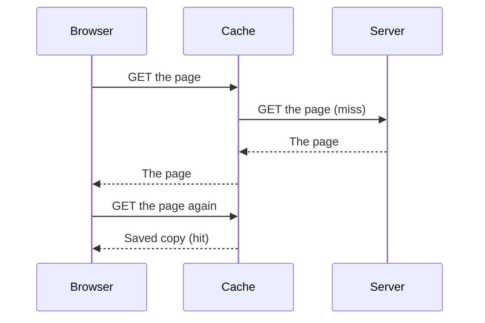

> **In one sentence:** A cache keeps a copy of an answer, so that the next request for the same thing can use the copy without asking the server.

## Why should I care?

You met a cache in [[dns]]: the resolver saved the answers it found, so it did not have to look them up again. The web uses the same idea for pages, pictures and other files.

Caching helps in two ways. Your answer can arrive faster, and the server has less work to do. Caching also explains why you sometimes see an old version of a website, after it has changed. This page shows how that happens.

## Analogy

Think of a **clerk at a shop counter**. The storeroom is far away, at the back of the building. At first, the clerk walks there for every order.

A clever clerk keeps some popular items on a **shelf behind the counter**. Now most customers get their item right away. Each item has a label: **"good until Friday"**. After Friday, the clerk checks with the storeroom before using it again. The shelf is the cache, and the storeroom is the server.

**Where the analogy breaks down:** an item on a shelf can go to only one customer. A saved file can be copied, so one saved answer can serve many people. Also, the clerk writes the label. On the web, the server can say how long a copy may be used, with notes in its response.

## How it actually works

A **cache** is a place that stores responses, so they can be used again. MDN, a website that documents how the web works, calls the server that made the response the **origin server**. On this page, "the server" means the origin server.

When a request arrives at a cache, there are two possible results:

- **Cache hit:** a usable answer is in the cache, so the cache can send it right away.
- **Cache miss:** the answer is not there, so the request goes on to the server. The cache can save the answer for next time.

This picture shows a miss, and then a hit for the same page:



### Where caches are

There are two main kinds:

- **A private cache** belongs to one client. The usual example is the cache in your browser. It can keep things meant only for you.
- **A shared cache** sits between clients and the server, and its copies can be used for many people. Website owners can set one up in front of their server, so that requests reach the cache first.

One kind of shared cache is a **CDN** (Content Delivery Network). MDN describes a CDN as "a group of servers spread out over many locations". These servers store copies of data, and the closest one can answer you.

### How long a copy can be used

A saved copy is either **fresh** or **stale**. A fresh copy can still be used. A stale copy has expired. The copy's **age** is the time since the server made the response, or last confirmed that it is still good. A copy is fresh while its age is below a limit.

The server can set the limit with a header, one line of extra information in the response. Here is MDN's example:

```
Cache-Control: max-age=604800
```

The number is in seconds, and 604800 seconds is one week. So this copy is fresh for one week.

This is why you can see an old page. While a copy is fresh, a cache normally uses it without asking the server, even if the page on the server has changed.

A shared cache can tell your browser how old its copy is, with an `Age` header. `Age: 86400` means one day.

### When a copy has expired

A stale copy is not thrown away right away. The cache can ask the server: "Has this changed?" If it has not, the server answers with the status code `304`, which means "not modified". The server does not need to send the whole file again, and the copy becomes fresh again. If the file has changed, the server sends the new one.

### What should not be shared

Some answers are only for one person, like a page showing your account. A shared cache must not give that page to someone else. So the server can send `Cache-Control: private`, which means that only a private cache may store it.

## How it came to be

Caching was already described in the HTTP/1.0 document, from May 1996. It says a cache stores responses "to reduce the response time and network bandwidth consumption": to answer faster, and to send less data.

The HTTP/1.1 document, from January 1997, describes the `Cache-Control` header. Today, the rules for HTTP caching have their own document, RFC 9111, from June 2022.

## 🧪 Try it in your browser

You will find the age of a saved copy. You need a computer with a keyboard for this. These steps only look, and they change no settings.

1. Open a new tab in Chrome, Edge or Firefox.
2. Open the developer tools: `F12` or `Ctrl` + `Shift` + `I` on Windows, `Cmd` + `Option` + `I` on Mac. If `F12` does nothing, try the other keys.
3. Click the **Network** tab. In Edge, if you do not see it, click the **More tools** button and choose **Network**.
4. Click the address bar, type `https://developer.mozilla.org/en-US/docs/Web/HTTP/Guides/Caching` and press `Enter`.
5. Click the first row in the list. A details area opens. Click its **Headers** tab.
6. Under **Response Headers** (Firefox: **Response headers**), look for the lines named `cache-control` and `age`. They may have small or capital letters.

**What you may see:** two lines like these. Your numbers may be different.

```
cache-control: public, max-age=3600
age: 1034
```

The first line says the copy is fresh for 3,600 seconds, which is one hour. The second says this copy is 1,034 seconds old, or about 17 minutes. That is below the limit, so the copy is still fresh, and the server did not have to answer this request.

Not every response has an `age` line. If yours has none, or the number is 0, you did nothing wrong. To try once more, open a new tab and repeat steps 2 to 6. Do not use the reload button for this, because a reload asks the shared caches not to reuse their copies. You may see the same result.

When you are done, close the tab.

## Common misunderstandings

- **"A cached page is always an old, wrong page."** No. But a copy can be out of date. While it is fresh, a cache normally uses it without asking the server, even if the page has changed. After it expires, a cache normally checks with the server first.
- **"The only cache is in my browser."** No. There can be shared caches between your browser and the server.
- **"Clearing my browser's cache deletes the website."** No. Clearing means deleting the saved copies in your browser. It only removes your own copies. The website is still on its server.

## Recap

- A cache keeps a copy of an answer. A hit uses the copy, and a miss goes on to the server.
- A copy is fresh for a limited time. After that, the cache can ask the server if it has changed.
- Caches can be private, like the one in your browser, or shared between many people, like a CDN.

## Sources

- MDN Web Docs, HTTP caching: https://developer.mozilla.org/en-US/docs/Web/HTTP/Guides/Caching
- RFC 9111, HTTP Caching (June 2022): https://www.rfc-editor.org/rfc/rfc9111
- RFC 1945, HTTP/1.0 (May 1996): https://www.rfc-editor.org/rfc/rfc1945
- RFC 2068, HTTP/1.1 (January 1997): https://www.rfc-editor.org/rfc/rfc2068
- Wikipedia, Cache (computing): https://en.wikipedia.org/wiki/Cache_(computing)
- MDN Web Docs, CDN (glossary): https://developer.mozilla.org/en-US/docs/Glossary/CDN
- Chrome for Developers, Open Chrome DevTools: https://developer.chrome.com/docs/devtools/open
- Chrome for Developers, Network features reference: https://developer.chrome.com/docs/devtools/network/reference
- Microsoft Edge DevTools, Keyboard shortcuts: https://learn.microsoft.com/en-us/microsoft-edge/devtools/shortcuts/
- Microsoft Edge DevTools, Network tool: https://learn.microsoft.com/en-us/microsoft-edge/devtools/network/
- Firefox DevTools User Docs, index: https://firefox-source-docs.mozilla.org/devtools-user/index.html
- Firefox DevTools User Docs, Network request details: https://firefox-source-docs.mozilla.org/devtools-user/network_monitor/request_details/index.html
