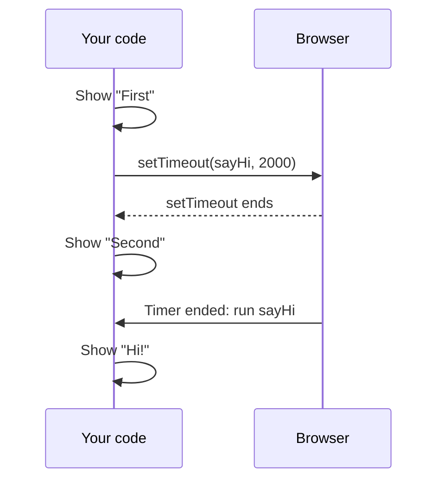

> **In one sentence:** A callback is a function you pass to another function as an argument, so that the other function can call it, immediately or later.

## Why should I care?

In [[functions|Functions]], you called most functions yourself. But your code cannot know when a person will click a button. So you cannot write the call at the right place in your program.

In [[javascript|JavaScript]], you typed `function () { alert("You clicked!") }`, and the browser called that function on each click. It has no name, and you never wrote a call to it. This page shows how that works.

## Analogy

In Functions, a function was a smaller recipe with its own name. Now imagine that you write the sauce recipe on a card and give the card to a helper. You say: "Make this when the guests arrive."

The card is the callback. The helper is the code that receives it, such as the browser. The guests arriving is the signal to run it, such as a timer ending or a click.

**Where the analogy breaks down:** a helper can forget, or can change the recipe. Code follows what is written. And code may call your function many times, or immediately.

## How it actually works

### A function is a value

You have met values such as numbers and strings. MDN Web Docs, a website that documents web technologies, says "functions in JavaScript are treated as values". So you can store a function in a variable.

```js
// Define a function, as you did before.
function sayHi() {
  console.log("Hi!");
}

// No round brackets: this stores the function. It does not call it.
const hello = sayHi;

// Round brackets: now the function runs.
hello();
```

This shows `Hi!`. The name alone means the function itself. The name with round brackets means "call it now".

### Passing a function to a function

A value can be an argument, so a function can be an argument too.

```js
// action is a parameter. It will hold a function.
function doTwice(action) {
  action(); // call the function that action holds
  action(); // and call it again
}

function sayHi() {
  console.log("Hi!");
}

// Pass sayHi as the argument. There are no round brackets after sayHi.
doTwice(sayHi);
```

This shows `Hi!` two times. Here, `sayHi` is a **callback**. MDN defines a callback function as "a function passed into another function as an argument", which that other function then calls. MDN says the other function "calls back (or executes) the function". You wrote `sayHi`, but `doTwice` decides when to call it and how many times.

### A function with no name

You can also create the function inside the call. A function with no name is called an **anonymous function**.

```js
// countToThree calls the function it receives, and gives it an argument.
function countToThree(action) {
  for (let i = 1; i <= 3; i++) {
    action(i);
  }
}

// This function has no name. It is created right here, in the call.
countToThree(function (n) {
  console.log("Number " + n);
});
```

This shows `Number 1`, `Number 2` and `Number 3`. In the last line, `}` ends the function, and `)` ends the call to `countToThree`.

Now you can see how a nameless function gets called. It has no name of its own, but the parameter `action` holds it. So `action(i)` calls it.

`countToThree` gives `n` its value. The code that calls a callback chooses its arguments.

### Arrow functions

An **arrow function** is a shorter way to write a function. Instead of `function (n)`, you write `(n) =>`.

```js
function countToThree(action) {
  for (let i = 1; i <= 3; i++) {
    action(i);
  }
}

// The same call as before, written with an arrow function.
countToThree((n) => {
  console.log("Number " + n);
});

// A longer arrow function, with { } and return.
const addLong = (a, b) => { return a + b; };
console.log(addLong(2, 3)); // shows 5

// If the only line is a return line, you can drop both { } and the word return.
const add = (a, b) => a + b;
console.log(add(2, 3)); // shows 5
```

With no parameters, write empty round brackets: `() => { ... }`.

You will also see `() => console.log("Third")`. MDN says the braces can be left out if the function "directly returns an expression". An expression is code that gives a value. Here, `console.log("Third")` runs when the function is called. Its value is `undefined`, and nothing uses it.

(This is simplified. Arrow functions differ from other functions in a few more ways, which this page leaves out.)

### Running code later with setTimeout

The browser provides `setTimeout`. You pass it a function and a delay in **milliseconds**. 1000 milliseconds is one second. `setTimeout` hands both to the browser, and then `setTimeout` ends. Later, when the timer ends, the browser runs your function.

```js
function sayHi() {
  console.log("Hi!");
}

console.log("First");
setTimeout(sayHi, 2000); // start a timer of 2000 milliseconds
console.log("Second");   // this does not wait for the timer
```

This shows `First`, then `Second`, and about two seconds later, `Hi!`.

MDN says `setTimeout` "returns immediately", so the lines after it do not wait. It also says: "The actual delay may be longer than set." Here, `Hi!` appears after the program's last line has run. Code can still run after the last line, because the browser runs it. (This is simplified. This page does not explain how the browser keeps the timer.)



### Event listeners are callbacks

Now look at that click code again, in this form:

```js
document.body.addEventListener("click", function () {
  console.log("Clicked!");
});
```

`document.body` is the part of the page that holds its content. The browser also provides `addEventListener`. Here it receives two arguments: the name of an event, and a function. MDN calls that function "a callback function". The browser calls it on each click.

## How it came to be

A language that lets you pass functions around like this is said to have **first-class functions**. Here, "first-class" means that functions are treated like other values. Wikipedia says Christopher Strachey coined the term in the mid-1960s.

Arrow functions appear in the 6th edition of ECMAScript, the name of standardized JavaScript, from June 2015.

## 🧪 Try it in your browser

You need a computer with Chrome, Edge or Firefox.

**Safety rule:** only type code in the console that you understand or that comes from a source you trust. Never paste anything a stranger sends you. The lines below only create a function, set timers, add a click listener and show text in the console.

1. Open [example.com](https://example.com/).
   **What you should see:** a short page. It says the domain is for use in documentation examples.
2. Open the **console**:
   - **Windows:** press `Ctrl` + `Shift` + `J` (in Firefox: `Ctrl` + `Shift` + `K`)
   - **Mac:** press `Cmd` + `Option` + `J` (in Firefox: `Cmd` + `Option` + `K`)
3. Ignore any messages already there. Click the line where you can type, below any messages. **Type** this line yourself (some browsers may block pasting at first), then press `Enter`. The browser may show suggestions, and the line may look different while you type. Keep typing.

   ```
   function sayHi() { console.log("Hi!") }
   ```

   **What you should see:** the console may show `undefined`. That is normal.
4. Pass the function to `setTimeout`. Type this line, press `Enter`, and wait:

   ```
   setTimeout(sayHi, 3000)
   ```

   **What you should see:** a number first. It identifies the timer, and yours may be different. About three seconds later, `Hi!` appears.
5. Now watch the order. Type this line and press `Enter`:

   ```
   console.log("First"); setTimeout(() => console.log("Third"), 2000); console.log("Second")
   ```

   **What you should see:** `First`, then `Second`. The console may also show `undefined`. About two seconds later, `Third` appears.
6. Make a mistake on purpose, with round brackets after `sayHi`. Type this line and press `Enter`:

   ```
   setTimeout(sayHi(), 3000)
   ```

   **What you should see:** `Hi!` immediately, not after three seconds. `Hi!` does not come again, because `setTimeout` never received `sayHi`. You may also see an error message; that is part of this mistake.
7. Attach a listener. Type this line and press `Enter`:

   ```
   document.body.addEventListener("click", () => console.count("Clicked"))
   ```

   **What you should see:** the console may show `undefined`. `console.count` shows a label and how many times it has been called with that label.
8. Click a line of text on the page. If the page has a link, do not click it.
   **What you should see:** `Clicked: 1` in the console. Click again, and you see `Clicked: 2`. The text is inside the body. A click on an element also counts as a click on the elements around it.

**If something goes wrong:** for an error message, look for a typo. If `Enter` gives a new line and no answer, a bracket is probably still open. In both cases, reload the page, delete anything left on the typing line, and start again from step 3.

## Common misunderstandings

- **"A callback always runs later."** No. This page's title, "Code to Run Later", names the case that `setTimeout` and clicks show. But `doTwice` called its callback immediately.
- **"`setTimeout(sayHi(), 3000)` passes `sayHi`."** No. The round brackets call `sayHi` immediately, and it gives back `undefined`. So `setTimeout` receives `undefined`.

## Recap

- A function is a value, so you can store it in a variable or pass it as an argument. A function you pass for another function to call is a callback.
- A nameless function gets called through the parameter or variable that holds it, or by the browser.
- `setTimeout` and `addEventListener` take callbacks: you decide what code runs, and the browser runs it when a timer ends or an event happens.

## Sources

- MDN Web Docs, Callback function (glossary): https://developer.mozilla.org/en-US/docs/Glossary/Callback_function
- MDN Web Docs, First-class function (glossary): https://developer.mozilla.org/en-US/docs/Glossary/First-class_Function
- MDN Web Docs, Functions, reusable blocks of code: https://developer.mozilla.org/en-US/docs/Learn_web_development/Core/Scripting/Functions
- MDN Web Docs, Build your own function: https://developer.mozilla.org/en-US/docs/Learn_web_development/Core/Scripting/Build_your_own_function
- MDN Web Docs, Arrow function expressions: https://developer.mozilla.org/en-US/docs/Web/JavaScript/Reference/Functions/Arrow_functions
- MDN Web Docs, Window.setTimeout(): https://developer.mozilla.org/en-US/docs/Web/API/Window/setTimeout
- MDN Web Docs, EventTarget.addEventListener(): https://developer.mozilla.org/en-US/docs/Web/API/EventTarget/addEventListener
- MDN Web Docs, Event bubbling: https://developer.mozilla.org/en-US/docs/Learn_web_development/Core/Scripting/Event_bubbling
- MDN Web Docs, Document.body: https://developer.mozilla.org/en-US/docs/Web/API/Document/body
- MDN Web Docs, The body element: https://developer.mozilla.org/en-US/docs/Web/HTML/Reference/Elements/body
- MDN Web Docs, console.log(): https://developer.mozilla.org/en-US/docs/Web/API/console/log_static
- MDN Web Docs, JavaScript (glossary): https://developer.mozilla.org/en-US/docs/Glossary/JavaScript
- MDN Web Docs, About MDN: https://developer.mozilla.org/en-US/about
- Wikipedia, First-class function: https://en.wikipedia.org/wiki/First-class_function
- Ecma International, ECMAScript 2015 Language Specification (6th edition, June 2015): https://262.ecma-international.org/6.0/
- MDN Web Docs, Expressions and operators: https://developer.mozilla.org/en-US/docs/Web/JavaScript/Guide/Expressions_and_operators
- MDN Web Docs, Introduction to web APIs: https://developer.mozilla.org/en-US/docs/Learn_web_development/Extensions/Client-side_APIs/Introduction
- WHATWG HTML Standard, Timers: https://html.spec.whatwg.org/multipage/timers-and-user-prompts.html
- WHATWG Console Standard: https://console.spec.whatwg.org/
- MDN Web Docs, Functions (JavaScript reference): https://developer.mozilla.org/en-US/docs/Web/JavaScript/Reference/Functions
- MDN Web Docs, console.count(): https://developer.mozilla.org/en-US/docs/Web/API/console/count_static
- Example Domain: https://example.com/
- Chrome for Developers, Open Chrome DevTools: https://developer.chrome.com/docs/devtools/open
- Chrome for Developers, Run JavaScript in the Console: https://developer.chrome.com/docs/devtools/console/javascript
- Microsoft Edge DevTools, Keyboard shortcuts: https://learn.microsoft.com/en-us/microsoft-edge/devtools/shortcuts/
- Microsoft Edge DevTools, Run JavaScript in the Console: https://learn.microsoft.com/en-us/microsoft-edge/devtools/console/console-javascript
- Firefox DevTools User Docs, Web Console: https://firefox-source-docs.mozilla.org/devtools-user/web_console/index.html
- Firefox DevTools User Docs, The JavaScript input interpreter: https://firefox-source-docs.mozilla.org/devtools-user/web_console/the_command_line_interpreter/index.html
- Chrome for Developers, What are self-XSS attacks?: https://developer.chrome.com/blog/self-xss
