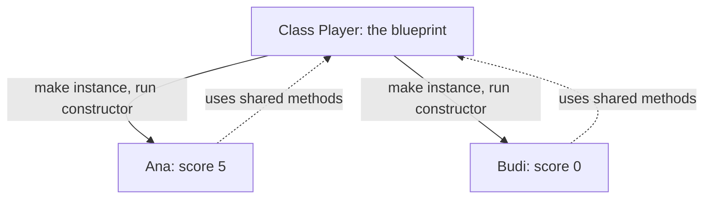

> **In one sentence:** A class is a blueprint for making many objects of the same kind, each with its own values and the same methods.

## Why should I care?

In [[objects|Objects]], you built one object at a time. Each object grouped values and the methods (functions) that work on them. Now imagine a game with 100 players. Every player needs a name, a score and a way to add points.

Writing 100 objects by hand would repeat the same methods 100 times. A **class** lets you describe a player once. Then you can make as many players as you need, and each one has the same methods.

## Analogy

Think of a building plan for a house, called a **blueprint**. From one blueprint, a builder can build many houses. Each house is real and separate: you can paint one blue and another green. The blueprint itself is not a house, and nobody lives in it.

A class is the blueprint. Each object made from it is one house.

Each house's own paint colour is like an object's own values.

**Where the analogy breaks down:** each real house also gets its own doors and windows. Objects do not get their own copies of the methods: there is one copy of each method, in one place, and every object uses it. Also, a blueprint is only a drawing on paper, while a class is part of your program.

## How it actually works

### Blueprint, instance and constructor

Three words come with every class:

- An **instance** is one object made from a class. To make one is to **instantiate** the class.
- The **constructor** is code that runs once for each new instance. It gives the new object its starting values.
- **Methods** written in the class are shared by every instance.

Go does this work without classes. Its tab shows how.

The examples come in [[javascript|JavaScript]], [[python|Python]] and [[go-language|Go]]. You only need to read one tab.

<!-- tabs -->

### JavaScript

```js
// The class Player is the blueprint.
class Player {
  // The constructor runs once for each new player.
  constructor(name) {
    this.name = name; // this is the new object
    this.score = 0;
  }

  // A method: it adds points to this player's score.
  addPoints(points) {
    this.score = this.score + points;
  }

  // A method: it shows this player's name and score.
  describe() {
    console.log(this.name + " has " + this.score + " points");
  }
}

// new makes an instance and runs the constructor.
const ana = new Player("Ana");
const budi = new Player("Budi");

ana.addPoints(5);
ana.describe();  // shows Ana has 5 points
budi.describe(); // shows Budi has 0 points
```

This shows:

```
Ana has 5 points
Budi has 0 points
```

The word `class` starts the class, and its name follows. Inside the curly brackets, the method named `constructor` is special: `new Player("Ana")` creates a new object and runs the constructor with `"Ana"`. Inside the constructor, `this` is the object being created. In `this.name = name`, the left side is the new object's property `name`, and the right side is the parameter `name`.

Methods are written without the word `function`. MDN says they "are shared by all instances". If you call a class without `new`, as in `Player("Ana")`, you get an error.

MDN says JavaScript classes are built on a feature called **prototypes**. You can use classes without knowing about it.

### Python

```python
# The class Player is the blueprint.
class Player:
    # __init__ runs once for each new player.
    def __init__(self, name):
        self.name = name  # self is the new object
        self.score = 0

    # A method: it adds points to this player's score.
    def add_points(self, points):
        self.score = self.score + points

    # A method: it shows this player's name and score.
    def describe(self):
        print(self.name, "has", self.score, "points")

# Calling the class makes an instance and runs __init__.
ana = Player("Ana")
budi = Player("Budi")

ana.add_points(5)
ana.describe()   # shows Ana has 5 points
budi.describe()  # shows Budi has 0 points
```

This shows:

```
Ana has 5 points
Budi has 0 points
```

In Objects, a small class made one Phone, with `__init__` and `self`. Here, one class makes two players, and `__init__` and `self` work in the same way.

The word `class` starts the class. Its name and a colon follow. The indented lines below are the class's body. Each `def` inside it defines a method.

To make an instance, call the class like a function: `Player("Ana")`. Python then runs `__init__` for the new instance. It does the constructor's job: it gives the new instance its starting values. In `self.name = name`, the left side is the new object's attribute `name`, and the right side is the parameter `name`.

When you call `ana.describe()`, Python passes `ana` in as `self`. The call works like `Player.describe(ana)`.

`print` can take several values. It shows them with a space between each one.

The methods belong to the class, not to each instance.

### Go

A Tour of Go, on Go's website, says: "Go does not have classes." The example below uses three parts instead: a struct type, a function that makes values, and methods.

```go
package main

import "fmt"

// Player is a struct type: a group of named fields.
type Player struct {
	Name  string
	Score int
}

// NewPlayer makes a new Player and gives back a pointer to it.
func NewPlayer(name string) *Player {
	return &Player{Name: name, Score: 0}
}

// AddPoints is a method of Player. p is its receiver.
func (p *Player) AddPoints(points int) {
	p.Score = p.Score + points
}

// Describe is a method of Player too.
func (p *Player) Describe() {
	fmt.Println(p.Name, "has", p.Score, "points")
}

func main() {
	ana := NewPlayer("Ana")
	budi := NewPlayer("Budi")

	ana.AddPoints(5)
	ana.Describe()  // shows Ana has 5 points
	budi.Describe() // shows Budi has 0 points
}
```

This shows:

```
Ana has 5 points
Budi has 0 points
```

`type Player struct` defines a new type. Each value of this type has two **fields**: `Name`, a string (text), and `Score`, an `int` (a whole number).

A **pointer** is a value that says where another value is kept. Through a pointer, code can reach the original value and change it. `&Player{...}` makes a new Player and gives back a pointer to it. The type `*Player` means "a pointer to a Player".

`NewPlayer` is an ordinary function. Effective Go, a guide on Go's website, calls a function that makes new instances of a type a **constructor**. By habit, its name usually starts with `New`. Here, `ana` holds a pointer to one Player.

`(p *Player)` before a method's name is its **receiver**: the Player that the method works on. Both methods here have pointer receivers, so they work on the Player that `ana` points to, not on a copy. With a plain `Player` receiver, the method would work on a copy, and the change would be lost.

If a variable holds a plain Player, not a pointer, Go adds the `&` for you when you call a method with a pointer receiver. A Tour of Go calls this "a convenience". This page's `NewPlayer` gives back the pointer itself, as the constructor example in Effective Go does.

Names that start with a capital letter, such as `Score` and `NewPlayer`, can be used by code in other packages (named groups of Go code). This program has one package, so the capitals are not needed here: it runs the same with lowercase names.

<!-- /tabs -->

### What happens when you make an instance



Each instance keeps its own values. Ana's score changed, and Budi's did not. But the methods live in one place, and every instance uses them. In Go, the type `Player` and its methods take the place of the class.

In JavaScript and Python, a class can also be built on another class and reuse its methods. This is called **inheritance**, and this page leaves it out. Go has no inheritance of this kind. Its FAQ says that Go "takes a different approach".

## How it came to be

Simula is a programming language developed in the 1960s at the Norwegian Computing Center in Oslo, by Ole-Johan Dahl and Kristen Nygaard. A version called Simula 67 introduced objects, classes and inheritance, along with other ideas.

Simula is considered the first **object-oriented** programming language. MDN describes object-oriented programming as "an approach in programming in which data is encapsulated within objects". Encapsulated means kept inside.

JavaScript reserved the word `class` for possible future use. Class declarations, which create classes, came later: with an edition of JavaScript's standard (its official rules) finalized in June 2015.

## 🧪 Try it in your browser

These steps use JavaScript, because the browser's console runs it. In JavaScript, `class` starts a class, and `constructor` is the code that runs for each new instance. `this` is the object being made, and `new` makes an instance. `const` creates a variable, and `===` checks whether two values are the same. A semicolon (`;`) separates two instructions on one line. The whole class goes inside its outer curly brackets, and its methods are written without the word `function`. You need a computer with Chrome, Edge or Firefox.

**Type each line only once.** Typing a line again may change the results or show an error message. If you typed a line twice, or see an error message at any step other than step 9, reload the page and start again from step 3.

**Safety rule:** only type code in the console that you understand or that comes from a source you trust. Never paste anything a stranger sends you. The lines below make a class and two objects, read and change a score, and show one expected error.

1. Open [example.com](https://example.com/).
   **What you should see:** a short page. It says the domain is for use in documentation examples.
2. Open the **console**:
   - **Windows:** press `Ctrl` + `Shift` + `J` (in Firefox: `Ctrl` + `Shift` + `K`)
   - **Mac:** press `Cmd` + `Option` + `J` (in Firefox: `Cmd` + `Option` + `K`)
3. Click the line where you can type, below any messages. **Type** this line yourself (some browsers may block pasting at first), then press `Enter`.

   ```
   class Player { constructor(name) { this.name = name; this.score = 0 } addPoints(points) { this.score = this.score + points } }
   ```

   **What you should see:** the console may show `undefined`. That is normal: the line defines a class, and has no result to show. The browser may show suggestions, and the line may look different while you type. Keep typing.

4. Make the first instance:

   ```
   const ana = new Player("Ana")
   ```

   **What you should see:** the console may show `undefined`. That is normal.
5. Make the second instance:

   ```
   const budi = new Player("Budi")
   ```

   **What you should see:** again, the console may show `undefined`.
6. Give Ana 5 points:

   ```
   ana.addPoints(5)
   ```

   **What you should see:** the console may show `undefined`, because the method gives no value back.
7. Read both scores, one line at a time:

   ```
   ana.score
   ```

   ```
   budi.score
   ```

   **What you should see:** `5`, then `0`. Each instance keeps its own values.
8. Check whether both players use the same method:

   ```
   ana.addPoints === budi.addPoints
   ```

   **What you should see:** `true`. There is one `addPoints`, shared by both instances. Without round brackets, `ana.addPoints` is the method itself. It does not call the method.
9. Make a mistake on purpose, and forget `new`:

   ```
   Player("Cai")
   ```

   **What you should see:** an error message with the word `TypeError`. It says that the class needs `new`. This error is expected. This is the last step, so you can stop here.

## Common misunderstandings

- **"A class and an object are the same thing."** No. The class describes a kind of object. Each instance is a separate object, with its own values. In Go, the struct type plays the part of the description.
- **"Each instance gets its own copy of every method."** No. The methods are kept in one place and shared. Each instance has its own values, not its own methods.
- **"Every language has classes."** No. Go does not have classes. It uses types such as structs, functions that make values (usually named `New...`), and methods.

## Recap

- A class is a blueprint, and each object made from it is an instance with its own values.
- The constructor runs once for each new instance and gives it its starting values. The methods are shared by every instance.
- Go does not have classes. A struct type, a function whose name usually starts with `New`, and methods do this work.

## Sources

- MDN Web Docs, Classes: https://developer.mozilla.org/en-US/docs/Web/JavaScript/Reference/Classes
- MDN Web Docs, Using classes: https://developer.mozilla.org/en-US/docs/Web/JavaScript/Guide/Using_classes
- MDN Web Docs, class: https://developer.mozilla.org/en-US/docs/Web/JavaScript/Reference/Statements/class
- MDN Web Docs, constructor: https://developer.mozilla.org/en-US/docs/Web/JavaScript/Reference/Classes/constructor
- MDN Web Docs, new: https://developer.mozilla.org/en-US/docs/Web/JavaScript/Reference/Operators/new
- MDN Web Docs, TypeError: class constructors must be invoked with 'new': https://developer.mozilla.org/en-US/docs/Web/JavaScript/Reference/Errors/Class_ctor_no_new
- MDN Web Docs, OOP (glossary): https://developer.mozilla.org/en-US/docs/Glossary/OOP
- MDN Web Docs, const: https://developer.mozilla.org/en-US/docs/Web/JavaScript/Reference/Statements/const
- MDN Web Docs, Strict equality (===): https://developer.mozilla.org/en-US/docs/Web/JavaScript/Reference/Operators/Strict_equality
- MDN Web Docs, Function: https://developer.mozilla.org/en-US/docs/Web/JavaScript/Reference/Global_Objects/Function
- MDN Web Docs, Functions (JavaScript reference): https://developer.mozilla.org/en-US/docs/Web/JavaScript/Reference/Functions
- MDN Web Docs, Functions, reusable blocks of code: https://developer.mozilla.org/en-US/docs/Learn_web_development/Core/Scripting/Functions
- MDN Web Docs, Grammar and types: https://developer.mozilla.org/en-US/docs/Web/JavaScript/Guide/Grammar_and_types
- MDN Web Docs, console.log(): https://developer.mozilla.org/en-US/docs/Web/API/console/log_static
- MDN Web Docs, eval(): https://developer.mozilla.org/en-US/docs/Web/JavaScript/Reference/Global_Objects/eval
- Python Tutorial, Classes: https://docs.python.org/3/tutorial/classes.html
- Python Language Reference, Data model: https://docs.python.org/3/reference/datamodel.html
- Python documentation, Built-in Functions (print): https://docs.python.org/3/library/functions.html
- Go, Frequently Asked Questions (FAQ): https://go.dev/doc/faq
- A Tour of Go, Methods (source text): https://github.com/golang/website/blob/master/_content/tour/methods.article
- A Tour of Go, Pointers (source text): https://github.com/golang/website/blob/master/_content/tour/moretypes.article
- The Go Programming Language, Effective Go: https://go.dev/doc/effective_go
- The Go Programming Language Specification: https://go.dev/ref/spec
- Go Packages, fmt: https://pkg.go.dev/fmt
- Wikipedia, Simula: https://en.wikipedia.org/wiki/Simula
- ECMAScript Language Specification, 5.1 Edition, Future Reserved Words: https://262.ecma-international.org/5.1/#sec-7.6.1.2
- Wikipedia, ECMAScript version history: https://en.wikipedia.org/wiki/ECMAScript_version_history
- Chrome for Developers, What's New in DevTools (Chrome 80): https://developer.chrome.com/blog/new-in-devtools-80
- Mozilla Bugzilla, Bug 1257088, Console prevents re-declaration of let and const: https://bugzilla.mozilla.org/show_bug.cgi?id=1257088
- Example Domain: https://example.com/
- Chrome for Developers, Open Chrome DevTools: https://developer.chrome.com/docs/devtools/open
- Chrome for Developers, Run JavaScript in the Console: https://developer.chrome.com/docs/devtools/console/javascript
- Microsoft Edge DevTools, Keyboard shortcuts: https://learn.microsoft.com/en-us/microsoft-edge/devtools/shortcuts/
- Microsoft Edge DevTools, Run JavaScript in the Console: https://learn.microsoft.com/en-us/microsoft-edge/devtools/console/console-javascript
- Firefox DevTools User Docs, Web Console: https://firefox-source-docs.mozilla.org/devtools-user/web_console/index.html
- Firefox DevTools User Docs, The JavaScript input interpreter: https://firefox-source-docs.mozilla.org/devtools-user/web_console/the_command_line_interpreter/index.html
- Chrome for Developers, What are self-XSS attacks?: https://developer.chrome.com/blog/self-xss
