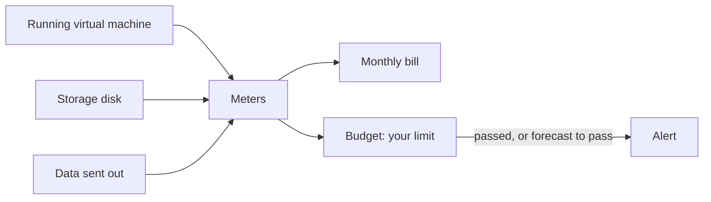

> **In one sentence:** With pay-as-you-go cloud services, anything you start can keep costing money until you delete it, and budget alerts can warn you, sometimes late, before a bill surprises you.

## Why should I care?

In [[cloud-computing]] you learned that cloud users usually pay only for what they use. But "what you use" can include things you forgot about: a rented computer nobody looks at, or files you no longer need.

Knowing what is counted, and what warns you, helps avoid a surprise bill.

## Analogy

Think again of **electricity at home**. A lamp left on in an empty room still uses power. The meter keeps counting, and you pay at the end of the month.

**Where the analogy breaks down:** a lamp has one meter. A cloud service can have several, and turning one thing off may leave another counting. Also, cloud cost reports can lag by hours, sometimes over a day.

## How it actually works

### Pay-as-you-go

This page uses one company, Amazon Web Services (AWS), as the example. AWS calls its way of charging **pay-as-you-go**. Its pricing page says: "With AWS you pay only for the individual services you need, for as long as you use them".

### What is counted

Three AWS meters follow. This page quotes no prices; AWS's pricing pages show them.

1. **Time a virtual machine runs.** AWS calls a virtual machine in its EC2 service an **instance**: "a virtual server in the AWS Cloud". AWS bills a running instance "even if the instance remains idle", that is, running but doing nothing.
2. **Storage, per gigabyte per month.** A gigabyte (GB) is a unit for amounts of data (see [[data-size-units]]). AWS's EBS (Elastic Block Store) service gives an instance storage disks, called **volumes**, that work like "a local hard drive". You pay for each GB you reserve, every month, "until you release the storage", that is, give it back.
3. **Data sent out to the internet.** Example: your website's pages and pictures, sent to its visitors. AWS's EC2 pricing page prices "Data Transfer OUT From Amazon EC2 To Internet" "per GB". In November 2026, the page said customers get 100 GB of this each month at no charge, in total, shared across AWS services and most regions.

### Stopped is not the same as deleted

An EC2 instance has **states**, such as running, stopped and terminated. AWS's guide says a **stopped** instance "is shut down and cannot be used", and its running time is not billed. But the guide warns: "Some AWS resources, such as Amazon EBS volumes and Elastic IP addresses, incur charges regardless of the instance's state." To **incur** a charge means to have to pay it.

An **Elastic IP address** is a fixed public [[ip-address|IP address]], an address "reachable from the internet". AWS charges for every Elastic IP address in your account, in use or not.

A **terminated** instance "has been permanently deleted", and its own charges stop. But by default, AWS deletes only its main disk and keeps any other EBS volumes. Those are charged until you delete them. Its Elastic IP addresses are also "still allocated to you" until you release them. AWS's page about unexpected charges says its list of leftovers "is not an exhaustive list". Leftovers can be in any region where you created resources, and some services restart things you stop.

### Tools that warn you

AWS's **Billing and Cost Management** console (its web interface for managing costs) has several tools:

- **The Bills page** shows "detailed monthly billing data".
- **AWS Cost Explorer** lets you "view and analyze your costs and usage".
- **AWS Budgets** can email you if you pass, or are forecast to pass, an amount you choose.

A budget **alert** is only a warning. AWS says "There can be a delay" between a charge and its notification, and costs "may continue to increase" after it.

In September 2026, AWS announced **spend limits**, "a type of AWS Budgets", for the Paid plan (see below) of its new sign-up. There, your resources are grouped in **projects**. AWS says: "If your usage in a project reaches its limit, AWS pauses that project which stops its resources so your costs stay within it." If you do nothing for 90 days after a pause, AWS "permanently deletes your project data".

### The AWS Free Tier

AWS changed its **Free Tier** for accounts created from July 15, 2025. Older accounts stay in the "legacy" (older) Free Tier program.

In November 2026, AWS's guide said new customers get "USD $100 in credits", and can earn up to $100 more. **Credits** pay for your use until they run out or expire. The guide says you pick a plan at sign-up. AWS's Free Tier FAQ says new accounts start on the Free plan and can upgrade later.

- **Free account plan:** "You will not incur any charges during this period until you upgrade to a paid account plan." It ends "after six months or when your credits are fully used", whichever comes first. Then AWS "suspends your account". Without an upgrade within 90 days, AWS will "permanently erase" the account "and all its content".
- **Paid account plan:** when your use is more than your credits, or a service does not accept credits, "you pay standard pay-as-you-go pricing". You also pay when your credits expire.

### If a bill surprises you

For questions about a bill, AWS recommends that "you open a case with Support". A case is a written request for help. AWS says account and billing support is "free of charge".

## How it came to be

When Amazon announced EC2 in August 2006, it said EC2 allows "you to pay only for capacity that you actually use".

## 🧪 Try it in your browser

This reads public pages only, with no account. They may look different.

1. Open `https://aws.amazon.com/ec2/pricing/on-demand/` in Chrome, Edge or Firefox.
2. Find the section called **Data Transfer**, far down the page. In Chrome or Edge on Windows, you can press Ctrl+F and type `Data Transfer OUT`, or scroll down. The page may show a menu for choosing a region. Any region is fine.
3. **What you should see:** "Data Transfer IN To Amazon EC2 From Internet" (data coming in to an instance) and "Data Transfer OUT From Amazon EC2 To Internet" (data going out from it). Under "OUT", a sentence says how much data you can send out free each month, and the prices below it are "per GB".
4. Open `https://docs.aws.amazon.com/awsaccountbilling/latest/aboutv2/checklistforunwantedcharges.html`.
5. **What you should see:** a page called "Understanding unexpected charges", with a list of topics. One of them is "Charges incurred by Elastic IP addresses".

You have seen one AWS meter and AWS's list of surprises. Close both tabs.

## Common misunderstandings

- **"If I stop my virtual machine, I pay nothing."** Not on AWS: its storage disks and Elastic IP addresses are still billed.
- **"A budget stops my spending at the limit."** A budget alert only warns you, sometimes late. AWS's new spend limits can pause a project, but only on some accounts.

## Recap

- With pay-as-you-go, you pay for running time, gigabytes stored and data sent out, among other things.
- Stopping is not deleting: on AWS, disks and Elastic IP addresses still cost money.
- Budget alerts warn you, sometimes late; costs can keep growing.

## Sources

- AWS, Cloud Services Pricing: https://aws.amazon.com/pricing/
- AWS documentation, What is Amazon EC2?: https://docs.aws.amazon.com/AWSEC2/latest/UserGuide/concepts.html
- AWS documentation, Amazon EC2 instance state changes: https://docs.aws.amazon.com/AWSEC2/latest/UserGuide/ec2-instance-lifecycle.html
- AWS documentation, What is Amazon Elastic Block Store?: https://docs.aws.amazon.com/ebs/latest/userguide/what-is-ebs.html
- AWS, Amazon EBS pricing: https://aws.amazon.com/ebs/pricing/
- AWS, Amazon EC2 On-Demand Pricing: https://aws.amazon.com/ec2/pricing/on-demand/
- AWS Billing User Guide, Understanding unexpected charges: https://docs.aws.amazon.com/awsaccountbilling/latest/aboutv2/checklistforunwantedcharges.html
- AWS, AWS Free Tier: https://aws.amazon.com/free/
- AWS Billing User Guide, Explore AWS services with AWS Free Tier: https://docs.aws.amazon.com/awsaccountbilling/latest/aboutv2/free-tier.html
- AWS News Blog, AWS Free Tier update (15 July 2025): https://aws.amazon.com/blogs/aws/aws-free-tier-update-new-customers-can-get-started-and-explore-aws-with-up-to-200-in-credits/
- AWS Cost Management User Guide, Managing your costs with AWS Budgets: https://docs.aws.amazon.com/cost-management/latest/userguide/budgets-managing-costs.html
- AWS Cost Management User Guide, AWS Cost Explorer: https://docs.aws.amazon.com/cost-management/latest/userguide/ce-what-is.html
- AWS Billing User Guide, What is AWS Billing and Cost Management?: https://docs.aws.amazon.com/awsaccountbilling/latest/aboutv2/billing-what-is.html
- AWS Billing User Guide, Getting help with your bills and payments: https://docs.aws.amazon.com/awsaccountbilling/latest/aboutv2/billing-get-answers.html
- AWS What's New, Announcing Amazon EC2 (beta): https://aws.amazon.com/about-aws/whats-new/2006/08/24/announcing-amazon-elastic-compute-cloud-amazon-ec2---beta/
- AWS documentation, Elastic IP addresses: https://docs.aws.amazon.com/AWSEC2/latest/UserGuide/elastic-ip-addresses-eip.html
- AWS Account Management, Create a spend limit in AWS Settings: https://docs.aws.amazon.com/accounts/latest/reference/create-spend-limit.html
- AWS Account Management, Compare sign-up options: https://docs.aws.amazon.com/accounts/latest/reference/sign-up-for-aws.html
- AWS What's New, New AWS experience helps builders get started and ship faster (September 16, 2026): https://aws.amazon.com/about-aws/whats-new/2026/09/New-AWS-Builder-Experience/
- AWS, AWS Free Tier FAQs: https://aws.amazon.com/free/free-tier-faqs/
- Google Chrome Help, Search within a page: https://support.google.com/chrome/answer/95440
- Microsoft Support, Keyboard shortcuts in Microsoft Edge: https://support.microsoft.com/en-us/microsoft-edge/keyboard-shortcuts-in-microsoft-edge-50d3edab-30d9-c7e4-21ce-37fe2713cfad
