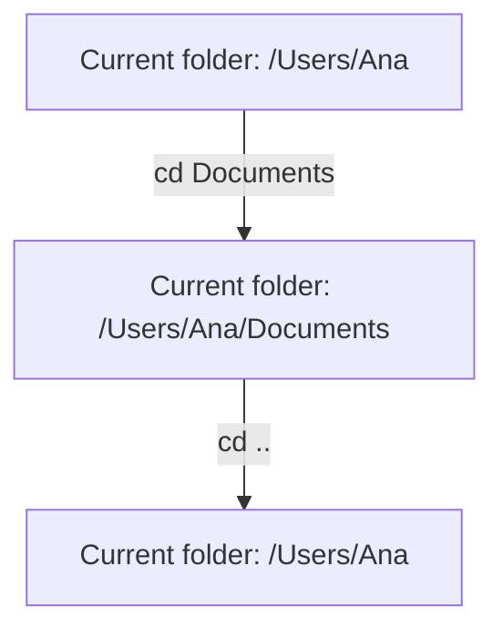

> **In one sentence:** The command line is the line in a terminal window where you type commands; a program called a shell reads each command and carries it out.

## Why should I care?

You already type lines and press `Enter` in the browser console, from [[what-is-programming|What is Programming?]]. The command line looks similar, but its commands work with your [[files-and-folders|folders]] and start programs.

Why type instead of click? MDN Web Docs, a website that documents web technologies, says "A large number of tools" are used this way. For web development, it sees a "near-guaranteed chance" that you will need it. One command can also rename hundreds of files. By clicking, "it would take you a long time".

## Analogy

Imagine a large library with many rooms. A helper beside you reads requests from your notepad. "Which room am I in?" "What is in this room?" "Go to History."

The notepad is the terminal. The helper is the shell. Each request is a command. "History" is an argument. The room you are in is your current folder.

**Where the analogy breaks down:** a human helper can guess what you meant. A shell cannot: if you misspell a command, you usually get an error message. Also, no folder moves. The shell only remembers which folder is current.

## How it actually works

### Terminal, shell and command line

- The **terminal** is a window for text. MDN calls it "a text interface for executing text-based programs". (Executing means running.) Opening a terminal starts a shell.
- The **shell** is the program that reads what you type and carries it out. In a paper about the Unix system, D. M. Ritchie and K. Thompson wrote that it "reads lines typed by the user".
- The **command line** is the line where you type commands.

Before you type, the window shows a short text, called a **prompt**. In PowerShell, a shell that runs on Windows, it can look like `PS C:\>`. You type after it, then press `Enter`.

### Commands and arguments

A **command** is one instruction for the shell. Ritchie and Thompson's paper describes "the command name followed by arguments to the command, all separated by spaces". An **argument** is extra information for the command.

```
cd Documents
```

`cd` is the command name and `Documents` is its argument.

### The current folder

The shell keeps one folder as your **current folder**, also called the working directory. A short path such as `Documents` means "the folder named Documents, inside the current folder". The paper says this about a path "not starting with '/'". Windows paths use `\`, and Microsoft gives PowerShell the same rule.

The **parent** is the folder that holds the current folder. `..` is a short name for it.

MDN says a terminal normally starts in your **home folder**. That folder holds your own files. For a user called Ana on a Mac, that is `/Users/Ana`. On Windows it is usually inside `C:\Users`. Its name may come from your user name or Microsoft account email.

### Three commands

These commands only show information or change the current folder. They change no files. In Windows PowerShell, each name is an **alias**: another name for one of PowerShell's own commands.

| Type this | What it does | Alias for |
|---|---|---|
| `pwd` | Shows the path of the current folder ("print working directory"). | `Get-Location` |
| `ls` | Lists the names in the current folder (hidden items are left out). | `Get-ChildItem` |
| `cd Documents` | Makes `Documents` the current folder ("Change Directory"). | `Set-Location` |
| `cd ..` | Makes the parent the current folder. | `Set-Location` |



### Running a program by name

For many command names, the shell looks for a program with that name, in a list of folders called `PATH`. If it finds nothing, you usually get an error message. The other words are arguments for that program. (This is simplified.)

For later: Node.js runs JavaScript outside the browser. Once it is installed, you can type:

```
node hello.js
```

The shell looks for the program `node`. It gives the name `hello.js` to `node`, which runs that file from the current folder.

## How it came to be

Writing in 2000, Louis Pouzin says he wrote a paper on the command language of a computer system called Multics. He dates it to the end of 1964 or the beginning of 1965. He says that is when he came up with the name "shell" for it.

## 🧪 Try it in your browser

A **file picker** is a window for choosing a file. Open one, but choose nothing.

1. In Chrome, Edge or Firefox, open this MDN page: `https://developer.mozilla.org/en-US/docs/Web/HTML/Reference/Elements/input/file`
2. Find the example box with the words **Choose a profile picture**. Click the button in that box.
   **What you should see:** a file picker. MDN says "the exact interface" (how it looks) "differs across browsers and operating systems".
3. Keep the window open. Look at which folder is showing, and at the list of names in it. You may open a folder. Do not choose a file. Compare with this table:

   | What you may see | On the command line |
   |---|---|
   | A place showing the current folder | Like `pwd` |
   | A list of names in that folder | Like `ls` |
   | Opening a folder | Like `cd` with that name |

   These parts come from Microsoft's documentation of an older Windows window. Yours may look different. This example asks for pictures, so the picker may hide other files. `ls` would list them.

   The comparison stops there: a file picker is not a shell.
4. Click **Cancel**, or press `Esc`.
   **What you should see:** the window closes.

**On a phone:** the button also opens a file picker, but it may look very different. Close it without choosing.

## Optional: three commands on your own computer

You can skip this section. MDN warns that other commands can delete files permanently, so never type a command you do not understand.

1. Open the terminal.
   - **Windows:** open the **Start** menu, type **Windows PowerShell**, select it, then select **Open**. This opens a terminal window running the PowerShell shell.
   - **Mac:** open Spotlight search, type **Terminal**, then click **Terminal**. Apple says new user accounts use a shell called zsh by default, starting with macOS 10.15.
2. Type `pwd` and press `Enter` (`Return` on a Mac).
   **What you should see:** the path of your current folder. Windows PowerShell puts the heading `Path` above it.
3. Type `ls` and press `Enter`.
   **What you should see:** the names in that folder. On Windows, each name also has details.
4. Type `cd`, a space, and a folder name from the list with no spaces in it, such as `Documents`. Press `Enter`.
   **What you should see:** no message, only a new prompt. In Windows PowerShell, the prompt now shows the new folder. If the name is wrong, you get an error message. Check your spelling. A Mac may ask for your permission. Apple says you can decide which apps can use which folders, in System Settings.
5. Type `pwd` and press `Enter`.
   **What you should see:** the path is one name longer.
6. Type `cd ..`, press `Enter`, then type `pwd` and press `Enter`.
   **What you should see:** the path is one name shorter.

## Common misunderstandings

- **"The browser console and the terminal are the same thing."** No. Chrome's documentation says the console "reads the JavaScript that you type into it". A shell reads commands.
- **"`cd Documents` moves my Documents folder."** No. `cd` changes only which folder is current.

## Recap

- The terminal is the window, the command line is where you type, and the shell reads your commands.
- A command is a name, often followed by arguments.
- `pwd` shows the current folder, `ls` lists it, `cd` changes it. Other commands can start programs.

## Sources

- MDN Web Docs, Command line crash course: https://developer.mozilla.org/en-US/docs/Learn_web_development/Getting_started/Environment_setup/Command_line
- MDN Web Docs, About MDN: https://developer.mozilla.org/en-US/about
- D. M. Ritchie and K. Thompson, The UNIX Time-Sharing System (first published 1974; this link is the revised 1978 version): https://plan9.io/cm/cs/who/dmr/cacm.html
- Louis Pouzin, The Origin of the Shell, at Multicians.org: https://multicians.org/shell.html
- The Open Group, POSIX, pwd: https://pubs.opengroup.org/onlinepubs/9799919799/utilities/pwd.html
- The Open Group, POSIX, ls: https://pubs.opengroup.org/onlinepubs/9799919799/utilities/ls.html
- The Open Group, POSIX, cd: https://pubs.opengroup.org/onlinepubs/9799919799/utilities/cd.html
- Microsoft Learn, What is PowerShell?: https://learn.microsoft.com/en-us/powershell/scripting/overview
- Microsoft Learn, Starting Windows PowerShell: https://learn.microsoft.com/en-us/powershell/scripting/windows-powershell/starting-windows-powershell
- Microsoft Learn, Get-Location (Windows PowerShell 5.1): https://learn.microsoft.com/en-us/powershell/module/microsoft.powershell.management/get-location?view=powershell-5.1
- Microsoft Learn, Get-ChildItem (Windows PowerShell 5.1): https://learn.microsoft.com/en-us/powershell/module/microsoft.powershell.management/get-childitem?view=powershell-5.1
- Microsoft Learn, Set-Location (Windows PowerShell 5.1): https://learn.microsoft.com/en-us/powershell/module/microsoft.powershell.management/set-location?view=powershell-5.1
- Microsoft Learn, about_Path_Syntax (Windows PowerShell 5.1): https://learn.microsoft.com/en-us/powershell/module/microsoft.powershell.core/about/about_path_syntax?view=powershell-5.1
- Microsoft Learn, about_Command_Precedence (Windows PowerShell 5.1): https://learn.microsoft.com/en-us/powershell/module/microsoft.powershell.core/about/about_command_precedence?view=powershell-5.1
- Microsoft Learn, KNOWNFOLDERID: https://learn.microsoft.com/en-us/windows/win32/shell/knownfolderid
- Apple Support, Terminal User Guide, Open or quit Terminal on Mac: https://support.apple.com/guide/terminal/open-or-quit-terminal-apd5265185d-f365-44cb-8b09-71a064a42125/mac
- Apple Support, Terminal User Guide, Execute commands and run tools in Terminal on Mac: https://support.apple.com/guide/terminal/execute-commands-and-run-tools-apdb66b5242-0d18-49fc-9c47-a2498b7c91d5/mac
- Apple Support, Mac User Guide, Folders that come with your Mac: https://support.apple.com/guide/mac-help/mchlp1143/mac
- Apple Support, Mac User Guide, Control access to files and folders on Mac: https://support.apple.com/guide/mac-help/control-access-to-files-and-folders-on-mac-mchld5a35146/mac
- Apple Developer, File System Programming Guide, File System Basics: https://developer.apple.com/library/archive/documentation/FileManagement/Conceptual/FileSystemProgrammingGuide/FileSystemOverview/FileSystemOverview.html
- Node.js, Introduction to Node.js: https://nodejs.org/en/learn/getting-started/introduction-to-nodejs
- Node.js, Run Node.js scripts from the command line: https://nodejs.org/en/learn/command-line/run-nodejs-scripts-from-the-command-line
- Chrome for Developers, Run JavaScript in the Console: https://developer.chrome.com/docs/devtools/console/javascript
- Microsoft Learn, Naming Files, Paths, and Namespaces: https://learn.microsoft.com/en-us/windows/win32/fileio/naming-a-file
- Microsoft Learn, about_Prompts (Windows PowerShell 5.1): https://learn.microsoft.com/en-us/powershell/module/microsoft.powershell.core/about/about_prompts?view=powershell-5.1
- Windows Insider Blog, Releasing Windows 11 Builds 26100.7015 and 26200.7015 to the Release Preview Channel: https://blogs.windows.com/windows-insider/2025/10/21/releasing-windows-11-builds-26100-7015-and-26200-7015-to-the-release-preview-channel/
- Apple Support, Use zsh as the default shell on your Mac: https://support.apple.com/en-us/102360
- Apple Platform Security, Controlling app access to files in macOS: https://support.apple.com/guide/security/controlling-app-access-to-files-secddd1d86a6/web
- MDN Web Docs, `<input type="file">`: https://developer.mozilla.org/en-US/docs/Web/HTML/Reference/Elements/input/file
- Microsoft Learn, Open and Save As dialog boxes: https://learn.microsoft.com/en-us/windows/win32/dlgbox/open-and-save-as-dialog-boxes
