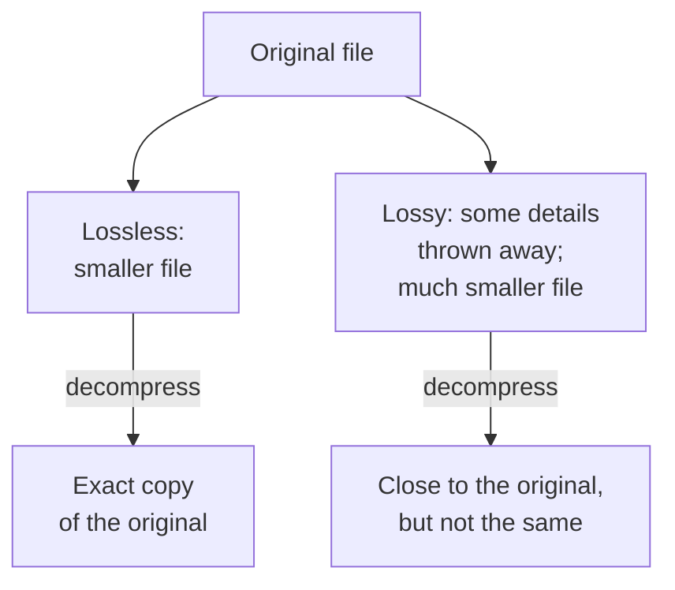

> **In one sentence:** Compression stores information in fewer bytes: lossless compression gives back an exact copy (like PNG and ZIP files), while lossy compression throws away details people hardly notice (like JPEG and MP3 files).

## Why should I care?

In [[images-as-numbers]], you saw that a picture 800 pixels wide and 600 pixels high needs 1,440,000 bytes: about 1.4 MB (see [[data-size-units]]). Fewer bytes means less space on your device and less to download.

You use compression every day without seeing it: JPEG photos, ZIP downloads, and web pages. A [[server]] can compress a web page before sending it to your browser. MDN Web Docs, a reference for web developers, says this makes some documents on the web up to 70% smaller.

## Analogy

Think of a **shopping list**. Instead of writing "apple, apple, apple, apple, apple, apple", you write "6 apples". The list is shorter, but it means exactly the same thing. Anyone can turn "6 apples" back into six apples.

That is the idea of lossless compression: find a shorter way to write the same information.

**Where the analogy breaks down:** a shopping list is always exact. Some computer compression is not: it throws away small details on purpose (you will see this below). Also, a computer does not look for words like "apple". It looks for patterns in the numbers, the bytes, that make up the file.

## How it actually works

To **compress** a file means to write its information in fewer bytes. To **decompress** it means to turn it back into its full form, for example the pixel numbers that a screen needs to show a picture.

There are two kinds of compression.

### Lossless: an exact copy comes back

With **lossless** compression, decompressing gives back the original data exactly, byte for byte. Nothing is lost. Examples:

- **PNG** pictures. The PNG standard describes PNG as a lossless file format (a type of file).
- **ZIP** files. A ZIP file is a package that holds one or more files, usually compressed. ZIP can use a method called **Deflate**, and Deflate is lossless.
- **gzip**, a method that web servers use to compress pages before sending them. MDN calls it the most common one.

### A worked example: run-length encoding

Here is one simple lossless idea, called **run-length encoding**. A "run" is a row of the same value, repeated. Instead of storing each value, you store one copy plus a count. That is the "6 apples" idea.

Take one row of 10 pixels: 6 white pixels, then 4 black pixels. Each pixel uses 3 bytes (red, green, blue), so the row needs 10 × 3 = **30 bytes**:

| Pixel | 1 | 2 | 3 | 4 | 5 | 6 | 7 | 8 | 9 | 10 |
|---|---|---|---|---|---|---|---|---|---|---|
| Color | white | white | white | white | white | white | black | black | black | black |

Now write each run as a count followed by the color. In a simple made-up scheme, the count uses 1 byte and the color uses 3 bytes:

| Run | Count (1 byte) | Color (3 bytes) |
|---|---|---|
| 1 | 6 | 255, 255, 255 (white) |
| 2 | 4 | 0, 0, 0 (black) |

That is 2 runs × 4 bytes = **8 bytes** instead of 30. To decompress, the computer writes white 6 times and black 4 times. It gets back exactly the same 10 pixels.

But look at a row where white and black take turns: white, black, white, black, and so on. Every run is only 1 pixel long. That makes 10 runs × 4 bytes = **40 bytes**, more than the original 30. Run-length encoding works well only when the data has many long runs. Otherwise it can make the file bigger.

(This is simplified. Many real formats use other methods, sometimes together with run-length encoding. PNG, for example, uses Deflate, which combines two other methods.)

### Lossy: throw away what people hardly notice

With **lossy** compression, some of the data is thrown away forever. The file gets much smaller, and the result is close to the original, but not the same. Examples:

- **JPEG** pictures. MDN says photos "can usually tolerate lossy compression, because the discarded detail is harder to see."
- **MP3** music files (see [[sound-as-numbers]]).
- Video on the web. MDN says: "Video formats on the Web are lossy."



## How it came to be

- **1992:** the **JPEG** standard for pictures was created. Work on it started in 1986.
- **1996:** **Deflate** was described in a public document called RFC 1951. The same year, **PNG** became a W3C Recommendation (an official web standard). The PNG standard calls PNG a replacement for GIF, an older picture format.

## 🧪 Try it in your browser

You will compress some text with gzip in your browser's **console** (see [[browser-devtools]]) and see how many bytes are left.

**Safety rule:** only type code in the console that you understand or that comes from a source you trust. Never paste code that a stranger sends you. This code is safe: it only works on text inside your own browser tab. You do not need to understand every word yet.

1. In Chrome, Edge or Firefox, open any ordinary web page, for example `https://example.com`.
2. Open the console:
   - **Windows:** press `Ctrl` + `Shift` + `J` (in Firefox: `Ctrl` + `Shift` + `K`)
   - **Mac:** press `Cmd` + `Option` + `J` (in Firefox: `Cmd` + `Option` + `K`)
3. Click the empty line at the bottom. **Type** this line yourself (some browsers block pasting in the console), then press `Enter`. It makes a text with "ha" repeated 5,000 times:

   ```
   let text = "ha".repeat(5000)
   ```

   You will see `undefined`. That is normal: it means "done, nothing to show".
4. Type this line and press `Enter`. It shows the size of the text in bytes:

   ```
   new Blob([text]).size
   ```

   You should see `10000`: the text is 10,000 bytes.
5. Now compress it with gzip and show the size of the result in bytes. Type this line carefully and press `Enter`:

   ```
   new Response(new Blob([text]).stream().pipeThrough(new CompressionStream("gzip"))).blob().then(b => console.log(b.size))
   ```

   If the browser adds a bracket or a quote mark by itself while you type, make sure the line still looks exactly like the one above. You may first see a line with the word `Promise` (it means "the answer is coming"). Then a small number appears, well under 100. It may differ a little between browsers. The text shrank from 10,000 bytes to a few dozen. It is one short pattern, repeated, so gzip can write it in a very short form, like "6 apples".
   If you see red text instead, check the line letter by letter. Or reload the page and start again from step 3.
6. When you are done, close the tab.

**On a phone:** on paper, draw 8 white squares and 4 black ones, and write them as runs ("8 white, 4 black"). Then try white and black taking turns.

## Common misunderstandings

- **"Compression always makes a file smaller."** No. As the white-black-white example showed, run-length encoding can make data with no long runs bigger.
- **"I can get the lost detail back by saving a JPEG as PNG."** No. MDN says that once lossy compression has been done, "the content cannot be restored to its original state."

## Recap

- Compression stores information in fewer bytes, so files take less space and download faster.
- Lossless compression (PNG, ZIP, gzip) gives back an exact copy. Lossy compression (JPEG, MP3, web video) throws away details people hardly notice, and those details cannot come back.
- Compression uses repeats in the data, like long runs of the same pixel. Data without them may not shrink, and can even grow.

## Sources

- MDN Web Docs, Lossless compression: https://developer.mozilla.org/en-US/docs/Glossary/Lossless_compression
- MDN Web Docs, Lossy compression: https://developer.mozilla.org/en-US/docs/Glossary/Lossy_compression
- MDN Web Docs, Image file type and format guide: https://developer.mozilla.org/en-US/docs/Web/Media/Guides/Formats/Image_types
- MDN Web Docs, Compression in HTTP: https://developer.mozilla.org/en-US/docs/Web/HTTP/Guides/Compression
- Wikipedia, Run-length encoding (general background reference): https://en.wikipedia.org/wiki/Run-length_encoding
- W3C, PNG Specification Version 1.0 (1996): https://www.w3.org/TR/REC-png-961001
- W3C, PNG Specification (Third Edition): https://www.w3.org/TR/png-3/
- JPEG, Overview of JPEG 1: https://jpeg.org/jpeg/
- Library of Congress, ZIP File Format (PKWARE): https://www.loc.gov/preservation/digital/formats/fdd/fdd000354.shtml
- RFC 1951, DEFLATE Compressed Data Format Specification: https://www.rfc-editor.org/rfc/rfc1951
- MDN Web Docs, CompressionStream: https://developer.mozilla.org/en-US/docs/Web/API/CompressionStream
- MDN Web Docs, Blob: https://developer.mozilla.org/en-US/docs/Web/API/Blob
- MDN Web Docs, Response.blob(): https://developer.mozilla.org/en-US/docs/Web/API/Response/blob
- MDN Web Docs, String.prototype.repeat(): https://developer.mozilla.org/en-US/docs/Web/JavaScript/Reference/Global_Objects/String/repeat
- Chrome for Developers, Open Chrome DevTools: https://developer.chrome.com/docs/devtools/open
- Microsoft Edge DevTools, Keyboard shortcuts: https://learn.microsoft.com/en-us/microsoft-edge/devtools/shortcuts/
- Firefox DevTools User Docs, Web Console: https://firefox-source-docs.mozilla.org/devtools-user/web_console/index.html
- Chrome for Developers, Self-XSS protection: https://developer.chrome.com/blog/self-xss
