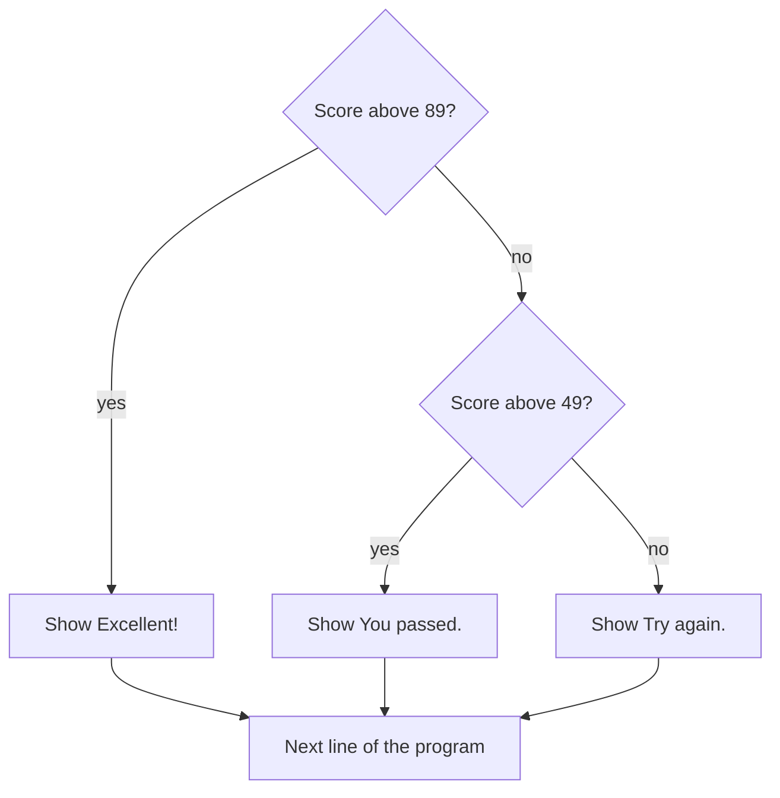

> **In one sentence:** A condition is a test in your code that gives true or false, and if and else use that answer to choose which code runs.

## Why should I care?

In [[what-is-programming|What is Programming, Really?]], the statements of a program ran one after another. A program like that cannot choose.

MDN Web Docs, a website that documents web technologies, gives this example: in a game, "if the player's number of lives is 0, then it's game over".

## Analogy

Think of a fork in a road, where one road splits into two. A sign at the fork asks one question: "Is the bridge open?" Yes means left. No means right. You take one road, never both. In code, the sign is the condition, and the roads are the blocks.

**Where the analogy breaks down:** a driver can think, ask someone, or ignore the sign. The computer works out the answer and follows your code. Two real roads may never meet again, but a program carries on with the next line after the choice. And an `if` with no `else` has only one extra road: on false, the program goes straight on.

## How it actually works

Each code example on this page is its own separate program. So the same name can appear with `const` twice.

### A comparison gives a boolean

In [[variables|Variables]], you met the **boolean**: a kind of value that can only be `true` or `false`. A **comparison operator** is a sign that compares two values and gives you a boolean.

| Operator | Question it asks |
|---|---|
| `===` | Are the two values equal? |
| `!==` | Are the two values not equal? |
| `<` | Is the left value less than the right value? |
| `>` | Is the left value greater than the right value? |

There are also `<=` (less than or equal to) and `>=` (greater than or equal to). Look at the last two lines below: 20 is not above 20, but it is equal to 20.

```js
const age = 20;

console.log(age > 18);   // shows true
console.log(age < 18);   // shows false
console.log(age === 20); // shows true
console.log(age !== 20); // shows false
console.log(age > 20);   // shows false
console.log(age >= 20);  // shows true
```

### `if` runs a block only when the condition is true

A **condition** is the test between the round brackets of an `if`. A **block** is a group of statements between curly braces, `{` and `}`.

```js
const temperature = 35;

if (temperature > 30) {
  // This block runs only when the condition is true.
  console.log("It is hot today.");
}

// This line is outside the block, so it always runs.
console.log("Have a good day.");
```

This shows `It is hot today.` and then `Have a good day.` If `temperature` were 12, the condition would be false. The program would skip the block and show only `Have a good day.`

### `else` runs when the condition is false

`else` gives the program a second block.

```js
const temperature = 12;

if (temperature > 30) {
  console.log("It is hot today.");
} else {
  // This block runs only when the condition is false.
  console.log("It is not hot today.");
}
```

This shows `It is not hot today.` You can leave out `else` when you need nothing to happen on false.

### `else if` adds more choices

`else if` adds another test. The program checks the tests in order, from top to bottom. MDN says "only the first logical condition which evaluates to `true` will be executed".

```js
const score = 72;

if (score > 89) {
  console.log("Excellent!");
} else if (score > 49) {
  // 72 is not above 89, but it is above 49.
  console.log("You passed.");
} else {
  console.log("Try again.");
}
```

This shows `You passed.` If `score` were 95, it would be above both 89 and 49. The program stops at the first true test, so only `Excellent!` would show.



### Combining tests with `&&`, `||` and `!`

A **logical operator** works with booleans:

- `&&` means AND. The result is `true` only when both sides are true.
- `||` (two vertical bars) means OR. The result is `true` when at least one side is true.
- `!` means NOT. It turns `true` into `false`, and `false` into `true`.

```js
const age = 20;
const hasTicket = true;
const isWeekend = false;
const isHoliday = true;

// && : both sides must be true.
if (age > 17 && hasTicket) {
  console.log("You may enter.");
}

// || : at least one side must be true.
if (isWeekend || isHoliday) {
  console.log("No school today.");
}

// ! : turns true into false, and false into true.
if (!isWeekend) {
  console.log("It is not the weekend.");
}
```

This shows all three messages. Here is how each condition is worked out:

- **First:** `age > 17` gives `true`. `hasTicket` is already a boolean, and it is `true`. Both sides are true, so `&&` gives `true`.
- **Second:** `isHoliday` is `true`, so `||` gives `true`.
- **Third:** `isWeekend` is `false`. `!` turns that into `true`, so the block runs.

(This is simplified. `&&` reads from left to right and stops at the first false side. JavaScript also accepts other values as conditions: `0` counts as false, and `100` counts as true. `&&` and `||` can then give non-boolean values.)

## How it came to be

Charles Babbage conceived his Analytical Engine, a programmable computing machine, in 1834. The Computer History Museum says "none of Babbage's designs was physically realized in its entirety in his lifetime". It lists "conditional branching" among this design's functions. That modern name means moving to different instructions, depending on some condition. Babbage himself did not use it.

The words `if` and `else` appear in Algol 60, a programming language discussed in Paris in January 1960. Its revised report says: "Conditional statements cause certain statements to be executed or skipped". Algol 60 also uses `then` in them. A JavaScript `if` statement does not.

## 🧪 Try it in your browser

You need a computer with Chrome, Edge or Firefox.

**Safety rule:** only type code in the console that you understand or that comes from a source you trust. Never paste anything a stranger sends you. The lines below only create a variable, give it values, compare numbers and show messages in the console.

1. Open [example.com](https://example.com).
   **What you should see:** a short page of text. The tab's title is **Example Domain**.
2. Open the **console**:
   - **Windows:** press `Ctrl` + `Shift` + `J` (in Firefox: `Ctrl` + `Shift` + `K`)
   - **Mac:** press `Cmd` + `Option` + `J` (in Firefox: `Cmd` + `Option` + `K`)

   Ignore any messages already there.
3. Click the empty line at the bottom. **Type** this line yourself (some browsers may block pasting at first), then press `Enter`:

   ```
   let score = 70
   ```

   **What you should see:** no message from your code. The console may also show `undefined`. This is normal.
4. Type this line and press `Enter`:

   ```
   score > 50
   ```

   **What you should see:** `true`.
5. Type this as one line and press `Enter`:

   ```
   if (score > 50) { console.log("You passed"); } else { console.log("Try again"); }
   ```

   **What you should see:** `You passed`. The console may also show `undefined`. This is normal. Each statement inside the blocks has a semicolon. There is none after `}`, because a block does not need one.

   The browser may show suggestions, and the line may look different while you type. Keep typing. If `Enter` gives a new line and no answer, the code may be incomplete, perhaps with a missing bracket. Delete what you typed with `Backspace`, and type the line again.
6. Type this line and press `Enter`:

   ```
   score = 40
   ```

   **What you should see:** `40`.
7. Type the line from step 5 again and press `Enter`.
   **What you should see:** `Try again`. The code is the same, but the value changed, so the other block ran.
8. Type this line and press `Enter`:

   ```
   score > 30 && score < 50
   ```

   **What you should see:** `true`. 40 is above 30 and below 50.

If you see an error message, look for a typo. If it is about `score`, click your browser's reload button and start again from step 3.

**On a phone:** read steps 4 and 8, and say what each line will show.

## Common misunderstandings

- **"`=` and `===` mean the same thing."** No. `=` puts a value into a variable. `===` compares two values. MDN says you "should almost never" use `=` as a condition. This code has that mistake:

  ```js
  let score = 40;

  // A mistake: one = sets score to 100. It does not compare.
  if (score = 100) {
    console.log("Full marks!");
  }

  console.log(score); // shows 100, and the 40 is gone
  ```

  It shows `Full marks!` and then `100`. An assignment also gives the value it assigned, as the console showed you in Variables. So the condition receives 100, which counts as true.
- **"`1` and `"1"` are equal."** Not with `===`. A number and a string are different kinds of value, so `"1" === 1` gives `false`. JavaScript also has `==`, which tries to convert different kinds first, so `"1" == 1` gives `true`.
- **"A `let` or `const` variable made inside a block can be used after the block."** No. MDN says these are "scoped to the containing block". Scope is the part of the code where a name can be used.

  ```js
  const temperature = 35;

  if (temperature > 30) {
    let message = "It is hot.";
    console.log(message); // inside the block, this works
  }

  console.log(message); // outside the block, this gives an error
  ```

  If another variable named `message` exists outside the block, there is no error, and that other variable is used. The older `var` is different: such a variable can still be used outside an `if` block. To use a `let` variable later, make it before the `if`:

  ```js
  const temperature = 35;
  let message = "It is not hot."; // made outside the block

  if (temperature > 30) {
    message = "It is hot."; // a new value, from inside the block
  }

  console.log(message); // shows It is hot.
  ```

## Recap

- A comparison such as `age > 18` gives a boolean, and `&&`, `||` and `!` work with booleans.
- `if` runs a block when its condition is true and `else` when it is false. With `else if`, only the block of the first true test runs.
- `=` stores a value in a variable, and `===` compares two values.

## Sources

- MDN Web Docs, About MDN: https://developer.mozilla.org/en-US/about
- MDN Web Docs, Making decisions in your code, conditionals: https://developer.mozilla.org/en-US/docs/Learn_web_development/Core/Scripting/Conditionals
- MDN Web Docs, if...else: https://developer.mozilla.org/en-US/docs/Web/JavaScript/Reference/Statements/if...else
- MDN Web Docs, Block statement: https://developer.mozilla.org/en-US/docs/Web/JavaScript/Reference/Statements/block
- MDN Web Docs, var: https://developer.mozilla.org/en-US/docs/Web/JavaScript/Reference/Statements/var
- MDN Web Docs, Control flow and error handling: https://developer.mozilla.org/en-US/docs/Web/JavaScript/Guide/Control_flow_and_error_handling
- MDN Web Docs, Assignment (=): https://developer.mozilla.org/en-US/docs/Web/JavaScript/Reference/Operators/Assignment
- MDN Web Docs, Lexical grammar: https://developer.mozilla.org/en-US/docs/Web/JavaScript/Reference/Lexical_grammar
- MDN Web Docs, Strict equality (===): https://developer.mozilla.org/en-US/docs/Web/JavaScript/Reference/Operators/Strict_equality
- MDN Web Docs, Strict inequality (!==): https://developer.mozilla.org/en-US/docs/Web/JavaScript/Reference/Operators/Strict_inequality
- MDN Web Docs, Equality (==): https://developer.mozilla.org/en-US/docs/Web/JavaScript/Reference/Operators/Equality
- MDN Web Docs, Less than (<): https://developer.mozilla.org/en-US/docs/Web/JavaScript/Reference/Operators/Less_than
- MDN Web Docs, Greater than (>): https://developer.mozilla.org/en-US/docs/Web/JavaScript/Reference/Operators/Greater_than
- MDN Web Docs, Logical AND (&&): https://developer.mozilla.org/en-US/docs/Web/JavaScript/Reference/Operators/Logical_AND
- MDN Web Docs, Logical OR (||): https://developer.mozilla.org/en-US/docs/Web/JavaScript/Reference/Operators/Logical_OR
- MDN Web Docs, Logical NOT (!): https://developer.mozilla.org/en-US/docs/Web/JavaScript/Reference/Operators/Logical_NOT
- MDN Web Docs, Boolean (glossary): https://developer.mozilla.org/en-US/docs/Glossary/Boolean
- MDN Web Docs, Scope (glossary): https://developer.mozilla.org/en-US/docs/Glossary/Scope
- MDN Web Docs, ReferenceError, variable is not defined: https://developer.mozilla.org/en-US/docs/Web/JavaScript/Reference/Errors/Not_defined
- MDN Web Docs, eval(): https://developer.mozilla.org/en-US/docs/Web/JavaScript/Reference/Global_Objects/eval
- MDN Web Docs, console.log(): https://developer.mozilla.org/en-US/docs/Web/API/console/log_static
- MDN Web Docs, Storing the information you need, variables: https://developer.mozilla.org/en-US/docs/Learn_web_development/Core/Scripting/Variables
- MDN Web Docs, Truthy (glossary): https://developer.mozilla.org/en-US/docs/Glossary/Truthy
- Computer History Museum, The Engines: https://www.computerhistory.org/babbage/engines/
- Wikipedia, Branch (computer science): https://en.wikipedia.org/wiki/Branch_(computer_science)
- Revised Report on the Algorithmic Language Algol 60: https://www.masswerk.at/algol60/report.htm
- Example Domain: https://example.com
- Chrome for Developers, Open Chrome DevTools: https://developer.chrome.com/docs/devtools/open
- Microsoft Edge DevTools, Keyboard shortcuts: https://learn.microsoft.com/en-us/microsoft-edge/devtools/shortcuts/
- Firefox DevTools User Docs, Web Console: https://firefox-source-docs.mozilla.org/devtools-user/web_console/index.html
- Chrome for Developers, What are self-XSS attacks?: https://developer.chrome.com/blog/self-xss
- Microsoft Edge DevTools, Run JavaScript in the Console: https://learn.microsoft.com/en-us/microsoft-edge/devtools/console/console-javascript
- Firefox DevTools User Docs, Web Console Interpreter: https://firefox-source-docs.mozilla.org/devtools-user/web_console/the_command_line_interpreter/index.html
