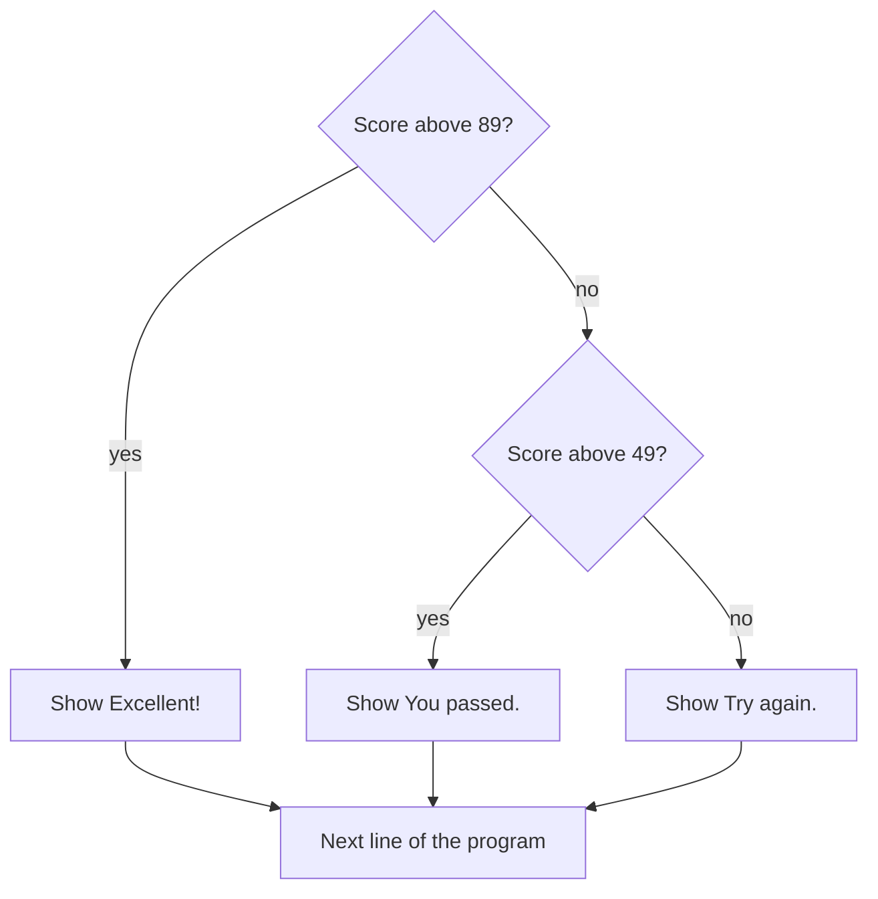

> **In one sentence:** A condition is a test in your code that gives true or false, and if and else use that answer to choose which code runs.

## Why should I care?

In [[what-is-programming|What is Programming, Really?]], the statements of a program ran one after another. A program like that cannot choose.

MDN Web Docs, a website that documents web technologies, gives this example: in a game, "if the player's number of lives is 0, then it's game over".

## Analogy

Think of a fork in a road, where one road splits into two. A sign at the fork asks one question: "Is the bridge open?" Yes means left. No means right. You take one road, never both. In code, the sign is the condition, and the roads are the blocks.

**Where the analogy breaks down:** a driver can think, ask someone, or ignore the sign. The computer works out the answer and follows your code. And an `if` with no `else` has only one extra road: on false, the program goes straight on.

## How it actually works

The code comes in JavaScript, [[python|Python]] and [[go-language|Go]]. You only need to read one tab. Each example is its own separate program.

### A comparison gives a boolean

In [[variables|Variables]], you met the **boolean**: a kind of value that can only be true or false. A **comparison operator** is a sign that compares two values and gives you a boolean. All three languages share these:

| Operator | Question it asks |
|---|---|
| `<` | Is the left value less than the right value? |
| `>` | Is the left value greater than the right value? |

There are also `<=` (less than or equal to) and `>=` (greater than or equal to). In the example below, `age` is 20. `age > 20` gives false and `age >= 20` gives true: 20 is not above 20, but equals 20.

<!-- tabs -->

### JavaScript

`===` asks whether two values are equal. `!==` asks whether they are not equal.

```js
const age = 20;

console.log(age > 18);   // shows true
console.log(age < 18);   // shows false
console.log(age === 20); // shows true
console.log(age !== 20); // shows false
console.log(age > 20);   // shows false
console.log(age >= 20);  // shows true
```

### Python

You make a variable by writing a name, then `=`, then a value. `print()` shows a value on the screen. A comment starts with `#`.

Python asks about equal values with these two signs:

| Operator | Question it asks |
|---|---|
| `==` | Are the two values equal? |
| `!=` | Are the two values not equal? |

Python writes its booleans with a capital letter: `True` and `False`.

```python
age = 20

print(age > 18)   # shows True
print(age < 18)   # shows False
print(age == 20)  # shows True
print(age != 20)  # shows False
print(age > 20)   # shows False
print(age >= 20)  # shows True
```

### Go

A Go program needs a frame around its code. Every Go example on this page has the same one:

- `package main` names the package where a program starts. A package is a way to group functions.
- `import "fmt"` brings in `fmt`, a package with functions that can print text.
- Here, `func` starts a **function**, a piece of code with a name. The function named `main` runs when you run the program. Your code goes between its `{` and `}`.
- `fmt.Println()` shows a value on its own line. A comment starts with `//`.

`age := 20` makes a new variable named `age` and gives it the value 20. `var age = 20` is a longer way to write the same thing. `:=` works only inside a function. Go refuses to compile a program with a variable made inside a function and never used.

Go asks about equal values with these two signs:

| Operator | Question it asks |
|---|---|
| `==` | Are the two values equal? |
| `!=` | Are the two values not equal? |

```go
package main

import "fmt"

func main() {
	age := 20

	fmt.Println(age > 18)  // shows true
	fmt.Println(age < 18)  // shows false
	fmt.Println(age == 20) // shows true
	fmt.Println(age != 20) // shows false
	fmt.Println(age > 20)  // shows false
	fmt.Println(age >= 20) // shows true
}
```

<!-- /tabs -->

### `if`, `else` and `else if` choose a block

A **condition** is the test in an `if`. A **block** is a group of statements that belong together.

- `if` runs a block only when the condition is true.
- `else` gives a second block, for when the condition is false. You can leave it out.
- `else if` adds another test. The tests run from top to bottom, and only the block of the first true test runs.

<!-- tabs -->

### JavaScript

The condition goes between round brackets. A block goes between curly braces, `{` and `}`.

**`if`:**

```js
const temperature = 35;

if (temperature > 30) {
  // This block runs only when the condition is true.
  console.log("It is hot today.");
}

// This line is outside the block, so it always runs.
console.log("Have a good day.");
```

This shows `It is hot today.` and then `Have a good day.` If `temperature` were 12, the program would skip the block and show only `Have a good day.`

**`else`:**

```js
const temperature = 12;

if (temperature > 30) {
  console.log("It is hot today.");
} else {
  // This block runs only when the condition is false.
  console.log("It is not hot today.");
}
```

This shows `It is not hot today.`

**`else if`:**

```js
const score = 72;

if (score > 89) {
  console.log("Excellent!");
} else if (score > 49) {
  // 72 is not above 89, but it is above 49.
  console.log("You passed.");
} else {
  console.log("Try again.");
}
```

This shows `You passed.` If `score` were 95, only `Excellent!` would show, because the program stops testing at the first true test.

### Python

The `if` line ends with a colon, `:`. A block is the group of **indented** lines below it: lines that start with spaces. Python uses indentation to group statements. Each line in a block must be indented by the same amount. (Python's reference calls this group a "suite".)

**`if`:**

```python
temperature = 35

if temperature > 30:
    # This block runs only when the condition is true.
    print("It is hot today.")

# This line is not indented, so it is outside the block. It always runs.
print("Have a good day.")
```

This shows `It is hot today.` and then `Have a good day.` If `temperature` were 12, the program would skip the block and show only `Have a good day.`

**`else`:**

```python
temperature = 12

if temperature > 30:
    print("It is hot today.")
else:
    # This block runs only when the condition is false.
    print("It is not hot today.")
```

This shows `It is not hot today.`

**`elif`:** Python writes `else if` as one word. Its tutorial says `elif` "is short for" else if. Its reference says `if` "selects exactly one" of the blocks. If every test is false and there is no `else`, no block runs.

```python
score = 72

if score > 89:
    print("Excellent!")
elif score > 49:
    # 72 is not above 89, but it is above 49.
    print("You passed.")
else:
    print("Try again.")
```

This shows `You passed.` If `score` were 95, only `Excellent!` would show, because the program stops testing at the first true test.

### Go

The condition comes straight after `if`. A block goes between curly braces, `{` and `}`, and Go always requires them. The `{` must stay on the same line as the end of the condition.

**`if`:**

```go
package main

import "fmt"

func main() {
	temperature := 35

	if temperature > 30 {
		// This block runs only when the condition is true.
		fmt.Println("It is hot today.")
	}

	// This line is outside the block, so it always runs.
	fmt.Println("Have a good day.")
}
```

This shows `It is hot today.` and then `Have a good day.` If `temperature` were 12, the program would skip the block and show only `Have a good day.`

**`else`:**

```go
package main

import "fmt"

func main() {
	temperature := 12

	if temperature > 30 {
		fmt.Println("It is hot today.")
	} else {
		// This block runs only when the condition is false.
		fmt.Println("It is not hot today.")
	}
}
```

This shows `It is not hot today.`

**`else if`:**

```go
package main

import "fmt"

func main() {
	score := 72

	if score > 89 {
		fmt.Println("Excellent!")
	} else if score > 49 {
		// 72 is not above 89, but it is above 49.
		fmt.Println("You passed.")
	} else {
		fmt.Println("Try again.")
	}
}
```

This shows `You passed.` If `score` were 95, only `Excellent!` would show, because the program stops testing at the first true test.

<!-- /tabs -->



### Combining tests with AND, OR and NOT

A **logical operator** works with booleans:

- AND: the result is true only when both sides are true.
- OR: the result is true when at least one side is true.
- NOT: it turns true into false, and false into true.

This shows all three messages.

<!-- tabs -->

### JavaScript

`&&` means AND. `||` (two vertical bars) means OR. `!` means NOT.

```js
const age = 20;
const hasTicket = true;
const isWeekend = false;
const isHoliday = true;

// && : both sides must be true.
if (age > 17 && hasTicket) {
  console.log("You may enter.");
}

// || : at least one side must be true.
if (isWeekend || isHoliday) {
  console.log("No school today.");
}

// ! : turns true into false, and false into true.
if (!isWeekend) {
  console.log("It is not the weekend.");
}
```

How each condition works:

- **First:** `age > 17` gives `true`, and `hasTicket` is `true`. So `&&` gives `true`.
- **Second:** `isHoliday` is `true`, so `||` gives `true`.
- **Third:** `isWeekend` is `false`. `!` turns that into `true`, so the block runs.

(This is simplified. `&&` reads from left to right and stops at the first false side. JavaScript also accepts other values as conditions: `0` counts as false, and `100` counts as true. `&&` and `||` can then give non-boolean values.)

### Python

`and` means AND. `or` means OR. `not` means NOT.

```python
age = 20
has_ticket = True
is_weekend = False
is_holiday = True

# and : both sides must be true.
if age > 17 and has_ticket:
    print("You may enter.")

# or : at least one side must be true.
if is_weekend or is_holiday:
    print("No school today.")

# not : turns True into False, and False into True.
if not is_weekend:
    print("It is not the weekend.")
```

How each condition works:

- **First:** `age > 17` gives `True`, and `has_ticket` is `True`. So `and` gives `True`.
- **Second:** `is_holiday` is `True`, so `or` gives `True`.
- **Third:** `is_weekend` is `False`. `not` turns that into `True`, so the block runs.

(This is simplified. `and` reads from left to right and stops at the first false side. Python also accepts other values as conditions: `0` counts as false, and `100` counts as true. `and` and `or` can then give non-boolean values.)

### Go

`&&` means AND. `||` (two vertical bars) means OR. `!` means NOT.

```go
package main

import "fmt"

func main() {
	age := 20
	hasTicket := true
	isWeekend := false
	isHoliday := true

	// && : both sides must be true.
	if age > 17 && hasTicket {
		fmt.Println("You may enter.")
	}

	// || : at least one side must be true.
	if isWeekend || isHoliday {
		fmt.Println("No school today.")
	}

	// ! : turns true into false, and false into true.
	if !isWeekend {
		fmt.Println("It is not the weekend.")
	}
}
```

How each condition works:

- **First:** `age > 17` gives `true`, and `hasTicket` is `true`. So `&&` gives `true`.
- **Second:** `isHoliday` is `true`, so `||` gives `true`.
- **Third:** `isWeekend` is `false`. `!` turns that into `true`, so the block runs.

(This is simplified. `&&` reads from left to right and stops at the first false side. Every Go condition must give a boolean. The compiler refuses a program that uses a number as a condition, such as `if 100 {`.)

<!-- /tabs -->

## How it came to be

Charles Babbage conceived his Analytical Engine, a programmable computing machine, in 1834. The Computer History Museum says "none of Babbage's designs was physically realized in its entirety in his lifetime". It lists "conditional branching" among this design's functions. That modern name means moving to different instructions, depending on some condition. Babbage himself did not use it.

The words `if` and `else` appear in Algol 60, a programming language discussed in Paris in January 1960. Its revised report says: "Conditional statements cause certain statements to be executed or skipped".

## 🧪 Try it in your browser

These steps use JavaScript, whichever tab you chose, because your browser's console runs it. Here, `let` makes a variable, and `console.log` shows a value. The test goes in `( )`, and `{ }` holds a block. `&&` means AND, and `;` ends a statement.

You need a computer with Chrome, Edge or Firefox.

**Safety rule:** only type code in the console that you understand or that comes from a source you trust. Never paste anything a stranger sends you. The lines below only create a variable, give it values, compare numbers and show messages in the console.

1. Open [example.com](https://example.com).
   **What you should see:** a short page of text. The tab's title is **Example Domain**.
2. Open the **console**:
   - **Windows:** press `Ctrl` + `Shift` + `J` (in Firefox: `Ctrl` + `Shift` + `K`)
   - **Mac:** press `Cmd` + `Option` + `J` (in Firefox: `Cmd` + `Option` + `K`)

   Ignore any messages already there.
3. Click the line where you can type, below any messages. **Type** this line yourself (some browsers may block pasting at first), then press `Enter`:

   ```
   let score = 70
   ```

   **What you should see:** no message from your code. The console may also show `undefined`. This is normal.
4. Type this line and press `Enter`:

   ```
   score > 50
   ```

   **What you should see:** `true`.
5. Type this as one line and press `Enter`:

   ```
   if (score > 50) { console.log("You passed"); } else { console.log("Try again"); }
   ```

   **What you should see:** `You passed`. The console may also show `undefined`. This is normal. There is no semicolon after `}`, because a block does not need one.

   The browser may show suggestions, and the line may look different while you type. Keep typing. If `Enter` gives a new line and no answer, the code may be incomplete. Delete what you typed with `Backspace`, and type the line again.
6. Type this line and press `Enter`:

   ```
   score = 40
   ```

   **What you should see:** `40`.
7. Type the line from step 5 again and press `Enter`.
   **What you should see:** `Try again`. The code is the same, but the value changed, so the other block ran.
8. Type this line and press `Enter`:

   ```
   score > 30 && score < 50
   ```

   **What you should see:** `true`. 40 is above 30 and below 50.

If you see an error message, look for a typo. If it is about `score`, click your browser's reload button and start again from step 3.

**On a phone:** read steps 4 and 8, and say what each line will show.

## Common misunderstandings

<!-- tabs -->

### JavaScript

- **"`=` and `===` mean the same thing."** No. `=` puts a value into a variable. `===` compares two values. MDN says you "should almost never" use `=` as a condition. This code has that mistake:

  ```js
  let score = 40;

  // A mistake: one = sets score to 100. It does not compare.
  if (score = 100) {
    console.log("Full marks!");
  }

  console.log(score); // shows 100, and the 40 is gone
  ```

  It shows `Full marks!` and then `100`. An assignment also gives the value it assigned, as the console showed you in Variables. So the condition receives 100, which counts as true.
- **"`1` and `"1"` are equal."** Not with `===`. A number and a string are different kinds of value, so `"1" === 1` gives `false`. JavaScript also has `==`, which tries to convert different kinds first, so `"1" == 1` gives `true`.
- **"A `let` or `const` variable made inside a block can be used after the block."** No. MDN says these are "scoped to the containing block". Scope is the part of the code where a name can be used.

  ```js
  const temperature = 35;

  if (temperature > 30) {
    let message = "It is hot.";
    console.log(message); // inside the block, this works
  }

  console.log(message); // outside the block, this gives an error
  ```

  If another variable named `message` exists outside the block, there is no error, and that other variable is used. The older `var` is different: such a variable can still be used outside an `if` block. To use a `let` variable later, make it before the `if`:

  ```js
  const temperature = 35;
  let message = "It is not hot."; // made outside the block

  if (temperature > 30) {
    message = "It is hot."; // a new value, from inside the block
  }

  console.log(message); // shows It is hot.
  ```

### Python

- **"`=` and `==` mean the same thing."** No. `=` puts a value into a variable. `==` compares two values. Python refuses a single `=` as a condition. Its tutorial says this avoids typing `=` "when `==` was intended".

  ```python
  score = 40

  # A mistake: one = is not allowed in a condition.
  if score = 100:
      print("Full marks!")
  ```

  This gives a `SyntaxError`, an error about how the code is written. Write `if score == 100:` instead. (Python also has `:=`, which can put a value into a variable inside a condition. This page does not cover it.)
- **"`1` and `"1"` are equal."** No. `1` is a number and `"1"` is a string. Python's documentation says that different kinds of value "never compare equal", unless it states otherwise. So `"1" == 1` gives `False`.
- **"In Python, a variable made inside an `if` block cannot be used after the block."** It can, if the block ran.

  ```python
  temperature = 35

  if temperature > 30:
      message = "It is hot."  # made inside the block

  print(message)  # outside the block, this still works: shows It is hot.
  ```

  If `temperature` were 12, the block would not run, so `message` would not exist. The last line would then give a `NameError`, the error for a name that is not found. To use the variable either way, make it before the `if`:

  ```python
  temperature = 12
  message = "It is not hot."  # made before the if

  if temperature > 30:
      message = "It is hot."  # a new value, from inside the block

  print(message)  # shows It is not hot.
  ```

### Go

- **"`=` and `==` mean the same thing."** No. `=` puts a new value into a variable that already exists. `==` compares two values. Go's compiler refuses a single `=` as a condition, so this program never runs:

  ```go
  package main

  import "fmt"

  func main() {
  	score := 40

  	// A mistake: one = is not allowed as a condition.
  	if score = 100 {
  		fmt.Println("Full marks!")
  	}
  }
  ```

  You see an error message. Write `if score == 100 {` instead.
- **"`1` and `"1"` are equal."** No. A number and a string are different kinds of value. Go compares only values whose kinds fit together. So the compiler refuses `"1" == 1`, and the program does not run.
- **"A variable made inside a block can be used after the block."** No. Go's specification says the scope of such a variable "ends at the end of the innermost containing block". Scope is the part of the code where a name can be used.

  ```go
  package main

  import "fmt"

  func main() {
  	temperature := 35

  	if temperature > 30 {
  		message := "It is hot."
  		fmt.Println(message) // inside the block, this works
  	}

  	fmt.Println(message) // outside the block, the compiler refuses this
  }
  ```

  To use the variable later, make it before the `if`. Inside the block, write `=`, because `:=` would make a second variable that exists only in the block:

  ```go
  package main

  import "fmt"

  func main() {
  	temperature := 35
  	message := "It is not hot." // made outside the block

  	if temperature > 30 {
  		message = "It is hot." // a new value, from inside the block
  	}

  	fmt.Println(message) // shows It is hot.
  }
  ```

<!-- /tabs -->

## Recap

- A comparison such as `age > 18` gives a boolean, and logical operators work with booleans.
- `if` runs a block when its condition is true and `else` when it is false. With more tests, only the block of the first true test runs.
- `=` stores a value in a variable. `===` in JavaScript, and `==` in Python and Go, compare two values.

## Sources

- MDN Web Docs, About MDN: https://developer.mozilla.org/en-US/about
- MDN Web Docs, Making decisions in your code, conditionals: https://developer.mozilla.org/en-US/docs/Learn_web_development/Core/Scripting/Conditionals
- MDN Web Docs, if...else: https://developer.mozilla.org/en-US/docs/Web/JavaScript/Reference/Statements/if...else
- MDN Web Docs, Block statement: https://developer.mozilla.org/en-US/docs/Web/JavaScript/Reference/Statements/block
- MDN Web Docs, var: https://developer.mozilla.org/en-US/docs/Web/JavaScript/Reference/Statements/var
- MDN Web Docs, Control flow and error handling: https://developer.mozilla.org/en-US/docs/Web/JavaScript/Guide/Control_flow_and_error_handling
- MDN Web Docs, Assignment (=): https://developer.mozilla.org/en-US/docs/Web/JavaScript/Reference/Operators/Assignment
- MDN Web Docs, Lexical grammar: https://developer.mozilla.org/en-US/docs/Web/JavaScript/Reference/Lexical_grammar
- MDN Web Docs, Strict equality (===): https://developer.mozilla.org/en-US/docs/Web/JavaScript/Reference/Operators/Strict_equality
- MDN Web Docs, Strict inequality (!==): https://developer.mozilla.org/en-US/docs/Web/JavaScript/Reference/Operators/Strict_inequality
- MDN Web Docs, Equality (==): https://developer.mozilla.org/en-US/docs/Web/JavaScript/Reference/Operators/Equality
- MDN Web Docs, Less than (<): https://developer.mozilla.org/en-US/docs/Web/JavaScript/Reference/Operators/Less_than
- MDN Web Docs, Greater than (>): https://developer.mozilla.org/en-US/docs/Web/JavaScript/Reference/Operators/Greater_than
- MDN Web Docs, Logical AND (&&): https://developer.mozilla.org/en-US/docs/Web/JavaScript/Reference/Operators/Logical_AND
- MDN Web Docs, Logical OR (||): https://developer.mozilla.org/en-US/docs/Web/JavaScript/Reference/Operators/Logical_OR
- MDN Web Docs, Logical NOT (!): https://developer.mozilla.org/en-US/docs/Web/JavaScript/Reference/Operators/Logical_NOT
- MDN Web Docs, Boolean (glossary): https://developer.mozilla.org/en-US/docs/Glossary/Boolean
- MDN Web Docs, Scope (glossary): https://developer.mozilla.org/en-US/docs/Glossary/Scope
- MDN Web Docs, ReferenceError, variable is not defined: https://developer.mozilla.org/en-US/docs/Web/JavaScript/Reference/Errors/Not_defined
- MDN Web Docs, eval(): https://developer.mozilla.org/en-US/docs/Web/JavaScript/Reference/Global_Objects/eval
- MDN Web Docs, console.log(): https://developer.mozilla.org/en-US/docs/Web/API/console/log_static
- MDN Web Docs, Storing the information you need, variables: https://developer.mozilla.org/en-US/docs/Learn_web_development/Core/Scripting/Variables
- MDN Web Docs, Truthy (glossary): https://developer.mozilla.org/en-US/docs/Glossary/Truthy
- Computer History Museum, The Engines: https://www.computerhistory.org/babbage/engines/
- Wikipedia, Branch (computer science): https://en.wikipedia.org/wiki/Branch_(computer_science)
- Revised Report on the Algorithmic Language Algol 60: https://www.masswerk.at/algol60/report.htm
- Example Domain: https://example.com
- Chrome for Developers, Open Chrome DevTools: https://developer.chrome.com/docs/devtools/open
- Microsoft Edge DevTools, Keyboard shortcuts: https://learn.microsoft.com/en-us/microsoft-edge/devtools/shortcuts/
- Firefox DevTools User Docs, Web Console: https://firefox-source-docs.mozilla.org/devtools-user/web_console/index.html
- Chrome for Developers, What are self-XSS attacks?: https://developer.chrome.com/blog/self-xss
- Microsoft Edge DevTools, Run JavaScript in the Console: https://learn.microsoft.com/en-us/microsoft-edge/devtools/console/console-javascript
- Firefox DevTools User Docs, Web Console Interpreter: https://firefox-source-docs.mozilla.org/devtools-user/web_console/the_command_line_interpreter/index.html
- Python Tutorial, An Informal Introduction to Python: https://docs.python.org/3/tutorial/introduction.html
- Python Tutorial, More Control Flow Tools: https://docs.python.org/3/tutorial/controlflow.html
- Python Tutorial, Data Structures: https://docs.python.org/3/tutorial/datastructures.html
- Python Language Reference, Compound statements: https://docs.python.org/3/reference/compound_stmts.html
- Python Language Reference, Expressions: https://docs.python.org/3/reference/expressions.html
- Python Language Reference, Lexical analysis: https://docs.python.org/3/reference/lexical_analysis.html
- Python Language Reference, Execution model: https://docs.python.org/3/reference/executionmodel.html
- Python documentation, Built-in Types: https://docs.python.org/3/library/stdtypes.html
- Python documentation, Built-in Exceptions: https://docs.python.org/3/library/exceptions.html
- The Go Programming Language Specification: https://go.dev/ref/spec
- The Go Programming Language, Effective Go: https://go.dev/doc/effective_go
- Go, Frequently Asked Questions (FAQ): https://go.dev/doc/faq
- Go Tutorial, Get started with Go: https://go.dev/doc/tutorial/getting-started
- Go Packages, fmt: https://pkg.go.dev/fmt
