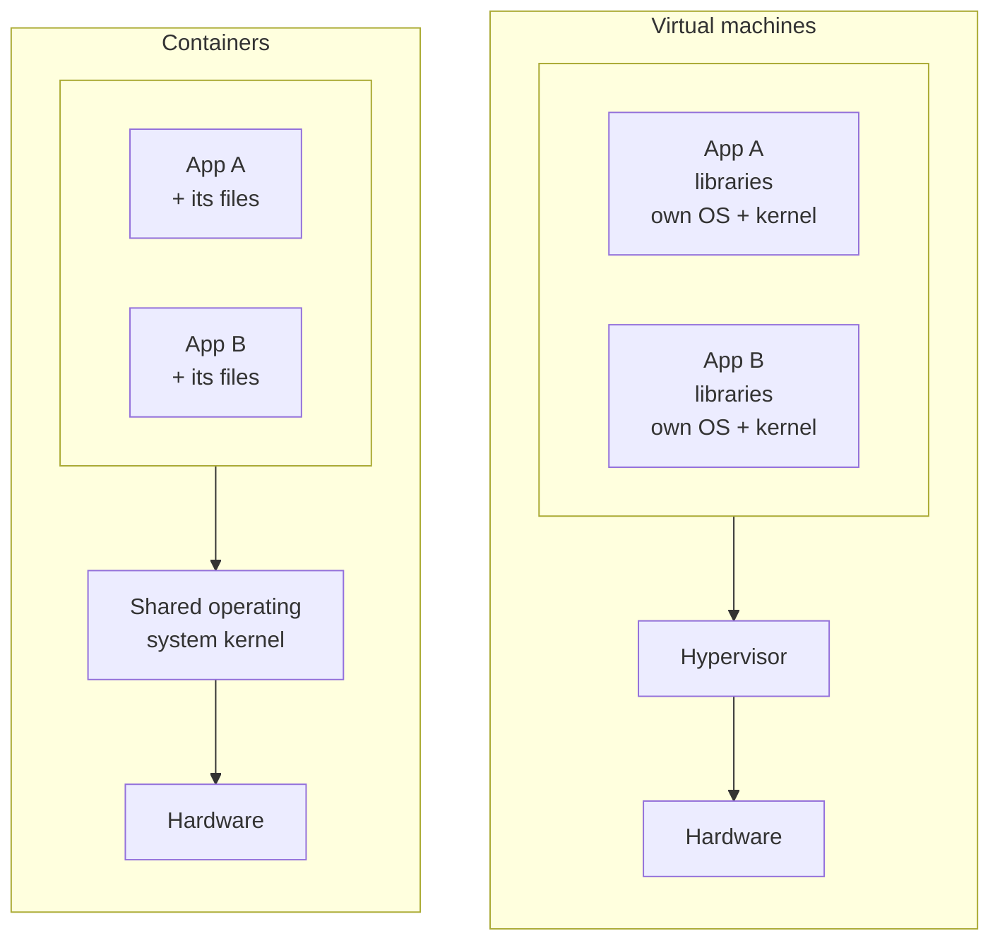

> **In one sentence:** A container is a program packed with the files and libraries it needs, running as an isolated process that shares the computer's operating system kernel, so it can run the same way on many different machines.

## Why should I care?

A program rarely runs alone. It needs **libraries** (ready-made code that programs use), the right version of its tools, and some settings. Your computer may differ from your teammates' or from the [[server|server]].

**Docker** is a set of products for packing software into containers and running them. A company, Docker, Inc., makes it. Docker's guide warns: "Each difference is a chance for the app to work on one machine and fail on another." Docker says containers package "an app together with everything it needs to run".

## Analogy

Think of a **packed suitcase**. With it, you can stay in any hotel, because you do not depend on what the room has. But every guest shares the same hotel building.

A container is like the suitcase. The shared building is the computer's **kernel**, explained below.

**Where the analogy breaks down:** a suitcase holds things but does nothing. A container is a running program. Also, one packed suitcase cannot become ten. One container image can start many identical containers.

## How it actually works

### The image: the packed copy

A **container image** is, in Docker's words, "a package of everything a container needs to start". That includes [[operating-system|operating system]] files, the program's code and its **dependencies** (the libraries it depends on). It also holds "settings such as which command to run".

Docker says: "Once built, an image never changes."

### The container: a running image

Docker defines a container as "an ordinary process on your computer" that "runs in isolation". You met [[processes|processes]]: a process is a running program, with its own memory. A container adds more separation:

- **Its own files.** It sees only the files it started with, which come from the image. "It can't see your files, and your other projects can't see its files."
- **Its own view.** It sees its own processes, network settings and computer name (hostname), "not the rest of your machine's".

### Sharing the kernel

The **kernel** is "the core of the operating system that talks to the hardware", says Docker.

In [[virtual-machines|Virtual Machines]], each guest ran its own operating system. Docker says every virtual machine "boots its own complete operating system, including its own kernel". A container does not. "It's still a process, so every container on a machine shares that machine's kernel."



### Why that matters

There is no operating system to boot. Docker says this is "why a container starts in about a second", and why one machine can run many of them. AWS adds that container files are smaller: "you can measure them in MB". Virtual machine images are "several GB" (gigabytes), "as they contain their own operating system".

There is a cost: Docker says a virtual machine's isolation is stronger. Virtual machines are separated by "the hardware boundary the hypervisor creates". Containers are separated by the kernel they share.

### The recipe and the registry

You build an image "from a recipe called a Dockerfile", says Docker. Here is one from Docker's guide; you do not need to run it.

```dockerfile
FROM node:22
WORKDIR /usr/local/app
COPY backend ./
RUN npm ci
EXPOSE 3000
CMD ["node", "src/index.js"]
```

1. `FROM` picks a **base image** to build on top of: an image can start from another image. `node:22` already has [[nodejs|Node.js]] 22 installed, a program that runs JavaScript code outside the browser.
2. `WORKDIR` chooses a folder inside the image, `/usr/local/app`, to work in.
3. `COPY` copies the project's `backend` folder into that folder (`./`) in the image.
4. `RUN` runs a command while the image is built. `npm` is "the standard package manager for Node.js": a tool that installs [[packages|packages]] (shared code). `npm ci` installs exactly the versions listed in the project's lock file, `package-lock.json`.
5. `EXPOSE` records which **port** the program listens on: a number that identifies the program for network messages. It does not open the port.
6. `CMD` sets the command a container runs each time it starts.

Images are shared through a **registry**: "a service that stores images so anyone with access can pull them" (download them). Docker's public registry is **Docker Hub**.

Docker says a packed app "runs the same way on every machine that has Docker": a laptop, a server or a cloud computer.

## How AWS does it

AWS (Amazon Web Services) describes its container services like this:

- **Amazon ECS** (Elastic Container Service) helps you start, look after and change the number of your running containers.
- **Amazon EKS** (Elastic Kubernetes Service) is a Kubernetes service that AWS runs for you. **Kubernetes** is a "platform for managing containerized workloads and services": programs packed in containers, says its own documentation.
- **Amazon ECR** (Elastic Container Registry) is "an AWS managed container image registry service".
- **AWS Fargate** lets you "run containers without having to manage servers or clusters" (groups) of EC2 instances, AWS's virtual machines. You package your program in containers and run them as **tasks**. AWS gives each Fargate task "its own isolation boundary": a separate wall around it. So on Fargate, separate tasks do not share a kernel.

## How it came to be

Docker was first shown to the public in 2013, says Wikipedia.

In June 2015, Docker and other companies launched the **Open Container Initiative** (OCI). Its purpose is "creating open industry standards around container formats and runtimes": shared rules for images and for the programs that run them.

## 🧪 Try it in your browser

You will look at a real image in a real registry. You need no account, and you install nothing.

1. In Chrome, Edge or Firefox, open `https://hub.docker.com/_/node`. This is the Node.js image that the Dockerfile above started from. The heading is **node**, with the label **Docker Official Image**. The page may look different. If a box about cookies or signing in appears, you can close it.
2. Scroll down to the heading **Supported tags and respective `Dockerfile` links**. Below it is a list of tags. A **tag** names one image, "usually a version or variant" (another form of it), says Docker. The heading means each tag, or group of tags, links to the Dockerfile that builds it.

**What you should see:** an image page in a registry, with a list of tag names. The list changes over time. Close the tab when you are done.

**What this shows:** images are shared through registries, and their recipes (Dockerfiles) can be shared too.

## Common misunderstandings

- **"A container is a small virtual machine."** No. A container has no kernel of its own. It is a process that shares the host's kernel.
- **"A container runs on any computer."** Not quite. Docker says Linux containers "need a Linux kernel to share". On macOS and Windows, Docker's app Docker Desktop runs them inside a small Linux virtual machine.

## Recap

- A container image packs a program with its libraries and settings. It never changes once built.
- A running container is an isolated process that shares the computer's kernel, unlike a virtual machine with its own operating system.
- Images are built from a Dockerfile and shared through a registry. On AWS, ECS, EKS and Fargate run containers, and ECR stores images.

## Sources

- Docker Learn, What is a container?: https://docs.docker.com/learn/content/what-is-a-container/
- Docker Learn, Write your first Dockerfile: https://docs.docker.com/learn/content/write-your-first-dockerfile/
- Docker Hub, node (Docker Official Image): https://hub.docker.com/_/node
- AWS, What is containerization?: https://aws.amazon.com/what-is/containerization/
- AWS, What's the difference between containers and virtual machines?: https://aws.amazon.com/compare/the-difference-between-containers-and-virtual-machines/
- Wikipedia, Library (computing) (general background reference): https://en.wikipedia.org/wiki/Library_(computing)
- Wikipedia, Docker (software): https://en.wikipedia.org/wiki/Docker_(software)
- Wikipedia, Docker, Inc.: https://en.wikipedia.org/wiki/Docker,_Inc.
- Node.js, Introduction to Node.js: https://nodejs.org/en/learn/getting-started/introduction-to-nodejs
- Node.js, An introduction to the npm package manager: https://nodejs.org/en/learn/getting-started/an-introduction-to-the-npm-package-manager
- Open Container Initiative, About the OCI: https://opencontainers.org/about/overview/
- AWS documentation, What is Amazon Elastic Container Service?: https://docs.aws.amazon.com/AmazonECS/latest/developerguide/Welcome.html
- AWS documentation, What is Amazon Elastic Container Registry?: https://docs.aws.amazon.com/AmazonECR/latest/userguide/what-is-ecr.html
- AWS documentation, Architect for AWS Fargate for Amazon ECS: https://docs.aws.amazon.com/AmazonECS/latest/developerguide/AWS_Fargate.html
- AWS documentation, What is Amazon EKS?: https://docs.aws.amazon.com/eks/latest/userguide/what-is-eks.html
- Kubernetes documentation, Overview: https://kubernetes.io/docs/concepts/overview/
- Wikipedia, Port (computer networking): https://en.wikipedia.org/wiki/Port_(computer_networking)
