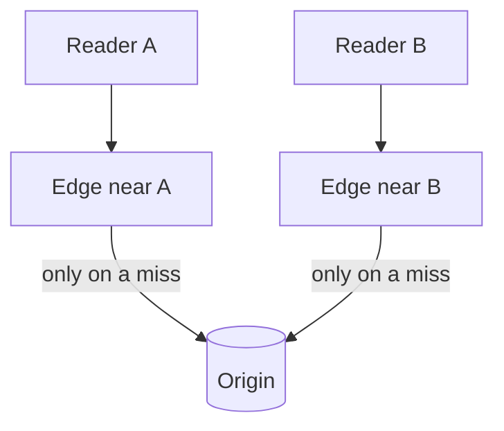

> **In one sentence:** A content delivery network (CDN) keeps copies of a website's files on servers in many places around the world, so each reader can get them from a server near them instead of from the one original server.

## Why should I care?

In [[caching]] you met the CDN in one line: a shared cache made of "a group of servers spread out over many locations".

In [[regions-and-availability-zones]] you saw that AWS (Amazon Web Services) says you can lower latency with a Region close to "the majority of your users". **Latency** is "the network time it takes for a requested resource to reach its destination", says MDN, a website that documents web technologies. But readers may live on every continent, and MDN notes that distance affects latency. A CDN brings copies closer to all of them, so a website can load quickly even far from its own server.

## Analogy

Think of a **newspaper** printed in one city. Readers do not travel there. Copies go to **kiosks in many towns**, and each reader buys one at the nearest kiosk. The printing house is the original server, and the kiosks are the CDN's servers.

**Where the analogy breaks down:** a kiosk gets its copies before anyone asks. At AWS's CDN, a server near the reader gets a file only after someone asks for it.

## How it actually works

### The origin and the edges

The **origin** (or origin server) is the server that holds the original files. AWS says it "stores the original, definitive version" of them.

A CDN adds many other servers, in data centers spread around the world. AWS calls these places **edge locations**, or **points of presence** (POPs). Each one keeps copies: it is a shared cache.

### What happens on a request

AWS describes these steps:

1. A reader's browser asks for a file, such as a picture.
2. First the browser asks [[dns|DNS]] for the address of the website's name. AWS says: "DNS routes the request to the CloudFront POP (edge location) that can best serve the request, typically the nearest CloudFront POP in terms of latency." So the browser's request goes to a nearby edge.
3. The edge checks its cache. On a **cache hit**, it sends its copy right away.
4. On a **cache miss**, it asks the origin for the file. It passes the file on to the reader, and keeps a copy "for the next time someone requests it".

(This is simplified. CloudFront also has bigger caches, called regional edge caches, between the origin and the edges. And DNS is one way to choose an edge: Wikipedia says "a variety of algorithms" (methods) are used.)

### Why use one

- **Faster answers.** The copy comes from nearby, so latency is lower.
- **Less work for the origin.** AWS says that keeping files longer in the cache "reduces the load on your origin": the work the origin must do.
- **Big crowds.** MDN says CDNs give "fast service less affected by high traffic".

### What gets cached, and what does not

Cloudflare, a company that runs a CDN, says its cache stores "frequently accessed content (such as images, videos, or webpages)". But by default, its CDN "does not cache HTML": the language that "specifies webpage structure", MDN says. A site owner can change this with Cloudflare's Cache Rules, which adjust "what is eligible to cache", for example "on HTML content".

Pages meant for one person are different. As you saw in [[caching]], a server can mark them `Cache-Control: private`. Cloudflare says it "**does not** cache the resource" when that header is set.

## How AWS does it

AWS's CDN is called **Amazon CloudFront**. Its files "typically include web pages, images, and media files".

- **Origins.** An origin can be "an Amazon S3 bucket or your own HTTP server". Amazon S3 is AWS's storage service. It calls each stored file an **object**, and a bucket "is a container for objects" (see [[object-storage]]).
- **How long copies last.** Each copy has a **TTL** (time to live): how long it counts as fresh, like `max-age` in [[caching]]. AWS says: "By default, each file stays in an edge location for 24 hours before it expires." (That was its guide in November 2026.) The origin can set another time with `max-age`. After a copy expires, CloudFront asks the origin whether the file has changed.
- **Removing copies early.** A "cache invalidation request" removes a file from the edges before it expires.

Other companies run CDNs too. Besides Cloudflare, Akamai also runs one: its own guide speaks of "Akamai's CDN services".

## How it came to be

Wikipedia says CDNs "arose in the late 1990s to alleviate the performance bottlenecks of the Internet": to ease the places where traffic got stuck. On November 18, 2008, AWS announced "the public beta of Amazon CloudFront". A public beta is a test version that anyone can use, and it may still have bugs.

## 🧪 Try it in your browser

You need a computer. These steps only look, and they change no settings.

1. Open a new tab in Chrome, Edge or Firefox.
2. Open the developer tools: `F12` or `Ctrl` + `Shift` + `I` on Windows, `Cmd` + `Option` + `I` on Mac. If `F12` does nothing, try the other keys.
3. Click the **Network** tab. In Edge, if you do not see it, click the **More tools** button and choose **Network**.
4. Click the address bar, type `https://developers.cloudflare.com/cache/concepts/cache-responses/` and press `Enter`. You will read this page in a moment. It explains the `cf-cache-status` header, which "indicates whether a resource is cached or not". First, look at the headers of the page itself.
5. Click the first row in the list. A details area opens. Click its **Headers** tab.
6. Under **Response Headers** (Firefox: **Response headers**), look for the line named `cf-cache-status`. It may have small or capital letters.

**What you may see:** one word after it, such as `HIT`, `MISS` or `DYNAMIC`. Your word may be different.

Now read the page. It has a heading for each word (some headings name two words). `HIT` means "The resource was found in Cloudflare's cache." `MISS` means it was not there, "so it was served from the origin web server". `DYNAMIC` means the file was not allowed in the cache, so the request went to the origin. Find the heading for your word. If you do not find the line, you did nothing wrong. Close the tab when you are done.

## Common misunderstandings

- **"Every edge holds a copy of the whole website."** No. At CloudFront, an edge gets a file when a reader asks for it. It might also remove a file that is not requested often, "to make room".
- **"When I change a file, every reader sees the new one right away."** No. AWS says CloudFront normally serves a file from an edge "until the file expires", unless you remove it early.

## Recap

- A CDN keeps copies of a website's files at edge locations around the world. The origin keeps the originals.
- A request goes to a nearby edge. A hit uses its copy, and a miss fetches the file from the origin.
- At AWS, the CDN is Amazon CloudFront. Its origin can be an S3 bucket, and a TTL says how long copies last.

## Sources

- MDN Web Docs, CDN (glossary): https://developer.mozilla.org/en-US/docs/Glossary/CDN
- MDN Web Docs, HTTP caching: https://developer.mozilla.org/en-US/docs/Web/HTTP/Guides/Caching
- MDN Web Docs, About MDN: https://developer.mozilla.org/en-US/about
- MDN Web Docs, HTML (glossary): https://developer.mozilla.org/en-US/docs/Glossary/HTML
- MDN Web Docs, Latency (glossary): https://developer.mozilla.org/en-US/docs/Glossary/Latency
- AWS documentation, AWS Regions: https://docs.aws.amazon.com/global-infrastructure/latest/regions/aws-regions.html
- Wikipedia, Content delivery network (general background reference): https://en.wikipedia.org/wiki/Content_delivery_network
- Wikipedia, Software release life cycle (general background reference): https://en.wikipedia.org/wiki/Software_release_life_cycle
- Amazon CloudFront Developer Guide, What is Amazon CloudFront?: https://docs.aws.amazon.com/AmazonCloudFront/latest/DeveloperGuide/Introduction.html
- Amazon CloudFront Developer Guide, How CloudFront delivers content: https://docs.aws.amazon.com/AmazonCloudFront/latest/DeveloperGuide/HowCloudFrontWorks.html
- Amazon CloudFront Developer Guide, Manage how long content stays in the cache (expiration): https://docs.aws.amazon.com/AmazonCloudFront/latest/DeveloperGuide/Expiration.html
- Amazon S3 User Guide, What is Amazon S3?: https://docs.aws.amazon.com/AmazonS3/latest/userguide/Welcome.html
- AWS What's New, Announcing Amazon CloudFront (November 18, 2008): https://aws.amazon.com/about-aws/whats-new/2008/11/18/whats-new-cloudfront
- Cloudflare Docs, Cloudflare Cache: https://developers.cloudflare.com/cache/
- Cloudflare Docs, Default cache behavior: https://developers.cloudflare.com/cache/concepts/default-cache-behavior/
- Cloudflare Docs, Cache Rules: https://developers.cloudflare.com/cache/how-to/cache-rules/
- Cloudflare Docs, Cloudflare cache responses: https://developers.cloudflare.com/cache/concepts/cache-responses/
- Akamai, What is a CDN?: https://www.akamai.com/glossary/what-is-a-cdn
- Chrome for Developers, Open Chrome DevTools: https://developer.chrome.com/docs/devtools/open
- Chrome for Developers, Network features reference: https://developer.chrome.com/docs/devtools/network/reference
- Microsoft Edge DevTools, Keyboard shortcuts: https://learn.microsoft.com/en-us/microsoft-edge/devtools/shortcuts/
- Microsoft Edge DevTools, Network tool: https://learn.microsoft.com/en-us/microsoft-edge/devtools/network/
- Firefox DevTools User Docs, index: https://firefox-source-docs.mozilla.org/devtools-user/index.html
- Firefox DevTools User Docs, Network request details: https://firefox-source-docs.mozilla.org/devtools-user/network_monitor/request_details/index.html
