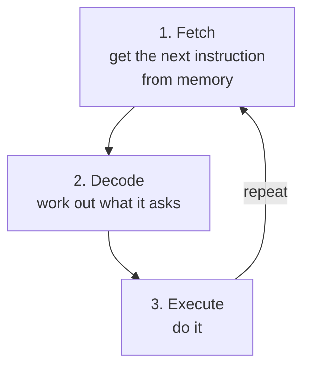

> **In one sentence:** The CPU (Central Processing Unit) is the part of a computer that carries out a program's instructions, one small step at a time, using circuits built from logic gates.

## Why should I care?

In [[what-is-a-computer]], you met the **processor**, or **CPU**: the part that does the processing. Every app on your laptop or phone works because a CPU carries out its instructions. You may have seen CPU words such as "cores" and "GHz" when reading about computers. After this page, you will know what they mean.

Every program you write will, in the end, be carried out by a CPU.

## Analogy

Think of a **worker at a desk**. On the desk is a long, numbered list of tiny tasks, and a **bookmark** that marks the next task. The worker also has a **calculator** and a few small **notes** for numbers in use right now.

The worker repeats the same three steps:

1. Read the task at the bookmark.
2. Work out what the task asks.
3. Do it, then move the bookmark to the next task.

Some tasks say "go to task 12". Then the worker moves the bookmark to task 12 instead.

**Where the analogy breaks down:** the worker understands the tasks. A CPU understands nothing. Its instructions are numbers in [[binary]], and its circuits react to those numbers in a fixed way. Also, a worker needs seconds for each task. A CPU can carry out billions of instructions every second.

## How it actually works

### Where the instructions wait

A program's instructions are kept in the computer's **memory** (RAM), which you met in "What is a Computer?". Each instruction is stored as a pattern of bits.

### The main parts

- The **control unit** decodes each instruction, like the worker working out a task. It turns the instruction's bits into **control signals**: electrical signals that tell the other parts what to do.
- The **ALU** (Arithmetic Logic Unit) does arithmetic, such as adding, and logic operations, which follow rules like those in [[logic-gates]]. It is like the worker's calculator.
- **Registers** are a few very small memory places inside the CPU. They hold the numbers the CPU is working on right now, like the worker's notes.
- The **program counter** is a special register. It holds the memory address (the location in memory) of the next instruction, like the bookmark.

### The cycle: fetch, decode, execute

In the simplest picture, the CPU repeats one cycle, again and again:



After a fetch, the program counter usually moves on to the next instruction in memory. Some instructions, called **jumps**, change the program counter to point somewhere else. This is like "go to task 12".

### The clock

A part called the **clock** sends out electrical pulses, called **ticks**, at a very precise rate. The ticks set the pace of the fetch-decode-execute cycle.

Clock speed is measured in **hertz** (Hz). One hertz is one cycle per second. For the clock, one cycle is one tick (not one full fetch-decode-execute cycle). "Giga" means billion (1,000,000,000), so a 2 gigahertz (GHz) clock ticks 2 billion times per second.

### How gates add numbers

You have seen the AND, OR and NOT gates. Here is how gates can add two bits. In binary, 1 + 1 is 2, which is written `10`: you write 0 and **carry** 1 to the next position, like carrying in normal addition.

```
A  B  |  sum  carry
0  0  |   0     0
0  1  |   1     0
1  0  |   1     0
1  1  |   0     1
```

*Diagram: adding two bits, A and B. The sum is the right-hand bit of the answer. The carry is the bit that moves to the next position.*

Look at the columns:

- The **carry** is 1 only when both inputs are 1. That is the AND rule.
- The **sum** is 1 when exactly one input is 1. That is a gate called **XOR**. (XOR can be built from AND, OR and NOT gates.)

So one XOR gate and one AND gate, side by side, add two bits. This circuit is called a **half adder**. A bigger circuit, the **full adder**, also takes in a carry from the position on its right. When full adders are chained together, each one passes its carry to the next. Together they can add numbers with many bits. Processors use adders like these in their ALU.

The control unit and the registers are also built from logic gates. Their circuits are too large to show here.

### Cores

Stanford's course says: "Modern CPU chips have multiple 'cores'". Each core is "a semi-independent CPU", so it can follow its own list of instructions.

## How it came to be

Early computers were built from many separate parts. [[eniac|ENIAC]], shown to the public in 1946, used about 18,000 vacuum tubes as its switches.

Later came [[transistor|transistors]], and then chips that hold many transistors on one small piece of material. In 1971, Intel made the **4004**, its first CPU on a single chip. According to the Computer History Museum, Ted Hoff and Stanley Mazor had the idea for it. Federico Faggin, helped by Masatoshi Shima, fit its 2,300 transistors into one low-cost case. A CPU on a single chip is called a [[microprocessor]].

## 🧪 Try it in your browser

You will ask your browser how many processors it can use. You need a computer with a keyboard.

**Safety rule:** only type instructions in the console that you understand or that come from a source you trust. Never paste anything a stranger sends you. The instructions below are safe: they only read a number and add two numbers.

1. In Chrome, Edge or Firefox, open any ordinary web page, for example `https://example.com`.
2. Open the console:
   - **Windows:** press `Ctrl` + `Shift` + `J` (in Firefox: `Ctrl` + `Shift` + `K`)
   - **Mac:** press `Cmd` + `Option` + `J` (in Firefox: `Cmd` + `Option` + `K`)
3. Click the empty line at the bottom. **Type** this line yourself (some browsers block pasting in the console), then press `Enter`:

   ```
   navigator.hardwareConcurrency
   ```

   Capital letters matter: type a capital `C` in `Concurrency`. You should see a whole number, such as 4, 8 or 12. This number counts **logical processors**. Many cores can follow more than one list of instructions at once, so the browser may count such a core more than once: a 4-core CPU may show 8. The browser may also report a smaller number than the real one.
4. Type `25 + 17` and press `Enter`. You should see `42`. To work out this answer, your CPU fetched, decoded and executed many of the browser program's instructions.
5. Close the tab.

**On a phone:** cover the "sum" and "carry" columns of the table above with your finger. Work out each row yourself, then check.

## Common misunderstandings

- **"The CPU stores my files."** No. Stanford's course says the CPU does the active "running" of code, while RAM and storage have "a more passive role, such as storing data".
- **"4 cores make a computer 4 times faster."** No. Stanford's course says: "having 4 cores is not 4x faster than having 1 core".
- **"The CPU thinks."** No. It follows instructions exactly, using circuits made of logic gates.

## Recap

- The CPU carries out a program's instructions, which wait in memory as bits.
- It repeats one cycle: fetch an instruction, decode it, execute it. A clock keeps the steps in time.
- Inside, logic gates do the work. For example, an XOR gate and an AND gate together add two bits.

## Sources

- Stanford CS101, Computer Hardware: https://web.stanford.edu/class/cs101/hardware-1.html
- Clayton Cafiero, University of Vermont, Fetch, decode, execute (repeat!): https://www.uvm.edu/~cbcafier/cs2210/content/02_basics_of_architecture/fetch_decode_execute.html
- NIST, SI Units, Time and Frequency: https://www.nist.gov/pml/owm/si-units-time
- NIST, Metric (SI) Prefixes: https://www.nist.gov/pml/owm/metric-si-prefixes
- Computer History Museum, How Do Digital Computers "Think"?: https://www.computerhistory.org/revolution/digital-logic/12/269
- Wikipedia, Adder (electronics) (general background reference): https://en.wikipedia.org/wiki/Adder_(electronics)
- Computer History Museum, 1971: Microprocessor Integrates CPU Function onto a Single Chip: https://www.computerhistory.org/siliconengine/microprocessor-integrates-cpu-function-onto-a-single-chip/
- Penn Engineering, Celebrating Penn Engineering History: ENIAC: https://www.engineering.upenn.edu/about/history-heritage/eniac/
- MDN Web Docs, Navigator.hardwareConcurrency: https://developer.mozilla.org/en-US/docs/Web/API/Navigator/hardwareConcurrency
- Chrome for Developers, Open Chrome DevTools: https://developer.chrome.com/docs/devtools/open
- Microsoft Edge DevTools, Keyboard shortcuts: https://learn.microsoft.com/en-us/microsoft-edge/devtools/shortcuts/
- Firefox DevTools User Docs, Web Console: https://firefox-source-docs.mozilla.org/devtools-user/web_console/index.html
- Chrome for Developers, Self-XSS protection: https://developer.chrome.com/blog/self-xss
