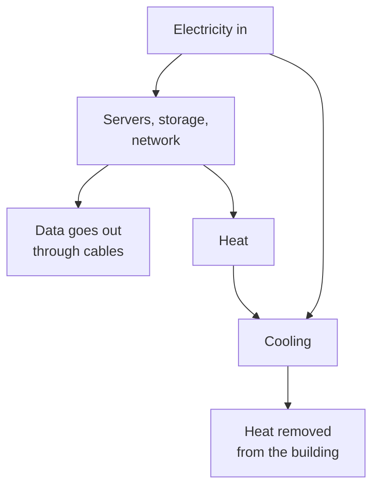

> **In one sentence:** Data centers are buildings full of servers that use electricity to compute and more electricity to remove the heat; the International Energy Agency estimates they used about 1.5% of the world's electricity in 2024.

## Why should I care?

[[artificial-intelligence|AI]] chatbots run mainly in [[physical-internet|data centers]], and so do many email servers. These buildings **compute** (do calculations and run programs) non-stop, using electricity.

News often says data centers use "huge" amounts of power. This lesson shows where the electricity goes, how much it is, and how sure the experts are.

## Analogy

Think of a **busy restaurant kitchen**. The stoves and ovens need power to cook. They also make the kitchen hot. So the kitchen needs more power for fans and air conditioning. A well-designed kitchen spends less on cooling.

A data center is similar: servers do the work, and cooling removes the heat they make.

**Where the analogy breaks down:** in a kitchen, heat is the goal: it cooks the food. In a data center, the goal is computing, and the heat is an unwanted side effect. Also, a kitchen's useful output is food. A data center's useful output is data, sent through cables.

## How it actually works

### What is inside

The International Energy Agency (IEA) "works with governments and industry" on energy. It describes data centers as buildings that hold servers, storage systems, network equipment and related parts. The equipment sits in **racks**: tall metal frames that hold many machines. (A [[server]] is a computer that answers requests from other computers.)

### Where the electricity goes

In its April 2025 report *Energy and AI*, the IEA gives rough shares. They are averages and ranges, so they do not add up exactly to 100%.

- **Servers:** around 60% of the electricity, on average.
- **Storage systems** (machines that keep data): around 5%.
- **Network equipment:** up to 5%.
- **Cooling:** from about 7% in efficient data centers to over 30% in less efficient ones.

Other things, such as lighting, use the rest. Backup batteries and generators are there for power cuts, but the IEA says they are rarely used.

Why cooling? Servers get hot as they work. Wikipedia explains that the right temperature and humidity (water in the air) prevent damage "caused by overheating".

### Measuring efficiency: PUE

Data center owners often measure efficiency with **PUE** (power usage effectiveness). Wikipedia explains it: divide all the power going into the data center by the power used by the computing equipment. So PUE can never be below 1.0.

- A PUE of **2.0**, Google explains, means that for every watt used for computing, another watt goes to cooling and to delivering power to the machines. (The watt is explained below.)
- A PUE "closer to 1.0 means nearly all the energy is used for computing".

Google cites the Uptime Institute's 2025 survey: the average PUE of the data centers in it was **1.54**. That means about 0.54 watt extra for every watt of computing. Uptime says this average has shown little change for six years in a row.

### How much electricity?

You do not need to remember these numbers. Notice that each one has a year.

First, the unit. A **watt** is a unit of power. A **kilowatt-hour (kWh)** is 1,000 watts used for one hour. A **terawatt-hour (TWh)** is "one trillion watt hours": 1,000,000,000,000 watt-hours, or 1,000,000,000 kWh.

The IEA's numbers:

- **2024:** about 415 TWh, around 1.5% of the world's electricity (April 2025 report).
- **2025:** about 485 TWh. Use grew by 17% in that year (April 2026 report, *Key Questions on Energy and AI*).
- **2030:** about 950 TWh, around 3% of the world's electricity (April 2026 report; the 2025 report said about 945 TWh). This is a forecast, not a measurement.

For size: the IEA says 945 TWh is "slightly more than Japan's total electricity consumption today".

The IEA says there are "large uncertainties" about AI's future electricity use. For 2035, its scenarios (possible futures) range from 700 to 1,700 TWh: from less than 2% to about 4.4% of the world's electricity. Data centers also "tend to concentrate in specific locations", the IEA says. That can make connecting them to the local power network harder.

### The part AI plays

In its 2025 report, the IEA says AI is the most important reason for the expected growth to 2030, together with other digital services. Electricity use by data centers built mainly for AI grew by 50% in 2025. At the same time, the energy used per AI task (for example, one answer) dropped "by at least an order of magnitude annually in recent years": at least ten times less, each year. Both can be true: total use can still grow if the number of tasks grows faster.

### How owners try to use less

The IEA's "High Efficiency" scenario assumes better software, hardware and infrastructure (such as cooling). In that case, data center use in 2035 is 20% lower than in its main forecast. Google says it fills its data centers with servers "designed to use as little energy as possible".

## How it came to be

Wikipedia says data centers "have their roots in the huge computer rooms of the 1940s", built for machines like [[eniac]]. It says a single early large computer "required a great deal of power and had to be cooled to avoid overheating".

In the United States, the Department of Energy released a report by Lawrence Berkeley National Laboratory in December 2024. It estimates that data centers used 58 TWh in 2014 and 176 TWh in 2023. That was about 4.4% of all US electricity in 2023. For 2028, the report gives a range, not one number: 6.7% to 12%.

## 🧪 Try it in your browser

This only reads a public page.

1. Open the IEA's summary: `https://www.iea.org/reports/energy-and-ai/executive-summary`. If a message about cookies covers the page, close it.
2. On a computer, press `Ctrl` + `F` (on a Mac, `Command` + `F`). This works in Chrome, Edge and Firefox. A small search box opens. On a phone in Chrome, tap the menu with three dots, then **Find in page**.
3. Type `TWh` and press Enter. The page has several matches. The first one is the sentence you want.

**What you should see:** a sentence that says data centers used around 1.5% of the world's electricity in 2024, or 415 TWh. Notice the year next to the number.

## Common misunderstandings

- **"Data centers use most of the world's electricity."** No. The IEA estimates about 1.5% in 2024. But it is growing fast, and it is concentrated in some places.
- **"All the electricity goes to cooling."** No. On average, the servers use the largest share.
- **"The forecasts are certain."** No. The IEA gives several scenarios for the future.

## Recap

- A data center uses electricity for its servers, storage and network, and more for cooling away their heat.
- The IEA estimates about 415 TWh (around 1.5% of the world's electricity) in 2024, and forecasts about double by 2030, with large uncertainty.
- PUE compares all the power a data center uses with the power used for computing. Better software, hardware and infrastructure (such as cooling) can lower total use.

## Sources

- IEA, Energy and AI, Executive summary (April 2025): https://www.iea.org/reports/energy-and-ai/executive-summary
- IEA, Energy and AI, Energy demand from AI (April 2025): https://www.iea.org/reports/energy-and-ai/energy-demand-from-ai
- IEA, Energy and AI, report page: https://www.iea.org/reports/energy-and-ai
- IEA, Key Questions on Energy and AI, Executive summary (April 2026): https://www.iea.org/reports/key-questions-on-energy-and-ai/executive-summary
- IEA news, Data centre electricity use surged in 2025 (April 2026): https://www.iea.org/news/data-centre-electricity-use-surged-in-2025-even-with-tightening-bottlenecks-driving-a-scramble-for-solutions
- US Department of Energy, DOE Releases New Report Evaluating Increase in Electricity Demand from Data Centers (December 2024): https://www.energy.gov/articles/doe-releases-new-report-evaluating-increase-electricity-demand-data-centers
- MDN Web Docs, Server (glossary): https://developer.mozilla.org/en-US/docs/Glossary/Server
- IEA, About: https://www.iea.org/about
- US EIA, Measuring electricity: https://www.eia.gov/energyexplained/electricity/measuring-electricity.php
- US EIA, Glossary, Terawatthour: https://www.eia.gov/tools/glossary/index.php?id=T
- Google Data Centers, Power usage effectiveness: https://datacenters.google/efficiency/
- Uptime Institute, Global Data Center Survey 2025: https://intelligence.uptimeinstitute.com/resource/uptime-institute-global-data-center-survey-2025
- Wikipedia, Data center (general background reference): https://en.wikipedia.org/wiki/Data_center
- Google Chrome Help, Search within a webpage: https://support.google.com/chrome/answer/95440
- Google Chrome Help, Find in page on Android: https://support.google.com/chrome/answer/95440?co=GENIE.Platform%3DAndroid
- Microsoft Support, Microsoft Edge keyboard shortcuts: https://support.microsoft.com/en-us/help/4531783/microsoft-edge-keyboard-shortcuts
- Mozilla Support, Keyboard shortcuts in Firefox: https://support.mozilla.org/en-US/kb/keyboard-shortcuts-perform-firefox-tasks-quickly
