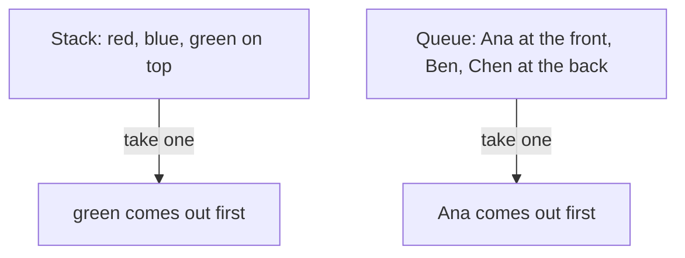
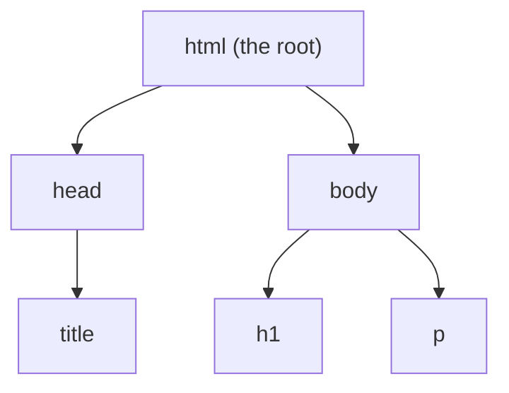

> **In one sentence:** A data structure is a way to organize data. Each one makes some actions on the data simpler or faster than other structures do.

## Why should I care?

In [[lists-and-dictionaries|Lists and Dictionaries]], a list found a value by its position, and a dictionary by its key.

Those are two **data structures**: ways to organize and store data. Wikipedia says a data structure is "usually chosen for efficient access to data". Each one has strengths and weaknesses. This page adds three more: the stack, the queue and the tree.

## Analogy

Think of a pile of clean plates in a kitchen. You put each clean plate on top, and you take the top one when you need a plate. Taking the bottom plate means lifting all the others first.

The pile is good at one job: giving you the plate that was added last. A **stack** in code works the same way.

**Where the analogy breaks down:** on this page, each stack is a list underneath. So your code could still read any item by its index, even one at the bottom. The stack rule is a way you choose to use the list.

## How it actually works

### A stack: last in, first out

A **stack** has two main actions: add an item to the top, and take the item from the top. Wikipedia names them **push** and **pop**. The item you take is always the one that went in most recently. This order is called **last in, first out**.

### A queue: first in, first out

A **queue** uses two ends. You add an item at the back, and you take the item at the front. So the item that waited longest comes out first. This order is called **first in, first out**.



### Stacks and queues in code

The examples are in [[javascript|JavaScript]], [[python|Python]] and [[go-language|Go]]. You only need to read one tab.

<!-- tabs -->

### JavaScript

`.push` adds an item to the end of an array and gives back the new length. `.pop` removes the last item and gives it back. So an array can work as a stack, with its end as the top.

```js
// An array used as a stack.
const stack = ["red", "blue"];
// push adds an item to the end: the top of the stack.
stack.push("green");
console.log(stack.length); // Shows: 3
// pop removes the last item and gives it back.
console.log(stack.pop());  // Shows: green
console.log(stack.pop());  // Shows: blue
console.log(stack.length); // Shows: 1
```

`.shift` removes the first item and gives it back. The other items each move down one index. So with `.push` and `.shift`, an array can work as a queue.

```js
// An array used as a queue.
const queue = ["Ana", "Ben"];
// push adds an item to the end: the back of the queue.
queue.push("Chen");
// shift removes the first item and gives it back.
console.log(queue.shift()); // Shows: Ana
console.log(queue.shift()); // Shows: Ben
console.log(queue[0]);      // Shows: Chen
```

### Python

A Python list works as a stack, with its end as the top. `.append` adds an item to the end: it does the push job. `.pop()` with empty round brackets removes the last item and gives it back: it does the pop job.

```python
# A list used as a stack.
stack = ["red", "blue"]
# append adds an item to the end: the top of the stack.
stack.append("green")
print(len(stack))   # Shows: 3
# pop() removes the last item and gives it back.
print(stack.pop())  # Shows: green
print(stack.pop())  # Shows: blue
print(len(stack))   # Shows: 1
```

A list can also work as a queue. `.pop(0)` removes the item at index 0, the front, and gives it back. But Python's tutorial warns that "lists are not efficient for this purpose": they do more work than needed. It says adding or removing at the end is fast. Removing at the beginning is slow, "because all of the other elements have to be shifted by one".

The tutorial says: "To implement a queue, use collections.deque which was designed to have fast appends and pops from both ends." To implement a queue means to build one.

`deque` is pronounced "deck". It is short for "double-ended queue". It comes with Python, in a part of Python's standard library called `collections`. `from collections import deque` brings `deque` into your program. `deque(["Ana", "Ben"])` makes a deque that holds the items of the list in its round brackets.

A deque has a left end and a right end. Here, the left end is the front of the queue, and the right end is the back.

```python
# Bring in deque, which comes with Python.
from collections import deque

# A deque used as a queue.
queue = deque(["Ana", "Ben"])
# append adds an item to the right end: the back of the queue.
queue.append("Chen")
# popleft() removes the item at the left end and gives it back.
print(queue.popleft())  # Shows: Ana
print(queue.popleft())  # Shows: Ben
print(queue[0])         # Shows: Chen
```

On an empty list, `.pop()` stops with an error message that names `IndexError`. So does `.popleft()` on an empty deque.

### Go

In Go, a slice can work as a stack or a queue. A page on Go's website called SliceTricks shows the code for adding and removing items at either end of a slice.

You add an item to the end with `append`, as in Lists and Dictionaries: `append` does the push job. To remove an item, you make a smaller slice with a **slice expression**: it does the pop job. `s[low:high]` gives the items from index `low` up to, but not including, index `high`. If you leave out `low`, it starts at 0. If you leave out `high`, it goes to the end.

```go
package main

import "fmt"

func main() {
	// A slice used as a stack.
	stack := []string{"red", "blue"}
	// append adds an item to the end: the top of the stack.
	stack = append(stack, "green")
	fmt.Println(len(stack)) // Shows: 3

	// Read the last item: the top of the stack.
	top := stack[len(stack)-1]
	// Keep every item except the last one.
	stack = stack[:len(stack)-1]
	fmt.Println(top)   // Shows: green
	fmt.Println(stack) // Shows: [red blue]
}
```

The last index is the length minus 1, so `stack[len(stack)-1]` is the top item. `stack[:len(stack)-1]` keeps everything before it. `fmt.Println` shows a whole slice in square brackets, with spaces between the items.

```go
package main

import "fmt"

func main() {
	// A slice used as a queue.
	queue := []string{"Ana", "Ben"}
	// append adds an item to the end: the back of the queue.
	queue = append(queue, "Chen")

	// Read the first item: the front of the queue.
	first := queue[0]
	// Keep every item from index 1 to the end.
	queue = queue[1:]
	fmt.Println(first) // Shows: Ana
	fmt.Println(queue) // Shows: [Ben Chen]
}
```

`queue[0]` is the front item, and `queue[1:]` keeps everything after it. On an empty slice, reading `queue[0]` stops the program with a run-time panic.

<!-- /tabs -->

### A tree: items in levels

A **tree** keeps items in levels. Each item can have many **children**: items one level below it. Each item has exactly one **parent**: the item one level above it. The one exception is the top item, the **root**, which has no parent.

You have met a tree already. In [[html|HTML]], elements sit inside other elements: each element is a child of the element it sits inside. MDN Web Docs, a website that documents web technologies, says that a browser reading a page "builds a DOM tree". The DOM is the browser's map of the page's parts.



Here, `html` is the root. `body` is the parent of `h1` and `p`. (This is simplified: the real DOM tree also holds the text inside each element, and more.)

### Choosing a structure

Wikipedia says that different data structures "are suited to different tasks". So ask what your program will do most:

| You need most often to… | Use |
|---|---|
| read an item by its position | a list |
| find a value by its key | a dictionary |
| take the newest item first | a stack |
| take the oldest item first | a queue |
| keep items in levels, with parents and children | a tree |

## How it came to be

Wikipedia reports that stacks appeared in computer science writing in 1946. That year, Alan Turing used the terms "bury" and "unbury". He used them for running a smaller part of a program and then coming back.

Klaus Samelson and Friedrich L. Bauer of the Technical University of Munich proposed a stack in 1955, Wikipedia says. They called it Operationskeller ("operational cellar"), and applied for a patent on it in 1957. Wikipedia names others with similar ideas around that time.

## 🧪 Try it in your browser

These steps use JavaScript, because the browser's console runs JavaScript. There, a list is called an array. `const` creates a variable. `.push` adds an item to the end of an array and gives back the new length. `.pop()` removes the last item and gives it back. `.shift()` removes the first item and gives it back. You need a computer with Chrome, Edge or Firefox.

**Safety rule:** only type code in the console that you understand or that comes from a source you trust. Never paste anything a stranger sends you. The lines below create two arrays, then add and remove their items.

1. Open [example.com](https://example.com).
   **What you should see:** a short page of text.
2. Open the **console**:
   - **Windows:** press `Ctrl` + `Shift` + `J` (in Firefox: `Ctrl` + `Shift` + `K`)
   - **Mac:** press `Cmd` + `Option` + `J` (in Firefox: `Cmd` + `Option` + `K`)
3. Click the line where you can type, below any messages. In each step below, **type** the line yourself (some browsers may block pasting at first), then press `Enter`. The browser may show suggestions, and the line may look different while you type. Keep typing.

   ```
   const stack = ["red"]
   ```

   **What you should see:** no result of its own. The console may also show `undefined`. That is normal: the line created a variable, and there is no result to show.
4. Add an item to the top:

   ```
   stack.push("green")
   ```

   **What you should see:** `2`, the new length.
5. Take the top item:

   ```
   stack.pop()
   ```

   **What you should see:** the word green. It went in last, so it comes out first.
6. Take the top item again:

   ```
   stack.pop()
   ```

   **What you should see:** the word red. The stack is now empty.
7. Make a queue:

   ```
   const queue = ["Ana", "Ben"]
   ```

   **What you should see:** again, no result of its own. The console may also show `undefined`.
8. Add an item at the back:

   ```
   queue.push("Chen")
   ```

   **What you should see:** `3`.
9. Take the front item:

   ```
   queue.shift()
   ```

   **What you should see:** the name Ana. It went in first, so it comes out first.

If you see an error message at any step, reload the page, delete anything left on the typing line, and start again from step 3.

## Common misunderstandings

- **"One data structure is the best one."** No. Each one is suited to some tasks. Choose by what your program does most often.
- **"A stack and a queue need a special kind of value."** Not always. In the examples above, the stack is a list in all three languages. In JavaScript and Go, the queue is a list too.
- **"In a tree, an item can have two parents."** No. Each item has exactly one parent, except the root, which has none.

## Recap

- A data structure is a way to organize data, so that some actions on it are simpler or faster.
- A stack gives back the newest item first (last in, first out). A queue gives back the oldest item first (first in, first out).
- A tree keeps items in levels: each item has one parent, except the root. The elements of a web page form a tree. Choose a structure by what you need to do most.

## Sources

- Wikipedia, Data structure: https://en.wikipedia.org/wiki/Data_structure
- Wikipedia, Stack (abstract data type): https://en.wikipedia.org/wiki/Stack_(abstract_data_type)
- Wikipedia, Queue (abstract data type): https://en.wikipedia.org/wiki/Queue_(abstract_data_type)
- Wikipedia, Tree (abstract data type): https://en.wikipedia.org/wiki/Tree_(abstract_data_type)
- MDN Web Docs, Introduction to the DOM: https://developer.mozilla.org/en-US/docs/Web/API/Document_Object_Model/Introduction
- MDN Web Docs, Array: https://developer.mozilla.org/en-US/docs/Web/JavaScript/Reference/Global_Objects/Array
- MDN Web Docs, Array.prototype.push(): https://developer.mozilla.org/en-US/docs/Web/JavaScript/Reference/Global_Objects/Array/push
- MDN Web Docs, Array.prototype.pop(): https://developer.mozilla.org/en-US/docs/Web/JavaScript/Reference/Global_Objects/Array/pop
- MDN Web Docs, Array.prototype.shift(): https://developer.mozilla.org/en-US/docs/Web/JavaScript/Reference/Global_Objects/Array/shift
- MDN Web Docs, eval(): https://developer.mozilla.org/en-US/docs/Web/JavaScript/Reference/Global_Objects/eval
- MDN Web Docs, About MDN: https://developer.mozilla.org/en-US/about
- Python Tutorial, Data Structures: https://docs.python.org/3/tutorial/datastructures.html
- Python documentation, collections: https://docs.python.org/3/library/collections.html
- Python documentation, The Python Standard Library: https://docs.python.org/3/library/index.html
- The Go Programming Language Specification: https://go.dev/ref/spec
- Go Wiki, SliceTricks: https://go.dev/wiki/SliceTricks
- Go Packages, fmt: https://pkg.go.dev/fmt
- Microsoft Edge DevTools, Run JavaScript in the Console: https://learn.microsoft.com/en-us/microsoft-edge/devtools/console/console-javascript
- Chrome for Developers, Open Chrome DevTools: https://developer.chrome.com/docs/devtools/open
- Microsoft Edge DevTools, Keyboard shortcuts: https://learn.microsoft.com/en-us/microsoft-edge/devtools/shortcuts/
- Firefox DevTools User Docs, Web Console: https://firefox-source-docs.mozilla.org/devtools-user/web_console/index.html
- Chrome for Developers, What are self-XSS attacks?: https://developer.chrome.com/blog/self-xss
- Example Domain: https://example.com
