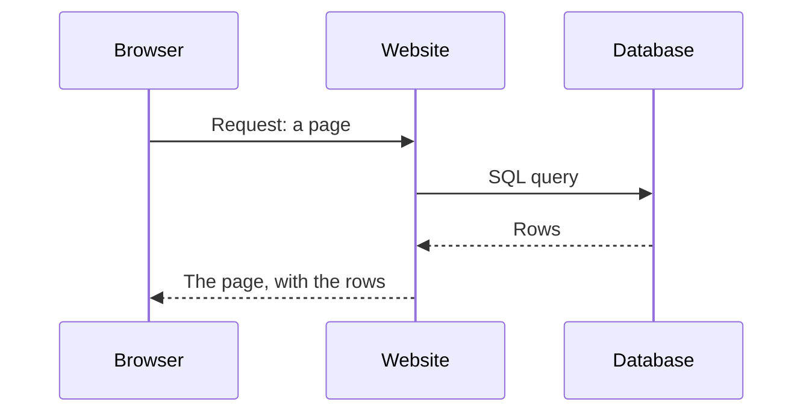

> **In one sentence:** A database is an organized collection of data that programs can search and change, and it is looked after by a program called a database management system (DBMS).

## Why should I care?

Wikipedia lists uses of databases, such as "computerized library systems, flight reservation systems", and "a website that happens to use a database to store and search information".

Your own website could use one too, for example to keep messages from visitors.

## Analogy

Think of the attendance register in a school office: a big book, with lines for columns: name, class and date. Each line across the page is about one student. Only the office clerk writes in it. A teacher asks, "Who in class 3 was absent today?" The clerk looks, and answers.

The register is like the **database**. Its pages are like **tables**, and each line across is like a **row**. The clerk is like the **database management system**.

**Where the analogy breaks down:** a clerk understands everyday speech. A database program only understands an exact language, such as SQL.

## How it actually works

### The data and the program that looks after it

Wikipedia calls a database "an organized collection of data". A **database management system (DBMS)** is "the software that interacts with end users, applications, and the database itself". End users are the people who use the programs. PostgreSQL and SQLite are two examples of database programs.

For PostgreSQL and SQLite, the data is kept in [[files-and-folders|files]] in storage. PostgreSQL's server program "manages the database files" and does the work "on behalf of the clients" that ask it.

### What the DBMS does for you

A DBMS adds, changes, deletes and finds data. A program could keep data in a plain file instead, but a DBMS also helps with three harder problems:

- **Many users at the same time.** PostgreSQL's server "can handle multiple concurrent connections from clients". **Concurrent** means at the same time, and a connection is a program's open line to the database.
- **Finding things fast.** A DBMS can keep an **index**, a guide for finding rows. (This is not a list's position number.) Without one, PostgreSQL's documentation says, the system "would have to scan the entire" table, "row by row". With an index on a column, it "can use a more efficient method".
- **Not losing half a change.** A **transaction** is a group of changes treated as one. SQLite's documentation says all changes in one transaction "either occur completely or not at all". This holds even if "a program crash, an operating system crash, or a power failure" interrupts the writing.

### Tables, rows and columns

A **relational database** keeps data in **tables**. PostgreSQL's documentation explains the name: "Relation is essentially a mathematical term for table." It also says: "Each table is a named collection of rows. Each row of a given table has the same set of named columns". In PostgreSQL, each column also has one **data type**, the kind of value it holds, such as a number or text.

Here is a small table called `friends`:

| id | name | city |
|---|---|---|
| 1 | Ana | Lima |
| 2 | Sam | Oslo |
| 3 | Mira | Lima |

The column `id` is the table's **primary key**. PostgreSQL says a primary key "can be used as a unique identifier for rows in the table". So no two rows may share a value there, and every row must have a value there.

In [[lists-and-dictionaries]], a key was the name of one value in a dictionary. A primary key is a similar idea: a value that finds exactly one row.

### Asking with SQL

**SQL** (Structured Query Language) is a language "used to manage data, especially in a relational database management system". A question to a database is called a **query**.

This query asks for the names of friends who live in Lima:

```sql
SELECT name FROM friends WHERE city = 'Lima';
```

Word by word:

- `SELECT name`: the columns you want back. Here, only `name`.
- `FROM friends`: the table to look in.
- `WHERE city = 'Lima'`: a condition. Only rows where it is true come back. In SQL, `=` here means "is equal to".
- `'Lima'`: text in SQL goes between single quotes.
- `;`: the semicolon ends the command.

The answer is two rows: Ana and Mira.

### Other kinds of databases

Not every database uses tables. Wikipedia says non-relational databases are called **NoSQL**, meaning "not only SQL" or "non-relational". Two kinds:

- A **key–value store** uses the same idea as a dictionary: Wikipedia says "the associative array (also called a map or dictionary)".
- A **document store** keeps each record (all the data about one item, like one row) as a "document", found by "a unique key". Here a document is a block of data, not a word-processor file.

### Where the database runs

PostgreSQL uses a **client/server model**, as in [[server]]: client programs connect to the database server program and ask. PostgreSQL says a client could be "a web server that accesses the database to display web pages". The client and the server "can be on different hosts" (computers on a network).

So a website's server program is also a client: it answers browsers and asks the database.



## How it came to be

In 1970, Edgar F. "Ted" Codd, a mathematician at the IBM San Jose Research Lab, published a paper. IBM gives its title: "A Relational Model of Data for Large Shared Data Banks". Wikipedia says the model insisted "that applications should search for data by content, rather than by following links". That means by what the data says, not by a fixed path to it.

SQL was first made at IBM by Donald D. Chamberlin and Raymond F. Boyce, and was first called SEQUEL.

## 🧪 Try it in your browser

You will read a real query and its answer in PostgreSQL's official documentation. This works on a computer or a phone.

1. Open `https://www.postgresql.org/docs/current/tutorial-select.html`. Its title is "Querying a Table". The page may look different.
2. Find the query `SELECT * FROM weather;`. The page says `*` is a shorthand for "all columns".
3. Below it come a second query, then "The output should be:" and a table. That table answers both queries. **What you should see:** a table with the columns `city`, `temp_lo`, `temp_hi`, `prcp` and `date`, and the line `(3 rows)`. Another page of the tutorial says `temp_lo` is the "low temperature", `temp_hi` the "high temperature" and `prcp` "precipitation".
4. Scroll down to the query that ends with `AND prcp > 0.0`. The page calls `AND` one of "the usual Boolean operators": both conditions must be true. PostgreSQL's documentation says `>` means "Greater than". The page says this gets "the weather of San Francisco on rainy days".
5. **What you should see:** an answer with only one row, and the line `(1 row)`.

## Common misunderstandings

- **"Rows always come back in the order I added them."** No. PostgreSQL's documentation says SQL "does not guarantee the order of the rows", unless you ask for sorting.
- **"A database always runs on its own server."** Not always. SQLite's documentation says "SQLite is built into the application" that uses it. A whole SQLite database "is contained in a single disk file".

## Recap

- A database is organized data. A database management system (DBMS) stores it, finds it and changes it for programs.
- A relational database keeps data in tables of rows and columns. A primary key, if the table has one, identifies each row, and SQL asks questions.
- A website's server program can be a client of a database server: it sends queries and gets rows back.

## Sources

- Wikipedia, Database (general background reference): https://en.wikipedia.org/wiki/Database
- Wikipedia, SQL: https://en.wikipedia.org/wiki/SQL
- Wikipedia, NoSQL: https://en.wikipedia.org/wiki/NoSQL
- PostgreSQL Documentation, Concepts: https://www.postgresql.org/docs/current/tutorial-concepts.html
- PostgreSQL Documentation, Architectural Fundamentals: https://www.postgresql.org/docs/current/tutorial-arch.html
- PostgreSQL Documentation, Creating a New Table: https://www.postgresql.org/docs/current/tutorial-table.html
- PostgreSQL Documentation, Querying a Table: https://www.postgresql.org/docs/current/tutorial-select.html
- PostgreSQL Documentation, Constraints: https://www.postgresql.org/docs/current/ddl-constraints.html
- PostgreSQL Documentation, Lexical Structure: https://www.postgresql.org/docs/current/sql-syntax-lexical.html
- PostgreSQL Documentation, Comparison Functions and Operators: https://www.postgresql.org/docs/current/functions-comparison.html
- PostgreSQL Documentation, Indexes, Introduction: https://www.postgresql.org/docs/current/indexes-intro.html
- PostgreSQL Documentation, Concurrency Control, Introduction: https://www.postgresql.org/docs/current/mvcc-intro.html
- SQLite, Appropriate Uses For SQLite: https://www.sqlite.org/whentouse.html
- SQLite, About SQLite: https://www.sqlite.org/about.html
- SQLite, SQLite is Transactional: https://www.sqlite.org/transactional.html
- IBM, The relational database: https://www.ibm.com/history/relational-database
