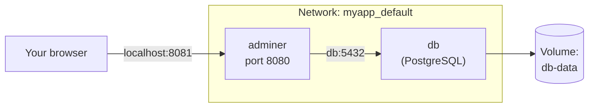

> **In one sentence:** Docker Compose is a tool that describes several containers, and how they connect, in one YAML file called compose.yaml, and then creates and starts them all with one command.

## Why should I care?

A real app is often more than one program. In [[databases|What is a Database?]], a website's server program asked a separate database program for its data. With Docker, each can run in its own container.

You could start each container by hand with `docker run`. Docker Compose is "a tool for defining and running multi-container applications", says Docker. You write the setup in one file. Then, "with a single command, you create and start all the services from your configuration file."

## Analogy

Think of the **cast list for a school play**. It names every role and the costume for each. On stage, actors call each other by their role names.

The Compose file is like the cast list. Each role is a **service**, and the costume is the image. Containers, too, reach each other by name.

**Where the analogy breaks down:** actors read the list and move by themselves. A Compose file does nothing alone: the `docker compose` command reads it and creates the containers.

## How it actually works

### One file, several services

The file is written in **YAML**, a text format that people can read and that "is commonly used for configuration files" (Wikipedia). Indentation (spaces at the start of a line) shows which line belongs to which. Tab characters (from the Tab key) are not allowed there. A line that starts with `-` is one item in a list.

Docker says the default file name is `compose.yaml`, "placed in the working directory": the folder you run the command in.

A **service** is one part of your app, such as the website or the database. Docker says a service runs "the same container image, and configuration, one or more times". So one service can have several copies.

### A small example, line by line

This file is based on the example on Docker Hub's `postgres` page. It has a PostgreSQL database and **Adminer**, "a database management tool" used in a browser.

```yaml
services:
  db:
    image: postgres:18
    environment:
      POSTGRES_PASSWORD: example
    volumes:
      - db-data:/var/lib/postgresql

  adminer:
    image: adminer
    ports:
      - "127.0.0.1:8081:8080"

volumes:
  db-data:
```

1. `services:` starts the list of services. Each name below it, `db` and `adminer`, is a service name you choose.
2. `image: postgres:18` is "the image to start the container from", here version 18 of PostgreSQL.
3. `environment:` sets **environment variables** in the container: named values that "can affect the way running processes will behave". The `postgres` image requires `POSTGRES_PASSWORD`, which "sets the superuser password": the password of the database's main user.
4. `volumes:` under `db` mounts the named volume `db-data` at `/var/lib/postgresql`, the folder the `postgres` page gives for version 18. The data lives outside the container, as in [[docker-volumes|Volumes]].
5. `ports:` publishes a port, like `-p` in [[running-containers|Running Containers]]. Port 8081 on your computer leads to port 8080 in the container. `127.0.0.1` is an address that means this computer, like **localhost**. Without it, other computers can connect too, "bypassing host firewall rules". This "can expose the container directly to the internet if the host has a public IP address". Docker says to keep it in quotes, so YAML does not misread it.
6. The last `volumes:`, with no indentation, declares `db-data`, so it "persists between `compose down` and `compose up` cycles", says Docker's quickstart.

**About the password:** `example` is an obvious example value, from Docker Hub's page. A real password must be secret: Docker warns that environment variables "risk unintentional information exposure". Compose offers **secrets** instead.

### How services find each other

Here a **network** is something Docker creates and names, so containers can talk. Docker says: "By default, Compose sets up a single network for your app." Containers on it find each other by service name.

So Adminer reaches the database at `db`, port 5432: "The TCP port the server listens on; 5432 by default", says PostgreSQL. Docker's own example connects to `postgres://db:5432`. That is an address for PostgreSQL programs, in the style of a web address.

Notice that `db` has no `ports:` line. Publishing a port is for reaching a container from outside the Docker network, such as from your own computer: "The host port is only used when accessing the service from outside the network." Containers on the same network reach each other directly.



The name `db` also matches Adminer's default server, says the `adminer` image's page. To use Adminer, you would open `http://localhost:8081` in your browser.

### Starting, checking and stopping

The commands below were run on a computer with Docker. You only need to read them; Docker does not need to be installed. Lines that start with $ are commands; you would not type the $. Here the file is in a folder called `myapp`. Docker says the project name "is taken from the name of the directory it lives in".

```console
$ docker compose up -d
 …
 Volume myapp_db-data Created
 Network myapp_default Created
 Container myapp-adminer-1 Started
 Container myapp-db-1 Started
```

`up` will "Create and start containers". `-d` (detached) runs them "in the background", like `docker run -d`. The output shows the volume, the network and two containers. You can ignore the other words in the output. By default, Compose downloads an image only if your computer does not have it yet.

```console
$ docker compose ps
NAME              IMAGE         …   SERVICE   …   STATUS         PORTS
myapp-adminer-1   adminer       …   adminer   …   Up 8 seconds   127.0.0.1:8081->8080/tcp
myapp-db-1        postgres:18   …   db        …   Up 8 seconds   5432/tcp
```

`ps` will "List containers", with their service and ports.

```console
$ docker compose logs db
 …
db-1  | … LOG:  database system is ready to accept connections
```

`logs` will "View output from containers", here the database's messages.

```console
$ docker compose down
 …
 Container myapp-db-1 Removed
 Network myapp_default Removed
```

`down` stops the containers and removes them and the network. The named volume stays, so your data stays. Docker's quickstart says `docker compose down -v` "removes named volumes along with the containers", and warns: "it permanently deletes the stored data." This `-v` deletes volumes, unlike the `-v` of `docker run`.

### Building your own image

Instead of `image:`, a service can say `build: .`. Compose then builds the image from the `Dockerfile` at the top of that folder, as in [[dockerfiles|Dockerfiles]].

## How it came to be

Compose v1 "was first released in 2014", says Docker. You typed it as `docker-compose`, with a dash. Compose v2, "announced in 2020", uses `docker compose`, with a space. The next version jumped to v5 in 2025, "to avoid confusion" with old file formats called "v2" and "v3". Compose still reads old file names such as `docker-compose.yml`.

## 🧪 Try it in your browser

You will read a real Compose file on **GitHub**, a platform where developers "create, store, manage, and share their code". You need no account.

1. In Chrome, Edge or Firefox, open `https://github.com/docker/awesome-compose/tree/master/flask-redis`. Under its first heading, it says: "Python/Flask application using a Redis database". The page may look different, and a box about cookies may appear.
2. In the list of files, click **compose.yaml**.
3. Find the two services, `redis` and `web`. The `redis` service uses `image:`. The `web` service uses `build:`, so it is built from a Dockerfile.
4. Under `web`, find `volumes:` with `.:/code`. The dot is a short folder path: the folder that holds the Compose file. So this is a bind mount.
5. Go back and click **app.py**. Find the line `redis = Redis(host='redis', port=6379)`.

**What you should see:** the program reaches its database by the service name `redis`. Docker says these samples are for "local development environments".

## Common misunderstandings

- **"`docker compose down` deletes my database."** Not by default. It removes containers and networks; named volumes stay unless you add `-v`.
- **"I must look up each container's address."** No. Containers reach each other "using the service name directly". Addresses can change on restart; names stay.

## Recap

- A Compose file (`compose.yaml`, written in YAML) lists your services, their images or builds, ports, volumes and environment variables.
- By default, Compose puts all services on one network, where they reach each other by service name.
- `docker compose up -d` starts everything, `ps` and `logs` let you check it, and `down` removes it but keeps named volumes unless you add `-v`.

## Sources

- Docker Docs, Docker Compose: https://docs.docker.com/compose/
- Docker Docs, How Compose works: https://docs.docker.com/compose/intro/compose-application-model/
- Docker Docs, Networking in Compose: https://docs.docker.com/compose/how-tos/networking/
- Docker Docs, Define services in Docker Compose: https://docs.docker.com/reference/compose-file/services/
- Docker Docs, Container specification (Compose file reference): https://docs.docker.com/reference/compose-file/container-spec/
- Docker Docs, Workload specification (Compose file reference): https://docs.docker.com/reference/compose-file/workload-spec/
- Docker Docs, Compose Build Specification: https://docs.docker.com/reference/compose-file/build/
- Docker Docs, Define and manage volumes in Docker Compose: https://docs.docker.com/reference/compose-file/volumes/
- Docker Docs, docker compose up: https://docs.docker.com/reference/cli/docker/compose/up/
- Docker Docs, docker compose ps: https://docs.docker.com/reference/cli/docker/compose/ps/
- Docker Docs, docker compose logs: https://docs.docker.com/reference/cli/docker/compose/logs/
- Docker Docs, docker compose down: https://docs.docker.com/reference/cli/docker/compose/down/
- Docker Docs, Docker Compose Quickstart: https://docs.docker.com/compose/gettingstarted/
- Docker Docs, Manage secrets securely in Docker Compose: https://docs.docker.com/compose/how-tos/use-secrets/
- Docker Docs, History and development of Docker Compose: https://docs.docker.com/compose/intro/history/
- Docker Hub, postgres (Docker Official Image): https://hub.docker.com/_/postgres
- Docker Hub, adminer (Docker Official Image): https://hub.docker.com/_/adminer
- GitHub, docker/awesome-compose: https://github.com/docker/awesome-compose
- GitHub, docker/awesome-compose, flask-redis sample: https://github.com/docker/awesome-compose/tree/master/flask-redis
- Wikipedia, YAML: https://en.wikipedia.org/wiki/YAML
- Wikipedia, Environment variable: https://en.wikipedia.org/wiki/Environment_variable
- Wikipedia, Localhost: https://en.wikipedia.org/wiki/Localhost
- Wikipedia, GitHub: https://en.wikipedia.org/wiki/GitHub
- PostgreSQL Documentation, Connection Strings (libpq): https://www.postgresql.org/docs/current/libpq-connect.html
- PostgreSQL Documentation, Connections and Authentication: https://www.postgresql.org/docs/current/runtime-config-connection.html
