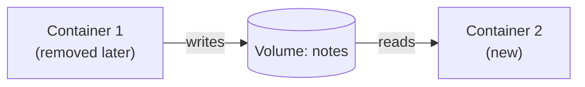

> **In one sentence:** A Docker volume is storage that Docker creates and manages outside any one container, so the files in it stay when the container is removed; a bind mount instead attaches a folder from your own computer to a container.

## Why should I care?

In [[running-containers]], you saw that `docker rm` removes a container, and its changes go with it.

Docker's guide gives an example. You add items to a to-do app in a container, then replace the container with a new one. The to-dos are gone, even though nothing went wrong. A [[databases|database]] needs to keep its data. Volumes and bind mounts are Docker's ways to keep it.

## Analogy

Think of a **USB stick**. You save a file on it, plug it into another computer, and the file is still there. A container is like the computer, and a volume is like the stick.

**Where the analogy breaks down:** a USB stick is a separate object you can hold. A volume is a folder that Docker keeps on the computer that runs Docker. With Docker Desktop, that folder is inside Docker's small Linux virtual machine, not among your normal files. Also, a stick goes into one computer at a time, but one volume can be shared among several containers.

## How it actually works

### Why a container loses its files

In [[containers]], you learned that an image never changes once built. Docker's guide says: "When a container starts, Docker gives it a thin **writable layer** on top of the image". **Writable** means it can be changed. Every file the container creates or changes goes into that layer.

The guide adds: "The writable layer belongs to that one container, and `docker rm` deletes it."

### A volume lives outside the container

"A **named volume** is storage that Docker creates and manages for you," says the same guide. "You refer to it by name, and it exists independently of any container."

When you attach a volume, it appears inside the container as a [[files-and-folders|folder]]. Files written into that folder go into the volume, not into the writable layer. So Docker says a volume keeps the data "even if the container using it is removed".



### Write, remove, read again

The commands below were run on a computer with Docker. You only need to read them; Docker does not need to be installed. Lines that start with $ are commands; you would not type the $. The other lines are what Docker printed.

They use **alpine**, a Docker Official Image: "A minimal Docker image based on Alpine Linux".

```
$ docker volume create notes
notes
$ docker run --name writer -v notes:/data alpine sh -c 'echo Saved by the first container > /data/hello.txt'
$ docker rm writer
writer
```

1. `docker volume create notes` creates an empty volume named `notes`.
2. `-v notes:/data` attaches it. "The part before the colon is the volume's name; the part after is where it appears inside the container."
3. `sh` is the image's shell. `-c` tells it to run the text in quotes as commands. `echo` writes the sentence, and `>` puts it into the file `hello.txt`, creating the file if needed.
4. `docker rm writer` removes the container and its writable layer.

Now a brand-new container reads the file. `cat` prints what is in a file:

```
$ docker run --name reader -v notes:/data alpine cat /data/hello.txt
Saved by the first container
```

The file survived, because it was in the volume.

"If you start a container with a volume that doesn't yet exist, Docker creates the volume for you." A longer way to write `-v` is `--mount type=volume,src=notes,dst=/data`, where `src` means source and `dst` means destination.

### Listing and removing volumes

```
$ docker volume ls
DRIVER    VOLUME NAME
…
local     notes
…
```

This lists all volumes. Here, `…` stands for lines left out. You can ignore the DRIVER column.

Docker "won't remove a volume that a container is using". Here, the `reader` container has finished but still exists:

```
$ docker volume rm notes
Error response from daemon: remove notes: volume is in use - [3cd32be91e9e…]
$ docker rm reader
reader
$ docker volume rm notes
notes
```

A volume "stays on disk until you remove it", says Docker. A new volume with the same name starts empty: the old files are not in it.

```
$ docker volume create notes
notes
$ docker run --name reader2 -v notes:/data alpine cat /data/hello.txt
cat: can't open '/data/hello.txt': No such file or directory
$ docker rm reader2
reader2
$ docker volume rm notes
notes
```

### Bind mounts: a folder from your computer

In [[containers]], a container could not see your files. A **bind mount** is how you choose to let it see one folder. It "attaches a directory from your machine at a path inside the container".

This helps when you edit files that a container uses. Say you made a folder `C:\Users\Ana\pages` and, with a text editor, saved a file `index.html` in it. That is a web page file in [[html|HTML]]. nginx (a web server) can show it.

nginx's Docker Hub page uses the folder `/usr/share/nginx/html` inside the container for "simple static content". A **static** page is sent "exactly as stored".

```
$ docker run -d --name web -p 8888:80 -v "C:\Users\Ana\pages:/usr/share/nginx/html" nginx
f9ad77324fd1…
```

`-d` and `-p 8888:80` work as in Running Containers. The part before `:/usr` is the full path of your folder. Docker Desktop on Windows "detects the Windows-style path". The folder must already hold `index.html`. If the folder does not exist, `-v` creates it for you, but empty.

If `index.html` holds `<h1>Hello from my folder</h1>`, then:

```
$ curl.exe http://localhost:8888
<h1>Hello from my folder</h1>
```

Change the file and ask again. The new text appears, with no new container:

```
$ curl.exe http://localhost:8888
<h1>Changed on my computer</h1>
$ docker stop web
web
$ docker rm web
web
```

"Changes on either side are visible on the other immediately." Docker warns that, by default, a program in a container can change your files through a bind mount.

### Which one to use

Docker's guide compares them:

| | Named volume | Bind mount |
|---|---|---|
| Where the files are | Docker's storage area, by name | A folder you choose on your computer |
| Who looks after them | Docker, with `docker volume` commands | You, with your own tools |
| Works the same on any computer? | Yes | No: the folder must exist on that computer |

Docker's advice: "if the application owns the data, use a volume." Here, owning means the program creates and uses the data. If you want to edit the files yourself, use a bind mount.

## How it came to be

Docker Engine 1.9.0, dated 2015-11-03, added a "New top-level `volume` subcommand".

## 🧪 Try it in your browser

You need no account, and you install nothing.

1. In Chrome, Edge or Firefox, open `https://docs.docker.com/learn/content/keep-data-with-volumes-and-bind-mounts/`. The heading is **Keep data with volumes and bind mounts**. The page may look different.
2. Find the heading **Step 5: Choose between a volume and a bind mount**.
3. Read its table. The columns are **Named volume** and **Bind mount**.

**What you should see:** rows such as "Where the data lives" and "Reach for it for" (when to use it). That last row names databases for volumes and source code for bind mounts.

## Common misunderstandings

- **"`-v` always means a volume."** No. With `-v`, a path to a folder on your computer makes a bind mount. A plain name, like `notes`, means a volume.
- **"Removing a container removes its named volume."** No. Docker says "A Docker data volume persists after you delete a container."

## Recap

- A container's own files live in its writable layer, which `docker rm` deletes.
- A volume is storage Docker manages outside any container. `docker volume rm` deletes it.
- A bind mount attaches a folder from your computer. Use a volume for data the program creates, and a bind mount for files you edit.

## Sources

- Docker Learn, Keep data with volumes and bind mounts: https://docs.docker.com/learn/content/keep-data-with-volumes-and-bind-mounts/
- Docker Learn, What is a container?: https://docs.docker.com/learn/content/what-is-a-container/
- Docker Docs, Storage: https://docs.docker.com/engine/storage/
- Docker Docs, Volumes: https://docs.docker.com/engine/storage/volumes/
- Docker Docs, Bind mounts: https://docs.docker.com/engine/storage/bind-mounts/
- Docker Docs, docker volume create: https://docs.docker.com/reference/cli/docker/volume/create/
- Docker Docs, docker volume ls: https://docs.docker.com/reference/cli/docker/volume/ls/
- Docker Docs, docker volume rm: https://docs.docker.com/reference/cli/docker/volume/rm/
- Docker Docs, Docker Engine prior releases (1.9.0): https://docs.docker.com/engine/release-notes/prior-releases/
- Docker Hub, alpine (Docker Official Image): https://hub.docker.com/_/alpine
- Docker Hub, nginx (Docker Official Image): https://hub.docker.com/_/nginx
- POSIX, sh: https://pubs.opengroup.org/onlinepubs/9799919799/utilities/sh.html
- POSIX, echo: https://pubs.opengroup.org/onlinepubs/9799919799/utilities/echo.html
- POSIX, Shell Command Language (2.7.2 Redirecting Output): https://pubs.opengroup.org/onlinepubs/9799919799/utilities/V3_chap02.html
- POSIX, cat: https://pubs.opengroup.org/onlinepubs/9799919799/utilities/cat.html
- Docker Docs, Troubleshoot Docker Desktop (path conversion on Windows): https://docs.docker.com/desktop/troubleshoot-and-support/troubleshoot/topics/
- Wikipedia, Static web page: https://en.wikipedia.org/wiki/Static_web_page
