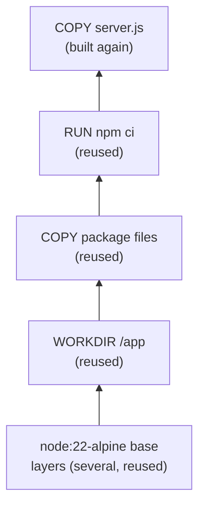

> **In one sentence:** A Dockerfile is a text file of instructions that docker build follows, step by step, to make your own image, and each step that changes files becomes a reusable layer.

## Why should I care?

In [[running-containers|Running Containers]], you ran images that other people made. To run your own program, you need your own image.

Docker's reference says a **Dockerfile** is "a text document that contains all the commands a user could call on the command line to assemble an image."

The commands below were run on a computer with Docker. You only need to read them; Docker does not need to be installed. Lines that start with `$` are commands; you would not type the `$`.

## Analogy

Think of a **stack of books**. To swap a book in the middle, you lift off every book above it.

An image is a stack of **layers**. Change one step, and the steps above it are redone too.

**Where the analogy breaks down:** with books, you put the same books back. Docker instead runs those later steps again and makes new layers. The old layers do not change, so the old image keeps its old stack.

## How it actually works

### A tiny project

The project is one folder with four files (and one more, explained later):

```text
hello/
  Dockerfile
  package.json
  package-lock.json
  server.js
```

`server.js` is a small [[nodejs|Node.js]] web server: in MDN's words, "software that understands URLs (web addresses) and [[http|HTTP]]". You need not understand every line.

```javascript
import http from "node:http";            // Node.js's HTTP server and client
import camelCase from "camelcase";        // a package from npm

const server = http.createServer((request, response) => {
  // Answer every request with this text, in camelCase
  response.end(camelCase("hello from docker") + "\n");
});

server.listen(3000);                      // start listening on port 3000
```

It uses one [[packages|package]], `camelcase`. Its README (the page that describes it) says it converts text like `foo-bar` into `fooBar`.

`package.json` is npm's file for the project. Its `dependencies` part "maps a package name to a version range":

```json
{
  "name": "hello",
  "type": "module",
  "dependencies": {
    "camelcase": "8.0.0"
  }
}
```

`"type": "module"` tells Node.js to read `.js` files "as using ES module syntax", the style that allows `import`. `package-lock.json` was made by npm; it records the exact version of each package installed. Here is the `Dockerfile`:

```dockerfile
FROM node:22-alpine
WORKDIR /app
COPY package.json package-lock.json ./
RUN npm ci
COPY server.js ./
EXPOSE 3000
CMD ["node", "server.js"]
```

You met these instructions in [[containers|Containers]]. Two things in the Dockerfile are new: a smaller base image, `node:22-alpine`, and two `COPY` lines.

### Building the image

`docker build -t hello:1.0 .` has three parts:

- `docker build` starts a build that follows the Dockerfile.
- `-t hello:1.0` gives the image a name, `hello`, and a **tag**, `1.0`. Docker calls a tag "One version within the repository". A repository is a name that holds all versions of one image.
- `.` is the **build context**: the current folder. The `docker` command sends a copy of it to **BuildKit**, "the builder backend used by Docker". By default, the file named `Dockerfile` in it is used.

BuildKit printed this. `--progress=plain` "Prints the raw build progress in a plaintext format"; terminals show a "redrawing" view. "…" marks cuts:

```text
$ docker build --progress=plain -t hello:1.0 .
…
#6 [1/5] FROM docker.io/library/node:22-alpine@sha256:1314fb30…
…
#6 sha256:87aaee1f… 56.25MB / 56.25MB 11.2s done
…
#6 DONE 13.2s

#7 [2/5] WORKDIR /app
#7 DONE 0.4s

#8 [3/5] COPY package.json package-lock.json ./
#8 DONE 0.1s

#9 [4/5] RUN npm ci
…
#9 1.239 added 1 package, and audited 2 packages in 828ms
…
#9 DONE 1.3s

#10 [5/5] COPY server.js ./
#10 DONE 0.0s

#11 exporting to image
…
#11 naming to docker.io/library/hello:1.0 done
#11 DONE 0.1s
```

Read the steps in brackets, `[1/5]` to `[5/5]`. Ignore the `#` numbers, the `sha256` codes and "audited".

- `EXPOSE` and `CMD` "don't get a number, because they don't produce files". `WORKDIR` does: it "Creates" the folder "if it's missing".
- Step 1 downloaded the base image, several layers (lines with MB), so it took longest.

### Layers and the build cache

Docker says "Each Dockerfile instruction that changes files produces one layer, and once a layer is created, it never changes." Docker reuses a layer "only when nothing it depends on has changed". These saved layers are the **build cache**.

Docker checks inputs: "For COPY, the inputs are the files it copies." "For RUN, the input is the command text." And: "Once a step reruns, every step after it reruns too."

Next, the text in `server.js` was changed to `"hello from my image"`, and the image was rebuilt as `hello:1.1` (plain by default outside a terminal):

```text
$ docker build -t hello:1.1 .
…
#4 [1/5] FROM docker.io/library/node:22-alpine@sha256:1314fb30…
#4 DONE 0.0s
…
#6 [2/5] WORKDIR /app
#6 CACHED

#7 [3/5] COPY package.json package-lock.json ./
#7 CACHED

#8 [4/5] RUN npm ci
#8 CACHED

#9 [5/5] COPY server.js ./
#9 DONE 0.0s
…
```

`CACHED` means Docker reused the layer. Only the last `COPY` ran again, because only its file changed.



### Why the order matters

The example in Containers copied the whole `backend` folder before `RUN npm ci`. That works, but any code edit changes that layer, and `npm ci` installs everything again. In Docker's own example, you "wait 40 seconds" each time. Docker's advice: "Copy only the files npm ci needs, install, and copy your source code afterward."

### Keeping files out: .dockerignore

"Everything in the context gets sent, whether the Dockerfile uses it or not," says Docker. A file named `.dockerignore` lists what to leave out, one name or pattern per line:

```text
node_modules
```

`node_modules` is where npm installs packages. Docker's guide says "A local node_modules stays on your machine, and npm ci installs a clean set inside the image instead."

### Tags and versions

A name without a tag means `latest`. But Docker warns: "`latest` is only a default name. It isn't updated automatically and doesn't have to be the newest image." Docker calls it "the usual release habit" to give each new version its own tag.

### Choosing a base image

Docker's advice for a base image: "ensure it's built from a trusted source and keep it small."

`node:22-alpine` is built on Alpine Linux. Docker Hub says Alpine Linux alone is about 5 MB. Node.js comes on top, so this image is bigger: the build downloaded one 56.25 MB layer. This page uses it because Docker Hub calls it useful when small size "is your primary concern". It also warns that some software can "run into issues" on Alpine. If you are unsure, it suggests the default image, here `node:22`.

### Running it

This time the container is named `hello-app`:

```text
$ docker run -d --name hello-app -p 8080:3000 hello:1.1
3692d4fc52b3e5ca1c83ba55476ec6184ffbd4f5f6e5842a607b0ae878ea7b14
$ curl http://localhost:8080
helloFromMyImage
```

`-p 8080:3000` connects port 8080 on your computer to port 3000 inside. The left number can differ, as long as no other program on your computer uses that port. `curl` asked `localhost` (this computer) and printed the answer.

## How it came to be

Wikipedia says Docker "debuted to the public in Santa Clara at PyCon in 2013."

## 🧪 Try it in your browser

You will read the Dockerfile behind the base image above. No account or install is needed.

1. In Chrome, Edge or Firefox, open `https://hub.docker.com/_/node`. The page may look different. If a box about cookies or signing in appears, you can close it.
2. Scroll to **Supported tags and respective `Dockerfile` links**. Press `Ctrl+F` (`Cmd+F` on a Mac) and search for `22-alpine,` with the comma. Its line lists several tags, for example `22.23.5-alpine`. Your numbers will differ.
3. Click the link on that line. A GitHub page opens with a Dockerfile.

**What you should see:** a Dockerfile whose first line is `FROM alpine:` and a version number. Below it are more instructions, such as `RUN` and `CMD`.

**What this shows:** the base image has a Dockerfile too, built on another image.

## Common misunderstandings

- **"`latest` is always the newest version."** No. Docker says it "doesn't have to be the newest image". It is only the default name.
- **"Docker reads only the files the Dockerfile uses."** No. It gets the whole build context, minus `.dockerignore`.

## Recap

- `docker build -t name:tag .` follows the Dockerfile in the current folder and makes a named, tagged image.
- Each step that changes files makes a layer. Docker reuses layers until the first change, then reruns every step after it.
- Install packages before copying your code, list extra files in `.dockerignore`, and tag each version.

## Sources

- Docker Learn, Write your first Dockerfile: https://docs.docker.com/learn/content/write-your-first-dockerfile/
- Docker Learn, How image layers and the build cache work: https://docs.docker.com/learn/content/how-image-layers-and-the-build-cache-work/
- Docker Learn, Share your image on Docker Hub: https://docs.docker.com/learn/content/share-your-image-on-docker-hub/
- Docker Docs, Dockerfile reference: https://docs.docker.com/reference/dockerfile/
- Docker Docs, docker buildx build (alias docker build): https://docs.docker.com/reference/cli/docker/buildx/build/
- Docker Docs, Docker build cache: https://docs.docker.com/build/cache/
- Docker Docs, Build context: https://docs.docker.com/build/concepts/context/
- Docker Docs, Building best practices: https://docs.docker.com/build/building/best-practices/
- Docker Docs, BuildKit: https://docs.docker.com/build/buildkit/
- Docker Docs, docker container run: https://docs.docker.com/reference/cli/docker/container/run/
- Docker Hub, node (Docker Official Image): https://hub.docker.com/_/node
- Node.js Docker image, Dockerfile for 22/alpine3.24: https://github.com/nodejs/docker-node/blob/main/22/alpine3.24/Dockerfile
- npm Docs, npm ci: https://docs.npmjs.com/cli/v12/commands/npm-ci
- camelcase (package source code and README): https://github.com/sindresorhus/camelcase
- npm Docs, package.json: https://docs.npmjs.com/cli/v12/configuring-npm/package-json
- npm Docs, package-lock.json: https://docs.npmjs.com/cli/v12/configuring-npm/package-lock-json
- Node.js documentation, Modules, Packages: https://nodejs.org/api/packages.html
- Docker Learn, Run your first container: https://docs.docker.com/learn/content/run-your-first-container/
- Node.js documentation, HTTP: https://nodejs.org/api/http.html
- MDN Web Docs, What is a web server?: https://developer.mozilla.org/en-US/docs/Learn_web_development/Howto/Web_mechanics/What_is_a_web_server
- curl, man page: https://curl.se/docs/manpage.html
- Wikipedia, Localhost: https://en.wikipedia.org/wiki/Localhost
- Wikipedia, Docker (software): https://en.wikipedia.org/wiki/Docker_(software)
