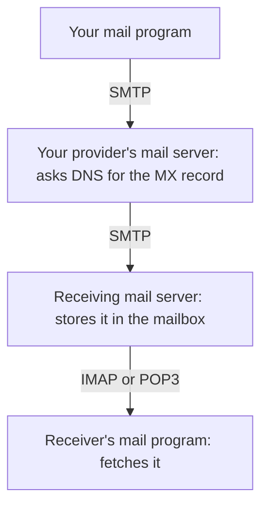

> **In one sentence:** Email travels from mail server to mail server, using DNS to find the receiver's server, and waits there until the receiver's mail program fetches it.

## Why should I care?

When you send an email, it can reach someone on the other side of the world, even if their computer or phone is switched off.

How does it find its way? It uses three things you already know: [[protocols]], [[client-and-server|clients and servers]], and [[domain-name|domain names]].

## Analogy

Think of sending a **letter by post**. You drop the letter at your local post office. It reads the address and sends the letter to the post office near the receiver, which puts it in the receiver's mailbox. Later, the receiver takes it out.

Email works in a similar way. Your **email provider** (the company or organization that gives you your email address) acts like your local post office.

**Where the analogy breaks down:** a letter ends up in a box at the receiver's home. An email does not go to the receiver's phone or computer. It waits on a server that belongs to the receiver's provider. The receiver's program fetches it from there. Also, a letter is one paper object. An email is data, so the server can keep it after the receiver reads it.

## How it actually works

### The parts of an email address

Look at the address `ana@example.com`. The `@` sign splits it in two. The official rules for email call this form `local-part@domain`:

- **`ana`** is the **local part**. It names one mailbox.
- **`example.com`** is a **domain name**. Its mail servers hold that mailbox.

The domain part follows the normal rules for domain names, so capital letters do not matter in it. `ana@EXAMPLE.COM` goes to the same domain as `ana@example.com`. For the local part, the official rules say mail servers must keep capital letters as they are, because some servers treat `Ana` and `ana` as different mailboxes. To be safe, type it exactly as you were given it.

### The journey of one message

Programs you use to write and read email are called **mail programs**. Many email providers also have a website for email, called **webmail**: a website that does the job of a mail program in your browser. Both are [[client-and-server|clients]]. The servers that pass email along are called **mail servers**.

You send a message to `ana@example.com`. Here is what happens (simplified):

1. **You press Send.** Your mail program hands the message to your provider's mail server. This step is called **submission**.
2. **Your provider's server looks up the receiver's domain.** It asks [[dns|DNS]]. DNS keeps several kinds of information about each domain, called **records**. One kind gives the IP address. Another kind is the **MX record**. MX stands for "mail exchanger". An MX record gives the name of a mail server that accepts email for that domain, here `example.com`.
3. **Your provider's server sends the message on.** It asks DNS again, this time for the IP address of that mail server. Then it contacts that server and sends the message. Sometimes the message passes through more mail servers on the way. These are called **relays**.
4. **The receiving server stores it.** It puts the message into Ana's **mailbox**: a place for her messages on that server.
5. **Ana's mail program fetches it.** Later, when Ana opens her mail program, it asks the server for new messages, and she sees yours.

The sender and the receiver do not need to be online at the same time. The servers hold each message and pass it on. This way of working is called **store-and-forward**.

If there are several MX records for a domain, each one has a number. The official rules say: "Lower numbers are more preferred than higher ones." So the server tries the one with the lowest number first.

### The protocols behind each step

- **SMTP** (Simple Mail Transfer Protocol) is for **sending**. Mail servers use it to pass messages to each other. Its official description says its goal is "to transfer mail reliably and efficiently." Mail programs also use SMTP to submit new messages to their provider's server.
- **IMAP** (Internet Message Access Protocol) is for **reading**. It lets your mail program work with messages that stay on the server. Your folders, such as your inbox, are on the server too.
- **POP3** (Post Office Protocol, version 3) is another way to **read**. Its official description says: "normally, mail is downloaded and then deleted." So the messages usually move from the server to one device.

Here is the whole journey again, with the protocol used at each step:

## How it came to be

In 1971, Ray Tomlinson, a computer engineer at the company Bolt Beranek and Newman (BBN), changed a program called SNDMSG. Before, it could only leave messages for people on the same computer. Now it could send messages to other computers on [[arpanet|ARPANET]]. He chose the `@` sign to separate a person's user name (the name they sign in with) from the name of their computer. That is why your address has an `@` today.

In August 1982, Jonathan B. Postel published RFC 821, a description of SMTP. (An **RFC** is a public document that describes how a part of the internet works.) SMTP has been updated since then, for example in RFC 5321 (2008).

## 🧪 Try it in your browser

You will look up the MX record of a real domain, as a mail server does before it sends a message. This only looks. It changes nothing, and you do not need an account.

1. In Chrome, Edge or Firefox, open this link to Dig, a Google tool that asks DNS questions: [toolbox.googleapps.com/apps/dig/#MX/wikipedia.org](https://toolbox.googleapps.com/apps/dig/#MX/wikipedia.org). Google's help pages suggest this tool for checking MX records. The end of the link, `#MX/wikipedia.org`, asks for the MX records of `wikipedia.org`. If no results appear, type `wikipedia.org` in the box at the top and press `Enter`.
2. **What you should see:** one or more lines that contain the letters `MX`. Look at the end of each of these lines: a number, then a name, like `10 mail.example.com.` (that one is only an example). The number tells which server to try first: lower first. The name is a mail server that accepts email for `wikipedia.org`. The dot at the very end is how DNS tools write a full domain name.
3. Now open this second link, for Gmail: [toolbox.googleapps.com/apps/dig/#MX/gmail.com](https://toolbox.googleapps.com/apps/dig/#MX/gmail.com). **What you should see:** different mail servers: the ones that accept email for Gmail addresses.

## Common misunderstandings

- **"An email goes straight from my computer to the receiver's computer."** No. It goes through mail servers. It waits on a server of the receiver's provider until their program fetches it.
- **"The receiver has to be online when I send."** No. Email is store-and-forward. The message waits on the server.
- **"The `@` sign is part of the domain name."** No. It separates the local part (the mailbox) from the domain (whose mail servers hold the mailbox).

## Recap

- An email address is `local-part@domain`. The domain tells mail servers where to deliver the message.
- Your provider's mail server uses DNS (the MX record) to find the receiver's mail server, and sends the message there with SMTP.
- The message waits in the receiver's mailbox on the server. Their mail program fetches it with IMAP (messages stay on the server) or POP3 (usually downloaded, then deleted).

## Sources

- RFC 5321, Simple Mail Transfer Protocol: https://www.rfc-editor.org/rfc/rfc5321
- RFC 821, Simple Mail Transfer Protocol (1982): https://www.rfc-editor.org/rfc/rfc821
- RFC 6409, Message Submission for Mail: https://www.rfc-editor.org/rfc/rfc6409
- RFC 5598, Internet Mail Architecture: https://www.rfc-editor.org/rfc/rfc5598
- RFC 9051, IMAP Version 4rev2: https://www.rfc-editor.org/rfc/rfc9051
- RFC 1939, Post Office Protocol, Version 3: https://www.rfc-editor.org/rfc/rfc1939
- Centre for Computing History, Ray Tomlinson: https://www.computinghistory.org.uk/det/1787/Ray-Tomlinson/
- Google Workspace Admin Help, Set up MX records for Google Workspace: https://knowledge.workspace.google.com/admin/domains/set-up-mx-records-for-google-workspace
- Google Admin Toolbox, Dig: https://toolbox.googleapps.com/apps/dig/
- Wikipedia, Email (general background reference): https://en.wikipedia.org/wiki/Email
