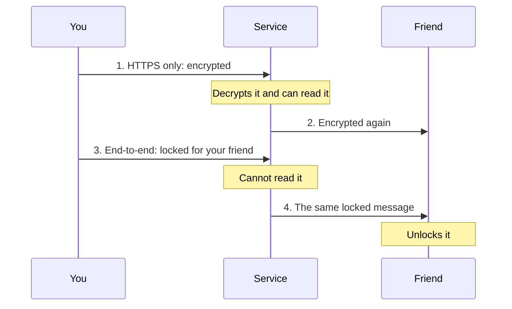

> **In one sentence:** With end-to-end encryption, a message is locked on the sender's device and can only be unlocked on the receiver's device, so the service that carries it cannot read it.

## Why should I care?

Some messaging apps say that your chats are "end-to-end encrypted". Google says that in Google Messages, when both people meet its conditions, no one, "including Google", can read the messages on the way. Apple says iMessage messages are "secured with end-to-end encryption so that no one but the sender and receiver can access them".

In [[https]], you learned how HTTPS encrypts messages between your browser and a server. This page shows the gap HTTPS leaves open.

## Analogy

Imagine you send a letter to a friend through a post office.

- **HTTPS only:** you put the letter in a locked box. The post office has the key. It opens the box and can read the letter. Then it locks the letter in a new box for your friend.
- **End-to-end:** your friend first sends you an open padlock. Only your friend has the key to it. You lock the box with that padlock. The post office carries the box, but it cannot open it. Only your friend can.

**Where the analogy breaks down:** keys and padlocks are numbers, not objects. Your friend's "open padlock" (a **public key**) can be made public, so anyone can lock messages for your friend. Also, the post office still sees the outside of the box: who sent it, to whom, and when. This outside information is called **metadata**.

## How it actually works

### Two ways to protect a message

The EFF's Surveillance Self-Defense guide compares two kinds of encryption.

**Transport-layer encryption** "protects messages as they travel from your device to the app's servers". Then it protects them again from the servers to the receiver. HTTPS is this kind. With a chat app, your HTTPS connection ends at the company's server, not at your friend. A messaging service that uses only this kind "can see unencrypted copies of your messages". Its servers decrypt each message and encrypt it again before sending it on.

**End-to-end encryption** "protects messages in transit all the way from sender to receiver". The two "ends" are the devices: "Only the endpoints (the original devices sending and receiving encrypted messages) can decrypt the message."



### Where the keys live

With end-to-end encryption, the keys that unlock a message stay on the devices.

Apple says that when iMessage is turned on, "the device generates encryption and signing pairs of keys". The public keys are sent to Apple's directory, which links them to your phone number or email address. Google says that in Google Messages, a new secret key is made on the two devices for each message. "It exists only on these two devices", and it is not shared "with Google, anyone else, or other devices". (How two devices agree on a secret without sending it is beyond this page, as in HTTPS.)

One standard way to send such a message is described in RFC 4880, the description of **OpenPGP**. Simplified, it works like this:

1. Your friend has a key pair: a public key that anyone may have, and a private key that only your friend keeps.
2. Your device makes a new random secret key, a **session key**, "for this message only".
3. Your device encrypts the message with the session key. Then it encrypts the session key with your friend's public key.
4. The service carries both. It has neither key, so it cannot read them.
5. Your friend's device decrypts the session key with its private key, and then the message.

(Messaging apps use their own, more complex methods.)

## How it came to be

In 1991, Philip Zimmermann published his program **PGP** in electronic form, for free. He wrote that you don't want your private email "or confidential documents read by anyone else". OpenPGP is based on PGP. RFC 4880, from November 2007, says OpenPGP software uses "a combination of strong public-key and symmetric cryptography": the session key is the symmetric part.

## 🧪 Try it in your browser

You will play the "session key" part of the steps above: encrypt and decrypt a short message inside your own browser tab. The code sends nothing anywhere. You need a computer with a keyboard. You do not need to understand every symbol.

**Safety rule:** only type code in the console that you understand or that comes from a source you trust. Never paste code that a stranger sends you.

1. In Chrome, Edge or Firefox, open `https://example.com`.
2. Open the **console**, the part of the browser's built-in tools where you can type commands:
   - **Chrome and Edge:** press `Ctrl` + `Shift` + `J` (Mac: `Cmd` + `Option` + `J`)
   - **Firefox:** press `Ctrl` + `Shift` + `K` (Mac: `Cmd` + `Option` + `K`)
3. Click the empty line at the bottom. **Type** each line below yourself, exactly, with the same capital letters, and press `Enter` after each one. (Browsers may block pasting here.) After each line, the console shows a short description of what was made. If you see red text, look for a typo and type the line again.

   This line makes a new random secret key. `AES-GCM` is the name of a cipher.

   ```
   key = await crypto.subtle.generateKey({name: "AES-GCM", length: 128}, false, ["encrypt", "decrypt"])
   ```

   This line makes a random value that the cipher needs, called an `iv` (initialization vector). It must be new for every message you encrypt with the same key.

   ```
   opts = {name: "AES-GCM", iv: crypto.getRandomValues(new Uint8Array(12))}
   ```

   This line turns the word `Hello` into [[byte|bytes]] and encrypts them with the key.

   ```
   box = await crypto.subtle.encrypt(opts, key, new TextEncoder().encode("Hello"))
   ```

4. Type `new Uint8Array(box)` and press `Enter`. **What you should see:** a list of numbers, such as `Uint8Array(21) [141, 17, 73, …]`. Your numbers will be different. There are 21, not 5: the cipher adds 16 that let the receiver check that nothing was changed. This is the ciphertext. It is all a service in the middle would see.
5. Type this line and press `Enter`:

   ```
   new TextDecoder().decode(await crypto.subtle.decrypt(opts, key, box))
   ```

   **What you should see:** `"Hello"` (or `'Hello'`). Only the key could turn the numbers back into your word.
6. Close the tab.

## Common misunderstandings

- **"End-to-end encrypted means nobody can ever see my messages."** The ends can. The EFF guide warns that if your devices "are compromised" (taken over by an attacker), your encrypted messages can be too. Google adds that received encrypted messages are "included in Android backup".
- **"The service knows nothing about my chats."** It can still see metadata: "everything except the content of your communications", in the EFF's words. A service with end-to-end encryption may still collect some, "like what time a message is sent".
- **"Every message in the app is end-to-end encrypted."** Not always. In Google Messages, a chat can fall back to SMS, a kind of text message that Google says is "not end-to-end encrypted". Google Messages shows a lock next to a message's time when end-to-end encryption is used.

## Recap

- HTTPS protects a message on the way to the server, but the server can read it. End-to-end encryption protects it all the way to the receiver's device.
- The keys that unlock the message stay on the sender's and receiver's devices, so the service in the middle cannot read it.
- It does not protect the devices themselves, and it does not hide metadata such as who you talk to and when.

## Sources

- EFF Surveillance Self-Defense, What Should I Know About Encryption?: https://ssd.eff.org/module/what-should-i-know-about-encryption
- EFF Surveillance Self-Defense, Why Metadata Matters: https://ssd.eff.org/module/why-metadata-matters
- MDN Web Docs, Public-key cryptography (glossary): https://developer.mozilla.org/en-US/docs/Glossary/Public-key_cryptography
- Google Messages Help, How end-to-end encryption in Google Messages provides more security: https://support.google.com/messages/answer/10262381?hl=en
- Apple Platform Security, iMessage security overview: https://support.apple.com/guide/security/imessage-security-overview-secd9764312f/web
- RFC 4880, OpenPGP Message Format: https://www.rfc-editor.org/rfc/rfc4880.html
- Philip R. Zimmermann, Why I Wrote PGP: https://www.philzimmermann.com/EN/essays/WhyIWrotePGP.html
- MDN Web Docs, SubtleCrypto.generateKey(): https://developer.mozilla.org/en-US/docs/Web/API/SubtleCrypto/generateKey
- MDN Web Docs, SubtleCrypto.encrypt(): https://developer.mozilla.org/en-US/docs/Web/API/SubtleCrypto/encrypt
- MDN Web Docs, SubtleCrypto.decrypt(): https://developer.mozilla.org/en-US/docs/Web/API/SubtleCrypto/decrypt
- MDN Web Docs, AesGcmParams: https://developer.mozilla.org/en-US/docs/Web/API/AesGcmParams
- W3C Web Cryptography API: https://w3c.github.io/webcrypto/
- MDN Web Docs, TextEncoder: https://developer.mozilla.org/en-US/docs/Web/API/TextEncoder
- V8, Top-level await: https://v8.dev/features/top-level-await
- Firefox source, Web Console test for top-level await: https://searchfox.org/firefox-main/source/devtools/client/webconsole/test/browser/browser_jsterm_await.js
- Chrome for Developers, Open Chrome DevTools: https://developer.chrome.com/docs/devtools/open
- Microsoft Edge DevTools, Keyboard shortcuts: https://learn.microsoft.com/en-us/microsoft-edge/devtools/shortcuts/
- Firefox DevTools User Docs, Web Console: https://firefox-source-docs.mozilla.org/devtools-user/web_console/index.html
- Chrome for Developers, Self-XSS protection: https://developer.chrome.com/blog/self-xss
