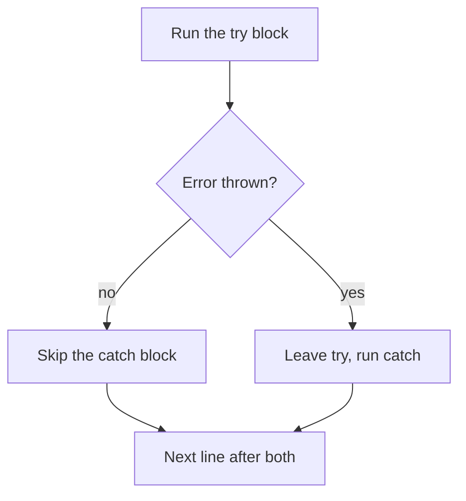

> **In one sentence:** Code usually fails in one of three main ways: before it runs, while it runs, or by giving a wrong answer. Error messages, throw, try and catch help you find and handle these failures.

## Why should I care?

You have already met error messages: `console.lgo` in [[what-is-programming|What is Programming, Really?]], and `sum is not defined` in [[functions|Functions]]. MDN Web Docs, a website that documents web technologies, says errors "can be a helpful debugging aid".

A **bug** is a mistake in a program, and each kind of error below can come from one.

## Analogy

In What is Programming, your program was a recipe, and the computer was the helper. A recipe can fail in three ways:

- **Syntax error:** a line cannot be read, so the helper does not start.
- **Runtime error:** step 5 needs an egg and there is none, so the helper stops.
- **Logic error:** the recipe says "two cups of salt", not "two spoons". Every step works, but the food tastes bad.

**Where the analogy breaks down:** a real helper may guess a word, buy an egg or taste the food. A computer does none of this.

## How it actually works

### Three kinds of error

MDN names "three main types" of error. (This is simplified. MDN says there are other differences.) Each example on this page is a separate program.

**A syntax error** breaks the language's rules. *Syntax* means the rules about how a program is structured.

```js
console.log("Before");
console.log("After"; // a mistake: the closing round bracket is missing
```

This shows only an error message that says `missing ) after argument list`. `Before` does not appear. JavaScript checks a script before running it. If the check fails, you get a `SyntaxError`, and that script does not start.

A web page can have other scripts, and each one is checked separately.

**A runtime error** happens while the code runs. The code follows the rules, so it starts. Then something goes wrong.

```js
console.log("Before");
console.log(total); // a mistake: no variable named total exists
console.log("Never shown");
```

This shows `Before`. Then the script stops with an error that says `total is not defined`. The console keeps working and reads your next line.

**A logic error** usually gives a wrong result with no message.

```js
// The goal: the cost of some notebooks, at a given price each.
function totalCost(count, price) {
  return count + price; // a mistake: this should be count * price
}

console.log(totalCost(3, 4)); // shows 7, but the right answer is 12
```

MDN says these errors are "often harder to fix than syntax errors", because "there usually isn't an error message". To find one, compare the result with the answer you expected.

So `console.lgo` and `sum is not defined` were runtime errors. `console.log("2 + 3")` was a logic error.

### Reading an error message

MDN gives this example, in two parts:

```
Uncaught TypeError: guessSubmit.addeventListener is not a function
number-game-errors.html:87:19
```

The first part says what went wrong. `TypeError` is the error's **name**, and the rest is its **message**. The mistake is a small `e`: the correct name is `addEventListener`. (MDN calls this a syntax error there, but its definition of a runtime error includes calling something that is not a function.) The second part says where: "line 87, character 19" of that file.

What the console shows may start with `Uncaught`, and the console may add other text around it. Browsers may word a message differently.

Read the name and message. If it gives a file and a line, go there. MDN warns that "the error will not necessarily be on that line".

### Throwing your own error

Each notebook costs 4 coins, so the function below works out `count * 4`. Without a check, a count of -2 would give -8, with no message. The `throw` statement lets your code report a value it cannot use.

```js
function notebookCost(count) {
  if (count < 1) {
    // Make an error object, then throw it. The function ends here.
    throw new Error("Count must be at least 1");
  }
  return count * 4;
}

console.log(notebookCost(3)); // shows 12
console.log(notebookCost(0)); // the error stops the program here
console.log("Never shown");
```

This shows `12`, then an error message with your words in it.

`new` means "create a new one", so `new Error("...")` creates an **error object**. An **object** is one value with named pieces of information. This one has a `name` and a `message`, and your text becomes the `message`.

A thrown error is a runtime error, and MDN also calls it an **exception**. The statements after `throw` do not run. The error goes to the code that called the function. If no code catches it, MDN says the program ends. Other values can be thrown, but MDN says to always throw an `Error` object.

### Catching an error with `try` and `catch`

Use these when your program can respond to a failure and go on. Put code that may fail in a `try` block, and your response in a `catch` block.

```js
function notebookCost(count) {
  if (count < 1) {
    throw new Error("Count must be at least 1");
  }
  return count * 4;
}

try {
  console.log(notebookCost(3)); // shows 12
  console.log(notebookCost(0)); // this call throws, so go to catch
  console.log("Never shown");
} catch (error) {
  // error holds the thrown error object.
  console.log("Problem: " + error.message);
}

console.log("The program goes on");
```

This shows:

```
12
Problem: Count must be at least 1
The program goes on
```

`notebookCost(0)` throws. The error leaves the function, reaches the call inside `try`, and the program moves to `catch`.

You choose the name after `catch`. Here `error`, with a small `e`, is a variable that exists only in that block. `Error` is JavaScript's own. A dot reads one piece of an object.

JavaScript's own runtime errors are caught the same way. MDN says they "result in new `Error` objects being created and thrown".

```js
try {
  console.log(total); // JavaScript itself throws an error here
} catch (error) {
  // Shows ReferenceError: total is not defined
  console.log(error.name + ": " + error.message);
}
```



## How it came to be

Wikipedia reports that the programming language LISP 1.5, with a manual dated 1961, could catch errors with `ERRORSET`. Wikipedia also lists "try/catch exception handling" in the 3rd edition of ECMAScript, JavaScript's standard, from December 1999.

## 🧪 Try it in your browser

You need a computer with Chrome, Edge or Firefox.

**Safety rule:** only type code in the console that you understand or that comes from a source you trust. Never paste anything a stranger sends you. The lines below only define a function, cause errors on purpose and show messages in the console.

1. Open [example.com](https://example.com).
   **What you should see:** a short page of text.
2. Open the **console**:
   - **Windows:** press `Ctrl` + `Shift` + `J` (in Firefox: `Ctrl` + `Shift` + `K`)
   - **Mac:** press `Cmd` + `Option` + `J` (in Firefox: `Cmd` + `Option` + `K`)
3. Click the line where you can type, below any messages. **Type** this line yourself (some browsers may block pasting at first), then press `Enter`. It has one bracket too many, on purpose, so typing more cannot complete it. (With a missing bracket, the console may give a new line and no answer, because it waits for you to finish.) The browser may show suggestions, and the line may look different while you type. Keep typing.

   ```
   console.log("Hi"))
   ```

   **What you should see:** an error message with the word `SyntaxError`. `Hi` is not shown as output.
4. This line uses a variable that does not exist. Type it and press `Enter`:

   ```
   console.log(total)
   ```

   **What you should see:** an error message that says `total is not defined`.
5. If a line below gives an unexpected error, or a new line and no answer, look for a typo. Reload the page, delete anything left on the typing line, and start again here.

   This line defines the function. Type it and press `Enter`:

   ```
   function notebookCost(count) { if (count < 1) { throw new Error("Count must be at least 1"); } return count * 4; }
   ```

   **What you should see:** no message from your code. The console may also show `undefined`. That is normal.
6. This line calls it with 0 and catches the error. Type it and press `Enter`:

   ```
   try { notebookCost(0); } catch (error) { console.log("Problem: " + error.message); }
   ```

   **What you should see:** `Problem: Count must be at least 1`. The console may also show `undefined`.
7. This line catches an error that JavaScript itself makes. Type it and press `Enter`:

   ```
   try { console.log(total); } catch (error) { console.log(error.name + ": " + error.message); }
   ```

   **What you should see:** `ReferenceError: total is not defined`. The console may also show `undefined`.

## Common misunderstandings

- **"`try` catches every kind of error."** No. A syntax error in the same script stops that script from starting, so its `try` never runs. A logic error usually throws nothing, so there is nothing to catch.
- **"`catch` repairs the problem."** No. It only runs the code you wrote in it. The rest of the `try` block is not run afterward, which is why `Never shown` never appeared.

## Recap

- A syntax error stops its script from starting. A runtime error stops code while it runs. A logic error usually gives a wrong result with no message.
- An error message gives a name, a message and may give a place. The cause may be on another line.
- `throw` reports an error, and `try` and `catch` let your program respond and go on.

## Sources

- MDN Web Docs, What went wrong? Troubleshooting JavaScript: https://developer.mozilla.org/en-US/docs/Learn_web_development/Core/Scripting/What_went_wrong
- MDN Web Docs, Control flow and error handling: https://developer.mozilla.org/en-US/docs/Web/JavaScript/Guide/Control_flow_and_error_handling
- MDN Web Docs, try...catch: https://developer.mozilla.org/en-US/docs/Web/JavaScript/Reference/Statements/try...catch
- MDN Web Docs, throw: https://developer.mozilla.org/en-US/docs/Web/JavaScript/Reference/Statements/throw
- MDN Web Docs, Error: https://developer.mozilla.org/en-US/docs/Web/JavaScript/Reference/Global_Objects/Error
- MDN Web Docs, Error() constructor: https://developer.mozilla.org/en-US/docs/Web/JavaScript/Reference/Global_Objects/Error/Error
- MDN Web Docs, Error.prototype.message: https://developer.mozilla.org/en-US/docs/Web/JavaScript/Reference/Global_Objects/Error/message
- MDN Web Docs, Error.prototype.name: https://developer.mozilla.org/en-US/docs/Web/JavaScript/Reference/Global_Objects/Error/name
- MDN Web Docs, SyntaxError: https://developer.mozilla.org/en-US/docs/Web/JavaScript/Reference/Global_Objects/SyntaxError
- MDN Web Docs, JavaScript error reference: https://developer.mozilla.org/en-US/docs/Web/JavaScript/Reference/Errors
- MDN Web Docs, SyntaxError: missing ) after argument list: https://developer.mozilla.org/en-US/docs/Web/JavaScript/Reference/Errors/Missing_parenthesis_after_argument_list
- MDN Web Docs, SyntaxError: Unexpected token: https://developer.mozilla.org/en-US/docs/Web/JavaScript/Reference/Errors/Unexpected_token
- MDN Web Docs, ReferenceError: "x" is not defined: https://developer.mozilla.org/en-US/docs/Web/JavaScript/Reference/Errors/Not_defined
- MDN Web Docs, Object (glossary): https://developer.mozilla.org/en-US/docs/Glossary/Object
- MDN Web Docs, eval(): https://developer.mozilla.org/en-US/docs/Web/JavaScript/Reference/Global_Objects/eval
- MDN Web Docs, console.log(): https://developer.mozilla.org/en-US/docs/Web/API/console/log_static
- MDN Web Docs, About MDN: https://developer.mozilla.org/en-US/about
- Allen B. Downey, Think Python, 2nd edition, Variables, expressions and statements (chapter 2): https://greenteapress.com/thinkpython2/html/thinkpython2003.html
- ECMAScript language specification (ECMA-262), Scripts and Modules: https://tc39.es/ecma262/multipage/ecmascript-language-scripts-and-modules.html
- ECMAScript language specification (ECMA-262), Source Text: https://tc39.es/ecma262/multipage/ecmascript-language-source-code.html
- Wikipedia, Exception handling (programming): https://en.wikipedia.org/wiki/Exception_handling_(programming)
- Wikipedia, ECMAScript version history: https://en.wikipedia.org/wiki/ECMAScript_version_history
- MDN Web Docs, The script element: https://developer.mozilla.org/en-US/docs/Web/HTML/Reference/Elements/script
- MDN Web Docs, new: https://developer.mozilla.org/en-US/docs/Web/JavaScript/Reference/Operators/new
- Allen B. Downey, Think Python, 2nd edition, The way of the program (chapter 1): https://greenteapress.com/thinkpython2/html/thinkpython2002.html
- Wikipedia, Lisp (programming language): https://en.wikipedia.org/wiki/Lisp_(programming_language)
- WHATWG HTML Standard, Web application APIs (scripting): https://html.spec.whatwg.org/multipage/webappapis.html
- MDN Web Docs, TypeError: "x" is not a function: https://developer.mozilla.org/en-US/docs/Web/JavaScript/Reference/Errors/Not_a_function
- Example Domain: https://example.com
- Chrome for Developers, Open Chrome DevTools: https://developer.chrome.com/docs/devtools/open
- Chrome for Developers, Run JavaScript in the Console: https://developer.chrome.com/docs/devtools/console/javascript
- Microsoft Edge DevTools, Keyboard shortcuts: https://learn.microsoft.com/en-us/microsoft-edge/devtools/shortcuts/
- Microsoft Edge DevTools, Run JavaScript in the Console: https://learn.microsoft.com/en-us/microsoft-edge/devtools/console/console-javascript
- Firefox DevTools User Docs, Web Console: https://firefox-source-docs.mozilla.org/devtools-user/web_console/index.html
- Firefox DevTools User Docs, The JavaScript input interpreter: https://firefox-source-docs.mozilla.org/devtools-user/web_console/the_command_line_interpreter/index.html
- Chrome for Developers, What are self-XSS attacks?: https://developer.chrome.com/blog/self-xss
