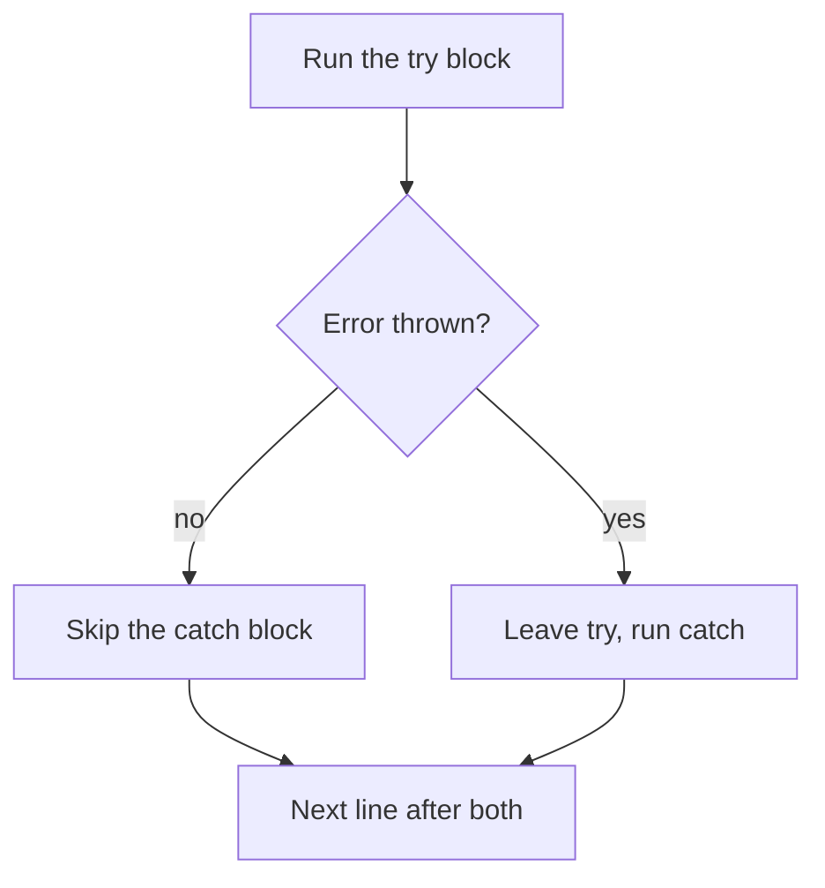
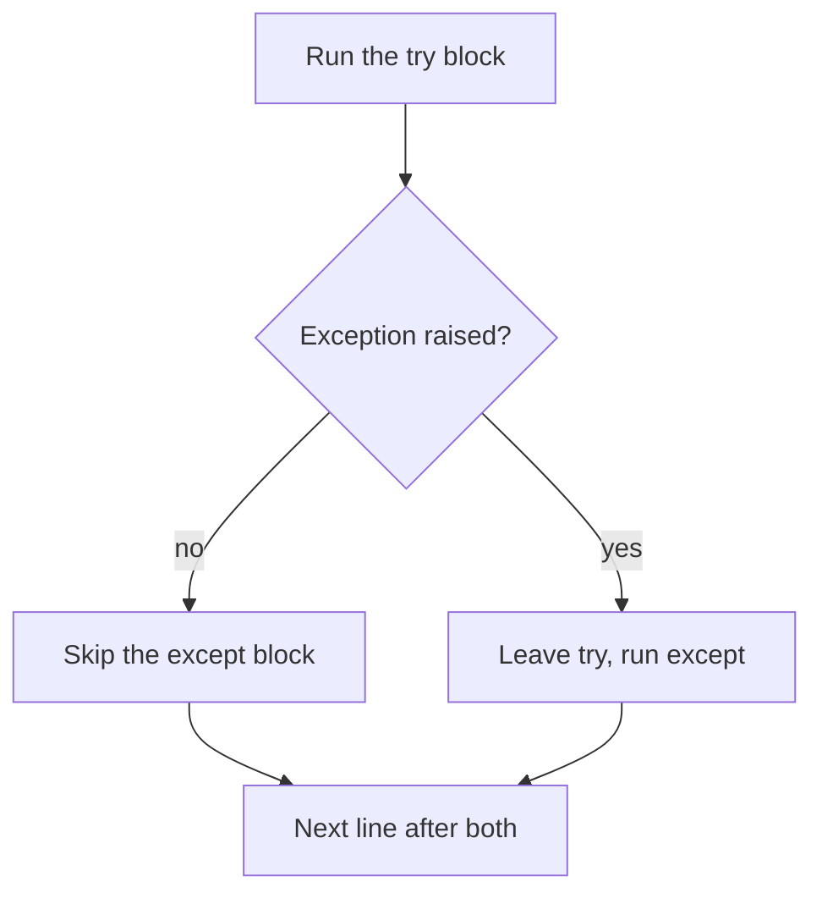
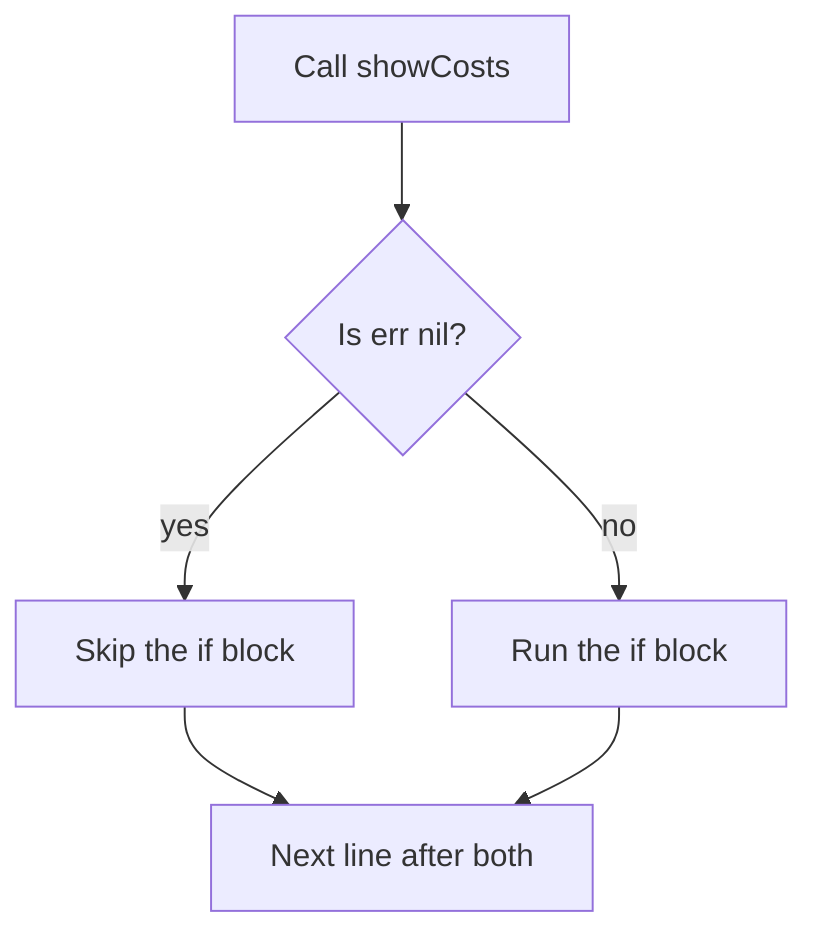

> **In one sentence:** Code usually fails in one of three main ways: before it runs, while it runs, or by giving a wrong answer. Error messages help you find these failures, and your code can respond to many of them.

## Why should I care?

You have already met error messages. In [[what-is-programming|What is Programming, Really?]], a misspelled name gave one. In [[functions|Functions]], so did a variable used outside its function. MDN Web Docs, a website that documents web technologies, says errors "can be a helpful debugging aid".

## Analogy

In What is Programming, your program was a recipe, and the computer was the helper. A recipe can fail in three ways:

- **Syntax error:** a line cannot be read, so the helper does not start.
- **Runtime error:** step 5 needs an egg and there is none, so the helper stops.
- **Logic error:** the recipe says "two cups of salt", not "two spoons". Every step works, but the food tastes bad.

**Where the analogy breaks down:** a real helper may guess a word, buy an egg or taste the food. A computer does none of this.

## How it actually works

### Three kinds of error

MDN names "three main types" of error. (This is simplified. MDN says there are other differences.)

**A syntax error** breaks the language's rules, as a missing bracket does. *Syntax* means the rules about how a program is structured.

**A runtime error** happens while the code runs. The code follows the rules, so it starts. Then something goes wrong. In JavaScript and Python, using a name that does not exist is one example.

**A logic error** usually gives a wrong result with no message, as adding where you should multiply does. To find one, compare the result with the answer you expected.

Here are all three in JavaScript, [[python|Python]] and [[go-language|Go]]. You only need to read one tab.

<!-- tabs -->

### JavaScript

**Syntax error:**

```js
console.log("Before");
console.log("After"; // a mistake: the closing round bracket is missing
```

This shows only an error message that says `missing ) after argument list`. `Before` does not appear. JavaScript checks a script before running it. If the check fails, you get a `SyntaxError`, and that script does not start.

**Runtime error:**

```js
console.log("Before");
console.log(total); // a mistake: no variable named total exists
console.log("Never shown");
```

This shows `Before`. Then the script stops with an error that says `total is not defined`.

So `console.lgo` and `sum is not defined` were runtime errors.

**Logic error:**

```js
// The goal: the cost of some notebooks, at a given price each.
function totalCost(count, price) {
  return count + price; // a mistake: this should be count * price
}

console.log(totalCost(3, 4)); // shows 7, but the right answer is 12
```

### Python

Python's interpreter runs your file directly. `print()` writes the value in its brackets. A `#` starts a comment: a note that Python does not run.

**Syntax error:**

```python
print("Before")
print("After"  # a mistake: the closing round bracket is missing
```

This shows only an error message that ends with `SyntaxError: '(' was never closed`. `Before` does not appear. Python reads the file first, and a syntax error found then stops it before line 1 runs.

**Runtime error:**

```python
print("Before")
print(total)  # a mistake: no variable named total exists
print("Never shown")
```

This shows `Before`. Then the program stops with an error message that ends with `NameError: name 'total' is not defined`.

Python calls an error found while the code runs an **exception**.

**Logic error:**

```python
# The goal: the cost of some notebooks, at a given price each.
def total_cost(count, price):
    return count + price  # a mistake: this should be count * price

print(total_cost(3, 4))  # shows 7, but the right answer is 12
```

`def` starts a function, and `return` gives a value back. The body of the function must be indented (moved to the right with spaces). Python groups statements by indentation.

### Go

Go is compiled: a compiler translates your program before it runs. The command `go run` compiles a program and then runs it.

Each program here starts in the same way. A package is a way to group functions. `package main` names the package where a program starts, and `import "fmt"` brings in the `fmt` package, which can print text. `func main()` defines the function that runs when you run the program, and `{ }` holds its code. `fmt.Println` writes a line. `//` starts a comment, a note that Go does not run.

**Syntax error:**

```go
package main

import "fmt"

func main() {
	fmt.Println("Before")
	fmt.Println("After" // a mistake: the closing round bracket is missing
}
```

The compiler refuses this program and shows an error message. `Before` does not appear, because the program never starts.

The compiler also refuses other mistakes. A variable that does not exist is refused too, because Go's rules say every name must be declared (created). In Go, that mistake is not a runtime error.

**Runtime error:**

```go
package main

import "fmt"

func main() {
	count := 0 // := creates a variable and gives it a value
	fmt.Println("Before")
	fmt.Println(10 / count) // a mistake: you cannot divide by zero
	fmt.Println("Never shown")
}
```

This shows `Before`. Then the program stops with an error message. Go calls this a **panic**. (Writing `10 / 0` directly is different: the compiler refuses it.)

**Logic error:**

```go
package main

import "fmt"

// The goal: the cost of some notebooks, at a given price each.
func totalCost(count int, price int) int {
	return count + price // a mistake: this should be count * price
}

func main() {
	fmt.Println(totalCost(3, 4)) // shows 7, but the right answer is 12
}
```

`func` starts a function, and `return` gives a value back. A function must name the kind of each value it takes and gives back: `int` means an integer (a whole number). The last `int` says what the function gives back.

<!-- /tabs -->

### Reading an error message

An error message says what went wrong, and often where. Its layout depends on the language.

<!-- tabs -->

### JavaScript

MDN gives this example, in two parts:

```
Uncaught TypeError: guessSubmit.addeventListener is not a function
number-game-errors.html:87:19
```

The first part says what went wrong. `TypeError` is the error's **name**, and the rest is its **message**. The mistake is a small `e`: the correct name is `addEventListener`. (MDN calls this a syntax error there, but it fits MDN's definition of a runtime error.) The second part says where: "line 87, character 19" of that file.

### Python

The lines at the start show where, with a file name and a line number. The last line says what happened. In `NameError: name 'total' is not defined`, `NameError` is the type of exception, and the rest explains it.

### Go

A message from the compiler names the problem and the file it is in. A panic message reports the error.

<!-- /tabs -->

If a message gives a file and a line, go there. MDN warns that "the error will not necessarily be on that line".

### Reporting your own error

Each notebook costs 4 coins, so the function below works out `count * 4`. Without a check, a count of -2 would give -8, with no message. Your code needs a way to report a value it cannot use.

<!-- tabs -->

### JavaScript

The `throw` statement does this.

```js
function notebookCost(count) {
  if (count < 1) {
    // Make an error object, then throw it. The function ends here.
    throw new Error("Count must be at least 1");
  }
  return count * 4;
}

console.log(notebookCost(3)); // shows 12
console.log(notebookCost(0)); // the error stops the program here
console.log("Never shown");
```

This shows `12`, then an error message with your words in it.

`new` means "create a new one", so `new Error("...")` creates an **error object**. An **object** is one value with named pieces of information. This one has a `name` and a `message`, and your text becomes the `message`.

A thrown error is a runtime error, and MDN also calls it an **exception**. The statements after `throw` do not run. The error goes to the code that called the function. If no code catches it, MDN says the program ends.

### Python

The `raise` statement does this.

```python
def notebook_cost(count):
    if count < 1:
        # Make an exception, then raise it. The function ends here.
        raise ValueError("Count must be at least 1")
    return count * 4

print(notebook_cost(3))  # shows 12
print(notebook_cost(0))  # the exception stops the program here
print("Never shown")
```

This shows `12`, then an error message that ends with `ValueError: Count must be at least 1`.

`def` starts a function, and the indented lines below it are its body. An `if` has an indented body too. `ValueError` is one of Python's own types of **exception**, an error found while the code runs. It is for a value of the right type (such as a number) that is not suitable. Your text goes inside it.

The exception goes to the code that called the function. If nothing handles it, Python's tutorial says "execution stops with an error message".

### Go

A Go function can report a failure by giving back an extra value: an error. Go's tutorial says: "That's common error handling in Go: Return an error as a value so the caller can check for it." This is a failure found while the program runs, so it belongs with runtime errors.

```go
package main

import (
	"errors"
	"fmt"
)

// This function gives back two values: a cost and an error.
func notebookCost(count int) (int, error) {
	if count < 1 {
		// Make an error value and give it back. The function ends here.
		return 0, errors.New("count must be at least 1")
	}
	return count * 4, nil // nil means "no error"
}

func main() {
	cost, err := notebookCost(3)
	fmt.Println(cost) // shows 12

	cost, err = notebookCost(0)
	fmt.Println(cost, err) // shows 0 count must be at least 1

	fmt.Println("Still running") // nothing stopped the program
}
```

This shows:

```
12
0 count must be at least 1
Still running
```

- **`import ( ... )`** brings in several packages.
- **`func`** starts a function. `int` means an integer (a whole number), and `error` is Go's own type for errors. `(int, error)` says that this function gives back both.
- **`errors.New`**, from the `errors` package, makes an error value with your text in it. Go's code review guide says this text should not start with a capital letter, unless it starts with a name.
- **`:=`** creates new variables, and **`=`** gives an existing variable a new value. You choose the name `err`.

The failure did not stop this program. An error is a value like any other, so it does not stop the program by itself. Your code must check it. Effective Go, a guide on Go's website, says: "Always check error returns".

<!-- /tabs -->

### Responding to an error

Sometimes your program can respond to a failure and go on.

<!-- tabs -->

### JavaScript

Put code that may fail in a `try` block, and your response in a `catch` block.

```js
function notebookCost(count) {
  if (count < 1) {
    throw new Error("Count must be at least 1");
  }
  return count * 4;
}

try {
  console.log(notebookCost(3)); // shows 12
  console.log(notebookCost(0)); // this call throws, so go to catch
  console.log("Never shown");
} catch (error) {
  // error holds the thrown error object.
  console.log("Problem: " + error.message);
}

console.log("The program goes on");
```

This shows:

```
12
Problem: Count must be at least 1
The program goes on
```

`notebookCost(0)` throws, so the program moves to `catch`.

You choose the name after `catch`. Here `error`, with a small `e`, is a variable that exists only in that block. `Error` is JavaScript's own. A dot reads one piece of an object.

JavaScript's own runtime errors are caught the same way.

```js
try {
  console.log(total); // JavaScript itself throws an error here
} catch (error) {
  // Shows ReferenceError: total is not defined
  console.log(error.name + ": " + error.message);
}
```



### Python

Put code that may fail in a `try` block, and your response in an `except` block. Each block is an indented group of lines.

```python
def notebook_cost(count):
    if count < 1:
        raise ValueError("Count must be at least 1")
    return count * 4

try:
    print(notebook_cost(3))  # shows 12
    print(notebook_cost(0))  # this call raises, so go to except
    print("Never shown")
except ValueError as error:
    # error holds the raised exception.
    print("Problem:", error)

print("The program goes on")
```

This shows:

```
12
Problem: Count must be at least 1
The program goes on
```

`notebook_cost(0)` raises an exception. It leaves the function, reaches the call inside `try`, and the program moves to `except`.

After `except`, you name the type of exception to respond to. If a different type is raised, this block does not run, and the exception goes on. You choose the name after `as`. Python clears that name at the end of the block. `print()` puts a space between its two values, and shows the exception's text.

Python's own runtime errors are handled the same way:

```python
try:
    print(total)  # Python itself raises a NameError here
except NameError as error:
    # Shows Problem: name 'total' is not defined
    print("Problem:", error)
```

This diagram shows an exception of the type you named:



### Go

Your code responds by checking the error value, with `if err != nil`. `!=` means "is not equal to", and `nil` means "no error". The failure moves up only if your code passes it up.

```go
package main

import (
	"errors"
	"fmt"
)

func notebookCost(count int) (int, error) {
	if count < 1 {
		return 0, errors.New("count must be at least 1")
	}
	return count * 4, nil
}

// showCosts gives back one value: an error, or nil.
func showCosts() error {
	cost, err := notebookCost(3)
	if err != nil {
		return err
	}
	fmt.Println(cost) // shows 12

	cost, err = notebookCost(0)
	if err != nil {
		return err // leave showCosts, and give the error to its caller
	}
	fmt.Println("Never shown")
	return nil
}

func main() {
	err := showCosts()
	if err != nil {
		fmt.Println("Problem:", err)
	}

	fmt.Println("The program goes on")
}
```

This shows:

```
12
Problem: count must be at least 1
The program goes on
```

`notebookCost(0)` gives back an error. `showCosts` sees that `err` is not `nil` and returns it, so it never reaches `Never shown`. Then `main` checks the error and prints its text. `fmt.Println` puts a space between its two values.



A panic is different. Go's own runtime errors, such as dividing by zero, are panics, so `if err != nil` does not see them. A built-in function called `recover` can stop a panic, but this page leaves it out.

<!-- /tabs -->

## How it came to be

To catch an error means to respond to it, so the program can go on. An exception is an error reported while code runs. Wikipedia reports that the programming language LISP 1.5, with a manual dated 1961, could catch errors with `ERRORSET`. Wikipedia also lists "try/catch exception handling" in the 3rd edition of ECMAScript, JavaScript's standard, from December 1999.

## 🧪 Try it in your browser

These steps use JavaScript, because your browser's console runs JavaScript. Here, `function` defines a function, `if` checks a condition, and `console.log` shows a value. `throw new Error("...")` makes an error with your text and reports it. `try` runs code that may fail, and `catch` runs if it does. `error.message` is the error's text, and `error.name` is its type.

You need a computer with Chrome, Edge or Firefox.

**Safety rule:** only type code in the console that you understand or that comes from a source you trust. Never paste anything a stranger sends you. The lines below only define a function, cause errors on purpose and show messages in the console.

1. Open [example.com](https://example.com).
   **What you should see:** a short page of text.
2. Open the **console**:
   - **Windows:** press `Ctrl` + `Shift` + `J` (in Firefox: `Ctrl` + `Shift` + `K`)
   - **Mac:** press `Cmd` + `Option` + `J` (in Firefox: `Cmd` + `Option` + `K`)
3. Click the line where you can type, below any messages. **Type** this line yourself (some browsers may block pasting at first), then press `Enter`. It has one bracket too many, on purpose, so typing more cannot complete it. The browser may show suggestions, and the line may look different while you type. Keep typing.

   ```
   console.log("Hi"))
   ```

   **What you should see:** an error message with the word `SyntaxError`. `Hi` is not shown as output.
4. This line uses a variable that does not exist. Type it and press `Enter`:

   ```
   console.log(total)
   ```

   **What you should see:** an error message that says `total is not defined`.
5. If a line below gives an unexpected error, or a new line and no answer, look for a typo. Reload the page, delete anything left on the typing line, and start again here.

   This line defines the function. Type it and press `Enter`:

   ```
   function notebookCost(count) { if (count < 1) { throw new Error("Count must be at least 1"); } return count * 4; }
   ```

   **What you should see:** no message from your code. The console may also show `undefined`. That is normal.
6. This line calls it with 0 and catches the error. Type it and press `Enter`:

   ```
   try { notebookCost(0); } catch (error) { console.log("Problem: " + error.message); }
   ```

   **What you should see:** `Problem: Count must be at least 1`. The console may also show `undefined`.
7. This line catches an error that JavaScript itself makes. Type it and press `Enter`:

   ```
   try { console.log(total); } catch (error) { console.log(error.name + ": " + error.message); }
   ```

   **What you should see:** `ReferenceError: total is not defined`. The console may also show `undefined`.

## Common misunderstandings

- **"My code can respond to every kind of error."** No. A syntax error stops its script or program from starting, so the code that would respond never runs. A logic error usually reports nothing, so there is nothing to respond to.
- **"Responding to an error repairs the problem."** No. Your response only does what you wrote in it. The skipped code does not run afterward.

## Recap

- A syntax error stops its script or program from starting. A runtime error goes wrong while the code runs. A logic error usually gives a wrong result with no message.
- An error message says what went wrong and may give a place. The cause may be on another line.
- Each language has its own way to report an error and respond to it.

## Sources

- MDN Web Docs, What went wrong? Troubleshooting JavaScript: https://developer.mozilla.org/en-US/docs/Learn_web_development/Core/Scripting/What_went_wrong
- MDN Web Docs, Control flow and error handling: https://developer.mozilla.org/en-US/docs/Web/JavaScript/Guide/Control_flow_and_error_handling
- MDN Web Docs, try...catch: https://developer.mozilla.org/en-US/docs/Web/JavaScript/Reference/Statements/try...catch
- MDN Web Docs, throw: https://developer.mozilla.org/en-US/docs/Web/JavaScript/Reference/Statements/throw
- MDN Web Docs, Error: https://developer.mozilla.org/en-US/docs/Web/JavaScript/Reference/Global_Objects/Error
- MDN Web Docs, Error() constructor: https://developer.mozilla.org/en-US/docs/Web/JavaScript/Reference/Global_Objects/Error/Error
- MDN Web Docs, Error.prototype.message: https://developer.mozilla.org/en-US/docs/Web/JavaScript/Reference/Global_Objects/Error/message
- MDN Web Docs, Error.prototype.name: https://developer.mozilla.org/en-US/docs/Web/JavaScript/Reference/Global_Objects/Error/name
- MDN Web Docs, SyntaxError: https://developer.mozilla.org/en-US/docs/Web/JavaScript/Reference/Global_Objects/SyntaxError
- MDN Web Docs, JavaScript error reference: https://developer.mozilla.org/en-US/docs/Web/JavaScript/Reference/Errors
- MDN Web Docs, SyntaxError: missing ) after argument list: https://developer.mozilla.org/en-US/docs/Web/JavaScript/Reference/Errors/Missing_parenthesis_after_argument_list
- MDN Web Docs, SyntaxError: Unexpected token: https://developer.mozilla.org/en-US/docs/Web/JavaScript/Reference/Errors/Unexpected_token
- MDN Web Docs, ReferenceError: "x" is not defined: https://developer.mozilla.org/en-US/docs/Web/JavaScript/Reference/Errors/Not_defined
- MDN Web Docs, Object (glossary): https://developer.mozilla.org/en-US/docs/Glossary/Object
- MDN Web Docs, eval(): https://developer.mozilla.org/en-US/docs/Web/JavaScript/Reference/Global_Objects/eval
- MDN Web Docs, console.log(): https://developer.mozilla.org/en-US/docs/Web/API/console/log_static
- MDN Web Docs, About MDN: https://developer.mozilla.org/en-US/about
- Allen B. Downey, Think Python, 2nd edition, Variables, expressions and statements (chapter 2): https://greenteapress.com/thinkpython2/html/thinkpython2003.html
- ECMAScript language specification (ECMA-262), Scripts and Modules: https://tc39.es/ecma262/multipage/ecmascript-language-scripts-and-modules.html
- ECMAScript language specification (ECMA-262), Source Text: https://tc39.es/ecma262/multipage/ecmascript-language-source-code.html
- Wikipedia, Exception handling (programming): https://en.wikipedia.org/wiki/Exception_handling_(programming)
- Wikipedia, ECMAScript version history: https://en.wikipedia.org/wiki/ECMAScript_version_history
- MDN Web Docs, The script element: https://developer.mozilla.org/en-US/docs/Web/HTML/Reference/Elements/script
- MDN Web Docs, new: https://developer.mozilla.org/en-US/docs/Web/JavaScript/Reference/Operators/new
- Wikipedia, Lisp (programming language): https://en.wikipedia.org/wiki/Lisp_(programming_language)
- WHATWG HTML Standard, Web application APIs (scripting): https://html.spec.whatwg.org/multipage/webappapis.html
- MDN Web Docs, TypeError: "x" is not a function: https://developer.mozilla.org/en-US/docs/Web/JavaScript/Reference/Errors/Not_a_function
- Example Domain: https://example.com
- Chrome for Developers, Open Chrome DevTools: https://developer.chrome.com/docs/devtools/open
- Chrome for Developers, Run JavaScript in the Console: https://developer.chrome.com/docs/devtools/console/javascript
- Microsoft Edge DevTools, Keyboard shortcuts: https://learn.microsoft.com/en-us/microsoft-edge/devtools/shortcuts/
- Microsoft Edge DevTools, Run JavaScript in the Console: https://learn.microsoft.com/en-us/microsoft-edge/devtools/console/console-javascript
- Firefox DevTools User Docs, Web Console: https://firefox-source-docs.mozilla.org/devtools-user/web_console/index.html
- Firefox DevTools User Docs, The JavaScript input interpreter: https://firefox-source-docs.mozilla.org/devtools-user/web_console/the_command_line_interpreter/index.html
- Chrome for Developers, What are self-XSS attacks?: https://developer.chrome.com/blog/self-xss
- Python documentation, Glossary: https://docs.python.org/3/glossary.html
- Python Tutorial, Errors and Exceptions: https://docs.python.org/3/tutorial/errors.html
- Python documentation, Built-in Exceptions: https://docs.python.org/3/library/exceptions.html
- Python Language Reference, Compound statements: https://docs.python.org/3/reference/compound_stmts.html
- Python Tutorial, An Informal Introduction to Python: https://docs.python.org/3/tutorial/introduction.html
- Python Tutorial, More Control Flow Tools: https://docs.python.org/3/tutorial/controlflow.html
- Python documentation, What's New In Python 3.10: https://docs.python.org/3/whatsnew/3.10.html
- Go Tutorial, Return and handle an error: https://go.dev/doc/tutorial/handle-errors
- Go Tutorial, Get started with Go: https://go.dev/doc/tutorial/getting-started
- Go, Frequently Asked Questions (FAQ): https://go.dev/doc/faq
- The Go Programming Language, Effective Go: https://go.dev/doc/effective_go
- The Go Programming Language Specification: https://go.dev/ref/spec
- Go Wiki, Go Code Review Comments: https://go.dev/wiki/CodeReviewComments
- Go Packages, errors: https://pkg.go.dev/errors
- Go Packages, fmt: https://pkg.go.dev/fmt
- Go Packages, Command go: https://pkg.go.dev/cmd/go
- Go Packages, Command compile: https://pkg.go.dev/cmd/compile
