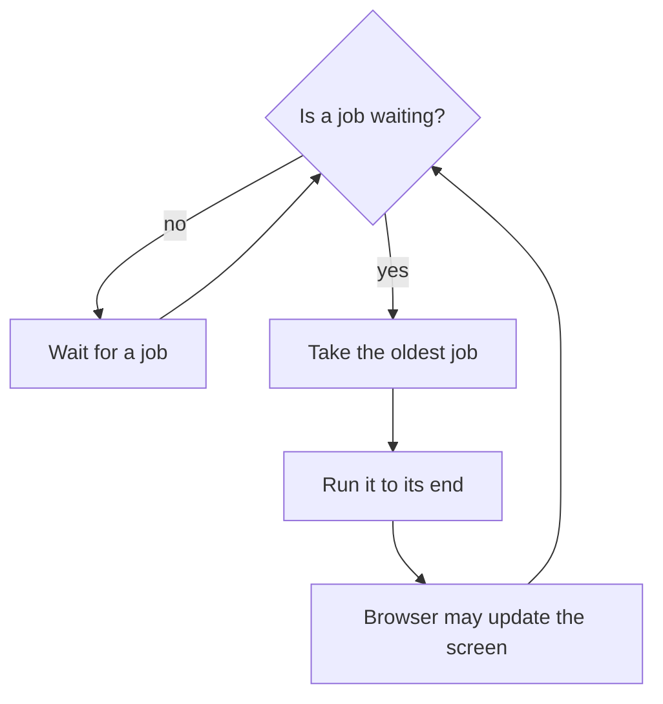

> **In one sentence:** The event loop is how a browser runs JavaScript one job at a time: it finishes the current job, takes the next waiting job from a queue, and repeats.

## Why should I care?

In [[asynchronous-code|Asynchronous Code]], your code started slow work, carried on, and handled the answer later. But who runs that "later" code, and when?

The answer also explains why a long calculation can freeze a page.

## Analogy

Picture one worker at a post office counter, and a queue of people, each waiting behind the next. The worker serves one person from start to end, then calls the next. If nobody is waiting, the worker waits.

Someone outside the queue keeps watch for parcels. When a parcel arrives, that person sends its owner to join the queue.

The worker is the part of the browser that runs your JavaScript. Each person is a job. The watcher is the part of the browser that does the waiting.

**Where the analogy breaks down:** a real worker can ask a slow person to step aside. The browser does not stop your running function to run other JavaScript.

## How it actually works

### One thread

A **thread** is "a sequence of instructions that a program follows". By default, a browser "uses a single thread to run all the JavaScript in your page". These words come from MDN Web Docs, a website that documents web technologies. A program like this is called single-threaded, and it "can only do one thing at a time".

That thread is called the **main thread**. It is also where the browser handles user events, such as clicks, and paints. To paint means to draw the page on the screen.

(This is simplified. JavaScript runs on the main thread "Unless intentionally using a web worker", which lets you "run some tasks in a different thread". A later topic on threads returns to them.)

### Jobs and the queue

On this page, a **job** is one piece of JavaScript that is ready to run, often a callback. Some MDN pages say **task** instead.

The **queue** holds the waiting jobs. Jobs get there in several ways:

- When a timer ends, its callback is added to the queue.
- When you click an element, a job is created to run its event callbacks.
- When you start a program, or run a line of code in the console, that is a job too.

The waiting itself is not a job. Who watches a timer while your JavaScript is busy? The browser does that waiting, outside your JavaScript. When the wait ends, the browser adds your callback to the queue.

### The loop

The **event loop** repeats the same steps:



Each job runs completely before any other job starts.

(This is simplified. An event loop can have several queues, so "oldest" is only part of the story. There are also **microtasks**, jobs with higher priority. This page leaves them out.)

### Why `setTimeout` with a delay of 0 still waits

```js
console.log("First");

// The delay is 0, but the callback must still wait in the queue.
setTimeout(() => {
  console.log("Third");
}, 0);

console.log("Second");
```

This shows `First`, `Second`, `Third`. The whole program is one job, and `setTimeout` returns immediately. The callback must wait, because "Currently-executing code must complete before functions on the queue are executed".

### Why a long calculation freezes the page

`keepBusy` keeps the main thread busy for about three seconds. It runs inside the program's one job.

```js
function keepBusy() {
  const end = Date.now() + 3000; // the time 3 seconds from now
  while (Date.now() < end) {
    // Nothing to do here. The loop keeps checking the time.
  }
  console.log("Job done");
}

// Ask for a callback in one second.
setTimeout(() => {
  console.log("Timer");
}, 1000);

keepBusy();          // No other job can start during this.
console.log("End");  // The current job ends after this line.
```

This shows `Job done`, `End`, then `Timer`:

1. At about 1 second, the timer ends. The browser adds the callback to the queue.
2. The callback waits about 2 more seconds, because the current job is still running.
3. At about 3 seconds, the job ends, and the callback runs.

So "The actual delay may be longer than set."

If a job takes too long, MDN says, a page is "unable to process user interactions like click". That is a frozen page. MDN's advice is to "make job processing short". An endless loop, from [[loops|Loops]], has the same cause, but its job does not end by itself.

Waiting on a server is different. The browser does that waiting, so it does not keep the main thread busy. During the wait, a page "can still process other things like user input".

## How it came to be

These are places where standards describe event loops and job queues. They do not say when the idea was invented.

The HTML Standard sets rules for browsers. It says that to coordinate "events, user interaction, scripts, rendering, networking, and so forth", "user agents must use event loops". Rendering means drawing the page. A browser is one example of a user agent.

ECMAScript is the name of standardized JavaScript. Its 6th edition, from June 2015, has a section called "Jobs and Job Queues".

## 🧪 Try it in your browser

You need a computer with Chrome, Edge or Firefox.

**Safety rule:** only type code in the console that you understand or that comes from a source you trust. Never paste anything a stranger sends you. Typed exactly, the lines below only create a function, set timers, keep the page busy for about three seconds and show text.

In step 4, `3000` means 3000 milliseconds, which is three seconds. Type it exactly. A bigger number means a longer freeze. If the tab stays stuck, see **Endless loops** in Loops.

1. Open [example.com](https://example.com/).
   **What you should see:** a short page. It says the domain is for use in documentation examples.
2. Open the **console**:
   - **Windows:** press `Ctrl` + `Shift` + `J` (in Firefox: `Ctrl` + `Shift` + `K`)
   - **Mac:** press `Cmd` + `Option` + `J` (in Firefox: `Cmd` + `Option` + `K`)
3. Ignore any messages already there. Click the place where you can type, below any messages. **Type** this line yourself (some browsers may block pasting at first), then press `Enter`. The browser may show suggestions, and the line may look different while you type. Keep typing.

   ```
   console.log("First"); setTimeout(() => console.log("Third"), 0); console.log("Second")
   ```

   **What you should see:** `First`, then `Second`, then `Third`. The console may also show `undefined` among them. It is not part of the order.
4. Create the function. Type this line and press `Enter`:

   ```
   function keepBusy() { const end = Date.now() + 3000; while (Date.now() < end) { } console.log("Job done") }
   ```

   **What you should see:** the console may show `undefined`.
5. Type this line, press `Enter`, and wait:

   ```
   setTimeout(() => console.log("Timer"), 1000); keepBusy(); console.log("End")
   ```

   **What you should see:** about three seconds after you press `Enter`, `Job done` and `End` appear, followed by `Timer`. The console may also show `undefined`.
6. Now remove `keepBusy`. Type this line, press `Enter`, and wait:

   ```
   setTimeout(() => console.log("Timer"), 1000); console.log("End")
   ```

   **What you should see:** `End`. The console may also show `undefined`. About one second later, `Timer` appears.

**If something goes wrong:** for an error message, look for a typo. If `Enter` gives a new line and no answer, a bracket is probably still open. In both cases, reload the page, delete anything left on the typing line, and start again from step 3.

## Common misunderstandings

- **"A delay of 0 means immediately."** No. The callback is "scheduled to run at the next opportunity; not immediately".
- **"A timer can interrupt my running function."** Not in the code on this page. A running function "cannot be preempted", which means it cannot be stopped to run other JavaScript.
- **"Asynchronous means my JavaScript runs at the same time as other JavaScript."** Not on the main thread. Jobs there run one at a time.

## Recap

- A browser runs a page's JavaScript one job at a time, and each job runs to its end.
- Callbacks wait in a queue until the current job has ended. So a timer can run later than you set.
- A long job stops other jobs from starting, and the page usually cannot react to clicks. So keep jobs short.

## Sources

- MDN Web Docs, JavaScript execution model: https://developer.mozilla.org/en-US/docs/Web/JavaScript/Reference/Execution_model
- MDN Web Docs, Using microtasks in JavaScript with queueMicrotask(): https://developer.mozilla.org/en-US/docs/Web/API/HTML_DOM_API/Microtask_guide
- MDN Web Docs, Window.setTimeout(): https://developer.mozilla.org/en-US/docs/Web/API/Window/setTimeout
- MDN Web Docs, Introducing asynchronous JavaScript: https://developer.mozilla.org/en-US/docs/Learn_web_development/Extensions/Async_JS/Introducing
- MDN Web Docs, Introducing workers: https://developer.mozilla.org/en-US/docs/Learn_web_development/Extensions/Async_JS/Introducing_workers
- MDN Web Docs, Main thread (glossary): https://developer.mozilla.org/en-US/docs/Glossary/Main_thread
- MDN Web Docs, Populating the page, how browsers work: https://developer.mozilla.org/en-US/docs/Web/Performance/Guides/How_browsers_work
- MDN Web Docs, Date.now(): https://developer.mozilla.org/en-US/docs/Web/JavaScript/Reference/Global_Objects/Date/now
- MDN Web Docs, Looping code: https://developer.mozilla.org/en-US/docs/Learn_web_development/Core/Scripting/Loops
- MDN Web Docs, console.log(): https://developer.mozilla.org/en-US/docs/Web/API/console/log_static
- MDN Web Docs, eval(): https://developer.mozilla.org/en-US/docs/Web/JavaScript/Reference/Global_Objects/eval
- MDN Web Docs, User agent (glossary): https://developer.mozilla.org/en-US/docs/Glossary/User_agent
- MDN Web Docs, JavaScript (glossary): https://developer.mozilla.org/en-US/docs/Glossary/JavaScript
- MDN Web Docs, About MDN: https://developer.mozilla.org/en-US/about
- WHATWG HTML Standard, Web application APIs (Event loops): https://html.spec.whatwg.org/multipage/webappapis.html
- WHATWG HTML Standard, Timers: https://html.spec.whatwg.org/multipage/timers-and-user-prompts.html
- WHATWG Fetch Standard: https://fetch.spec.whatwg.org/
- Ecma International, ECMAScript 2015 Language Specification (6th edition, June 2015): https://262.ecma-international.org/6.0/
- Example Domain: https://example.com/
- Chrome for Developers, Open Chrome DevTools: https://developer.chrome.com/docs/devtools/open
- Chrome for Developers, Run JavaScript in the Console: https://developer.chrome.com/docs/devtools/console/javascript
- Chrome for Developers, DevTools Digest, October 2016: https://developer.chrome.com/blog/devtools-digest-2016-10
- Chrome for Developers, What are self-XSS attacks?: https://developer.chrome.com/blog/self-xss
- Microsoft Edge DevTools, Keyboard shortcuts: https://learn.microsoft.com/en-us/microsoft-edge/devtools/shortcuts/
- Microsoft Edge DevTools, Run JavaScript in the Console: https://learn.microsoft.com/en-us/microsoft-edge/devtools/console/console-javascript
- Firefox DevTools User Docs, Web Console: https://firefox-source-docs.mozilla.org/devtools-user/web_console/index.html
- Firefox DevTools User Docs, The JavaScript input interpreter: https://firefox-source-docs.mozilla.org/devtools-user/web_console/the_command_line_interpreter/index.html
