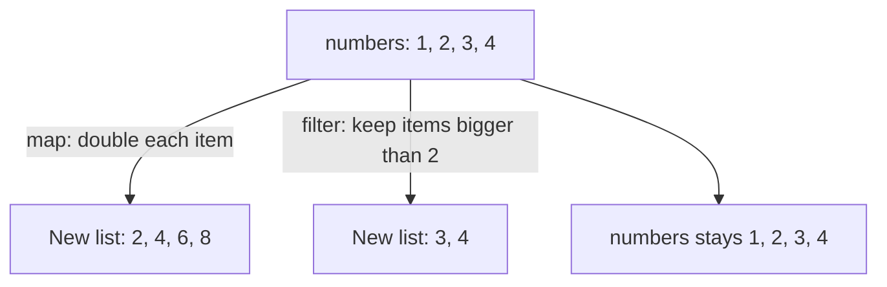

> **In one sentence:** Functional programming is a style of code built from functions that, ideally, only take values in and give values back, without changing anything else.

## Why should I care?

In [[functions|Functions]], you wrote functions that take values in and give one value back. **Functional programming** builds a whole program from functions like that. Wikipedia calls it a **programming paradigm**: a way to think about a program and organize its code. Python's documentation calls it the "functional style".

Python's documentation calls Python "multi-paradigm": it supports several paradigms, so you can write functional code in it, and other kinds too. This page teaches the main ideas, and two tools for lists: **map** and **filter**.

## Analogy

Think of a photocopier with a "make bigger" button. You put in a page, and you get back a new, bigger copy. Your page stays as it was. In functional code, a function takes a value and gives back a new value, and the old value stays as it was.

**Where the analogy breaks down:** a real copier uses paper and can jam. A pure function, explained below, does nothing except work out its result. And a function's result does not have to look like what went in.

## How it actually works

### Pure functions

A **side effect** is a change that a function makes besides giving back its value. Changing a variable outside the function is a side effect. So is showing text on the screen: Python's documentation names "sending some text to the screen" as a side effect.

A **pure function** has two properties, Wikipedia says:

- The same arguments always give the same return value.
- It has no side effects.

The examples are in [[javascript|JavaScript]], [[python|Python]] and [[go-language|Go]]. You only need to read one tab.

<!-- tabs -->

### JavaScript

```js
// Pure: the result depends only on n, and nothing else changes.
function double(n) {
  return n * 2;
}

let total = 0;

// Not pure: it changes total, a variable outside the function.
function addToTotal(n) {
  total = total + n;
  return total;
}

console.log(double(5));     // Shows: 10
console.log(double(5));     // Shows: 10
console.log(addToTotal(5)); // Shows: 5
console.log(addToTotal(5)); // Shows: 10
```

`*` multiplies. `double(5)` gives 10 every time. `addToTotal(5)` gives 5 the first time and 10 the second time, because each call changes `total`.

### Python

```python
# Pure: the result depends only on n, and nothing else changes.
def double(n):
    return n * 2

total = 0

# Not pure: it changes total, a variable outside the function.
def add_to_total(n):
    global total  # lets this function change total
    total = total + n
    return total

print(double(5))        # Shows: 10
print(double(5))        # Shows: 10
print(add_to_total(5))  # Shows: 5
print(add_to_total(5))  # Shows: 10
```

`*` multiplies. Python's reference says that without the word `global`, a function cannot give a new value to a variable created outside all functions.

`double(5)` gives 10 every time. `add_to_total(5)` gives 5 the first time and 10 the second time, because each call changes `total`.

### Go

```go
package main

import "fmt"

// Pure: the result depends only on n, and nothing else changes.
func double(n int) int {
	return n * 2
}

var total = 0

// Not pure: it changes total, a variable outside the function.
func addToTotal(n int) int {
	total = total + n
	return total
}

func main() {
	fmt.Println(double(5))     // Shows: 10
	fmt.Println(double(5))     // Shows: 10
	fmt.Println(addToTotal(5)) // Shows: 5
	fmt.Println(addToTotal(5)) // Shows: 10
}
```

`*` multiplies. `var total = 0` creates a variable outside all functions. `double(5)` gives 10 every time. `addToTotal(5)` gives 5 the first time and 10 the second time, because each call changes `total`.

<!-- /tabs -->

### New values instead of changes

In [[lists-and-dictionaries|Lists and Dictionaries]], you added an item to the end of a list. That changed the list itself. The functional style avoids changes like this. Python's documentation says that avoiding side effects means not using values that "get updated as a program runs". So instead of changing a list, you make a new one.

A value that cannot be changed after it is created is **immutable**, Wikipedia says. In JavaScript, Python and Go, a list can be changed. So not changing it is your choice.

### Functions are values

Map and filter, below, take a function as an argument. MDN Web Docs is a website that documents web technologies. It explains that in some languages, a function "can be passed as an argument to other functions". It can also be stored in a variable. Such a language is said to have **first-class functions**. Wikipedia says JavaScript, Python and Go had them from the start.

A function that takes other functions as arguments, or gives one back, is a **higher-order function**, MDN says. Map and filter are higher-order functions, because each one takes a function. A function's name alone means the function itself. With round brackets after it, the name means "call it now".

### map and filter

Python's tutorial describes two common jobs on a list. JavaScript and Python have tools for them named map and filter, so this page uses those names:

- **map:** call a function on each item, and collect the results in a new list.
- **filter:** keep only the items for which a function gives true (or a value that counts as true), in a new list.

In both, the original list stays as it was. (Here, map names an action. In Go, the word map also names a dictionary, which is a different thing.)

<!-- tabs -->

### JavaScript

Arrays have the methods `.map` and `.filter`. MDN says `map` "creates a new array", and `filter` gives back the items "that pass the test".

```js
const numbers = [1, 2, 3, 4];

function double(n) {
  return n * 2;
}

// map calls double on each item and collects the results in a new array.
// There are no round brackets after double: map receives the function itself.
const doubled = numbers.map(double);

// filter keeps the items for which the function gives true.
// (n) => n > 2 is a function with no name: it gives true when n is bigger than 2.
const big = numbers.filter((n) => n > 2);

console.log(doubled); // a new array: 2, 4, 6, 8
console.log(big);     // a new array: 3, 4
console.log(numbers); // the original, unchanged: 1, 2, 3, 4
```

`(n) => n > 2` is an **arrow function**, a short way to write a function. `n` is its parameter. MDN says the curly brackets can be left out if the function "directly returns an expression", which means code that gives a value. Here that value is `n > 2`, so the function gives back true or false.

### Python

A **list comprehension** builds a new list from another list. It is written in square brackets. `for n in numbers` takes each item of `numbers` in turn, as `n`. The part before `for` is what goes into the new list for each item. An `if` part keeps only some items.

```python
numbers = [1, 2, 3, 4]

def double(n):
    return n * 2

# Call double on each item n of numbers, and collect the results in a new list.
doubled = [double(n) for n in numbers]

# Keep only the items n that are bigger than 2, in a new list.
big = [n for n in numbers if n > 2]

print(doubled)  # Shows: [2, 4, 6, 8]
print(big)      # Shows: [3, 4]
print(numbers)  # Shows: [1, 2, 3, 4]  (unchanged)

# The same, with map() and filter(). list() collects their results in a list.
print(list(map(double, numbers)))              # Shows: [2, 4, 6, 8]
print(list(filter(lambda n: n > 2, numbers)))  # Shows: [3, 4]
```

Python's tutorial says a list comprehension's result "will be a new list".

Python also has the built-in functions `map()` and `filter()`. They do not give back a list. They give back an **iterator**, which Python's documentation says "returns the data one element at a time". `list()` asks for all of them and collects them in a list. `map(double, numbers)` has no round brackets after `double`, so `map` receives the function itself.

`lambda n: n > 2` creates a small function with no name. `n` is its parameter, and it gives back the value of `n > 2`: `True` or `False`. Python's tutorial says a lambda is limited to "a single expression", which means one piece of code that gives a value.

### Go

Go has no built-in map or filter, so you write the loop yourself. You can still pass a function in, because in Go a function is a value too.

Go's specification lists its built-in functions, such as `append` and `len`, and map and filter are not among them. Go's `slices` package has functions that take a function, such as `ContainsFunc`. Its documentation lists no function named `Map` or `Filter`.

This page names its functions `apply` and `keep`. A function cannot be named `map`: the specification makes `map` a **keyword**, a reserved word that may not be used as a name.

```go
package main

import "fmt"

func double(n int) int {
	return n * 2
}

// apply calls f on each item and collects the results in a new slice.
// The type func(int) int means: a function that takes an int and gives back an int.
func apply(numbers []int, f func(int) int) []int {
	result := []int{} // a new, empty slice
	for i := 0; i < len(numbers); i++ {
		result = append(result, f(numbers[i]))
	}
	return result
}

// keep collects the items for which test gives true, in a new slice.
func keep(numbers []int, test func(int) bool) []int {
	result := []int{}
	for i := 0; i < len(numbers); i++ {
		if test(numbers[i]) {
			result = append(result, numbers[i])
		}
	}
	return result
}

func main() {
	numbers := []int{1, 2, 3, 4}

	// No round brackets after double: apply receives the function itself.
	doubled := apply(numbers, double)

	// A function with no name, written in place: true when n is bigger than 2.
	big := keep(numbers, func(n int) bool { return n > 2 })

	fmt.Println(doubled) // Shows: [2 4 6 8]
	fmt.Println(big)     // Shows: [3 4]
	fmt.Println(numbers) // Shows: [1 2 3 4]  (unchanged)
}
```

The loop starts `i` at 0, because the first index of a slice is 0, and stops before `len(numbers)`, the number of items. Each function's parameter has a type. `func(int) bool` is the type of a function that takes an `int` and gives back a `bool`, the type for `true` and `false`.

`func(n int) bool { return n > 2 }` is a **function literal**: Go's specification says it "represents an anonymous function", which means a function with no name.

<!-- /tabs -->



## How it came to be

Wikipedia says the **lambda calculus** "forms the basis of all functional programming languages". It is a system of computation built from functions, and Alonzo Church developed it in the 1930s.

Wikipedia says John McCarthy developed Lisp, a functional programming language, at the Massachusetts Institute of Technology in the late 1950s. Python's list comprehensions were "borrowed from the functional programming language Haskell", Python's documentation says.

## 🧪 Try it in your browser

These steps use JavaScript, because the browser's console runs it. A list is an **array**, written in square brackets. Arrays have the **methods** (actions that belong to a value) `.map` and `.filter`, which do the jobs described above. `(n) => n * 2` is a function with parameter `n` that gives back `n * 2`. `let` creates a variable, and `console.log` shows a value. You need a computer with Chrome, Edge or Firefox.

**Safety rule:** only type code in the console that you understand or that comes from a source you trust. Never paste anything a stranger sends you. The lines below make lists of numbers and show numbers in the console.

1. Open [example.com](https://example.com).
   **What you should see:** a short page. It says the domain is for use in documentation examples.
2. Open the **console**:
   - **Windows:** press `Ctrl` + `Shift` + `J` (in Firefox: `Ctrl` + `Shift` + `K`)
   - **Mac:** press `Cmd` + `Option` + `J` (in Firefox: `Cmd` + `Option` + `K`)
3. Click the line where you can type, below any messages. In each step below, **type** the line yourself (some browsers may block pasting at first), then press `Enter`. The browser may show suggestions, and the line may look different while you type. Keep typing.

   ```
   [1, 2, 3, 4].map((n) => n * 2)
   ```

   **What you should see:** a list of the numbers 2, 4, 6 and 8.
4. Keep only some items:

   ```
   [1, 2, 3, 4].filter((n) => n > 2)
   ```

   **What you should see:** a list of the numbers 3 and 4.
5. Pass a named function. The `;` separates two commands on one line:

   ```
   function double(n) { return n * 2 }; [5, 10].map(double)
   ```

   **What you should see:** a list of the numbers 10 and 20.
6. Check that the original list stays as it was. Type this line only once.

   ```
   let numbers = [1, 2, 3, 4]; let doubled = numbers.map((n) => n * 2); console.log(numbers[3]); console.log(doubled[3])
   ```

   **What you should see:** `4`, the last item of `numbers`, then `8`, the last item of the new list. The console may also show `undefined`, because `console.log` gives back no result.

If you see an error message, look for a typo. If that does not help, reload the page and start again from step 3.

## Common misunderstandings

- **"map and filter change the list."** No. JavaScript's `.map` and `.filter`, Python's list comprehensions, and the Go functions on this page all build a new list. The original stays as it was.
- **"A functional program has no side effects at all."** No. Python's documentation says that it is "difficult to avoid all side effects, such as printing to the screen". The code examples on this page show text, and that is a side effect.

## Recap

- A pure function gives the same result for the same arguments, and has no side effects.
- The functional style makes new values instead of changing old ones.
- Functions are values: map and filter take a function and build a new list from an old one.

## Sources

- Python documentation, Functional Programming HOWTO: https://docs.python.org/3/howto/functional.html
- Python documentation, Built-in Functions: https://docs.python.org/3/library/functions.html
- Python Tutorial, Data Structures: https://docs.python.org/3/tutorial/datastructures.html
- Python Tutorial, More Control Flow Tools: https://docs.python.org/3/tutorial/controlflow.html
- Python Language Reference, Simple statements: https://docs.python.org/3/reference/simple_stmts.html
- MDN Web Docs, Array.prototype.map(): https://developer.mozilla.org/en-US/docs/Web/JavaScript/Reference/Global_Objects/Array/map
- MDN Web Docs, Array.prototype.filter(): https://developer.mozilla.org/en-US/docs/Web/JavaScript/Reference/Global_Objects/Array/filter
- MDN Web Docs, Array: https://developer.mozilla.org/en-US/docs/Web/JavaScript/Reference/Global_Objects/Array
- MDN Web Docs, Arrow function expressions: https://developer.mozilla.org/en-US/docs/Web/JavaScript/Reference/Functions/Arrow_functions
- MDN Web Docs, First-class function (glossary): https://developer.mozilla.org/en-US/docs/Glossary/First-class_Function
- MDN Web Docs, console.log(): https://developer.mozilla.org/en-US/docs/Web/API/console/log_static
- MDN Web Docs, About MDN: https://developer.mozilla.org/en-US/about
- The Go Programming Language Specification: https://go.dev/ref/spec
- Go Packages, slices: https://pkg.go.dev/slices
- Wikipedia, Programming paradigm: https://en.wikipedia.org/wiki/Programming_paradigm
- Wikipedia, Functional programming: https://en.wikipedia.org/wiki/Functional_programming
- Wikipedia, Pure function: https://en.wikipedia.org/wiki/Pure_function
- Wikipedia, Immutable object: https://en.wikipedia.org/wiki/Immutable_object
- Microsoft Edge DevTools, Run JavaScript in the Console: https://learn.microsoft.com/en-us/microsoft-edge/devtools/console/console-javascript
- Chrome for Developers, Open Chrome DevTools: https://developer.chrome.com/docs/devtools/open
- Microsoft Edge DevTools, Keyboard shortcuts: https://learn.microsoft.com/en-us/microsoft-edge/devtools/shortcuts/
- Firefox DevTools User Docs, Web Console: https://firefox-source-docs.mozilla.org/devtools-user/web_console/index.html
- Chrome for Developers, What are self-XSS attacks?: https://developer.chrome.com/blog/self-xss
- Example Domain: https://example.com
