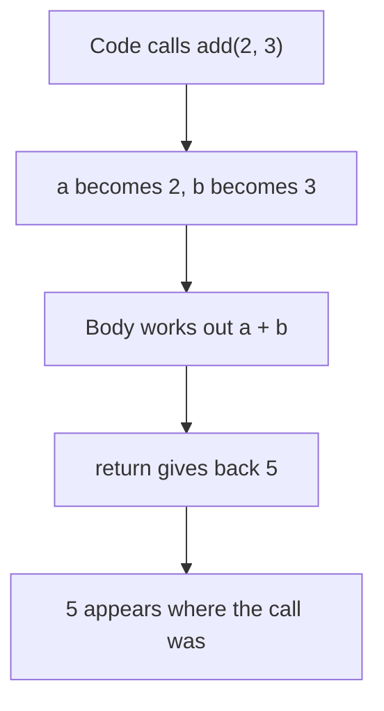

> **In one sentence:** A function is a block of code that runs when called, and it can take values in and give one value back.

## Why should I care?

You have used functions already. The browser provides `console.log` and `alert`, so you did not have to write them. When round brackets follow a function's name, as in `console.log("Hi")`, that function is being called, which means run. Round brackets have other uses too, as in `if (...)` and `(2 + 3) * 4`.

In [[loops|Loops]], you repeated code in one place. With a function, you write the code once and give it a name. Then you can run it from many places, without typing it again. To change that code, you change it in one place.

You also saw `function () { ... }` in [[javascript|JavaScript]]. That function has no name, and the browser called it on each click. A later topic shows how this works. On this page, every function has a name.

## Analogy

In [[what-is-programming|What is Programming]], your whole program was a recipe. A function is a smaller recipe inside it, with its own name, such as "make the sauce". The big recipe can say "make the sauce" wherever it needs to.

The ingredient list is like the function's parameters. The real ingredients you bring are like its arguments. The finished sauce is like the value it gives back. Writing the recipe cooks nothing.

**Where the analogy breaks down:** a cook can guess and adapt, but code means exactly what it says. And a recipe always gives you food, while a function with no value to give back gives only `undefined`.

## How it actually works

### Define it, then call it

**Defining** a function means writing it down and naming it. **Calling** a function means running it.

```js
// Define a function named greet. Nothing runs yet.
function greet() {
  console.log("Hello!"); // this line is the body
}

// Call the function two times. Now the body runs, two times.
greet();
greet();
```

This shows:

```
Hello!
Hello!
```

The word `function` starts the definition. Next comes the name, then round brackets. The code between `{` and `}` is the **body**. To call the function, write its name followed by round brackets. The round brackets in the definition line do not call anything. The next section shows what can go inside them.

### Parameters and arguments

A function can take values in, so each call can do something a little different. Each example on this page is a separate program.

```js
// name is a parameter: a name for a value that will arrive later.
function greet(name) {
  console.log("Hello, " + name);
}

greet("Ana");  // the argument is "Ana"
greet("Budi"); // the argument is "Budi"
greet();       // no argument, so name is undefined
```

This shows:

```
Hello, Ana
Hello, Budi
Hello, undefined
```

A **parameter** is a variable listed in the definition. It needs no `let`. An **argument** is the value you **pass**, which means the value you hand over in the call. With several parameters, separated by commas, the first argument goes to the first parameter, and so on.

For the functions on this page, a parameter with no argument holds `undefined`. (A parameter can also have a default value. This page does not use that.)

### Giving a value back with return

The word `return` ends the function and gives a value to the code that made the call. That value appears at the place where the call was written.

```js
// This function gives a value back to the code that called it.
function add(a, b) {
  return a + b;
}

const total = add(2, 3);  // the call add(2, 3) gives 5
console.log(total);       // shows 5
console.log(add(10, 20)); // shows 30
```

In the last line, `add(10, 20)` runs first and gives 30. Then `console.log` shows that 30.



Once a `return` runs, the rest of the function does not run:

```js
function larger(a, b) {
  if (a > b) {
    return a; // when this line runs, the function ends here
  }
  return b;
}

console.log(larger(9, 4)); // shows 9
console.log(larger(3, 7)); // shows 7
```

In `larger(9, 4)`, the condition is true, so `return a` runs and `return b` never does. In `larger(3, 7)`, the condition is false. The program skips the block and reaches `return b`.

If a function ends without returning a value, the call gives `undefined`:

```js
// This function shows text, but it has no return.
function sayHi(name) {
  console.log("Hi, " + name);
}

const answer = sayHi("Ana"); // shows Hi, Ana
console.log(answer);         // shows undefined
```

### Variables inside stay inside

A variable created with `const` or `let` inside a function is a **local variable**. Code outside the function cannot reach it, and the same goes for parameters. This is the scope rule you met in [[conditions|Conditions]].

```js
function add(a, b) {
  const sum = a + b; // sum exists only inside add
  return sum;
}

console.log(add(2, 3)); // shows 5
console.log(sum);       // error: sum is not defined
```

This shows `5`. Then the program stops with an error. In Chrome, Edge and Firefox, it says `sum is not defined`.

Each call to `add` creates a new `sum`, so `const` causes no problem when you call it again.

Code inside a function can read a variable defined outside all functions:

```js
const greeting = "Hello"; // defined outside the function

function greet(name) {
  console.log(greeting + ", " + name); // shows Hello, Ana
}

greet("Ana");
```

## How it came to be

Another name for this idea is **subroutine**. Others discussed it earlier. But Wikipedia reports that Maurice Wilkes, David Wheeler and Stanley Gill are "generally credited with the formal invention" of the idea.

In 1951, these three published a book based on their work with EDSAC, one of the first practical computers. It explained the EDSAC **library**, a collection of reusable code: more than eighty subroutines. The library was a real object, a filing cabinet of punched paper tape. That is a long strip of paper with small holes.

## 🧪 Try it in your browser

You need a computer with Chrome, Edge or Firefox.

**Safety rule:** only type code in the console that you understand or that comes from a source you trust. Never paste anything a stranger sends you.

1. Open [example.com](https://example.com/).
   **What you should see:** a short page. It says the domain is for use in documentation examples.
2. Open the **console**:
   - **Windows:** press `Ctrl` + `Shift` + `J` (in Firefox: `Ctrl` + `Shift` + `K`)
   - **Mac:** press `Cmd` + `Option` + `J` (in Firefox: `Cmd` + `Option` + `K`)
3. Click the empty line at the bottom. **Type** this line yourself (some browsers may block pasting at first), then press `Enter`.

   ```
   function add(a, b) { const sum = a + b; return sum }
   ```

   **What you should see:** the console may also show `undefined`. That is normal. You have defined the function but not called it. The browser may show suggestions, and the line may look different while you type. Keep typing.

   **If something goes wrong:** for an error message, look for a typo and type the line again. If `Enter` gives a new line and no answer, a bracket is probably still open. Reload the page and start again here.
4. Now call it:

   ```
   add(2, 3)
   ```

   **What you should see:** `5`. Showing each line's result is a feature of the console, so here it shows what the call gave back. If you see `add is not defined`, go back to step 3.
5. Call it again with other arguments:

   ```
   add(10, 20)
   ```

   **What you should see:** `30`.
6. Define a function with no `return`:

   ```
   function sayHi(name) { console.log("Hi, " + name) }
   ```

   **What you should see:** the console may also show `undefined`. That is normal.
7. Call it:

   ```
   sayHi("Ana")
   ```

   **What you should see:** `Hi, Ana`, from `console.log`. The console may also show `undefined`, because the call gave back no value.
8. Try to reach the local variable from outside:

   ```
   sum
   ```

   **What you should see:** an error message that says `sum is not defined`.

## Common misunderstandings

- **"Writing a function runs it."** No. MDN says that defining a function "does not execute it". A named function on this page runs when you call it. A nameless one, like the click example, can be called by something else.
- **"`console.log` and `return` do the same thing."** No. `console.log` shows a value to you. `return` gives a value to your code, so your code can store or use it. In step 4, the console showed that value only because it shows each line's result.

## Recap

- You define a function once. Its code runs only when it is called, and you call a named function with its name and round brackets.
- Parameters receive the arguments you pass, and `return` gives one value back. Without a returned value, the call gives `undefined`.
- Variables created with `const` or `let` inside a function are local: code outside the function cannot reach them.

## Sources

- MDN Web Docs, Functions, reusable blocks of code: https://developer.mozilla.org/en-US/docs/Learn_web_development/Core/Scripting/Functions
- MDN Web Docs, Function return values: https://developer.mozilla.org/en-US/docs/Learn_web_development/Core/Scripting/Return_values
- MDN Web Docs, Functions (JavaScript guide): https://developer.mozilla.org/en-US/docs/Web/JavaScript/Guide/Functions
- MDN Web Docs, Functions (JavaScript reference): https://developer.mozilla.org/en-US/docs/Web/JavaScript/Reference/Functions
- MDN Web Docs, return: https://developer.mozilla.org/en-US/docs/Web/JavaScript/Reference/Statements/return
- MDN Web Docs, Default parameters: https://developer.mozilla.org/en-US/docs/Web/JavaScript/Reference/Functions/Default_parameters
- MDN Web Docs, Grouping operator: https://developer.mozilla.org/en-US/docs/Web/JavaScript/Reference/Operators/Grouping
- MDN Web Docs, Local variable (glossary): https://developer.mozilla.org/en-US/docs/Glossary/Local_variable
- MDN Web Docs, ReferenceError: "x" is not defined: https://developer.mozilla.org/en-US/docs/Web/JavaScript/Reference/Errors/Not_defined
- MDN Web Docs, throw: https://developer.mozilla.org/en-US/docs/Web/JavaScript/Reference/Statements/throw
- MDN Web Docs, Error: https://developer.mozilla.org/en-US/docs/Web/JavaScript/Reference/Global_Objects/Error
- MDN Web Docs, ReferenceError: https://developer.mozilla.org/en-US/docs/Web/JavaScript/Reference/Global_Objects/ReferenceError
- Think Python, 2nd edition, The way of the program: https://greenteapress.com/thinkpython2/html/thinkpython2002.html
- MDN Web Docs, console: https://developer.mozilla.org/en-US/docs/Web/API/console
- MDN Web Docs, console.log(): https://developer.mozilla.org/en-US/docs/Web/API/console/log_static
- MDN Web Docs, Window.alert(): https://developer.mozilla.org/en-US/docs/Web/API/Window/alert
- MDN Web Docs, EventTarget.addEventListener(): https://developer.mozilla.org/en-US/docs/Web/API/EventTarget/addEventListener
- ECMAScript language specification (ECMA-262): https://tc39.es/ecma262/multipage/executable-code-and-execution-contexts.html
- Wikipedia, Function (computer programming): https://en.wikipedia.org/wiki/Function_(computer_programming)
- Wikipedia, The Preparation of Programs for an Electronic Digital Computer: https://en.wikipedia.org/wiki/The_Preparation_of_Programs_for_an_Electronic_Digital_Computer
- Wikipedia, EDSAC: https://en.wikipedia.org/wiki/EDSAC
- Wikipedia, Punched tape: https://en.wikipedia.org/wiki/Punched_tape
- Wikipedia, V8 (JavaScript engine): https://en.wikipedia.org/wiki/V8_(JavaScript_engine)
- Example Domain: https://example.com/
- Chrome for Developers, Open Chrome DevTools: https://developer.chrome.com/docs/devtools/open
- Chrome for Developers, Run JavaScript in the Console: https://developer.chrome.com/docs/devtools/console/javascript
- Microsoft Edge DevTools, Keyboard shortcuts: https://learn.microsoft.com/en-us/microsoft-edge/devtools/shortcuts/
- Microsoft Edge DevTools, Run JavaScript in the Console: https://learn.microsoft.com/en-us/microsoft-edge/devtools/console/console-javascript
- Firefox DevTools User Docs, Web Console: https://firefox-source-docs.mozilla.org/devtools-user/web_console/index.html
- Firefox DevTools User Docs, The JavaScript input interpreter: https://firefox-source-docs.mozilla.org/devtools-user/web_console/the_command_line_interpreter/index.html
- Chrome for Developers, What are self-XSS attacks?: https://developer.chrome.com/blog/self-xss
