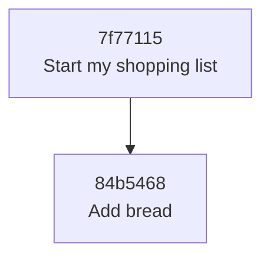
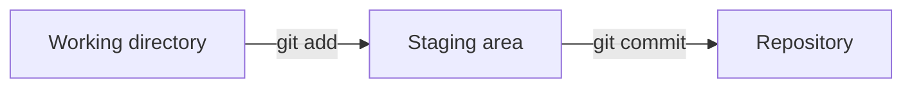

> **In one sentence:** Git is a version control tool that saves your project as a chain of commits: snapshots of your files, each with a message, an author, a time and an ID.

## Why should I care?

In [[version-control|Version Control]], you met the idea of saving the history of your work in a repository. Git is a program that does this. Its website calls it a "distributed version control system".

This page explains how Git saves your work, and shows the commands that make your first commits. You only need to read the commands: Git does not need to be installed for this page.

## Analogy

Think again of a photo album for your project. Git adds one step. First you choose what goes in front of the camera. Then you press the button. The photo goes into the album, with a note on the back: what you did, who you are, and when.

**Where the analogy breaks down:** a photo only shows how things looked. A commit keeps the full contents of your files, so Git can give them back to you.

## How it actually works

### Snapshots, not lists of changes

Pro Git, a book on Git's own website, says that most other version control systems store "a list of file-based changes". Git works differently. Each time you commit, Git takes "a picture of what all your files look like at that moment".

A **commit** is one saved snapshot of the whole project. Pro Git says each commit also holds the author's name and email address, "the message that you typed", and the time. Each commit also records its **parent**: the commit before it. The first commit has no parent.

Git [[compression|compresses]] what it stores, which means it stores it in fewer bytes. It also links to an unchanged file instead of storing it twice. Each commit still describes all your files.

Tools often show a commit as a **diff**: the changes since its parent. `git show` with a commit ID shows "the log message and textual diff". But what Git stores is the snapshot.

Each commit has an ID, called a **hash**. Git computes it from everything in the commit: the snapshot, the message, the author, the time and the parent. So two people's IDs differ, even for the same files. Pro Git says an ID has 40 characters, made of the digits 0–9 and the letters a–f. The first few characters also work, if no other ID starts the same way. Git shows seven by default, more if needed.



### Three areas

Git keeps your work in three areas:

1. The **working directory**: the files in your folder, which you can open and change.
2. The **staging area**: it holds the snapshot your next commit will save.
3. The **repository**: the stored commits. Git keeps it in a hidden folder named `.git`, inside your project folder.

Why the extra step? Pro Git says you "selectively stage" the changes you want in your next commit. So you choose exactly what each commit saves. `git add` stages changes, and `git commit` stores the staged snapshot in the repository.



### Your first commits, step by step

Each Git command on this page is the program name `git`, followed by arguments, as in [[command-line|The Command Line]]. Lines that start with `$` are commands; you would not type the `$`. The other lines are what Git printed.

Here is a real session. Mira made a folder named `my-notes` and made it her current folder. Inside it, she used a text editor, a program for writing text, to make a file, `notes.txt`, with one line: `Buy milk`.

**1. Make a repository.**

```
$ git init
Initialized empty Git repository in C:/Users/.../my-notes/.git/
```

`init` creates the `.git` folder. Nothing is tracked yet: **tracked** files are the files Git knows about. (The path is shortened here, at `...`.)

**2. Tell Git who you are.**

```
$ git config user.name "Mira"
$ git config user.email "mira@example.com"
```

Every commit uses this name and email. Here they printed nothing. With `--global` added, Git would use the setting for every project of your user on this computer. Without it, the setting is for this project only.

**3. Ask what has changed.**

```
$ git status
On branch master

No commits yet

Untracked files:
  (use "git add <file>..." to include in what will be committed)
	notes.txt

nothing added to commit but untracked files present (use "git add" to track)
```

`status` shows which files are in which state. **Untracked** means the file was not in the last commit and is not staged. `master` is the name of a **branch**: a name that points to a commit. Git 2.45, used here, names the first branch `master` by default. Git says this "will change to main when Git 3.0 is released". GitHub already names the default branch `main` in new repositories.

**4. Stage the file.**

```
$ git add notes.txt
$ git status
On branch master

No commits yet

Changes to be committed:
  (use "git rm --cached <file>..." to unstage)
	new file:   notes.txt
```

`add` puts the file's current content into the staging area. Here it printed nothing. "Changes to be committed" means the file is staged.

**5. Commit.**

```
$ git commit -m "Start my shopping list"
[master (root-commit) 7f77115] Start my shopping list
 1 file changed, 1 insertion(+)
 create mode 100644 notes.txt
```

`-m` means the message comes next, in quotes. The output shows the branch, the short ID `7f77115`, and how many files and lines changed. You can ignore `(root-commit)` and `create mode 100644` for now.

Mira added a second line, `Buy bread`, to `notes.txt`. She ran `git add notes.txt` again, then `git commit -m "Add bread"`.

**6. See the history.**

```
$ git log
commit 84b5468a5647f2c8a28d4e15283c210332dcb5f3
Author: Mira <mira@example.com>
Date:   Sat Nov 28 18:39:56 2026 +0700

    Add bread

commit 7f771154a33142021619d51429de866e7e328dc8
Author: Mira <mira@example.com>
Date:   Sat Nov 28 18:39:56 2026 +0700

    Start my shopping list
```

`log` lists the commits, newest first, each with its full ID, author, date and message. `+0700` is time zone information. Your IDs and dates will differ.

### Looking at an old version

`git show` shows things stored in Git. Put a commit ID, a colon and a file name after it:

```
$ git show 7f77115:notes.txt
Buy milk
```

This is `notes.txt` as it was in the first commit. To check that this changed no files, Mira ran `git status`:

```
$ git status
On branch master
nothing to commit, working tree clean
```

"Working tree" is another name for the working directory. "Clean" means no tracked file is modified, and there are no untracked files.

## How it came to be

Pro Git tells the story. In 2002, the Linux kernel project began using a version control tool called BitKeeper. In 2005, it stopped being free of charge for them. The community, "in particular Linus Torvalds, the creator of Linux", then built its own tool. Wikipedia dates the start of Git's development to 3 April 2005.

## 🧪 Try it in your browser

You can read the history of Git's own source code on GitHub, a website that hosts Git repositories. Its `git/git` repository is a copy, called a mirror, of Git's source code.

1. Open `https://github.com/git/git/commits/master` in Chrome, Edge or Firefox.
   **What you should see:** a list of commits. The page may look different from this description.
2. Look at one entry.
   **What you should see:** a commit message and the name of the account that made the commit. Beside each commit is a short ID, made of digits and the letters a to f.
3. Compare it with Mira's `git log`: each entry is one commit.

Only read the page. Do not click buttons that ask you to sign in or sign up.

## Common misunderstandings

- **"A commit stores only the lines that changed."** No. Each commit is a snapshot of all your files. A diff is only one way to show it.
- **"Saving a file makes a commit."** No. Git records a snapshot only when you run `git commit`, and only what is staged (usually with `git add`).
- **"Git and GitHub are the same thing."** No. Git is the program that keeps the history. GitHub is a website that hosts Git repositories.

## Recap

- A commit is a snapshot of your files, with a message, an author, a time, a parent, and an ID computed from all of these.
- `git add` stages changes, and `git commit` stores the staged snapshot in the repository.
- `git status` shows what has changed, `git log` lists the commits, and `git show` can display an old version of a file.

## Sources

- Git (git-scm.com): https://git-scm.com/
- Pro Git, 1.2 A Short History of Git: https://git-scm.com/book/en/v2/Getting-Started-A-Short-History-of-Git
- Pro Git, 1.3 What is Git?: https://git-scm.com/book/en/v2/Getting-Started-What-is-Git%3F
- Pro Git, 1.6 First-Time Git Setup: https://git-scm.com/book/en/v2/Getting-Started-First-Time-Git-Setup
- Pro Git, 2.1 Getting a Git Repository: https://git-scm.com/book/en/v2/Git-Basics-Getting-a-Git-Repository
- Pro Git, 2.2 Recording Changes to the Repository: https://git-scm.com/book/en/v2/Git-Basics-Recording-Changes-to-the-Repository
- Pro Git, 2.3 Viewing the Commit History: https://git-scm.com/book/en/v2/Git-Basics-Viewing-the-Commit-History
- Pro Git, 3.1 Branches in a Nutshell: https://git-scm.com/book/en/v2/Git-Branching-Branches-in-a-Nutshell
- Pro Git, 7.1 Revision Selection: https://git-scm.com/book/en/v2/Git-Tools-Revision-Selection
- Git reference, git-init: https://git-scm.com/docs/git-init
- Git reference, git-show: https://git-scm.com/docs/git-show
- GitHub Docs, About GitHub and Git: https://docs.github.com/en/get-started/start-your-journey/about-github-and-git
- GitHub, git/git repository: https://github.com/git/git
- GitHub, git/git commit history: https://github.com/git/git/commits/master
- Pro Git, 10.2 Git Internals, Git Objects: https://git-scm.com/book/en/v2/Git-Internals-Git-Objects
- Git reference, git-log: https://git-scm.com/docs/git-log
- GitHub Docs, About Git: https://docs.github.com/en/get-started/using-git/about-git
- GitHub Docs, About branches: https://docs.github.com/en/pull-requests/collaborating-with-pull-requests/proposing-changes-to-your-work-with-pull-requests/about-branches
- Wikipedia, Git: https://en.wikipedia.org/wiki/Git
