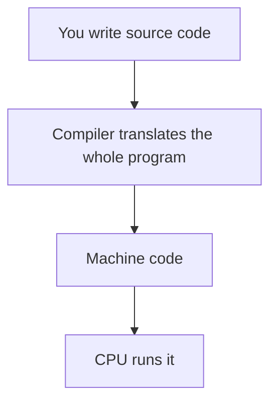

> **In one sentence:** Go is a programming language begun in 2007, whose programs are compiled into machine code before they run.

## Why should I care?

In [[programming-languages|Programming Languages]], you learned that people write programs as source code. Go is one such language. Its home page calls it "An open-source programming language supported by Google".

Go's FAQ (common questions) says programmers had to "choose either efficient compilation, efficient execution, or ease of programming". Its makers aimed for all three: fast compiling, simple work, and "to approach the performance of C for comparable programs". These are goals: the FAQ says Go does "quite poorly" on some benchmarks (speed tests). Go is compiled ahead of time; JavaScript, if compiled, is compiled while it runs.

Go's website lists uses such as these:

- **Cloud and network services:** these include services that run in the cloud, meaning on shared computing resources.
- **Command-line interfaces:** programs you use by typing commands.
- **Web development:** including web applications, software that people use through a browser.

## Analogy

Programming Languages compared a compiler to a translator who translates a whole letter first. Go works this way: your program is the letter, the compiler is the translator, and the [[cpu|CPU]] is the reader.

**Where the analogy breaks down:** a human translator can guess what you meant despite a small mistake. A compiler can refuse a whole program because of one line.

## How it actually works

### A tiny program

You need not learn this program's rules yet, including `func`, `{ }` and `( )`.

```go
// Go code lives in packages. A program that runs starts in package main.
package main

// Bring in fmt, a package with functions for printing text.
import "fmt"

// A function named main runs when you run this package.
func main() {
	// Print one line of text.
	fmt.Println("Hello, World!")
}
```

It prints this:

```
Hello, World!
```

- **`//`** starts a note for people who read the code.
- A **function** is a piece of code with a name. A **package** is a way to group functions.
- **`package main`** names the package where a program starts.
- **`import "fmt"`** brings in `fmt`, a package that comes with Go and can print text.
- **`fmt.Println`** runs `Println` from `fmt`, which writes the text as output.

### From source code to a running program

Go's FAQ says: "Go programs are compiled ahead of time to native machine code". Native [[machine-code|machine code]] means the CPU reads it directly. (For some other implementations of Go, the result differs, such as JavaScript. This page leaves those out.)



After installing Go, you can type a command on your computer: `go run .`, as Go's tutorial shows. Go's documentation says `go run` compiles the program, then runs it. This page does not need it.

## How it came to be

Go's FAQ says the language came from "frustration with existing languages and environments" for work at Google.

- **September 21, 2007:** Robert Griesemer, Rob Pike and Ken Thompson began writing the goals for a new language on a whiteboard.
- **2008:** by January, Ken Thompson had started work on a compiler. Ian Taylor and Russ Cox also began work.
- **November 10, 2009:** Go became a public open source project. Open source means the source code comes with the program, and people may change and share it.

## 🧪 Try it in your browser

The Go Playground is on Go's official website. These steps are written for a computer with Chrome, Edge or Firefox. It sends your program to go.dev's servers (shared computers on a network), so do not type private information into it.

1. Open [go.dev/play](https://go.dev/play/).
   **What you should see:** a code box and a **Run** button.
2. Click in the box, select all the code, delete it, then type or copy this program:

   ```go
   package main

   import "fmt"

   func main() {
   	fmt.Println("Hello, World!")
   }
   ```
3. Click **Run**.
   **What you should see:** `Hello, World!` on the page.
4. Add this line directly below `import "fmt"`, then click **Run**:

   ```go
   import "strings"
   ```

   Your program never uses the `strings` package.
   **What you should see:** an error message, not `Hello, World!`. Go's FAQ says Go "refuses to compile programs with unused variables or imports". (An import brings in a package. A variable stores a value.) So the program never runs.
5. Delete the `import "strings"` line and click **Run**.
   **What you should see:** `Hello, World!` appears again.

**On a phone:** say out loud what the compiler does.

## Common misunderstandings

- **"The language is called Golang."** Not quite. Go's FAQ says: "The language is called Go". The word "golang" came from the website, once `golang.org`. The FAQ adds: "Many use the golang name, though, and it is handy as a label".
- **"The Playground runs Go inside my browser."** No. Its page says it "runs on go.dev's servers".

## Recap

- Go's uses include network services and web development.
- Go programs are compiled ahead of time into machine code.
- Go began in 2007 and became public open source in 2009.

## Sources

- The Go Programming Language, home page: https://go.dev/
- Go, Frequently Asked Questions (FAQ): https://go.dev/doc/faq
- Go, Use Cases: https://go.dev/solutions/use-cases
- Go Tutorial, Get started with Go: https://go.dev/doc/tutorial/getting-started
- The Go Programming Language Specification: https://go.dev/ref/spec
- Go Packages, fmt: https://pkg.go.dev/fmt
- Go Packages, strings: https://pkg.go.dev/strings
- Go Packages, Command go: https://pkg.go.dev/cmd/go
- The Go Playground: https://go.dev/play/
- Go Playground source code, sandbox.go: https://github.com/golang/playground/blob/master/sandbox.go
- Stanford CS101, Software (part 2): https://web.stanford.edu/class/cs101/software-2.html
- Open Source Initiative, The Open Source Definition: https://opensource.org/osd
- MDN Web Docs, Server (glossary): https://developer.mozilla.org/en-US/docs/Glossary/Server
- MDN Web Docs, What is JavaScript?: https://developer.mozilla.org/en-US/docs/Learn_web_development/Core/Scripting/What_is_JavaScript
- Wikipedia, Machine code: https://en.wikipedia.org/wiki/Machine_code
- Wikipedia, Cloud computing: https://en.wikipedia.org/wiki/Cloud_computing
- Wikipedia, Web application: https://en.wikipedia.org/wiki/Web_application
- Wikipedia, Command-line interface: https://en.wikipedia.org/wiki/Command-line_interface
