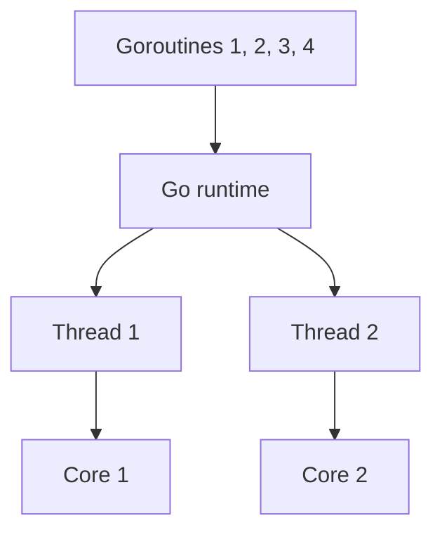

> **In one sentence:** A goroutine is a function call that Go runs concurrently with the rest of your program, and Go's runtime spreads goroutines over a set of threads.

## Why should I care?

[[threads|Threads]] showed that a program can run several threads, which share memory and need care. The language from [[go-language|What is Go?]] has its own way to do several things concurrently: the goroutine.

For example, Go's web server code, in its `net/http` package, starts a new goroutine for each visitor's connection. So one program can work on many visitors' requests concurrently.

Goroutines are managed by the **Go runtime**: a library, ready-made code, "that is part of every Go program", says Go's FAQ (common questions).

The FAQ says goroutines "can be very cheap": "It is practical to create hundreds of thousands of goroutines in the same address space."

## Analogy

Think of a post office with a few counters. Each counter has its own queue of customers. Each customer is a goroutine, and each counter is a thread. A clerk at the door, the Go runtime, sends customers to the queues.

Sometimes a customer must wait, for example for a form to arrive. They step aside, and the counter serves the next person. If the counter itself is stuck, the clerk can send the others in that queue to another counter.

**Where the analogy breaks down:** a post office serves people in the order they arrived. Go does not promise any order for goroutines. Also, when the function `main` (below) ends, the whole program stops. Goroutines that have not finished are dropped.

## How it actually works

### Starting a goroutine with `go`

Comments start with `//` and run to the end of the line. Read them to follow the code.

```go
// A program that runs starts in package main.
package main

// Bring in fmt, a package that comes with Go and can print text.
import "fmt"

// func defines a function named greet.
// "name string" means: the parameter name holds a string.
func greet(name string) {
	// + joins two strings, as in JavaScript.
	fmt.Println("Hello from " + name)
}

// The function main runs when you run the program.
func main() {
	// Start greet in a new goroutine. main does not wait for it.
	go greet("a goroutine")
	// main carries on with its own next line.
	fmt.Println("main is finished")
}
```

Putting `go` before a function call starts that call in a new goroutine. Go's specification, the reference manual for the language, says the program does not wait for the called function to finish.

`main` runs in a goroutine too. Go's `sync` package documentation calls it "a main goroutine". The specification calls the rest "other (non-main) goroutines".

`go run` is the command that compiles and runs a Go program. Running this program with it can print only this:

```
main is finished
```

Where is the greeting? When `main` returns, meaning it reaches its end, the program exits. The specification adds: "It does not wait for other (non-main) goroutines to complete." So the greeting may be lost. A run can also print both lines:

```
main is finished
Hello from a goroutine
```

Which one you see depends on timing. Neither result is wrong.

### Waiting with a channel

A **channel** connects goroutines. The specification says it lets functions "communicate by sending and receiving values".

```go
package main

import "fmt"

// work sends one message into the channel called done.
// "done chan string" means: done is a channel that carries strings.
func work(name string, done chan string) {
	// <- with the channel on the left sends a value into it.
	done <- name + " finished"
}

func main() {
	// := makes a new variable and gives it a value, like let.
	// make(chan string) creates a new channel for strings.
	done := make(chan string)

	// Start two goroutines. main does not wait here.
	go work("first", done)
	go work("second", done)

	// <-done receives one message. It waits until one arrives.
	fmt.Println(<-done)
	fmt.Println(<-done)
}
```

The specification says receiving waits until a value is available. `main` receives twice, so it waits for both messages before it ends. Sending can wait too: for a channel made like this, a send succeeds only when a receiver is ready.

The program prints these two lines, in either order:

```
second finished
first finished
```

Both lines always appear. Their order is not promised. Go's release notes for version 1.5 say "the order in which goroutines are scheduled", or given turns, changed. They add: "The properties of the scheduler were never defined by the language".

A channel is one way to wait. Go's `sync` package also has a `WaitGroup`. With it, `main` can wait until a whole group of goroutines has finished.

### How goroutines reach the CPU

Go's FAQ says the runtime spreads goroutines over "a set of threads". Effective Go, a guide on Go's website, says that if one goroutine waits, "others continue to run". Sometimes a goroutine blocks its whole thread, for example while it waits for the operating system. Then, the FAQ says, the runtime moves the other goroutines on that thread to a different thread.

A setting called `GOMAXPROCS` limits how many threads run Go code at the same moment.



### Sharing data needs care

The specification says goroutines run "within the same address space". So two goroutines can use the same variable.

Go's documentation describes a **data race**: "two goroutines access the same variable concurrently and at least one of the accesses is a write." It says data races are "among the most common and hardest to debug types of bugs in concurrent systems".

Go's documentation gives two common ways to protect shared data:

- **Send the data through a channel.** Effective Go says that then "Only one goroutine has access to the value at any given time." Its slogan: "Do not communicate by sharing memory; instead, share memory by communicating." In other words, pass data from goroutine to goroutine, instead of using it together.
- **Use a lock.** The `sync` package has a `Mutex`, "a mutual exclusion lock". Mutual exclusion means making sure that only one goroutine can use a variable at a time.

## How it came to be

Go's FAQ says the idea of spreading functions over threads "has been around for a while". It says Go took "some ideas from languages inspired by Tony Hoare's CSP". CSP stands for "Communicating Sequential Processes", a model for concurrency. Effective Go, "written for Go's release in 2009", already explains goroutines and channels.

## 🧪 Try it in your browser

The Go Playground is on Go's official website. These steps are written for a computer with Chrome, Edge or Firefox. The Playground "runs on go.dev's servers", so do not type private information into it.

1. Open [go.dev/play](https://go.dev/play/).
   **What you should see:** a code box and a **Run** button.
2. Click in the box, select all the code and delete it. Then type or copy the channel program from "Waiting with a channel" above.
3. Click **Run**.
   **What you should see:** two lines, `first finished` and `second finished`, in either order. The Playground's page says it gives programs "deterministic output", the same output every run, so it can store and reuse results. So you may see the same order every time. That is normal, and the order is still not promised.
4. Delete the last `fmt.Println(<-done)` line, then click **Run**.
   **What you should see:** one of the two lines, not both. Here this is certain, because only `main` prints. `main` receives one message and ends. The other goroutine is still waiting to send, so its message is never printed.

**If something goes wrong:** if you see an error message instead of the lines, the program could not be compiled, or it stopped with an error. Compare it with the program on this page, line by line.

## Common misunderstandings

- **"A goroutine is the same as a thread."** No. Many goroutines share a set of threads, and the Go runtime can move them between threads.
- **"`main` waits for the goroutines it starts."** No. When `main` ends, the program exits. Use a channel or a `WaitGroup` to wait.
- **"Goroutines always make a program faster."** No. The FAQ says concurrency "only enables parallelism when the underlying problem is intrinsically parallel". That means the job itself "can be broken into pieces that can execute in parallel".

## Recap

- `go` before a function call starts it in a new goroutine, and the caller does not wait.
- The Go runtime spreads goroutines over threads. With several cores, some can run at the same moment.
- Wait with channels or a `WaitGroup`. Goroutines that share data need channels or locks.

## Sources

- The Go Programming Language Specification: https://go.dev/ref/spec
- Effective Go: https://go.dev/doc/effective_go
- Go, Frequently Asked Questions (FAQ): https://go.dev/doc/faq
- A Tour of Go, Concurrency (source text): https://github.com/golang/website/blob/master/_content/tour/concurrency.article
- Go 1.5 Release Notes: https://go.dev/doc/go1.5
- The Go Memory Model: https://go.dev/ref/mem
- Go, Data Race Detector: https://go.dev/doc/articles/race_detector
- Go Packages, sync: https://pkg.go.dev/sync
- Go Packages, runtime: https://pkg.go.dev/runtime
- Go Packages, net/http: https://pkg.go.dev/net/http
- Go Packages, fmt: https://pkg.go.dev/fmt
- Go Packages, Command go: https://pkg.go.dev/cmd/go
- Go Tutorial, Get started with Go: https://go.dev/doc/tutorial/getting-started
- The Go Playground: https://go.dev/play/
- Go Playground source code, sandbox.go: https://github.com/golang/playground/blob/master/sandbox.go
- MDN Web Docs, Addition (+): https://developer.mozilla.org/en-US/docs/Web/JavaScript/Reference/Operators/Addition
- MDN Web Docs, let: https://developer.mozilla.org/en-US/docs/Web/JavaScript/Reference/Statements/let
