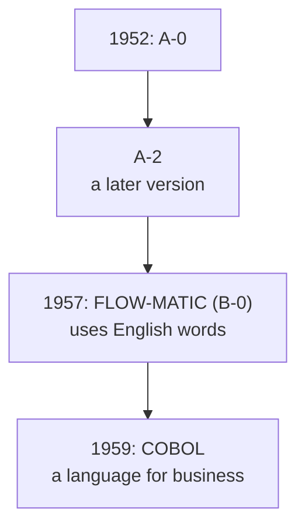

> **In one sentence:** In 1952, Grace Hopper's team finished A-0, an early program that built machine code from a programmer's short instructions; her team's later FLOW-MATIC (dated 1957 by the Computer History Museum) used English words and led to COBOL.

## The world before

In [[programming-languages]], you met the **compiler**: a program that translates source code into [[machine-code|machine code]]. IBM, a computer company, says that before its Fortran language (1957), programming was done by "a small group of specialists who wrote code in machine language".

Yale News says Grace Murray Hopper received a Ph.D. in mathematics from Yale University in 1934. In December 1943, she joined the US Naval Reserve (Women's Reserve).

The Navy gave her a job at Harvard University. There, according to Yale News, she "was responsible for programming the Mark I", a computer at Harvard. Later she worked on the Mark II, a different Harvard computer.

In 1949, she joined the Eckert-Mauchly Computer Corporation in Philadelphia as a "senior mathematician". The company was soon bought by Remington Rand. Yale says she was head programmer for Remington Rand and worked on the **UNIVAC I**. The Computer History Museum (CHM) calls the UNIVAC I "the first commercial business computer system in the United States".

## What happened

### 1952: A-0

In a paper from May 1952, Hopper described the problem. Writing and checking programs by hand had become "dull labor". The cost of programming and the time it took were getting the attention of company bosses.

Her answer was to let the computer do part of the programmer's work. Her plan used a **library** of **subroutines**. A subroutine is a small, ready-made program for one job, for example one kind of calculation. Each one "has been tested by operation on the computer".

In her plan, each subroutine had a short code, called a "call-number" (mostly letters), listed in a catalogue. The programmer wrote a list of call-numbers. After each one came its **arguments**: which values that step should work on. Then a program that Hopper called a "compiling routine" found each subroutine, adjusted it, and joined the pieces into one complete program. With enough subroutines in the library, she said, programming took hours instead of weeks.

The CHM says that in 1952, Hopper completed **A-0**, written for the UNIVAC I. Wikipedia describes A-0 in a similar way: a program was written as a list of subroutine codes and their arguments, and A-0 turned this list into machine code. The IEEE, an engineers' organization, dates A-0 to 1951–1952.

Hopper later remembered the reaction: "I had a running compiler and nobody would touch it. They told me computers could only do arithmetic." In other words, people did not believe that a computer could do more than calculate.

### Was A-0 "the first compiler"?

Sources do not agree on how to describe A-0:

- **Yale News:** "In 1952 her programming team developed the first computer language 'compiler' called A-0."
- **The CHM:** A-0 "possessed several features of a modern-day compiler".
- **The IEEE's milestone page for A-0:** A-0 was "a series of specifications that functioned as a linker/loader". The same page calls it "a pioneering utility program for the management of subroutines".
- **A biography of Hopper on the same IEEE history website:** Hopper completed "one of the first compilers in 1952".

The IEEE's words point back to what you read above: A-0 mostly found ready-made subroutines and joined them into one program. MDN Web Docs says a compiler today typically transforms code written in a higher-level language, such as C++, into machine code. A-0 did less than that.

So A-0 is often called the first compiler, and Hopper herself spoke of "writing the first compiler". Others call it one of the first, or say it was not yet a compiler in today's sense. You do not need to pick a side. What matters is the idea: the computer itself helped to build programs.

### 1957: FLOW-MATIC

By then, her company was part of Sperry Rand. Wikipedia says A-0 was followed by later versions, including A-2. In 1957, the CHM says, Sperry Rand released **MATH-MATIC**, "a refinement" of A-0. The CHM also says that "earlier work on the A-0 and A-2 compilers" led to **B-0**, also called **FLOW-MATIC**, completed in 1957. The CHM calls it "the first English-language business data processing compiler".

Yale News explains the difference: FORTRAN (Yale writes Fortran's name in capitals) "used mathematical symbols", while "Flow-Matic used regular English words."

## Why it mattered

The IEEE says that "Flow-Matic led to the development of COBOL", short for "Common Business-Oriented Language". Yale says COBOL was introduced in 1959. The IEEE says COBOL became "the dominant high-level language for business applications".

Many people helped create COBOL. Yale says Hopper "promoted the language" to the military and to companies, and "throughout the 1960s she led efforts to develop compilers for COBOL".

Yale also points to a bigger idea. Compilers "would eventually make it possible to write programs for multiple computers rather than a single machine". The IEEE says Hopper "popularized the idea of machine-independent programming languages": languages that do not belong to one kind of computer.

### A famous story: the moth

Today, people still use the word "bug" for "a mistake or failure in a technical system", the CHM says. You may hear that Hopper found the first computer bug.

The page above comes from the logbook of the Harvard Mark II computer. It is dated "9/9". The CHM says that on 9 September 1947, a team found a moth caught in the computer. They taped it into the logbook, and "one of the team members" wrote: "First actual case of bug being found." The CHM says Hopper "was present" and later made the story famous in her talks.

The stories differ. Yale News gives the year as 1945. The IEEE biography of Hopper says Hopper found the moth herself. Both CHM and Yale agree on one thing: people called machine faults "bugs" long before, in the 1800s.

## 🔍 See it for yourself

- The CHM timeline for [1952](https://www.computerhistory.org/timeline/1952/): look for "Grace Hopper completes A-0". This entry says A-0 let users write "English-like words", but Hopper's own 1952 paper describes short codes (call-numbers), not English words.
- The CHM timeline for [1957](https://www.computerhistory.org/timeline/1957/): look for the MATH-MATIC entry.
- The CHM page [September 9: First Instance of Actual Computer Bug Being Found](https://www.computerhistory.org/tdih/september/9/): look for the photo of the logbook page.
- The IEEE [milestone page for A-0](https://ethw.org/Milestones:A-0_Compiler_and_Initial_Development_of_Automatic_Programming,_1951-1952): it describes a plaque (a sign fixed to a wall) about A-0 at the University of Pennsylvania, in Philadelphia.

## Recap

- In 1952, Grace Hopper completed A-0. It built a program in machine code from short instructions and a library of ready-made subroutines.
- Sources disagree on whether A-0 was "the first compiler": some call it that, others say it mostly joined ready-made pieces, like a linker or loader.
- Her team's FLOW-MATIC (1957, according to the CHM) used English words, and it led to COBOL, a language for business.

## Sources

- Computer History Museum, Timeline of Computer History, 1952: https://www.computerhistory.org/timeline/1952/
- Computer History Museum, Timeline of Computer History, 1957: https://www.computerhistory.org/timeline/1957/
- Computer History Museum, This Day in History, September 9: https://www.computerhistory.org/tdih/september/9/
- Yale News, Grace Murray Hopper (1906–1992): A legacy of innovation and service: https://news.yale.edu/2017/02/10/grace-murray-hopper-1906-1992-legacy-innovation-and-service
- IEEE, ETHW, Milestone: A-0 Compiler and Initial Development of Automatic Programming, 1951-1952: https://ethw.org/Milestones:A-0_Compiler_and_Initial_Development_of_Automatic_Programming,_1951-1952
- IEEE, ETHW, Grace Murray Hopper: https://ethw.org/Grace_Murray_Hopper
- Grace Murray Hopper, The Education of a Computer (1952): http://xover.mud.at/~marty/iug2/p243-hopper.pdf
- Philip Schieber, The Wit and Wisdom of Grace Hopper (1987): http://www.cs.yale.edu/homes/tap/Files/hopper-wit.html
- Wikipedia, A-0 System (general background reference): https://en.wikipedia.org/wiki/A-0_System
- MDN Web Docs, Compile (glossary): https://developer.mozilla.org/en-US/docs/Glossary/Compile
- IBM, Fortran: https://www.ibm.com/history/fortran
- Wikimedia Commons, First Computer Bug, 1947: https://commons.wikimedia.org/wiki/File:First_Computer_Bug,_1947.jpg
