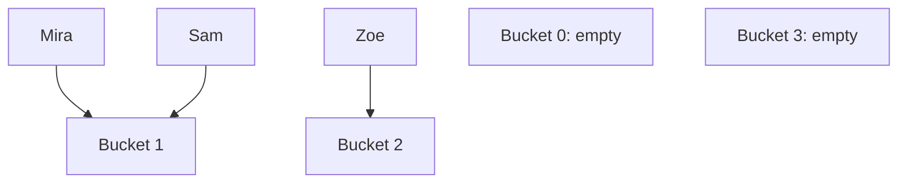

> **In one sentence:** A hash table turns each key into a number that picks a bucket, so a dictionary can go straight to the right place instead of checking every item.

## Why should I care?

In [[data-structures|Data Structures]], a dictionary found a value by its key. But how does it find "Sam" among a million keys?

In a plain list of key-value pairs, it would check each pair in order: a [[algorithms|linear search]]. In [[big-o|Big O]] terms, that is O(n): the number of steps grows as fast as n, the number of items. Wikipedia says a **hash table** is a data structure that implements (builds) a dictionary.

## Analogy

Think of a paper address book with a tab for each letter. A rule, "use the first letter", takes you straight to Sam's tab, S. There, you check only the names under S.

**Where the analogy breaks down:** many names share a first letter, so a hash table uses a rule that looks at the whole key.

## How it actually works

### A hash function picks a bucket

A hash table keeps its pairs in a row of **buckets** (also called slots), numbered like a list's items. A **hash function** is a rule that turns a key into a number. Wikipedia says a hash table uses it "to compute an index": to work out a bucket's number.

To find a key later, the table runs the function again. While the number of buckets stays the same, the same key gives the same bucket.

### A tiny hash function

Here is a made-up hash function. A computer stores each letter as a number, its code. In the ASCII standard, "M" is 77 and "a" is 97.

1. Add up the codes of the key's letters.
2. Divide the sum by 4, the number of buckets, and keep the **remainder**: what is left over.

| Key | Letter codes | Sum | Remainder after dividing by 4 |
|---|---|---|---|
| Mira | 77 + 105 + 114 + 97 | 393 | 1 |
| Sam | 83 + 97 + 109 | 289 | 1 |
| Zoe | 90 + 111 + 101 | 302 | 2 |

For example, 393 = 4 × 98 + 1, so Mira's remainder is 1. Buckets 0 and 3 stay empty.



### Collisions: two keys in one bucket

Mira and Sam both land in bucket 1. Two keys in one bucket is a **collision**. Wikipedia says avoiding them is "impossible to guarantee" for data you have not seen yet: the keys are not known in advance.

This page shows one way to handle them, called **chaining**: each bucket keeps a small list of its pairs. A lookup checks only the pairs in one bucket, one by one. (Wikipedia's version uses a linked list, another kind of list. There are other ways too.)

### A tiny hash table in code

The code below builds this hash table, with chaining. `put` stores a value under a key, and `get` finds it. The examples are in [[javascript|JavaScript]], [[python|Python]] and [[go-language|Go]]. You only need to read one tab.

<!-- tabs -->

### JavaScript

`function toyHash(key) { ... }` defines a **function**: named steps that you run later, by writing `toyHash("Mira")`. Then `key` holds "Mira". `return` ends the function and gives back a value, so `const slot = toyHash(key)` keeps that number in `slot`. `return;` with no value ends it early.

`.length` works on a string too: for these names, the number of letters. `key.charCodeAt(i)` gives the code of the letter at index `i`, and `%` gives the remainder. Each pair is a two-item array, such as `["Mira", 30]`. So `buckets[slot][i][0]` reads the key of pair `i` in bucket `slot`, and `[1]` its value.

```js
// Four empty buckets. Each bucket is a list of [key, value] pairs.
const buckets = [[], [], [], []];

// The made-up hash function: add up the letter codes,
// then keep the remainder after dividing by 4.
function toyHash(key) {
  let sum = 0;
  for (let i = 0; i < key.length; i++) {
    sum = sum + key.charCodeAt(i); // The code of the letter at index i.
  }
  return sum % buckets.length; // Always 0, 1, 2 or 3.
}

// Store a value under a key.
function put(key, value) {
  const slot = toyHash(key);
  for (let i = 0; i < buckets[slot].length; i++) {
    if (buckets[slot][i][0] === key) {
      buckets[slot][i][1] = value; // The key is there: change its value.
      return;                      // End the function here.
    }
  }
  buckets[slot].push([key, value]); // A new key: add a pair.
}

// Find the value stored under a key.
function get(key) {
  const slot = toyHash(key);
  for (let i = 0; i < buckets[slot].length; i++) {
    if (buckets[slot][i][0] === key) {
      return buckets[slot][i][1]; // Found it: give back the value.
    }
  }
  return undefined; // The key is not in its bucket.
}

put("Mira", 30);
put("Sam", 25);
put("Zoe", 40);
put("Mira", 31); // Mira is there already: this changes her value.

console.log(toyHash("Mira"), toyHash("Sam"), toyHash("Zoe")); // Shows: 1 1 2

console.log(buckets[1].length); // Shows: 2
console.log(get("Sam"));        // Shows: 25
console.log(get("Mira"));       // Shows: 31
console.log(get("Ann"));        // Shows: undefined
```

### Python

`def toy_hash(key):` defines a **function**: a named set of steps that you can run later, by writing `toy_hash("Mira")`. `key` is the value it receives. The lines below the `def` line are the function's body, and they must be indented (moved to the right). `return` ends the function and gives back a value. `return` with no value ends it early.

`for letter in key:` repeats once for each letter of the key. `ord(letter)` gives the letter's code. `%` gives the remainder. `range(len(buckets[slot]))` gives each index of a bucket, from 0 to the last one.

Each pair is a list of two items, such as `["Mira", 30]`. So `buckets[slot][i][0]` reads the key of pair number `i` in bucket `slot`, and `[1]` reads its value. `None` is Python's value for "no value here".

```python
# Four empty buckets. Each bucket is a list of [key, value] pairs.
buckets = [[], [], [], []]

# The made-up hash function: add up the letter codes,
# then keep the remainder after dividing by 4.
def toy_hash(key):
    total = 0
    for letter in key:
        total = total + ord(letter)  # The code of this letter.
    return total % len(buckets)      # Always 0, 1, 2 or 3.

# Store a value under a key.
def put(key, value):
    slot = toy_hash(key)
    for i in range(len(buckets[slot])):
        if buckets[slot][i][0] == key:
            buckets[slot][i][1] = value  # The key is there: change its value.
            return                       # End the function here.
    buckets[slot].append([key, value])   # A new key: add a pair.

# Find the value stored under a key.
def get(key):
    slot = toy_hash(key)
    for i in range(len(buckets[slot])):
        if buckets[slot][i][0] == key:
            return buckets[slot][i][1]  # Found it: give back the value.
    return None  # The key is not in its bucket.

put("Mira", 30)
put("Sam", 25)
put("Zoe", 40)
put("Mira", 31)  # Mira is there already: this changes her value.

print(toy_hash("Mira"), toy_hash("Sam"), toy_hash("Zoe"))  # Shows: 1 1 2

print(len(buckets[1]))  # Shows: 2
print(get("Sam"))       # Shows: 25
print(get("Mira"))      # Shows: 31
print(get("Ann"))       # Shows: None
```

Bucket 1 holds two pairs, Mira and Sam. "Ann" also goes to bucket 1, so `get("Ann")` checks those two pairs, finds no match, and gives back `None`. Python has its own `hash()`, so this page names its function `toy_hash`.

### Go

`func toyHash(key string) int` defines a **function**: a named set of steps that you can run later, by writing `toyHash("Mira")`. `key` is the value it receives, a string. The `int` after the round brackets is the type of value it gives back. `return` ends the function and gives back a value. `return` with no value ends it early. `get` gives back two values, so its line says `(int, bool)`. A `bool` is true or false.

`type entry struct { ... }` creates a new type named `entry`. It is a **struct**: it groups named values, called fields. Each `entry` has a `key` and a `value`. `entry{key, value}` makes a new entry, and `.key` and `.value` read its fields. `var buckets [4][]entry` creates a variable: a row of exactly 4 buckets, each a slice of entries, empty at first.

`key[i]` gives the string's byte at index `i`, a small number: for an English letter, its code. `int(...)` turns it into an `int`. `%` gives the remainder. `append` gives back the longer slice, so the code keeps it with `buckets[slot] =`. `fmt.Println` shows its values with spaces between them.

```go
package main

import "fmt"

// An entry holds one key and its value.
type entry struct {
	key   string
	value int
}

// Four buckets, empty at first. Each bucket is a slice of entries.
var buckets [4][]entry

// The made-up hash function: add up the letter codes,
// then keep the remainder after dividing by 4.
func toyHash(key string) int {
	sum := 0
	for i := 0; i < len(key); i++ {
		sum = sum + int(key[i]) // The code of the letter at index i.
	}
	return sum % len(buckets) // Always 0, 1, 2 or 3.
}

// Store a value under a key.
func put(key string, value int) {
	slot := toyHash(key)
	for i := 0; i < len(buckets[slot]); i++ {
		if buckets[slot][i].key == key {
			buckets[slot][i].value = value // The key is there: change its value.
			return                         // End the function here.
		}
	}
	// A new key: add an entry, and keep the result.
	buckets[slot] = append(buckets[slot], entry{key, value})
}

// Find the value stored under a key.
// It gives back two values: the value, and whether the key was found.
func get(key string) (int, bool) {
	slot := toyHash(key)
	for i := 0; i < len(buckets[slot]); i++ {
		if buckets[slot][i].key == key {
			return buckets[slot][i].value, true // Found it.
		}
	}
	return 0, false // The key is not in its bucket.
}

func main() {
	put("Mira", 30)
	put("Sam", 25)
	put("Zoe", 40)
	put("Mira", 31) // Mira is there already: this changes her value.

	fmt.Println(toyHash("Mira"), toyHash("Sam"), toyHash("Zoe")) // Shows: 1 1 2

	fmt.Println(len(buckets[1])) // Shows: 2
	fmt.Println(get("Sam"))      // Shows: 25 true
	fmt.Println(get("Mira"))     // Shows: 31 true
	fmt.Println(get("Ann"))      // Shows: 0 false
}
```

Bucket 1 holds two entries, Mira and Sam. "Ann" also goes to bucket 1, so `get("Ann")` checks those two entries, finds no match, and gives back `0, false`.

<!-- /tabs -->

### Fast on average, slow in the worst case

How can a million keys stay fast? Going to a bucket by its number is one step, like reading a list item by its index. Wikipedia's Time complexity article says reading an array item needs "only a single operation".

Wikipedia says speed depends on the **load factor**: the number of pairs divided by the number of buckets, so the average per bucket. It says "a common approach is to resize" the table when the load factor reaches a set limit. The pairs are then "rehashed": placed again, by the hash function, into the new, larger set of buckets. So buckets stay short.

Wikipedia says that in such a well-sized hash table, "the average time complexity for each lookup is independent of the number of elements stored in the table". Time complexity is how the number of steps grows. So a lookup is O(1) on average.

But if every key landed in one bucket, a lookup would check them one by one: a linear search. Wikipedia's summary box gives a search O(n) in the worst case. So a good hash function spreads keys across the buckets.

### The dictionaries built into each language

Each language also has a dictionary built in.

<!-- tabs -->

### JavaScript

In Lists and Dictionaries, you used an object, such as `{ Mira: 30 }`, as a dictionary. MDN Web Docs, a website that documents web technologies, says objects were used this way "historically", and that `Map` "performs better" with frequent additions and removals.

```js
// new Map() creates an empty Map.
const ages = new Map();
// set stores a value under a key.
ages.set("Mira", 30);
ages.set("Sam", 25);
// get gives back the value stored under a key.
console.log(ages.get("Sam")); // Shows: 25
console.log(ages.get("Ann")); // Shows: undefined
```

The ECMAScript standard, JavaScript's official description, says Maps use "either hash tables or other mechanisms". Their average access times must be "sublinear on the number of elements": growing more slowly than the number of items.

### Python

In the standard version of Python, the dictionary, `dict`, is a hash table. Python's FAQ says: "CPython's dictionaries are implemented as resizable hash tables." CPython is that standard version, from python.org. The FAQ says each key's hash code, the number a hash function gives, comes from Python's built-in `hash()`. It says the hash code depends on "a per-process seed". Python's data model page explains: string hash codes "are not predictable between repeated invocations of Python", that is, between runs.

A key must be **hashable**. Python's glossary says a hashable value has "a hash value which never changes during its lifetime". Its tutorial says: "You can't use lists as keys, since lists can be modified in place", that is, changed without making a new list. If a key could change, its hash code could change, the FAQ explains, and the dictionary would no longer find it. Strings and numbers "can always be keys".

```python
ages = {"Mira": 30, "Sam": 25}
print(ages["Sam"])  # Shows: 25

# A list can change, so it cannot be a key.
# This line stops with an error: TypeError.
bad = {["Mira"]: 30}
```

### Go

Go's map is a hash table. A post on Go's blog says: "Go provides a built-in map type that implements a hash table."

Not every type can be a key. Go's specification says the key type "must not be a function, map, or slice".

```go
package main

import "fmt"

func main() {
	// A map with string keys and whole-number values.
	ages := map[string]int{"Mira": 30, "Sam": 25}
	fmt.Println(ages["Sam"]) // Shows: 25
}
```

A map whose keys are slices of strings, `map[[]string]int{}`, does not work. Go's rules do not allow it.

<!-- /tabs -->

## How it came to be

Wikipedia says: "In January 1953, Hans Peter Luhn wrote an internal IBM memorandum that used hashing with chaining." A memorandum is a written note.

## 🧪 Try it in your browser

These steps use JavaScript, because the browser's console runs it. In the line below:

- `let mira = 0` creates a variable that holds 0. `;` separates commands.
- `for (...) { ... }` repeats the part in curly brackets while `i` is less than `"Mira".length`, the number of letters. `i++` adds 1.
- `"Mira".charCodeAt(i)` gives the code of the letter at index `i`. `%` gives the remainder, and `console.log()` shows a value.

You need a computer with Chrome, Edge or Firefox.

**Safety rule:** only type code in the console that you understand or that comes from a source you trust. Never paste anything a stranger sends you. The line below adds up the letter codes of one name.

1. Open [example.com](https://example.com).
   **What you should see:** a short page of text.
2. Open the **console**:
   - **Windows:** press `Ctrl` + `Shift` + `J` (in Firefox: `Ctrl` + `Shift` + `K`)
   - **Mac:** press `Cmd` + `Option` + `J` (in Firefox: `Cmd` + `Option` + `K`)
3. Click the line where you can type, below any messages. **Type** this line yourself (some browsers may block pasting at first), then press `Enter`. The browser may show suggestions, and the line may look different while you type. Keep typing. Type carefully: the line is long.

   ```
   let mira = 0; for (let i = 0; i < "Mira".length; i++) { mira = mira + "Mira".charCodeAt(i); } console.log(mira % 4);
   ```

   **What you should see:** `1`, Mira's bucket. The console may also show `undefined`. That is normal: there is no other result to show.

If you see an error message, look for a typo. Then click your browser's reload button and start again from step 3.

## Common misunderstandings

- **"A hash table finds every key in one step."** Not always. When many keys share a bucket, a lookup checks them one by one.
- **"Any value can be a key."** Not in Python or Go: a list in Python and a slice in Go cannot be keys. A JavaScript `Map` accepts any value as a key.

## Recap

- A hash function turns a key into a number that picks a bucket.
- Two keys in one bucket is a collision. Chaining keeps a small list in each bucket.
- A lookup is O(1) on average, but O(n) in the worst case. Go's map and Python's standard `dict` are hash tables, and a JavaScript `Map` may be one.

## Sources

- Wikipedia, Hash table: https://en.wikipedia.org/wiki/Hash_table
- Wikipedia, Time complexity: https://en.wikipedia.org/wiki/Time_complexity
- Wikipedia, ASCII: https://en.wikipedia.org/wiki/ASCII
- ECMAScript Language Specification, Keyed Collections: https://tc39.es/ecma262/multipage/keyed-collections.html
- MDN Web Docs, Map: https://developer.mozilla.org/en-US/docs/Web/JavaScript/Reference/Global_Objects/Map
- MDN Web Docs, Map() constructor: https://developer.mozilla.org/en-US/docs/Web/JavaScript/Reference/Global_Objects/Map/Map
- MDN Web Docs, String.prototype.charCodeAt(): https://developer.mozilla.org/en-US/docs/Web/JavaScript/Reference/Global_Objects/String/charCodeAt
- MDN Web Docs, String: length: https://developer.mozilla.org/en-US/docs/Web/JavaScript/Reference/Global_Objects/String/length
- MDN Web Docs, Remainder (%): https://developer.mozilla.org/en-US/docs/Web/JavaScript/Reference/Operators/Remainder
- MDN Web Docs, Functions: https://developer.mozilla.org/en-US/docs/Web/JavaScript/Guide/Functions
- MDN Web Docs, return: https://developer.mozilla.org/en-US/docs/Web/JavaScript/Reference/Statements/return
- MDN Web Docs, Array.prototype.push(): https://developer.mozilla.org/en-US/docs/Web/JavaScript/Reference/Global_Objects/Array/push
- MDN Web Docs, for: https://developer.mozilla.org/en-US/docs/Web/JavaScript/Reference/Statements/for
- MDN Web Docs, let: https://developer.mozilla.org/en-US/docs/Web/JavaScript/Reference/Statements/let
- MDN Web Docs, Increment (++): https://developer.mozilla.org/en-US/docs/Web/JavaScript/Reference/Operators/Increment
- MDN Web Docs, console.log(): https://developer.mozilla.org/en-US/docs/Web/API/console/log_static
- MDN Web Docs, eval(): https://developer.mozilla.org/en-US/docs/Web/JavaScript/Reference/Global_Objects/eval
- MDN Web Docs, About MDN: https://developer.mozilla.org/en-US/about
- Python documentation, Design and History FAQ: https://docs.python.org/3/faq/design.html
- Python documentation, Glossary: https://docs.python.org/3/glossary.html
- Python documentation, Data model: https://docs.python.org/3/reference/datamodel.html
- Python Tutorial, Data Structures: https://docs.python.org/3/tutorial/datastructures.html
- Python Tutorial, More Control Flow Tools: https://docs.python.org/3/tutorial/controlflow.html
- Python documentation, Built-in Functions: https://docs.python.org/3/library/functions.html
- Python documentation, Built-in Constants: https://docs.python.org/3/library/constants.html
- The Go Blog, Go maps in action: https://go.dev/blog/maps
- The Go Programming Language Specification: https://go.dev/ref/spec
- Go Packages, fmt: https://pkg.go.dev/fmt
- Microsoft Edge DevTools, Run JavaScript in the Console: https://learn.microsoft.com/en-us/microsoft-edge/devtools/console/console-javascript
- Chrome for Developers, Open Chrome DevTools: https://developer.chrome.com/docs/devtools/open
- Microsoft Edge DevTools, Keyboard shortcuts: https://learn.microsoft.com/en-us/microsoft-edge/devtools/shortcuts/
- Firefox DevTools User Docs, Web Console: https://firefox-source-docs.mozilla.org/devtools-user/web_console/index.html
- Chrome for Developers, What are self-XSS attacks?: https://developer.chrome.com/blog/self-xss
- Example Domain: https://example.com
