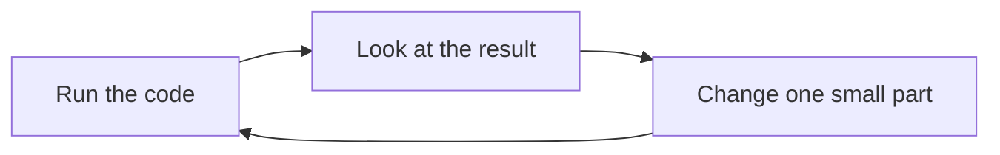

> **In one sentence:** You can keep learning programming on your own with a few habits: read the documentation, read and search error messages, try small changes, explain your code out loud, and ask clear questions.

## Why should I care?

Soon you will need things that these pages do not explain. MDN Web Docs, a website that documents web technologies, tells web developers: "you aren't expected to remember everything!"

This page gives you habits for learning on your own, each from a guide that it names.

## Analogy

MDN compares a programming **reference** to a dictionary. A dictionary lists the meaning of every word. A reference tries to cover every feature of a language.

**Where the analogy breaks down:** a dictionary entry gives you words to read. A reference entry often gives you example code too, and you can run that code and change it.

## How it actually works

### Habit 1: Read the documentation

MDN's advice for a problem with a "tool or product", such as a programming language: "consult the official documentation first." MDN describes several kinds of documentation, including these two:

- A **reference**: MDN says references "focus on *what* a feature does rather than *how* to use it."
- A **tutorial**: MDN says tutorials "are often step-by-step and aimed at beginners."

Here is where to find each kind, and help, for each language. You only need to read one tab.

<!-- tabs -->

### JavaScript

For JavaScript, use MDN. MDN says that for the web, "the *unofficial* official documentation is MDN".

- **Tutorial:** *Learn web development*, "designed to take you from 'beginner' to 'comfortable'".
- **Reference:** the *JavaScript reference*.
- **Errors:** the *JavaScript error reference* has a page with "additional details" for each error it lists.
- **Asking:** MDN's communication channels, linked from *Learn web development*, welcome "requests for help with items you don't understand".

### Python

For [[python|Python]], use docs.python.org, the documentation on Python's website.

- **Tutorial:** *The Python Tutorial*. It says it is "designed for *programmers* that are new to the Python language, **not** *beginners* who are new to programming." It "expects you to have a basic understanding of programming in general". These pages have covered some of that: variables, conditions, loops, functions and errors.
- **Reference:** the tutorial points to two references. The *Python built-ins reference* covers the built-ins: the functions and types of value that Python comes with, such as numbers. *The Python Standard Library* "describes the standard library distributed with Python": more code that comes with Python.
- **Errors:** *Built-in Exceptions*, in the built-ins reference, explains each of Python's own exceptions. For example, Python raises a `NameError` when it cannot find a name that your code uses.
- **Asking:** Python's help page says: "First check the Python FAQs". It also names discuss.python.org, where a "Python Help" category "hosts usage questions and answers from the Python community".

### Go

For [[go-language|Go]], use go.dev and pkg.go.dev.

- **Tutorial:** *A Tour of Go*, "An interactive introduction to Go in four sections". Go's site says: "Each section concludes with a few exercises so you can practice what you've learned."
- **Reference:** the standard library documentation at pkg.go.dev/std, "Reference documentation for Go's standard library". The standard library is the set of packages "you got when you installed Go". A package is a named group of Go code.
- **Errors:** Go's blog explains that Go code uses `error` values to show that something went wrong.
- **Asking:** the page go.dev/help lists places to get help. It says: "consult the FAQ and wiki before posting." The FAQ (frequently asked questions) has "Answers to common questions about Go", and the wiki is a set of pages "maintained by the Go community". The *Go Playground* is "A place to write, run, and share Go code", so the people you ask can run your example.

<!-- /tabs -->

### What one reference entry looks like

Here is one real entry from each language's reference: the entry for turning text into capital letters.

<!-- tabs -->

### JavaScript

MDN's page for `toUpperCase` starts with one sentence: it "returns this string converted to uppercase." A string is a piece of text. `toUpperCase` is a **method**: a function that belongs to a value, here the string. Further down, the page has sections including:

- **Syntax:** how to write it: `toUpperCase()`.
- **Parameters:** the values it takes. For this method: "None."
- **Return value:** what it gives back: "A new string representing the calling string converted to upper case."
- **Examples:** code that uses it, such as `"alphabet".toUpperCase()`, with the result `'ALPHABET'`.

### Python

In Python, a string (a piece of text) has the type `str`. The page *Built-in Types* has an entry for `str.upper()`. The entry has two parts:

- **A first line** that shows how to write it: `str.upper()`.
- **A description:** it returns a copy of the string, with its letters changed to capital letters.

This entry has no example. Some other entries on the same page, such as the one for `str.split`, do. Here is a call that uses it: the text, then a dot, then `upper()`.

```python
print("hello".upper())  # Shows: HELLO
```

### Go

The page for the `strings` package, on pkg.go.dev, has an entry for `ToUpper`. The entry has three parts:

- **A first line:** `func ToUpper(s string) string`. `func` starts a function. Inside the round brackets is one parameter, `s`, and its type, `string` (a piece of text). In Go, the type comes after the name. The last `string` is the type of the value it gives back.
- **A description:** it returns `s` with all its letters changed to capital letters.
- **An example:** a short program that calls `strings.ToUpper("Gopher")`, and its **Output**: `GOPHER`.

<!-- /tabs -->

### Habit 2: Read the error message, then search for it

In [[errors|Errors]], you learned to read an error message. MDN adds: "look at the line number you are given, go to that line, and see if you can spot what's wrong."

If that does not help, MDN's search tips say: "If your code is returning a specific error message, try entering the error into a search engine". The same tips say to include the name of your language in the search. But first, MDN advises, "spend time trying to solve the problem yourself".

### Habit 3: Try small changes

A Tour of Go, the tutorial on Go's website, says that its programs "are meant to be starting points for your own experimentation. Edit the program and run it again."

MDN's guide to fixing JavaScript does the same. It makes one small fix, such as one misspelled name, then reloads the web page to check. It also adds a line that shows a value, to "see what the variable contains".



### Habit 4: Explain your code out loud

When you are stuck, MDN suggests a break, and talking about the problem. It says this "even works when you explain the problem out loud, to yourself or to an inanimate object" (a thing that is not alive).

This is called **rubber duck debugging**. Wikipedia describes it like this: you explain your code step by step, in everyday language, out loud or in writing. This can show you your mistakes and misunderstandings.

### Habit 5: Ask clear questions

MDN suggests that you "look up information online first", and ask other people "when you are truly stuck". The tabs above name a place to ask for each language. When you ask, show that you have "already tried to solve the problem yourself first":

- "Keep a record of what you've already tried to do. What already failed?"
- Think about "what specifically is the problem?"
- If some code does not work, MDN suggests putting it online to show the person.

## How it came to be

The name "rubber duck debugging" comes from a story in a book, *The Pragmatic Programmer*, by Andy Hunt and Dave Thomas. Wikipedia says a research assistant, Greg Pugh, "carried around a rubber duck". He could explain his code to it.

## 🧪 Try it in your browser

This exercise practises Habits 1 and 3, in JavaScript, because the browser's console runs JavaScript. You need a computer with Chrome, Edge or Firefox.

1. Open MDN's page [String.prototype.toUpperCase()](https://developer.mozilla.org/en-US/docs/Web/JavaScript/Reference/Global_Objects/String/toUpperCase).
   **What you should see:** the title `String.prototype.toUpperCase()`, and a sentence that says it returns the string "converted to uppercase". You can ignore the word `prototype` for now.
2. Scroll down. Find the headings **Syntax**, **Return value** and **Examples**.
   **What you should see:** under **Syntax**, `toUpperCase()`. Under **Return value**, a sentence that begins "A new string". Under **Examples**, code that uses `toUpperCase()`.
3. Now run that example yourself. Open [example.com](https://example.com) in a new tab.
   **What you should see:** a short page of text.
4. Open the **console**:
   - **Windows:** press `Ctrl` + `Shift` + `J` (in Firefox: `Ctrl` + `Shift` + `K`)
   - **Mac:** press `Cmd` + `Option` + `J` (in Firefox: `Cmd` + `Option` + `K`)

   **Safety rule:** only type code in the console that you understand or that comes from a source you trust. Never paste anything a stranger sends you. The lines below only make capital-letter copies of short pieces of text.
5. Click the line where you can type, below any messages. **Type** this line yourself (some browsers may block pasting at first), then press `Enter`. The browser may show suggestions, and the line may look different while you type. Keep typing.

   ```
   "alphabet".toUpperCase()
   ```

   This line is a value (the text `"alphabet"`), then a dot, then the method `toUpperCase()`.

   **What you should see:** the word ALPHABET, in capital letters.
6. Make one small change: replace `alphabet` with `Hello`. Type the new line and press `Enter`.

   ```
   "Hello".toUpperCase()
   ```

   **What you should see:** the word HELLO: a new string in capital letters, as the Return value section says.

## Common misunderstandings

- **"If I find code that works, I can copy it without reading it."** MDN advises you to "at least try to understand how it works first", and ideally to "write your own version."
- **"Asking for help means I have failed."** No. MDN says developers should not keep going and pretend that they know what they are doing when they don't.

## Recap

- Look things up: a reference says what a feature does, and a tutorial teaches how to use it.
- Read an error message first, then search for it with your language's name. Try small changes, and explain your code out loud.
- When you are truly stuck, ask: say what the problem is, what you tried, and what failed.

## Sources

- MDN Web Docs, Research and learning: https://developer.mozilla.org/en-US/docs/Learn_web_development/Getting_started/Soft_skills/Research_and_learning
- MDN Web Docs, Browsing the web (Searching for information): https://developer.mozilla.org/en-US/docs/Learn_web_development/Getting_started/Environment_setup/Browsing_the_web
- MDN Web Docs, What went wrong? Troubleshooting JavaScript: https://developer.mozilla.org/en-US/docs/Learn_web_development/Core/Scripting/What_went_wrong
- MDN Web Docs, Learn web development: https://developer.mozilla.org/en-US/docs/Learn_web_development
- MDN Web Docs, JavaScript reference: https://developer.mozilla.org/en-US/docs/Web/JavaScript/Reference
- MDN Web Docs, JavaScript error reference: https://developer.mozilla.org/en-US/docs/Web/JavaScript/Reference/Errors
- MDN Web Docs, String.prototype.toUpperCase(): https://developer.mozilla.org/en-US/docs/Web/JavaScript/Reference/Global_Objects/String/toUpperCase
- MDN Web Docs, Method (glossary): https://developer.mozilla.org/en-US/docs/Glossary/Method
- MDN Web Docs, About MDN: https://developer.mozilla.org/en-US/about
- The Python Tutorial: https://docs.python.org/3/tutorial/index.html
- The Python Standard Library: https://docs.python.org/3/library/index.html
- Python built-ins reference, Built-in Types: https://docs.python.org/3/library/stdtypes.html
- Python built-ins reference, Built-in Exceptions: https://docs.python.org/3/library/exceptions.html
- Go, Documentation: https://go.dev/doc/
- A Tour of Go, Welcome: https://go.dev/tour/welcome/1
- A Tour of Go, welcome page text (golang/website repository): https://raw.githubusercontent.com/golang/website/master/_content/tour/welcome.article
- Go Packages, strings: https://pkg.go.dev/strings
- The Go Programming Language Specification: https://go.dev/ref/spec
- A Tour of Go, Basics text (golang/website repository): https://raw.githubusercontent.com/golang/website/master/_content/tour/basics.article
- Wikipedia, Rubber duck debugging: https://en.wikipedia.org/wiki/Rubber_duck_debugging
- Microsoft Edge DevTools, Run JavaScript in the Console: https://learn.microsoft.com/en-us/microsoft-edge/devtools/console/console-javascript
- Chrome for Developers, Open Chrome DevTools: https://developer.chrome.com/docs/devtools/open
- Firefox DevTools User Docs, Web Console: https://firefox-source-docs.mozilla.org/devtools-user/web_console/index.html
- Chrome for Developers, What are self-XSS attacks?: https://developer.chrome.com/blog/self-xss
- Example Domain: https://example.com
- Python built-ins reference: https://docs.python.org/3/builtins/index.html
- Python, Getting help: https://www.python.org/about/help/
- Go, Help: https://go.dev/help
- Go Tutorial, Get started with Go: https://go.dev/doc/tutorial/getting-started
- Go Packages, Standard library: https://pkg.go.dev/std
- The Go Blog, Error handling and Go: https://go.dev/blog/error-handling-and-go
