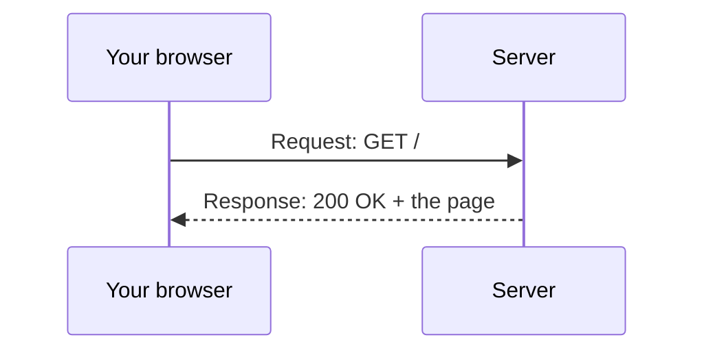

> **In one sentence:** HTTP (HyperText Transfer Protocol) is the set of rules that web browsers and web servers use to send requests and responses for web pages, pictures and other files.

## Why should I care?

You use HTTP every time you open a web page. In [[protocols]], you saw a short HTTP request and response, and the status codes 200 and 404. Here you will see the parts of both messages. MDN, a website that documents how the web works, calls HTTP "the foundation of any data exchange on the Web".

## Analogy

Think of **ordering at a shop counter with a written slip**.

- You write an **order slip**: what you want to do ("give me"), which item, and some extra notes ("please wrap it").
- The clerk writes a **reply slip**: a short code that says how it went ("OK" or "we do not have it"), some notes about the item, and then hands you the item.

An HTTP request is your order slip. An HTTP response is the reply slip, often with the item attached.

**Where the analogy breaks down:** a clerk may remember you the next time you come. Basic HTTP does not. Each request stands alone.

## How it actually works

As in [[client-and-server]], the client (usually your browser) always sends the request, and the server answers.



### The request

MDN lists the parts of a request:

1. **A method**: what the client wants to do. MDN says the usual ones are **GET**, to get something such as a page, and **POST**, to send something such as a filled-in form.
2. **A path**: which page or file on the server you want. It is the address without the `https://` and the website name. For `developer.mozilla.org/en-US/docs/Web/HTTP`, the path is `/en-US/docs/Web/HTTP`.
3. **The version** of HTTP.
4. **Headers** (optional): extra information for the server.
5. **A body**, for some methods such as POST: the data you send.

A **header** is one line with a name, a colon, and a value. Here is an example request, built from MDN's examples:

*Diagram: an HTTP request of three lines. Line 1 holds the method GET, the path / and the version HTTP/1.1. Lines 2 and 3 are headers: Host names the server, and Accept-Language says the client prefers German.*

```
GET / HTTP/1.1                    <- method, path, version
Host: developer.mozilla.org       <- header: which server
Accept-Language: de               <- header: "I prefer German"
```

`Accept-Language` tells the server which human language the client prefers (`de` means German). A browser sets it from the language of its menus, and from any languages you choose in its settings.

### The response

MDN lists the parts of a response: the **version**, a **status code** (a number that says if the request worked, and if not, why), a short **status message** such as `OK`, **headers**, and often a **body**: the thing you asked for, such as the page.

*Diagram: an HTTP response. Line 1 holds the version, the status code 200 and the status message OK. Line 2 is a header, Content-Type, which says the body is a web page. After the headers comes the body: the page itself.*

```
HTTP/1.1 200 OK                   <- version, status code, message
Content-Type: text/html           <- header: the body is a web page
... (more headers)
(then the body: the web page itself)
```

### Status codes come in five groups

The first digit of a status code tells you its group:

| Codes | Group | Example |
|---|---|---|
| 100–199 | Informational | |
| 200–299 | Success | 200 OK: "The request succeeded." |
| 300–399 | Redirection | 301: the address of the page has changed permanently (forever) |
| 400–499 | Client error | 404 Not Found: the server cannot find what you asked for |
| 500–599 | Server error | 500: the server met a situation it does not know how to handle |

### Each request stands alone

MDN calls HTTP "stateless". This means each request stands alone: HTTP makes "no link between two requests". So, by itself, a server does not remember your last request. Websites remember things with **cookies**: small pieces of data that a server sends to your browser, and that the browser sends back with later requests. You will learn more in [[cookies-and-privacy]].

**HTTPS** is HTTP sent over an encrypted connection. **Encrypted** means turned into a code that people without permission cannot read. You will learn how in [[https]].

## How it came to be

MDN says HTTP was developed by Tim Berners-Lee and his team between 1989 and 1991. It was one of four building blocks of the [[world-wide-web|World Wide Web]]. The others were HTML (the format of web pages), the first web browser and an early web server.

HTTP then grew, version by version:

- **HTTP/0.9**: each request was a single line. The only method was GET.
- **HTTP/1.0**: described in RFC 1945, in May 1996. Headers arrived with this version.
- **HTTP/1.1**: RFC 2068, January 1997.
- **HTTP/2**: standardized in May 2015.
- **HTTP/3**: RFC 9114, June 2022. It uses a protocol called QUIC instead of TCP to carry its messages.

## 🧪 Try it in your browser

You need a computer with a keyboard. These steps only look. They change nothing.

1. In Chrome, Edge or Firefox, open MDN's page about HTTP in a new tab: [developer.mozilla.org/en-US/docs/Web/HTTP](https://developer.mozilla.org/en-US/docs/Web/HTTP).
2. Open the network tool, as in [[protocols]]: in Chrome and Edge press `Ctrl` + `Shift` + `J` (Mac: `Cmd` + `Option` + `J`) and click the **Network** tab. In Edge, if you do not see it, click the **More tools** button and choose **Network**. In Firefox press `Ctrl` + `Shift` + `E` (Mac: `Cmd` + `Option` + `E`).
3. Reload the page with the browser's reload button. Rows appear: one row for each request.
4. Click the **first row**. It is usually the page itself. A panel with details opens.
5. Click the **Headers** tab in that panel, if it is not open already.
6. Find the **status code** (Chrome and Edge: in the **General** section; Firefox: next to **Status**). You will most likely see **200 OK**. You might see **304**. MDN says this means the server does not need to send the file again. The copy your browser saved earlier is still good. Both are normal.

   By default, the tool shows each part as a label and a value, not as lines like the examples above.
7. Find the **Response Headers** section (Firefox: **Response headers**). Look for `content-type`. Its value starts with `text/html`: the body is a web page. (Header names may be written in small letters.)
8. Scroll to the **Request Headers** section (Firefox: **Request headers**). These are the lines your browser sent. Look for:
   - `user-agent`: a long line that names your browser and your [[operating-system|operating system]]. (MDN calls a program that acts for a person, such as a browser, a **user agent**.)
   - `accept-language`: the languages your browser prefers, for example `en` for English. It may be a longer list. That is fine.
9. You will see many other headers too. That is normal. Close the tab when you are done.

## Common misunderstandings

- **"HTTP is only for web pages."** No. MDN says it also carries pictures and videos, and form answers sent to servers.
- **"The server remembers everything I did."** Not by itself. HTTP is stateless. Websites use cookies to remember you between requests.
- **"An error code always means my internet is broken."** No. A 404 or a 500 comes inside a response, so a server did answer. The table above shows what each group means.

## Recap

- HTTP is a question-and-answer protocol: the client sends a request (method, path, headers), and the server sends a response (status code, headers, often a body).
- Status codes come in five groups, from the 100s to the 500s: success is in the 200s, "not found" is 404, server errors are in the 500s.
- HTTP is stateless: each request stands alone. Cookies help websites remember you.

## Sources

- MDN Web Docs, Overview of HTTP: https://developer.mozilla.org/en-US/docs/Web/HTTP/Guides/Overview
- MDN Web Docs, HTTP request methods: https://developer.mozilla.org/en-US/docs/Web/HTTP/Reference/Methods
- MDN Web Docs, HTTP headers: https://developer.mozilla.org/en-US/docs/Web/HTTP/Reference/Headers
- MDN Web Docs, Accept-Language: https://developer.mozilla.org/en-US/docs/Web/HTTP/Reference/Headers/Accept-Language
- MDN Web Docs, User-Agent: https://developer.mozilla.org/en-US/docs/Web/HTTP/Reference/Headers/User-Agent
- MDN Web Docs, User agent (glossary): https://developer.mozilla.org/en-US/docs/Glossary/User_agent
- RFC 1945, Hypertext Transfer Protocol -- HTTP/1.0 (May 1996): https://www.rfc-editor.org/rfc/rfc1945.html
- MDN Web Docs, HTTP response status codes: https://developer.mozilla.org/en-US/docs/Web/HTTP/Reference/Status
- MDN Web Docs, 304 Not Modified: https://developer.mozilla.org/en-US/docs/Web/HTTP/Reference/Status/304
- MDN Web Docs, Using HTTP cookies: https://developer.mozilla.org/en-US/docs/Web/HTTP/Guides/Cookies
- MDN Web Docs, HTTPS (glossary): https://developer.mozilla.org/en-US/docs/Glossary/HTTPS
- MDN Web Docs, Encryption (glossary): https://developer.mozilla.org/en-US/docs/Glossary/Encryption
- MDN Web Docs, Evolution of HTTP: https://developer.mozilla.org/en-US/docs/Web/HTTP/Guides/Evolution_of_HTTP
- RFC 9114, HTTP/3: https://www.rfc-editor.org/rfc/rfc9114.html
- Chrome for Developers, Inspect network activity: https://developer.chrome.com/docs/devtools/network
- Chrome for Developers, Network features reference: https://developer.chrome.com/docs/devtools/network/reference
- Microsoft Edge DevTools, Inspect network activity: https://learn.microsoft.com/en-us/microsoft-edge/devtools/network/
- Firefox DevTools User Docs, Network Monitor: https://firefox-source-docs.mozilla.org/devtools-user/network_monitor/index.html
- Firefox DevTools User Docs, Network request details: https://firefox-source-docs.mozilla.org/devtools-user/network_monitor/request_details/index.html
