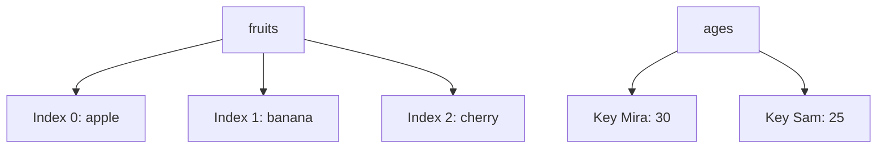

> **In one sentence:** A list keeps many values in order and finds them by position number. A dictionary keeps values under names called keys.

## Why should I care?

In [[variables|Variables]], one name held one value. Now imagine a game with 100 players. With one variable per score, you would need 100 names. A list needs one name for all the scores.

Sometimes position does not help. To find Sam's score, you want to ask for "Sam", and not for "player number 57". A dictionary lets you do that.

## Analogy

Think of a wall of mailboxes in a post office. One row has numbers on its boxes: 0, 1, 2. That row is a list. Another row has names on its boxes. That row is a dictionary.

**Where the analogy breaks down:** a real mailbox can hold many letters, but each place in a list or dictionary holds one value.

## How it actually works

### A list: many values, in order

Each item in a list has an **index**: its position number. The first item has index 0, the second has index 1, and so on. To read an item, write the list's name, then the index in square brackets. The last index is the number of items minus 1.

The examples below are in [[javascript|JavaScript]], [[python|Python]] and [[go-language|Go]]. You only need to read one tab.

<!-- tabs -->

### JavaScript

JavaScript calls a list an **array**. You write it with square brackets, and commas between the items. The whole array counts as one value, so one variable can hold it.

```js
// An array of three strings.
const fruits = ["apple", "banana", "cherry"];

console.log(fruits[0]);     // Shows: apple
console.log(fruits[2]);     // Shows: cherry
// .length tells you how many items there are.
console.log(fruits.length); // Shows: 3
// There is no item at index 3.
console.log(fruits[3]);     // Shows: undefined
```

Reading an index with no item gives the value `undefined`, not an error.

### Python

Python calls this a **list**. You write it with square brackets, and commas between the items. You make a variable with its name, `=` and a value.

A comment starts with `#`. `print()` shows the value of what is inside its round brackets, and it shows a string on its own without quote marks. `len()` gives the number of items.

```python
# A list of three strings.
fruits = ["apple", "banana", "cherry"]

print(fruits[0])    # Shows: apple
print(fruits[2])    # Shows: cherry
# len() tells you how many items there are.
print(len(fruits))  # Shows: 3
# There is no item at index 3, so this line stops with an error.
print(fruits[3])    # Error: IndexError
```

Reading an index with no item is an error in Python. You get an error message with the word `IndexError`.

### Go

Go calls this a **slice**. `[]string` means a slice of strings: all the items in a slice have one type (kind of value). You write the items in curly brackets, with commas between them.

`:=` makes a new variable and gives it a value. The variable takes its type from that value.

Every Go program on this page starts the same way. `package main` names the package (a group of code) where the program starts. `import "fmt"` brings in `fmt`, a package with code for printing. `func` starts a **function**, a named block of code. Go runs the function `main` when the program starts.

`fmt.Println` shows the value of what is inside its round brackets. `len` gives the number of items.

```go
package main

import "fmt"

func main() {
	// A slice of three strings.
	fruits := []string{"apple", "banana", "cherry"}

	fmt.Println(fruits[0]) // Shows: apple
	fmt.Println(fruits[2]) // Shows: cherry
	// len tells you how many items there are.
	fmt.Println(len(fruits)) // Shows: 3
	// There is no item at index 3, so this line stops with an error.
	fmt.Println(fruits[3]) // Error: run-time panic
}
```

Reading an index with no item stops the program while it runs, with an error message. Go calls this a **run-time panic**.

<!-- /tabs -->

### Adding and changing items

You can add an item to the end of a list, and change an item.

<!-- tabs -->

### JavaScript

A **method** is a named action that belongs to a value. You write the value, a dot, the method's name, then round brackets around whatever it needs. You have used one already: `console` is a value, and `log` is one of its methods. (This is simplified.)

The method `.push` adds an item to the end of an array. It also gives back the new length. The word `.length` has no round brackets, because it is not an action.

```js
const fruits = ["apple", "banana"];
// Add one item to the end.
fruits.push("cherry");
// Give the item at index 0 a new value.
fruits[0] = "mango";

console.log(fruits.length); // Shows: 3
console.log(fruits[2]);     // Shows: cherry
console.log(fruits[0]);     // Shows: mango
```

**`const` keeps the name, not the contents.** Look again: `fruits` was made with `const`, and its contents still changed. `const` stops you from assigning a new value to the name. `fruits[0] = "mango"` is allowed, because it changes an item, not the name.

```js
const scores = [10, 20];
// Allowed: this changes the contents of the same array.
scores.push(30);
console.log(scores.length); // Shows: 3

// Not allowed: this assigns a new array to the name.
// This line stops with an error.
scores = [1, 2];
```

### Python

A **method** is a named action that belongs to a value. You write the value, a dot, the method's name, then round brackets around whatever it needs. (This is simplified.)

The method `.append` adds an item to the end of a list.

```python
fruits = ["apple", "banana"]
# Add one item to the end.
fruits.append("cherry")
# Give the item at index 0 a new value.
fruits[0] = "mango"

print(len(fruits))  # Shows: 3
print(fruits[2])    # Shows: cherry
print(fruits[0])    # Shows: mango
```

### Go

`append` takes a slice and the new item, and gives back the resulting slice. So you write `fruits =` in front of it, to keep the result. Use `=` for a variable that already exists, and `:=` for a new one.

```go
package main

import "fmt"

func main() {
	fruits := []string{"apple", "banana"}
	// Add one item to the end, and keep the result.
	fruits = append(fruits, "cherry")
	// Give the item at index 0 a new value.
	fruits[0] = "mango"

	fmt.Println(len(fruits)) // Shows: 3
	fmt.Println(fruits[2])   // Shows: cherry
	fmt.Println(fruits[0])   // Shows: mango
}
```

In Go, `const` makes a constant. A constant can only be a number, a character (such as one letter), a string or a boolean. So a slice cannot be a constant.

<!-- /tabs -->

### A dictionary: values under names

A **dictionary** keeps pairs. Each pair has a **key**, which is a name, and a value.

<!-- tabs -->

### JavaScript

JavaScript uses a kind of value called an **object** for this. Curly brackets create it: the key, a colon, then the value, with commas between pairs. A dot or square brackets read from it.

```js
const ages = { Mira: 30, Sam: 25 };

// With a dot.
console.log(ages.Mira);    // Shows: 30
// In square brackets, with a string.
console.log(ages["Sam"]);  // Shows: 25

// In square brackets, with a variable that holds the key.
const person = "Sam";
console.log(ages[person]); // Shows: 25

// Change a value, and add a new pair.
ages.Mira = 31;
ages.Zoe = 40;
console.log(ages.Mira);    // Shows: 31
console.log(ages.Zoe);     // Shows: 40

// There is no key called Ann.
console.log(ages.Ann);     // Shows: undefined
```

`Mira` has no quote marks in `{ Mira: 30 }` or `ages.Mira`. In these two places, the word is the key's name, and JavaScript does not read it as a variable. Inside square brackets, JavaScript does read a word without quote marks as a variable name. So `ages["Sam"]` needs its quote marks, and `ages[person]` reads the variable `person`.

Use square brackets when a variable holds the key. `=` changes a value, and adds the key if it does not exist.

A missing key gives `undefined`, as a missing index does.

### Python

Python calls this a **dictionary** (`dict`). Curly brackets create it: the key, a colon, then the value, with commas between pairs. Here each key is a string, so it has quote marks. Square brackets read a value.

```python
ages = {"Mira": 30, "Sam": 25}

# In square brackets, with a string.
print(ages["Sam"])    # Shows: 25

# In square brackets, with a variable that holds the key.
person = "Sam"
print(ages[person])   # Shows: 25

# Change a value, and add a new pair.
ages["Mira"] = 31
ages["Zoe"] = 40
print(ages["Mira"])   # Shows: 31
print(ages["Zoe"])    # Shows: 40

# Check whether a key is there.
print("Ann" in ages)  # Shows: False
# There is no key called Ann, so this line stops with an error.
print(ages["Ann"])    # Error: KeyError
```

`ages[person]` has no quote marks, so Python reads `person` as a variable. `=` changes the value if the key exists, and adds the pair if it does not.

Reading a missing key is an error, with the word `KeyError` in its message. To check first, use `in`, which gives `True` or `False`.

### Go

Go calls this a **map**. `map[string]int` means the keys are strings and the values are `int`, a type for whole numbers. Curly brackets create it: the key, a colon, then the value, with commas between pairs. Square brackets read a value.

```go
package main

import "fmt"

func main() {
	// The keys are strings, and the values are whole numbers.
	ages := map[string]int{"Mira": 30, "Sam": 25}

	// In square brackets, with a string.
	fmt.Println(ages["Sam"]) // Shows: 25

	// In square brackets, with a variable that holds the key.
	person := "Sam"
	fmt.Println(ages[person]) // Shows: 25

	// Change a value, and add a new pair.
	ages["Mira"] = 31
	ages["Zoe"] = 40
	fmt.Println(ages["Mira"]) // Shows: 31
	fmt.Println(ages["Zoe"])  // Shows: 40

	// There is no key called Ann, so this gives 0.
	fmt.Println(ages["Ann"]) // Shows: 0
	// A second variable tells you whether the key was there.
	age, found := ages["Ann"]
	fmt.Println(age, found) // Shows: 0 false
}
```

`ages[person]` has no quote marks, so Go reads `person` as a variable. `=` changes the value if the key exists, and adds the pair if it does not.

Reading a missing key is not an error in Go. You get the **zero value** of the values' type, which is 0 for numbers. A real value could also be 0, so `age, found := ages["Ann"]` creates two variables at once. `age` gets the value. `found` is `true` if the key is there, and `false` if not.

<!-- /tabs -->

(This is simplified. In some languages, a key can be a number or another kind of value.)

This diagram shows `fruits` from the first example and `ages` as they start, before any changes:



### The names in each language

Each language has its own names:

| Idea | JavaScript | Python | Go |
|---|---|---|---|
| Values in numbered order | array | list | slice |
| Values under keys | object | dictionary (`dict`) | map |

## How it came to be

Not every language starts at 0. Fortran's index numbers start at 1 by default. Wikipedia says Martin Richards designed arrays (lists) that start at 0 for his language BCPL, and it cites his 1967 manual.

In a note dated 11 August 1982, Edsger W. Dijkstra argued for starting at 0. With that numbering, he wrote, an item's number equals the number of items before it.

## 🧪 Try it in your browser

You need a computer with Chrome, Edge or Firefox.

These steps use JavaScript, because your browser's console runs it. In JavaScript, a list is an **array** and a dictionary is an **object**.

- `const` creates a variable that cannot be given a new value.
- `.length` gives the number of items in an array.
- `.push` adds an item to the end of an array, and gives back the new length.
- `{ Mira: 30 }` creates an object with the key `Mira` and the value 30.
- `ages.Mira` reads the key `Mira` from `ages`. In curly brackets and after a dot, a key's name needs no quote marks.

**Safety rule:** only type code in the console that you understand or that comes from a source you trust. Never paste anything a stranger sends you. The lines below only create, read and change an array and a dictionary, and show results or an expected error.

1. Open [example.com](https://example.com).
   **What you should see:** a short page of text.
2. Open the **console**:
   - **Windows:** press `Ctrl` + `Shift` + `J` (in Firefox: `Ctrl` + `Shift` + `K`)
   - **Mac:** press `Cmd` + `Option` + `J` (in Firefox: `Cmd` + `Option` + `K`)
3. Click the line where you can type, below any messages. In each step below, **type** the line yourself (some browsers may block pasting at first), then press `Enter`. The browser may show suggestions, and the line may look different while you type. Keep typing.

   ```
   const fruits = ["apple", "banana"]
   ```

   **What you should see:** the console may show `undefined`. As in [[what-is-programming|What is Programming, Really?]], it means there is no result to show, and it is normal.
4. Read the first item:

   ```
   fruits[0]
   ```

   **What you should see:** the word apple.
5. Read the length:

   ```
   fruits.length
   ```

   **What you should see:** `2`.
6. Add an item:

   ```
   fruits.push("cherry")
   ```

   **What you should see:** `3`, the new length.
7. Read an index with no item:

   ```
   fruits[5]
   ```

   **What you should see:** `undefined`, because that item does not exist.
8. Make a mistake on purpose:

   ```
   fruits = []
   ```

   **What you should see:** an error message with the word `TypeError`. This error is expected, because `fruits` was made with `const`.
9. Check that the array still holds its items:

   ```
   fruits[2]
   ```

   **What you should see:** the word cherry.
10. Create a dictionary:

    ```
    const ages = { Mira: 30, Sam: 25 }
    ```

    **What you should see:** again, the console may show `undefined`.
11. Read with a dot:

    ```
    ages.Mira
    ```

    **What you should see:** `30`.
12. Read with square brackets:

    ```
    ages["Sam"]
    ```

    **What you should see:** `25`.
13. Change a value:

    ```
    ages.Mira = 31
    ```

    **What you should see:** `31`. An assignment has a result: the value that was assigned.
14. Read it again:

    ```
    ages.Mira
    ```

    **What you should see:** `31`.

If you see an error message at any other step, reload the page, delete anything left on the typing line, and start again from step 3.

**On a phone:** suppose `const letters = ["a", "b", "c"]`. This creates a JavaScript array. Say out loud what `letters[1]` (the item at index 1) and `letters.length` (the number of items) show. The answers are `b` and `3`.

## Common misunderstandings

<!-- tabs -->

### JavaScript

- **"A missing item is an error."** No. A missing index or key gives `undefined`.
- **"An array made with `const` can never change."** No. You can add and change its items.

### Python

- **"A missing item gives an empty result."** No. A missing index and a missing key are both errors.
- **"`ages[Sam]` and `ages["Sam"]` are the same."** No. Without quote marks, Python reads `Sam` as a variable name, and that variable may not exist.

### Go

- **"A missing item is always an error."** No. A missing index is an error, but a missing key gives the zero value, such as 0 for numbers.
- **"`append(fruits, "cherry")` is enough on its own."** No. `append` gives back the resulting slice, so keep it with `fruits =`.

<!-- /tabs -->

## Recap

- A list keeps values in order. Its indexes start at 0, and you read an item by its index in square brackets.
- A dictionary keeps values under keys, and you read a value by its key.
- The names differ: array and object in JavaScript, list and `dict` in Python, slice and map in Go.

## Sources

- MDN Web Docs, Arrays: https://developer.mozilla.org/en-US/docs/Learn_web_development/Core/Scripting/Arrays
- MDN Web Docs, Array: https://developer.mozilla.org/en-US/docs/Web/JavaScript/Reference/Global_Objects/Array
- MDN Web Docs, Array.prototype.push(): https://developer.mozilla.org/en-US/docs/Web/JavaScript/Reference/Global_Objects/Array/push
- MDN Web Docs, JavaScript object basics: https://developer.mozilla.org/en-US/docs/Learn_web_development/Core/Scripting/Object_basics
- MDN Web Docs, Working with objects: https://developer.mozilla.org/en-US/docs/Web/JavaScript/Guide/Working_with_objects
- MDN Web Docs, Property accessors: https://developer.mozilla.org/en-US/docs/Web/JavaScript/Reference/Operators/Property_accessors
- MDN Web Docs, Object initializer: https://developer.mozilla.org/en-US/docs/Web/JavaScript/Reference/Operators/Object_initializer
- MDN Web Docs, console: https://developer.mozilla.org/en-US/docs/Web/API/Window/console
- MDN Web Docs, const: https://developer.mozilla.org/en-US/docs/Web/JavaScript/Reference/Statements/const
- MDN Web Docs, TypeError: invalid assignment to const: https://developer.mozilla.org/en-US/docs/Web/JavaScript/Reference/Errors/Invalid_const_assignment
- MDN Web Docs, Storing the information you need — Variables: https://developer.mozilla.org/en-US/docs/Learn_web_development/Core/Scripting/Variables
- MDN Web Docs, console.log(): https://developer.mozilla.org/en-US/docs/Web/API/console/log_static
- MDN Web Docs, Assignment (=): https://developer.mozilla.org/en-US/docs/Web/JavaScript/Reference/Operators/Assignment
- MDN Web Docs, eval(): https://developer.mozilla.org/en-US/docs/Web/JavaScript/Reference/Global_Objects/eval
- Python documentation, An Informal Introduction to Python: https://docs.python.org/3/tutorial/introduction.html
- Python documentation, Data Structures: https://docs.python.org/3/tutorial/datastructures.html
- Python documentation, Built-in Exceptions: https://docs.python.org/3/library/exceptions.html
- Python Tutorial, Classes: https://docs.python.org/3/tutorial/classes.html
- The Go Programming Language Specification: https://go.dev/ref/spec
- The Go Programming Language, Effective Go: https://go.dev/doc/effective_go
- Go Packages, fmt: https://pkg.go.dev/fmt
- Wikipedia, Associative array: https://en.wikipedia.org/wiki/Associative_array
- Oracle, FORTRAN 77 Language Reference, Arrays: https://docs.oracle.com/cd/E19957-01/805-4939/6j4m0vn6r/index.html
- Wikipedia, Zero-based numbering: https://en.wikipedia.org/wiki/Zero-based_numbering
- Edsger W. Dijkstra, Why numbering should start at zero (EWD 831): https://www.cs.utexas.edu/~EWD/transcriptions/EWD08xx/EWD831.html
- Microsoft Edge DevTools, Run JavaScript in the Console: https://learn.microsoft.com/en-us/microsoft-edge/devtools/console/console-javascript
- Chrome for Developers, Open Chrome DevTools: https://developer.chrome.com/docs/devtools/open
- Microsoft Edge DevTools, Keyboard shortcuts: https://learn.microsoft.com/en-us/microsoft-edge/devtools/shortcuts/
- Firefox DevTools User Docs, Web Console: https://firefox-source-docs.mozilla.org/devtools-user/web_console/index.html
- Chrome for Developers, What are self-XSS attacks?: https://developer.chrome.com/blog/self-xss
- Example Domain: https://example.com
