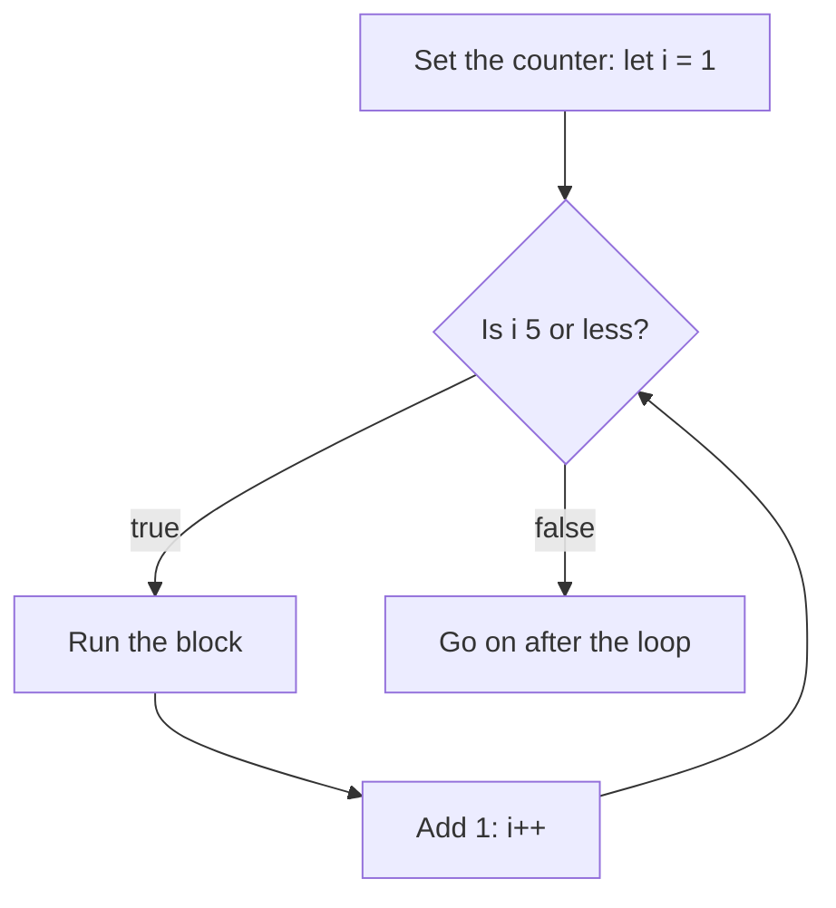

> **In one sentence:** A loop runs the same block of code again and again while a condition stays true, so you write the steps once and the computer repeats them.

## Why should I care?

In [[conditions|Conditions]], your code learned to make a decision once. Now imagine you want to show the numbers from 1 to 5. Without a loop, you write one line for each:

```js
console.log(1);
console.log(2);
console.log(3);
console.log(4);
console.log(5);
```

For 1,000 numbers, you would need 1,000 lines.

MDN Web Docs, a website that documents web technologies, says loops are "all about doing the same thing over and over again".

## Analogy

Imagine washing plates after a meal. Your rule is: **while there is a dirty plate, wash one.** "Is there a dirty plate?" is the condition. Washing one plate is the block. Each wash leaves one dirty plate fewer, and that is what makes the condition false in the end. You do not count the plates, so this fits a `while` loop.

**Where the analogy breaks down:** a person notices when something is wrong. If someone keeps adding plates forever, you will complain and stop. A computer does not notice. It checks only the condition you wrote.

## How it actually works

### The `while` loop

A `while` loop has a condition and a block, like an `if`. But after the block, an `if` moves on. A `while` goes back and checks the condition again.

```js
let count = 1;            // The counter starts at 1.

while (count <= 5) {      // Before each round, check: is count 5 or less?
  console.log(count);     // Yes: show the counter.
  count = count + 1;      // Add 1 to the counter.
}

console.log("Done");      // The condition is false now, so the program goes on.
```

This shows:

```
1
2
3
4
5
Done
```

The variable `count` is a **counter**: a variable the loop uses to count its rounds. One run of the block is called an **iteration**. This page calls it a **round**.

When `count` becomes 6, the condition is false. The loop ends, and the program continues after it.

### The `for` loop

To count its rounds, the loop above uses three things: a counter's start, a condition, and a step that changes the counter. A `for` loop puts all three on one line. Inside these brackets, semicolons have a special use: they separate the three parts.

```js
// Start at 1. Keep going while i is 5 or less. Add 1 after each round.
for (let i = 1; i <= 5; i++) {
  console.log(i);         // Show the counter.
}

console.log("Done");      // Runs once, after the loop has finished.
```

This shows the same six lines. Its three parts:

- `let i = 1` runs once, before the loop begins. In [[variables|Variables]], you learned to choose names that describe a value. `i` is an exception: it is a common short name for a counter.
- `i <= 5` is checked before each round. If it is false, the loop ends.
- `i++` runs at the end of each round. It adds 1 to `i`.



### Endless loops

If the condition never becomes false, the loop keeps going until something outside it stops it (or a `break`, below). Do not run this loop:

```js
let count = 1;

while (count <= 5) {      // count stays 1, so this is true every time.
  console.log(count);     // Nothing here changes count.
}
```

This is an **infinite loop**, or endless loop. MDN warns: "the loop will go on forever, and either the browser will force it to stop, or it will crash". So before you run a loop, ask: what will make this condition false?

If a page stops responding, browsers have a tool that lists their **processes**: running parts of the browser. Ending one has a cost. Chrome's documentation says it "will also cause the current page to fail and all data you have entered will be lost". Other tabs may share that process: the documentation for Chromium, the software Chrome and Edge are built on, says a new tab "will share a process" with a same-site tab in some cases. Other pages may have told you not to click **End process**. Use it here only because the page is already stuck.

- **Chrome:** click the menu with three dots (**More**), then **More tools**, then **Task manager**. Select the page, then click **End process**.
- **Edge:** press `Shift` + `Esc` to open the Browser Task Manager. Select the process, then select **End process**.
- **Firefox:** Firefox's version 108 release notes say `Shift` + `Esc` opens the **Process Manager**. Find the stuck page in the list. Look for a button with the tooltip **Close tab**, and click it to try to close the tab.

### Leaving early with `break`

Sometimes you want to stop as soon as you have found what you need. The `break` statement ends the loop immediately.

```js
for (let i = 1; i <= 100; i++) {   // Planned: 100 rounds.
  if (i === 4) {                   // In the round where i is 4...
    break;                         // ...leave the loop immediately.
  }
  console.log(i);                  // Show the counter.
}

console.log("Stopped");            // The program goes on from here.
```

This shows:

```
1
2
3
Stopped
```

4 is missing because `break` runs before the `console.log` line in that round.

## How it came to be

In 1834, Charles Babbage first thought of the [[babbage-and-lovelace|Analytical Engine]], a design for a programmable machine. The Computer History Museum says the design included "looping (iteration)", "though Babbage nowhere used these terms". The museum also says none of his designs was fully built in his lifetime.

## 🧪 Try it in your browser

You need a computer with Chrome, Edge or Firefox.

**Safety rule:** only type code in the console that you understand or that comes from a source you trust. Never paste anything a stranger sends you. Typed exactly, the lines below only create variables and show numbers in the console.

Type carefully. A typo such as `i--` (which subtracts 1) instead of `i++` can make a loop endless, with no error message. If the tab freezes, see **Endless loops** above.

1. Open [example.com](https://example.com).
   **What you should see:** a short page of text.
2. Open the **console**:
   - **Windows:** press `Ctrl` + `Shift` + `J` (in Firefox: `Ctrl` + `Shift` + `K`)
   - **Mac:** press `Cmd` + `Option` + `J` (in Firefox: `Cmd` + `Option` + `K`)
3. Ignore any messages already there. Click the empty line at the bottom. **Type** this line yourself (some browsers may block pasting at first), then press `Enter`. The browser may show suggestions, and the line may look different while you type. Keep typing.

   ```
   for (let i = 1; i <= 5; i++) { console.log(i); }
   ```

   **What you should see:** the numbers 1 to 5, each on its own line. The console may also show `undefined`.
4. Type this line and press `Enter`:

   ```
   let n = 1;
   ```

   **What you should see:** no numbers. The console may show `undefined`.
5. Type this `while` loop and press `Enter`. It doubles `n` each round.

   ```
   while (n < 100) { n = n + n; console.log(n); }
   ```

   **What you should see:** 2, 4, 8, 16, 32, 64, 128, each on its own line. The console may also show `undefined`. Look at 128: it is more than 100. When `n` was 64, the check said "true", so one more round ran. If you run this line again, no numbers appear: `n` is already 128, so no round runs. The console may also show `undefined`.
6. Type this line and press `Enter`:

   ```
   for (let i = 1; i <= 100; i++) { if (i === 4) { break; } console.log(i); }
   ```

   **What you should see:** 1, 2, 3. The console may also show `undefined`.

If you see an error message, look for a typo. Then click your browser's reload button and start again from step 3.

## Common misunderstandings

- **"A `while` or `for` loop stops at the moment the condition becomes false."** No. These loops check the condition only before each round. A round that has started runs to its end, unless something such as `break` ends it. That is why you saw 128 above.
- **"The block always runs at least once."** Not in `while` and `for`. If `count` starts at 10 in the `while` example, the first check is already false. The block never runs, and only `Done` is shown. (MDN says the block of `do...while`, a loop this page leaves out, is "always executed at least once".)
- **"I must choose exactly the right loop."** No. For loops like these, MDN says `for` and `while` are "largely interchangeable", and it recommends starting with `for`. A suggestion, not a rule: if you know the number of rounds, try `for`. If you do not, like the plate pile, try `while`.

## Recap

- A `while` or `for` loop repeats a block while its condition is true, and checks the condition before each round.
- `while` has the condition in its brackets, and any counter is your job. `for` also holds a counter's start and step on one line.
- Something must make the condition false, or `break` must end the loop. Otherwise, it runs until something outside stops it.

## Sources

- MDN Web Docs, Loops and iteration: https://developer.mozilla.org/en-US/docs/Web/JavaScript/Guide/Loops_and_iteration
- MDN Web Docs, Looping code: https://developer.mozilla.org/en-US/docs/Learn_web_development/Core/Scripting/Loops
- MDN Web Docs, while: https://developer.mozilla.org/en-US/docs/Web/JavaScript/Reference/Statements/while
- MDN Web Docs, for: https://developer.mozilla.org/en-US/docs/Web/JavaScript/Reference/Statements/for
- MDN Web Docs, break: https://developer.mozilla.org/en-US/docs/Web/JavaScript/Reference/Statements/break
- MDN Web Docs, console.log(): https://developer.mozilla.org/en-US/docs/Web/API/console/log_static
- MDN Web Docs, Increment (++): https://developer.mozilla.org/en-US/docs/Web/JavaScript/Reference/Operators/Increment
- MDN Web Docs, Less than or equal (<=): https://developer.mozilla.org/en-US/docs/Web/JavaScript/Reference/Operators/Less_than_or_equal
- Wikipedia, Loop (statement): https://en.wikipedia.org/wiki/Loop_(statement)
- MDN Web Docs, About MDN: https://developer.mozilla.org/en-US/about
- Computer History Museum, The Babbage Engine, The Engines: https://www.computerhistory.org/babbage/engines/
- MDN Web Docs, Decrement (--): https://developer.mozilla.org/en-US/docs/Web/JavaScript/Reference/Operators/Decrement
- MDN Web Docs, eval(): https://developer.mozilla.org/en-US/docs/Web/JavaScript/Reference/Global_Objects/eval
- Chrome for Developers, Run JavaScript in the Console: https://developer.chrome.com/docs/devtools/console/javascript
- Microsoft Edge DevTools, Run JavaScript in the Console: https://learn.microsoft.com/en-us/microsoft-edge/devtools/console/console-javascript
- Microsoft Edge, What is Chromium?: https://www.microsoft.com/en-us/edge/learning-center/what-is-chromium-how-does-it-enhance-your-browser
- Firefox source, aboutProcesses.ftl (Process Manager labels): https://searchfox.org/firefox-main/source/toolkit/locales/en-US/toolkit/about/aboutProcesses.ftl
- Example Domain: https://example.com
- Chromium docs, Process Model and Site Isolation: https://chromium.googlesource.com/chromium/src/+/main/docs/process_model_and_site_isolation.md
- Google Chrome Help, Manage tabs in Chrome: https://support.google.com/chrome/answer/2391819?hl=en&co=GENIE.Platform%3DDesktop
- Microsoft Learn, Fix High CPU or memory usage in Microsoft Edge browser: https://learn.microsoft.com/en-us/troubleshoot/microsoft-edge/performance/edge-high-cpu-memory
- Firefox 108.0 release notes: https://www.firefox.com/en-US/firefox/108.0/releasenotes/
- Chrome for Developers, Open Chrome DevTools: https://developer.chrome.com/docs/devtools/open
- Microsoft Edge DevTools, Keyboard shortcuts: https://learn.microsoft.com/en-us/microsoft-edge/devtools/shortcuts/
- Firefox DevTools User Docs, Web Console: https://firefox-source-docs.mozilla.org/devtools-user/web_console/index.html
- Chrome for Developers, What are self-XSS attacks?: https://developer.chrome.com/blog/self-xss
