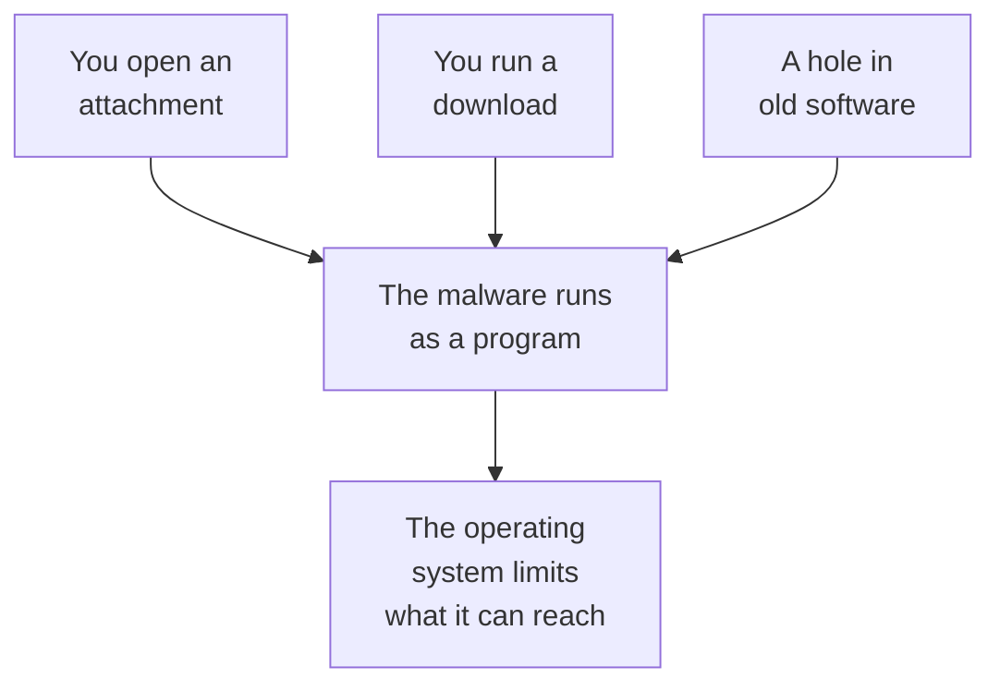

> **In one sentence:** Malware is software written on purpose to do harm, such as a virus, worm, Trojan horse, ransomware or spyware; it is a program like any other, so it can only do harm if it gets onto your device and runs.

## Why should I care?

Your browser may have warned you that a site or a download could be dangerous. Warnings like this help protect you from **malware**.

The UK's National Cyber Security Centre (NCSC) says: "Malware is malicious software". **Malicious** means made to do harm. The NCSC lists some of that harm, such as "causing a device to become locked or unusable" and stealing or deleting data.

## Analogy

Think of an **office building**. The workers are the programs. The building manager is the [[operating-system|operating system]]. The manager decides which rooms each worker's key opens.

Malware is like a worker who got in, often by lying about who they are. They have a harmful plan. What they can do depends on which doors their key opens. On a computer, those keys are called **permissions**.

**Where the analogy breaks down:** a real worker thinks and decides. Malware is a [[software|program]] that follows instructions written by a person. Some malware copies itself, which no worker can do. And some gets in with no one letting it in.

## How it actually works

### Malware is a program

Malware is software, like your browser. The US National Institute of Standards and Technology (NIST) describes malware as "a program that is written intentionally to carry out annoying or harmful actions". Like any program, it can only do something when it **runs**.

### Some kinds of malware

- **Virus:** the US Cybersecurity and Infrastructure Security Agency (CISA) says a virus "spreads by first infecting files or the system areas of a computer". Then it makes copies of itself.
- **Worm:** CISA says a worm "can spread without human interaction".
- **Trojan horse:** CISA says this is "a computer program that is hiding a virus or other potentially damaging program". It can claim to do one thing while, in fact, it does something harmful.
- **Ransomware:** the NCSC says it "prevents you from accessing your computer (or the data that is stored on it)". CISA says the attackers hold your data or systems "until a form of payment or ransom is provided". A **ransom** is a payment that attackers demand.
- **Spyware:** NIST says it is installed secretly "to gather information on individuals or organizations without their knowledge".

### How it usually gets in

CISA warns about these ways in:

1. **Email attachments.** An attachment is a file sent with an email. It can be a program. CISA says: "Most users get viruses from opening and running unknown email attachments."
2. **Downloads.** A download is a file you copy from a website. It can be a program. CISA says Trojan horses "can be included in software that you download for free".
3. **Old software with holes.** A **vulnerability** is a weakness in a program that an attacker could use. A **patch** is an update that fixes it: CISA says patches "address security vulnerabilities". CISA advises: "Install software patches on your computer so attackers do not take advantage of known vulnerabilities."

### What the operating system does

You learned that the operating system gives each program its own area of memory. Stanford's computer course says this helps to "limit what an erroneous or malicious program can do": a program with mistakes, or a harmful one. If a harmful program tries to reach into another program's memory, the operating system should block it, and may stop the program.

Android phones run each app in its own **sandbox**: a closed space, kept apart from other apps. The Android documentation says this "protects apps and the system from malicious apps". An app also needs permissions (your OK) to use things such as your location, contacts, camera or microphone. When an app asks, Android shows a window where you can allow it or refuse.

These limits help, but they only *limit* harm. They do not stop all of it. Ransomware, for example, can still lock your data.

### How to protect yourself

- **Update.** The NCSC says to "turn on 'automatic updates' in your device's settings, if available". (See [[software-updates]].)
- **Use trusted sources.** The NCSC advises: "only use trusted app stores".
- **Back up.** The NCSC says: "A backup is a copy of your important data that's stored in a separate safe location."
- **Check permissions.** The NCSC advises: "Review installed apps and permissions regularly".

## How it came to be

On November 2, 1988, Robert Morris, Jr. released a worm into the internet. He was a graduate student in Computer Science at Cornell. The worm used mistakes in programs to get into other computers. Because of a bug (a mistake), it copied itself much faster than he had expected.

Lawrence Livermore National Laboratory, a US government lab, says "an estimated 6,000 of the approximately 60,000 connected computers were hit". The worm did not destroy files. But it made many systems very slow.

## 🧪 Try it in your browser

Your browser has a built-in check for dangerous sites and downloads.

**Safety rule:** only look. Do not change any setting.

1. Open your browser's security settings:
   - **Chrome:** click the menu with three dots, then **Settings**. On the left, click **Privacy and security**, then **Security**.
   - **Edge:** click the menu with three dots (**Settings and more**), then **Settings**, then **Privacy, search, and services**. Then click **Security**.
   - **Firefox:** click the menu button at the top right (when you point at it, it says **Open application menu**), then **Settings**. On the left, click **Privacy and security**. Scroll down to the **Security** heading.
2. Look for the setting named below. Do not click it.

**What you should see:**

- **Chrome:** a part called **Safe Browsing**, with choices such as **Enhanced protection**, **Standard protection** and **No protection**.
- **Edge:** a switch named **Microsoft Defender SmartScreen**.
- **Firefox:** a box named **Block dangerous and deceptive content**, with **Block dangerous downloads** below it.

**What happened:** Google says this Chrome setting gives "warnings that help protect you against malware". Microsoft says that on a work or school network, the Edge setting may be locked. Close the settings tab when you are done.

## Common misunderstandings

- **"Malware always makes the computer slow or strange."** No. NIST says spyware gathers information "without their knowledge": the people it watches do not know. A device can look normal and still be infected.
- **"If I pay the ransom, I get my files back."** The NCSC warns: "even if you pay the ransom, there is no guarantee that you will get access to your computer, or your files."
- **"A backup on a drive that is always plugged in is safe."** A backup drive is a storage device you plug in to keep copies. The NCSC says malware "can move to attached media automatically", which means to drives that are plugged in. Unplug a backup drive when you are not using it.

## Recap

- Malware is software written to do harm: viruses, worms, Trojan horses, ransomware and spyware are some kinds.
- It usually gets in through attachments, downloads, or holes in software that was not updated.
- The operating system keeps programs apart and limits them with permissions; updates, trusted sources and backups protect you further.

## Sources

- NIST Glossary, malware: https://csrc.nist.gov/glossary/term/malware
- NIST Glossary, spyware: https://csrc.nist.gov/glossary/term/spyware
- CISA, Virus Basics: https://www.cisa.gov/news-events/news/virus-basics
- CISA, Malware, Phishing, and Ransomware: https://www.cisa.gov/topics/cyber-threats-and-advisories/malware-phishing-and-ransomware
- CISA, Understanding Patches and Software Updates: https://www.cisa.gov/news-events/news/understanding-patches-and-software-updates
- NIST Glossary, vulnerability: https://csrc.nist.gov/glossary/term/vulnerability
- CISA, Protecting Against Malicious Code: https://www.cisa.gov/news-events/news/protecting-against-malicious-code
- NCSC, Mitigating malware and ransomware attacks: https://www.ncsc.gov.uk/guidance/mitigating-malware-and-ransomware-attacks
- NCSC, Install the latest software and app updates: https://www.ncsc.gov.uk/collection/top-tips-for-staying-secure-online/install-the-latest-software-and-app-updates
- NCSC, Always back up your most important data: https://www.ncsc.gov.uk/collection/top-tips-for-staying-secure-online/always-back-up-your-most-important-data
- NCSC, Guidance for communities at high risk of digital surveillance: https://www.ncsc.gov.uk/news/ncsc-partners-share-guidance-for-communities-at-high-risk-of-digital-surveillance
- Stanford CS101, Running and Operating Systems: https://web.stanford.edu/class/cs101/software-1.html
- Android Open Source Project, Application sandbox: https://source.android.com/docs/security/app-sandbox
- Android Developers, Permissions on Android: https://developer.android.com/guide/topics/permissions/overview
- Lawrence Livermore National Laboratory, 1988 Morris worm: https://st.llnl.gov/news/look-back/1988-morris-worm-internets-first-cyberattack
- MIT course reading, The Robert Morris Internet Worm: https://groups.csail.mit.edu/mac/classes/6.805/articles/morris-worm.html
- Google Chrome Help, Safe Browsing protection level: https://support.google.com/chrome/answer/9890866?hl=en
- Microsoft Support, SmartScreen in Microsoft Edge: https://support.microsoft.com/en-gb/help/17443/microsoft-edge-smartscreen-faq
- Firefox source code, preferences.ftl: https://searchfox.org/firefox-main/source/browser/locales/en-US/browser/preferences/preferences.ftl
- Firefox source code, appmenu.ftl: https://searchfox.org/firefox-main/source/browser/locales/en-US/browser/appmenu.ftl
