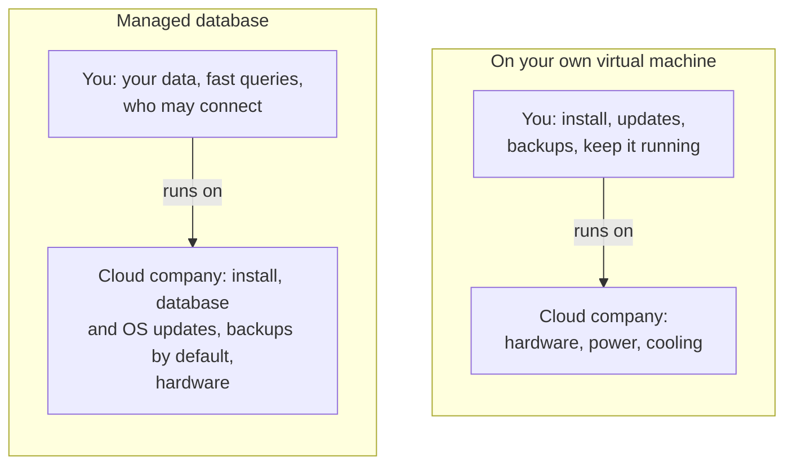

> **In one sentence:** A managed database is a database that a cloud company runs for you: it installs and updates the software, makes backups (by default) and can keep a spare copy in another zone, while you still look after your data, your queries and who may connect.

## Why should I care?

In [[databases|What is a Database?]] you met databases: programs that keep data in tables of rows and columns, which you ask questions with SQL.

You could run a database yourself on a [[virtual-machines|virtual machine]], a computer made of software that you rent. Then you install it, update it, make backups, and fix it when something fails. A managed database does much of that for you. AWS says this "frees you to focus on your application and your users".

## Analogy

Think of a **car**. You can own one and do all the care yourself. Or you can rent one from a company that does that care. Either way, you are the driver. Here, driving means using the database: your data, your questions (queries), and who may get in.

**Where the analogy breaks down:** a car company swaps a broken car for another one. A managed database has a ready spare copy to switch to only if you choose one, kept in another zone. (A **zone** is one of the "multiple distinct locations" inside an AWS region; see [[regions-and-availability-zones]].) Without a spare, the service still tries to detect the failure and recover, but has no second copy waiting.

## How it actually works

### Running it yourself

AWS (Amazon Web Services, a cloud company) explains who does what. For a database on a virtual machine, AWS "manages the hardware layers": the real computers, power, network and cooling. Everything above that is yours: installing the database, backups, keeping it running, and **patches** for the operating system and the database. A patch is a change to a program, often to fix mistakes (bugs) and security problems.

### Letting the cloud run it

A **managed database service** does most of that work for you. AWS says its service, Amazon RDS, "is responsible for most management tasks". Google calls its Cloud SQL "a fully managed relational database service".

### What you still do

AWS calls security "a shared responsibility". You are responsible for "the sensitivity of your data", how private it is. AWS's RDS guide names more of your jobs:

- **Fast queries.** A **query** is a question you send in SQL. AWS says you are responsible for "query tuning": "adjusting SQL queries to improve performance".
- **Who may connect.** You set rules about which [[ip-address|IP addresses]] or AWS virtual machines "can connect to your databases".

## How AWS does it

### Amazon RDS

**Amazon RDS** (Relational Database Service) "makes it easier to set up, operate, and scale a relational database". To **scale** means to make it bigger or smaller as your needs change.

RDS calls each database it runs for you a **DB instance**: "an isolated database environment in the AWS Cloud". That means a separate place where your database runs, kept apart from others. AWS runs it on its own computers.

A **DB engine** is "the specific relational database software" it runs. In November 2026, the RDS guide (which leaves out Amazon Aurora) listed six, including MySQL and PostgreSQL.

**Backups.** "By default, Amazon RDS enables automated backups", made daily at a time you can choose. AWS keeps them for a period you choose, up to 35 days. Setting it to 0 turns them off. During that period, "you can recover your DB instance to any point in time". Example: you delete a table by mistake at 3:00 PM. You can get a new copy of the database as it was at 2:59 PM (if automated backups are on). You can also make your own backups, called **DB snapshots**.

When you delete a database, its automated backups are deleted too, unless you choose **Retain automated backups**. Your own snapshots are kept.

**A spare copy in another zone.** AZ is short for Availability Zone, AWS's name for a zone. With an option called **Multi-AZ**, RDS "automatically provisions and maintains" a **standby** copy in a different zone. To **provision** means to set up. AWS says the main database is "synchronously replicated" to the standby: the standby is kept up to date with it. This can "help protect your databases against DB instance failure and Availability Zone disruption". When problems occur, RDS can switch, or **fail over**, to the standby "automatically". The standby holds only the latest version of your data, not earlier versions. To undo a mistake, you use the backups.

### Amazon DynamoDB

**Amazon DynamoDB** is a managed NoSQL database. It "supports both key-value and document data models": ways of arranging data that are not relational, unlike RDS. AWS calls it "serverless". There are still servers, but AWS handles them: "you don't need to provision any servers". So you do not choose a server size. By default, it "automatically replicates your data across three Availability Zones".

### What it costs

AWS's RDS pricing page lists, among other things:

- **DB instance hours**: time the database runs;
- **Storage (per GB per month)**: the space you reserve;
- **Backup Storage**: space for your backups and snapshots. Backup space up to the total size you reserved for your databases in that region is free.

Multi-AZ has its own prices. This article quotes no prices.

AWS says that while an RDS database is stopped, "you are charged for provisioned storage" and for backup storage. A database with the **Publicly Accessible** option turned on, which lets it be reached from the internet (if your connection rules allow it), also pays for its public IPv4 address. After seven days, "RDS automatically starts your DB instance for you". (More about surprise bills in [[cloud-costs]].)

## How it came to be

On October 27, 2009, AWS introduced Amazon RDS, running MySQL. People who already used MySQL could keep their code and tools, AWS said.

## 🧪 Try it in your browser

This reads one public AWS page, with no account. On a phone, scroll the table sideways. The page may look different.

1. Open `https://docs.aws.amazon.com/AmazonRDS/latest/UserGuide/Welcome.html` in Chrome, Edge or Firefox. The heading is "What is Amazon Relational Database Service (Amazon RDS)?".
2. Scroll down to "Comparison of responsibilities with Amazon EC2 and on-premises deployments". Amazon EC2 is AWS's service for virtual machines. "On-premises" means a server you buy and look after yourself.
3. In the table, find the rows **Database backups** and **Operating system (OS) patching**.

**What you should see:** in November 2026, the backup and patching rows said "Customer" under **Amazon EC2 management** and "AWS" under **Amazon RDS management**. Close the tab when you are done.

## Common misunderstandings

- **"Managed means no work."** No. Query tuning and connection rules are yours.
- **"Automated backups last forever."** No. You choose how long, up to 35 days.

## Recap

- You can run a database yourself on a virtual machine, or let a cloud company run it for you.
- The company installs and updates it, backs it up (by default), and can keep a standby in another zone. You still look after your data, your queries and who may connect.
- You pay for running hours, storage and backup space beyond a free amount, among other things. Stopping does not stop every charge.

## Sources

- AWS documentation, What is Amazon Relational Database Service (Amazon RDS)?: https://docs.aws.amazon.com/AmazonRDS/latest/UserGuide/Welcome.html
- AWS documentation, Security in Amazon RDS: https://docs.aws.amazon.com/AmazonRDS/latest/UserGuide/UsingWithRDS.html
- AWS documentation, Managing automated backups (Amazon RDS): https://docs.aws.amazon.com/AmazonRDS/latest/UserGuide/USER_ManagingAutomatedBackups.html
- AWS documentation, Introduction to backups (Amazon RDS): https://docs.aws.amazon.com/AmazonRDS/latest/UserGuide/USER_WorkingWithAutomatedBackups.html
- AWS documentation, Restoring a DB instance to a specified time (Amazon RDS): https://docs.aws.amazon.com/AmazonRDS/latest/UserGuide/USER_PIT.html
- AWS documentation, Multi-AZ DB instance deployments for Amazon RDS: https://docs.aws.amazon.com/AmazonRDS/latest/UserGuide/Concepts.MultiAZSingleStandby.html
- AWS documentation, Stopping an Amazon RDS DB instance temporarily: https://docs.aws.amazon.com/AmazonRDS/latest/UserGuide/USER_StopInstance.html
- AWS, Amazon RDS pricing: https://aws.amazon.com/rds/pricing/
- AWS, Amazon RDS FAQs: https://aws.amazon.com/rds/faqs/
- AWS, What is a relational database?: https://aws.amazon.com/relational-database/
- AWS documentation, What is Amazon DynamoDB?: https://docs.aws.amazon.com/amazondynamodb/latest/developerguide/Introduction.html
- AWS What's New, Introducing Amazon Relational Database Service (2009): https://aws.amazon.com/about-aws/whats-new/2009/10/27/introducing-amazon-relational-database-service/
- AWS documentation, What is Amazon EC2?: https://docs.aws.amazon.com/AWSEC2/latest/UserGuide/concepts.html
- Google Cloud documentation, Cloud SQL overview: https://docs.cloud.google.com/sql/docs/introduction
- Wikipedia, Patch (computing) (general background reference): https://en.wikipedia.org/wiki/Patch_(computing)
