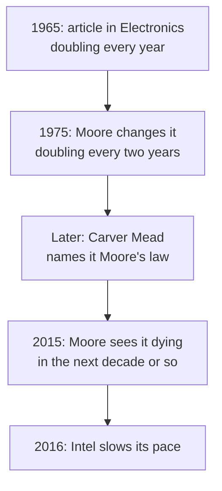

> **In one sentence:** Moore's law is a prediction Gordon Moore made in 1965 and changed in 1975: the number of components on a chip would keep doubling at a steady pace, about every two years from 1975 on. It is an observation about an industry, not a law of nature.

## Why should I care?

Computers have become far more capable over the decades, and computing has become much cheaper. One part of that story is that chips have held more and more [[transistor|transistors]] every few years, for decades.

Moore's law is the name for that pattern. You will often see it in news about computers, with the words "doubling every two years".

## Analogy

Imagine you write notes on one sheet of paper. Every two years, you learn to write so neatly and so small that twice as many words fit on the same sheet. The paper costs about the same, but each word now costs half as much paper.

That is the pattern Moore's law describes. The sheet is the [[integrated-circuit|chip]], and the words are its components.

*Where the analogy breaks down:* a person's handwriting would stop shrinking very soon. Chips kept improving for decades through progress in many chip-making methods at once, not only by making things smaller. Also, real chips did not stay the same size: chips, and the silicon discs they are made on, grew larger.

## How it actually works

### What is being counted

A chip is an integrated circuit: a set of electronic circuits on one thin, flat piece of material, most often silicon. It is made of many electronic parts, called **components**, such as transistors, and the connections between them.

Moore's law is about **how many components fit on one chip**, and how fast that number grows. Many sources, like the examples below, count only the transistors.

### Doubling

If something doubles (grows to twice its size) again and again, it grows very fast. This table shows a made-up number that starts at 1,000 and doubles every two years:

| After | Doublings | Number |
|---|---|---|
| 0 years | 0 | 1,000 |
| 2 years | 1 | 2,000 |
| 4 years | 2 | 4,000 |
| 10 years | 5 | 32,000 |
| 20 years | 10 | 1,024,000 |

Real chips show this kind of growth. Intel's first [[microprocessor]], the 4004 from 1971, had about 2,300 transistors. Apple's M4 chip, announced in 2024, has 28 billion transistors. That is more than ten million times as many.

### Why more components helped

**Computing power** means how much work a computer can do. The Computer History Museum says: "Doubling chip complexity doubled computing power without significantly increasing cost." Here, "chip complexity" means how many components a chip has.

IEEE, an organization of engineers, describes the prediction this way: the number of components grows, while the cost of each function (each small job the chip does) goes down. So each new **generation** of chips (a new, improved family of chips) could do more, for about the same price. IEEE says that cheap, widespread computing changed the way people work, play and communicate.

## How it came to be

In 1965, **Gordon Moore** led the research work at Fairchild Semiconductor (his title was Director of Research and Development). He looked at Fairchild's chips from 1959 on. For several years, he found how many components fit on one chip when each component cost the least. That number had grown fast.

On **April 19, 1965**, the magazine *Electronics* published his article "Cramming more components onto integrated circuits". ("Cramming" means pushing many things into a small space.) The pattern in his data meant a doubling **every year**. He predicted that by 1975, there might be "as many as 65,000 components on a single silicon chip". In a 2015 interview, Moore said he wrote the article to show that "this is the way the industry is going to get things really cheap."

In **1975**, Moore was at Intel, a company he had helped to found. He looked at new data. At an IEEE meeting, he changed his prediction to "a doubling every two years, rather than every year." He named several reasons for the progress: better methods for printing patterns onto chips, bigger silicon discs (called **wafers**) that chips are made on, better production methods, and "circuit and device cleverness". (How chips are made is outside this page.)

Later, Carver Mead, a professor at Caltech (a science and engineering institute in California), gave the idea its name: **Moore's law**.

The museum says that "Meeting Moore's timetable became the goal for engineers who design chips." So the prediction helped make itself come true. The museum also says the number of transistors on the largest microprocessors doubled about every two years from 1971 to 2010.

### Is it slowing down?

The sources on this page, from 2015 and 2016, describe a slowdown. In 2015, Moore told IEEE Spectrum, a magazine from IEEE: "I guess I see Moore's Law dying here in the next decade or so, but that's not surprising." He also said that "those walls keep receding": limits he expected kept moving further away. In 2016, the magazine MIT Technology Review reported that Intel had "signaled a slowing of Moore's Law": the time between its new generations of chips would grow longer.

## 🧪 Try it in your browser

1. Open the Computer History Museum's page [Revolution: Moore's Law](https://www.computerhistory.org/revolution/digital-logic/12/267).
2. Look through the pictures on the page for the one whose caption says it is the first page of the April 19, 1965 *Electronics* article.
3. Look for the picture whose caption says the number of transistors on the largest microprocessors doubled about every two years from 1971 to 2010.
4. Open the museum's [1965 Silicon Engine page](https://www.computerhistory.org/siliconengine/moores-law-predicts-the-future-of-integrated-circuits/). Look for the photo captioned "Cost vs. time sketch from Moore's 1964 notebook": a drawing he made the year before his article.

## Common misunderstandings

**"Moore's law is a law of nature."** It is not. Intel's own page says it "is not a scientific law". Moore himself said: "It's not a law in any real respect. It was an observation and a projection." (A projection is a guess about the future, based on the past.) Nothing forces it to continue.

**"Moore's law says every 18 months."** Moore's own numbers were every year (1965) and every two years (1975). In 2005, The Register, a technology news website, reported that Moore credited Intel executive (senior manager) David House with pointing out that the trend meant a doubling of **computing power** every 18 months. That is a different measure, and it was not Moore's figure.

**"Moore's law means computers get twice as fast every two years."** Moore's law counts components on a chip. It does not measure speed, or computing power. More components gave computers more computing power, but Moore's law itself is about the count, not speed.

## Recap

- In 1965, Gordon Moore predicted that the number of components on a chip would double every year. In 1975, he changed it to every two years. This became known as Moore's law.
- It is an observation and a prediction, not a law of nature. It came true partly because engineers treated it as a goal.
- More components per chip meant more computing power for about the same cost. Sources say the pace has slowed, and Moore himself expected it to end.

## Sources

- Computer History Museum, The Silicon Engine, 1965: "Moore's Law" Predicts the Future of Integrated Circuits: https://www.computerhistory.org/siliconengine/moores-law-predicts-the-future-of-integrated-circuits/
- Computer History Museum, Revolution: Moore's Law: https://www.computerhistory.org/revolution/digital-logic/12/267
- Computer History Museum, Revolution: Intel's Microprocessor: https://www.computerhistory.org/revolution/digital-logic/12/285
- IEEE Milestones, Moore's Law: Predicts Integrated Circuit Complexity Growth, 1965: https://ieeemilestones.ethw.org/Milestones:Moore's_Law_-_Predicts_Integrated_Circuit_Complexity_Growth,_1965
- Intel, Moore's Law: https://www.intel.com/content/www/us/en/newsroom/resources/moores-law.html
- IEEE Spectrum, Gordon Moore: The Man Whose Name Means Progress (2015): https://spectrum.ieee.org/gordon-moore-the-man-whose-name-means-progress
- The Register, Moore's Law at 40 (2005): https://www.theregister.com/2005/04/13/moores_law_forty/
- MIT Technology Review, Intel Puts the Brakes on Moore's Law (2016): https://www.technologyreview.com/2016/03/23/8768/intel-puts-the-brakes-on-moores-law/
- Apple Newsroom, Apple introduces M4 chip (May 2024): https://www.apple.com/newsroom/2024/05/apple-introduces-m4-chip/
- Caltech, About Caltech: https://www.caltech.edu/about
- Wikipedia, Integrated circuit (general background reference): https://en.wikipedia.org/wiki/Integrated_circuit
