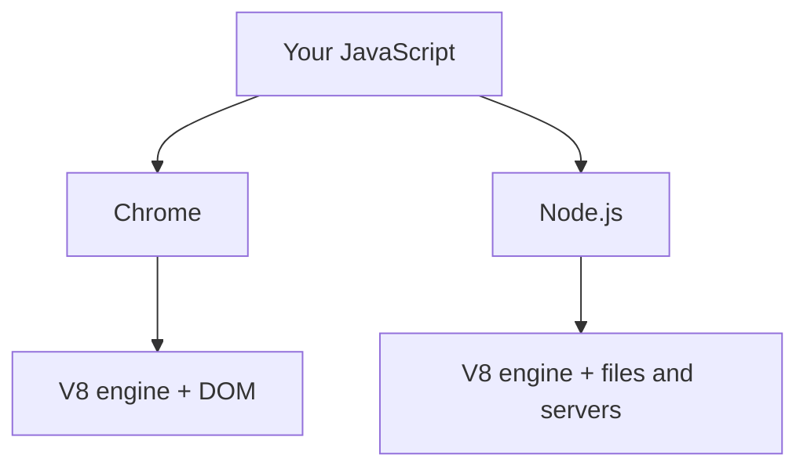

> **In one sentence:** Node.js is a runtime: a program that runs JavaScript outside the browser, using Chrome's V8 engine and adding its own tools for files and web servers.

## Why should I care?

So far, your [[javascript|JavaScript]] has run inside a browser tab. Node.js lets the same language run outside it, for example on a [[server]]. Its documentation says browser developers can write server code without learning "a completely different language".

**The code on this page is for reading.** To run it, you would need to install Node.js, which you get from nodejs.org. You do not need to install anything now. The Try-it section further down uses only a browser.

## Analogy

Imagine one model of engine. One copy goes into a car and another into a boat. The car adds wheels, and the boat adds a propeller.

V8 is the engine. A browser is the car, with tools for web pages. Node.js is the boat, with tools for files and servers.

**Where the analogy breaks down:** browsers and Node.js share more than the engine, such as `console.log` and `setTimeout`. Also, not every browser uses V8: Firefox has its own engine.

## How it actually works

### An engine and a runtime

MDN Web Docs, a website that documents web technologies, says running JavaScript needs two pieces of software:

- A **JavaScript engine** reads your source code and runs it.
- The second piece gives the code ways to reach the outside world. In a page, the DOM is part of this.

MDN calls the second piece a "host environment", and says Node.js "is another host environment". Node.js's documentation uses the word "runtime", and so does this page. A **runtime** is a program that runs JavaScript and gives it tools.

That documentation says Node.js "runs the V8 JavaScript engine, the core of Google Chrome, outside of the browser". **V8** is the engine's name.



### Running a file

Once Node.js is installed, you run a file with the `node` command on the [[command-line|command line]]. You could save this line in a file named `hello.js`. You do not need to do this now.

```js
console.log("Hello from Node.js");
```

Then you would type this in a terminal, in the same folder:

```
node hello.js
```

This shows `Hello from Node.js` in the terminal.

### What goes away, and what stays

There is no web page, so there is no DOM. The documentation says: "You don't have the `document`, `window` and all the other objects that are provided by the browser."

In Node.js, this line stops with the error `document is not defined`:

```js
console.log(document.title);
```

The language stays the same, including [[promises|promises]]. Node.js also has `console`, `setTimeout` and `fetch`.

### What Node.js adds

Node.js comes with **built-in modules**: named sets of tools that you load into your program. `require` loads one. In `node:fs/promises`, `node:` means built in, `fs` means the file tools, and `/promises` picks the versions that return promises. (Browsers have modules and tools of their own, which this page leaves out.)

```js
// Load the file tools that come with Node.js.
const fs = require("node:fs/promises");

async function showNote() {
  try {
    // Pause this function until the promise is settled.
    const text = await fs.readFile("note.txt", "utf8");
    console.log(text);
  } catch (error) {
    console.log("Problem: " + error.message);
  }
}

showNote();
console.log("I did not wait");
```

`"utf8"` asks for the contents as a string. Run `node` from the folder that holds `note.txt`. If that file holds `A note in a file`, this shows:

```
I did not wait
A note in a file
```

This is the order you met in Promises. In a page, the browser does the waiting. Here, Node.js handles it instead. By default, your JavaScript still runs in "a single JavaScript thread", with an [[event-loop|event loop]]. (This is simplified. Node.js's loop has more steps than this page shows.)

### A tiny web server

Node.js can be the server itself. This is a shorter version of the example in its documentation:

```js
// Load the web server tools that come with Node.js.
const http = require("node:http");

// This callback runs once for each request.
const server = http.createServer((request, response) => {
  response.setHeader("Content-Type", "text/plain"); // the answer is plain text
  response.end("Hello from Node.js"); // send this text and finish the response
});

// Start waiting for requests on this computer, at port 3000.
server.listen(3000, "127.0.0.1", () => {
  console.log("Open http://127.0.0.1:3000 in your browser");
});
```

`127.0.0.1` is the address a computer uses to reach itself. A **port** is a number for one service on a computer. 3000 is the number the documentation's example uses. The last callback runs when the server is ready.

Opening that address sends a request, and the response carries the text `Hello from Node.js`. By default, a running server stops the program from ending by itself. To stop it, press `Ctrl` + `C` in the terminal. That usually works. If it does not, close the terminal window.

### npm

The Node.js installer also installs **npm**, "the standard package manager for Node.js". A **package manager** is a program that installs and updates packages for a project. A [[packages|package]] here means code that the project depends on.

## How it came to be

Wikipedia says Node.js "was initially written by Ryan Dahl in 2009". It says he showed the project at the first European JSConf, on November 8, 2009, and that npm arrived in January 2010.

## 🧪 Try it in your browser

You need a computer with Chrome, Edge or Firefox. You will not run Node.js here. You will ask your browser about three names.

**Safety rule:** only type code in the console that you understand or that comes from a source you trust. Never paste anything a stranger sends you. The lines below only ask what kind of value a name holds.

1. Open [example.com](https://example.com).
   **What you should see:** a short page.
2. Open the **console**:
   - **Windows:** press `Ctrl` + `Shift` + `J` (in Firefox: `Ctrl` + `Shift` + `K`)
   - **Mac:** press `Cmd` + `Option` + `J` (in Firefox: `Cmd` + `Option` + `K`)
3. Click the line where you can type, below any messages. **Type** this line yourself (some browsers may block pasting at first), then press `Enter`. The browser may show suggestions, and the line may look different while you type. Keep typing.

   ```
   typeof document
   ```

   **What you should see:** the word object. `typeof` gives the kind of value a name holds.
4. Type this new line and press `Enter`:

   ```
   typeof require
   ```

   **What you should see:** the word undefined. Here it is the answer from `typeof`: this name has no value on this page. MDN says `typeof` works on a name that does not exist, "instead of throwing an error". Using a missing name directly is different, as `console.log(document.title)` was in Node.js above.
5. Type this new line and press `Enter`:

   ```
   typeof fetch
   ```

   **What you should see:** the word function.
6. Compare your answers with the Node.js column. These are Node.js's answers in a `.js` file with these lines, each inside `console.log`, and nothing else.

   | Line | Your browser | Node.js |
   |---|---|---|
   | `typeof document` | `object` | `undefined` |
   | `typeof require` | `undefined` | `function` |
   | `typeof fetch` | `function` | `function` |

7. See how the Node.js project describes itself, now that you know its main word. Open [nodejs.org/en/about](https://nodejs.org/en/about).
   **What you should see:** a description with the word `runtime`, and a code example with `createServer`, like the server above.

**If something goes wrong:** for an error message or a different answer, check your spelling and type the line again.

## Common misunderstandings

- **"Node.js is a new programming language."** No. The language is JavaScript. Node.js is a program that runs it.
- **"A Node.js program has the same limits as a web page."** No. It can use your files without asking you to pick them, which a page cannot. The documentation says "Node.js trusts any code it is asked to run". In practice, if a program deletes your files, Node.js does not stop it by default. So never run a program you do not trust.

## Recap

- Node.js is a runtime: it runs JavaScript outside the browser, using the V8 engine.
- It has no DOM, but it comes with built-in modules for files, web servers and more. You run a file with `node file.js`.
- Running Node.js needs an install. Promises and the event loop work there, too.

## Sources

- Node.js, Introduction to Node.js: https://nodejs.org/en/learn/getting-started/introduction-to-nodejs
- Node.js, Differences between Node.js and the Browser: https://nodejs.org/en/learn/getting-started/differences-between-nodejs-and-the-browser
- Node.js, The V8 JavaScript Engine: https://nodejs.org/en/learn/getting-started/the-v8-javascript-engine
- Node.js, About Node.js: https://nodejs.org/en/about
- Node.js, Run Node.js scripts from the command line: https://nodejs.org/en/learn/command-line/run-nodejs-scripts-from-the-command-line
- Node.js, The Node.js Event Loop: https://nodejs.org/en/learn/asynchronous-work/event-loop-timers-and-nexttick
- Node.js, An introduction to the npm package manager: https://nodejs.org/en/learn/getting-started/an-introduction-to-the-npm-package-manager
- Node.js, Output to the command line: https://nodejs.org/en/learn/command-line/output-to-the-command-line-using-nodejs
- Node.js, Download Node.js: https://nodejs.org/en/download
- Node.js, Node.js file paths: https://nodejs.org/en/learn/manipulating-files/nodejs-file-paths
- Node.js documentation, Global objects: https://nodejs.org/api/globals.html
- Node.js documentation, Modules, CommonJS modules: https://nodejs.org/api/modules.html
- Node.js documentation, File system: https://nodejs.org/api/fs.html
- Node.js documentation, HTTP: https://nodejs.org/api/http.html
- Node.js documentation, Net: https://nodejs.org/api/net.html
- Node.js documentation, Process: https://nodejs.org/api/process.html
- Node.js documentation, Permissions: https://nodejs.org/api/permissions.html
- npm Docs, Downloading and installing Node.js and npm: https://docs.npmjs.com/downloading-and-installing-node-js-and-npm
- MDN Web Docs, JavaScript execution model: https://developer.mozilla.org/en-US/docs/Web/JavaScript/Reference/Execution_model
- MDN Web Docs, typeof: https://developer.mozilla.org/en-US/docs/Web/JavaScript/Reference/Operators/typeof
- MDN Web Docs, await: https://developer.mozilla.org/en-US/docs/Web/JavaScript/Reference/Operators/await
- MDN Web Docs, ReferenceError: "x" is not defined: https://developer.mozilla.org/en-US/docs/Web/JavaScript/Reference/Errors/Not_defined
- MDN Web Docs, Port (glossary): https://developer.mozilla.org/en-US/docs/Glossary/Port
- MDN Web Docs, Window.fetch(): https://developer.mozilla.org/en-US/docs/Web/API/Window/fetch
- MDN Web Docs, Window.setTimeout(): https://developer.mozilla.org/en-US/docs/Web/API/Window/setTimeout
- MDN Web Docs, console.log(): https://developer.mozilla.org/en-US/docs/Web/API/console/log_static
- MDN Web Docs, File System API: https://developer.mozilla.org/en-US/docs/Web/API/File_System_API
- MDN Web Docs, About MDN: https://developer.mozilla.org/en-US/about
- Wikipedia, Node.js: https://en.wikipedia.org/wiki/Node.js
- Wikipedia, Localhost: https://en.wikipedia.org/wiki/Localhost
- Example Domain: https://example.com
- Chrome for Developers, Open Chrome DevTools: https://developer.chrome.com/docs/devtools/open
- Chrome for Developers, Run JavaScript in the Console: https://developer.chrome.com/docs/devtools/console/javascript
- Chrome for Developers, What are self-XSS attacks?: https://developer.chrome.com/blog/self-xss
- Microsoft Edge DevTools, Keyboard shortcuts: https://learn.microsoft.com/en-us/microsoft-edge/devtools/shortcuts/
- Microsoft Edge DevTools, Run JavaScript in the Console: https://learn.microsoft.com/en-us/microsoft-edge/devtools/console/console-javascript
- Firefox DevTools User Docs, Web Console: https://firefox-source-docs.mozilla.org/devtools-user/web_console/index.html
- Firefox DevTools User Docs, The JavaScript input interpreter: https://firefox-source-docs.mozilla.org/devtools-user/web_console/the_command_line_interpreter/index.html
