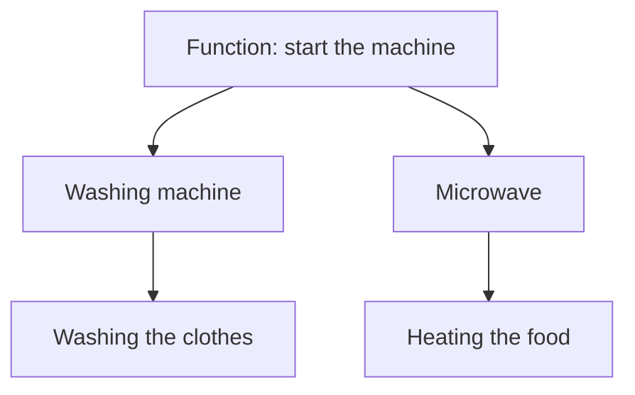

> **In one sentence:** Object-oriented programming is a style of programming that builds a program from objects, which keep data and the code that works on it together.

## Why should I care?

In [[classes|Classes]], you used a class to make many objects of the same kind.

Programs built around objects and classes follow a style with a name: **object-oriented programming**, or **OOP** for short. MDN Web Docs, a website that documents web technologies, calls it "a programming paradigm fundamental to many programming languages, including Java and C++". Java and C++ are two other programming languages. A paradigm is a style, as the next section explains.

## Analogy

Think of two machines at home: a washing machine and a microwave. Each has a **Start** button. You press the same kind of button, and each machine does its own job: one washes clothes, the other heats food. You do not need to know what happens inside. Each machine keeps its parts behind a cover, and you use only its buttons.

**Where the analogy breaks down:** a real cover can be opened with a screwdriver. In code, how well details are hidden depends on the language: some stop other code from reaching them, and others only ask you not to.

## How it actually works

### A paradigm is a style

A **programming paradigm** is a way to think about a program and organize its code. Wikipedia names several. This page explains only the object-oriented one. A paradigm is not a language: Wikipedia says that most languages support more than one.

### Objects that work together

MDN says that OOP is about modeling a system "as a collection of objects, where each object represents some particular aspect of the system". This page explains three ideas that MDN describes.

**1. Encapsulation: keep it together, hide the details.** An object keeps its data and the code that uses that data in one place. Other code needs to know only the object's **interface**: the data and functions it shows to the outside, MDN says. The rest, the data inside it, is kept private.

**2. Inheritance: a class built on another class.** A new class can be built on an existing class. It gets the old class's methods, and it can add its own. MDN calls the old class the **superclass** (or parent class), and the new one a **subclass** (or child class). When a subclass replaces a method it got with its own version, MDN says it **overrides** that method.

**3. Polymorphism: one call, many answers.** Different kinds of objects answer the same method call, each in its own way. MDN describes it as a method that "has the same name but a different implementation in different classes". The implementation is the code that does the work. The calling code does not need to know which kind of object it has.

Here is polymorphism in [[javascript|JavaScript]], [[python|Python]] and [[go-language|Go]]. You only need to read one tab.

<!-- tabs -->

### JavaScript

```js
// Two classes. Each has its own start method.
class WashingMachine {
  start() {
    return "Washing the clothes";
  }
}

class Microwave {
  start() {
    return "Heating the food";
  }
}

// This function works with any object that has a start method.
function pressStart(machine) {
  console.log(machine.start());
}

pressStart(new WashingMachine()); // Shows: Washing the clothes
pressStart(new Microwave());      // Shows: Heating the food
```

`return` gives a value back to the caller. Each object answers `machine.start()` with its own `start` method.

### Python

```python
# Two classes. Each has its own start method.
class WashingMachine:
    def start(self):
        return "Washing the clothes"


class Microwave:
    def start(self):
        return "Heating the food"


# This function works with any object that has a start method.
def press_start(machine):
    print(machine.start())


press_start(WashingMachine())  # Shows: Washing the clothes
press_start(Microwave())       # Shows: Heating the food
```

Each `def` inside a class defines a method, and `self` is the object it was called on. `return` gives a value back to the code that called the method. `press_start` calls `machine.start()` without asking what kind of machine it got. Each object answers with its own `start` method.

### Go

Go has no classes. For one piece of code, such as `pressStart` below, to call the same method on values of different types, Go uses an **interface type**: a type that lists methods. (This is a second meaning of the word interface.) Go's FAQ (common questions) says this works only "through an interface". Any type that has those methods fits the interface. A Tour of Go says a type "implements an interface by implementing its methods". You do not write any word such as `implements`: the Tour says there is "no explicit declaration of intent".

```go
package main

import "fmt"

// Starter is an interface: any type with a Start method that
// gives back a string is a Starter.
type Starter interface {
	Start() string
}

// Two struct types with no fields. Each has its own Start method.
type WashingMachine struct{}

func (w WashingMachine) Start() string {
	return "Washing the clothes"
}

type Microwave struct{}

func (m Microwave) Start() string {
	return "Heating the food"
}

// pressStart works with any Starter.
func pressStart(machine Starter) {
	fmt.Println(machine.Start())
}

func main() {
	pressStart(WashingMachine{}) // Shows: Washing the clothes
	pressStart(Microwave{})      // Shows: Heating the food
}
```

`struct{}` is a struct with no fields. `Start() string` means the method gives back a string. Both `WashingMachine` and `Microwave` have that method, so both are Starters. `pressStart` takes any Starter, and each value answers with its own `Start` method.

<!-- /tabs -->



### Hiding details and building on a class

Each language does these two things in its own way.

<!-- tabs -->

### JavaScript

```js
class Machine {
  // #starts is private: only code inside this class can use it.
  #starts = 0;

  start() {
    this.#starts = this.#starts + 1;
    return "Starting";
  }

  timesStarted() {
    return this.#starts;
  }
}

// Fan extends Machine: it inherits start and timesStarted.
class Fan extends Machine {}

// Washer extends Machine, and overrides start with its own.
class Washer extends Machine {
  start() {
    return "Washing clothes";
  }
}

const fan = new Fan();
console.log(fan.start());        // Shows: Starting
console.log(fan.start());        // Shows: Starting
console.log(fan.timesStarted()); // Shows: 2
console.log(new Washer().start()); // Shows: Washing clothes
```

A name that starts with `#` is a **private field**. MDN says that using it outside the class is a syntax error. `extends` makes `Fan` a subclass of `Machine`, so it inherits `start` and `timesStarted`. `Washer` is a subclass too, but it overrides `start` with its own version.

### Python

```python
class Machine:
    def __init__(self):
        # The underscore says: do not use this from outside.
        self._starts = 0

    def start(self):
        self._starts = self._starts + 1
        return "Starting"

    def times_started(self):
        return self._starts


# Fan is built on Machine: it inherits __init__, start and times_started.
class Fan(Machine):
    pass


# Washer is built on Machine, and overrides start with its own.
class Washer(Machine):
    def start(self):
        return "Washing clothes"


fan = Fan()
print(fan.start())          # Shows: Starting
print(fan.start())          # Shows: Starting
print(fan.times_started())  # Shows: 2
print(fan._starts)          # Shows: 2. Python does not stop this.
print(Washer().start())     # Shows: Washing clothes
```

`class Fan(Machine):` builds `Fan` on `Machine`. `pass` does nothing: Python needs a line in the class body, and `Fan` adds nothing of its own. `Fan` also inherits `__init__`, so a new Fan starts with `_starts` at 0. Python's tutorial says a method is looked for in the class, then in the class it is built on. `Washer` defines its own `start`, which overrides the one in `Machine`.

Python's tutorial says that private variables, which only the object itself can reach, do not exist in Python. Instead, a name that starts with an underscore, such as `_starts`, should be treated as not public. It is a habit that people follow, and the last line shows that Python does not enforce it.

### Go

Go has no inheritance: one type cannot be built on another as a subclass. Go's FAQ says Go "takes a different approach". Instead, a struct can **embed** another type: it lists the type inside itself without a field name.

```go
package main

import "fmt"

type Machine struct {
	starts int // a small first letter: hidden from other packages
}

func (m *Machine) Start() string {
	m.starts = m.starts + 1
	return "Starting"
}

func (m *Machine) TimesStarted() int {
	return m.starts
}

// Fan embeds Machine, so it gets Machine's field and methods.
type Fan struct {
	Machine
}

// Washer embeds Machine, but has its own Start method.
type Washer struct {
	Machine
}

func (w *Washer) Start() string {
	return "Washing clothes"
}

func main() {
	fan := Fan{}
	fmt.Println(fan.Start())        // Shows: Starting
	fmt.Println(fan.Start())        // Shows: Starting
	fmt.Println(fan.TimesStarted()) // Shows: 2
	fmt.Println(fan.starts)         // Shows: 2 (main is in the same package)

	washer := Washer{}
	fmt.Println(washer.Start()) // Shows: Washing clothes
}
```

`Fan` embeds `Machine`, so `fan.Start()` works. Effective Go says embedding lets a type "borrow" pieces of another. The FAQ calls it "analogous—but not identical—to subclassing": similar, but not the same.

`Washer` also embeds `Machine`, but has its own `Start`. Effective Go says a method in the outer type "hides" one with the same name in the embedded type. So `washer.Start()` uses the one from `Washer`.

In Go, hiding works between packages. A package is a named group of Go code. A name that starts with a capital letter, such as `Start`, can be used by other packages. A name with a small first letter, such as `starts`, cannot. Code in the same package, such as `main` here, can still use it.

<!-- /tabs -->

## How it came to be

Simula was developed in the 1960s at the Norwegian Computing Center in Oslo, by Ole-Johan Dahl and Kristen Nygaard. Wikipedia says that Simula 67 introduced objects, classes, inheritance and subclasses, and says Simula "is considered the first object-oriented programming language".

Wikipedia says that Smalltalk, another language, was created in the 1970s for use in education, as "the product of research led by Alan Kay at Xerox Palo Alto Research Center (PARC)". Wikipedia's article on Kay credits him with coining (creating) the term "object-oriented".

## 🧪 Try it in your browser

These steps use JavaScript, the language the browser's console runs. In it, `class` starts a class, and `extends` builds one class on another. `return` gives a value back, and `new` makes an object from a class. A semicolon (`;`) separates two instructions on one line. You need a computer with Chrome, Edge or Firefox.

**Type step 3 only once.** MDN says that a class "cannot be redeclared", so typing it again may give an error message. If you see an error message at any step, reload the page and start again from step 3.

**Safety rule:** only type code in the console that you understand or that comes from a source you trust. Never paste anything a stranger sends you. The lines below create three classes and a function, then call a method.

1. Open [example.com](https://example.com).
   **What you should see:** a short page. It says the domain is for use in documentation examples.
2. Open the **console**:
   - **Windows:** press `Ctrl` + `Shift` + `J` (in Firefox: `Ctrl` + `Shift` + `K`)
   - **Mac:** press `Cmd` + `Option` + `J` (in Firefox: `Cmd` + `Option` + `K`)
3. Click the line where you can type, below any messages. In each step below, **type** the line yourself (some browsers may block pasting at first), then press `Enter`. The browser may show suggestions, and the line may look different while you type. Keep typing.

   ```
   class Machine { start() { return "Starting" } }; class Washer extends Machine { start() { return "Washing clothes" } }; class Fan extends Machine {}
   ```

   **What you should see:** no result of its own. The console may also show `undefined`. That is normal: the line creates three classes. `Washer` overrides `start`, and `Fan` does not.
4. Make a function that presses start on any machine:

   ```
   function pressStart(machine) { return machine.start() }
   ```

   **What you should see:** no result of its own. The console may also show `undefined`.
5. Press start on a washer:

   ```
   pressStart(new Washer())
   ```

   **What you should see:** the words Washing clothes. `Washer` answered with its own `start`.
6. Press start on a fan:

   ```
   pressStart(new Fan())
   ```

   **What you should see:** the word Starting. `Fan` has no `start` of its own, so it used the one it inherited from `Machine`.
7. Press start on an object made without a class:

   ```
   pressStart({ start() { return "Boiling water" } })
   ```

   **What you should see:** the words Boiling water. `pressStart` works with any object that has a `start` method.

## Common misunderstandings

- **"OOP is a programming language."** No. It is a style, and most languages support more than one.
- **"Without classes, there is no OOP."** Not quite. Go has no classes. Its FAQ answers "Is Go an object-oriented language?" with "Yes and no": Go "allows an object-oriented style of programming", but "there is no type hierarchy". In JavaScript, MDN says, you can also make objects without any class.
- **"Private always means that no other code can reach it."** It depends on the language. In JavaScript, a name that starts with `#` cannot be used outside its class. In Python, a name that starts with an underscore is private only by habit. In Go, a small first letter hides a name only from code in other packages, which are separate groups of Go code.

## Recap

- A programming paradigm is a style of organizing code. Object-oriented programming builds a program from objects.
- Three ideas from this page: encapsulation (data and its code together, details hidden), inheritance (a class built on another) and polymorphism (one method call, different answers).
- Languages differ: JavaScript and Python have classes and inheritance, while Go uses methods, interface types (lists of methods) and embedding (a type placed inside a struct without a field name).

## Sources

- MDN Web Docs, Object-oriented programming: https://developer.mozilla.org/en-US/docs/Learn_web_development/Extensions/Advanced_JavaScript_objects/Object-oriented_programming
- MDN Web Docs, OOP (glossary): https://developer.mozilla.org/en-US/docs/Glossary/OOP
- MDN Web Docs, Encapsulation (glossary): https://developer.mozilla.org/en-US/docs/Glossary/Encapsulation
- MDN Web Docs, Inheritance (glossary): https://developer.mozilla.org/en-US/docs/Glossary/Inheritance
- MDN Web Docs, Polymorphism (glossary): https://developer.mozilla.org/en-US/docs/Glossary/Polymorphism
- MDN Web Docs, Using classes: https://developer.mozilla.org/en-US/docs/Web/JavaScript/Guide/Using_classes
- MDN Web Docs, class: https://developer.mozilla.org/en-US/docs/Web/JavaScript/Reference/Statements/class
- MDN Web Docs, extends: https://developer.mozilla.org/en-US/docs/Web/JavaScript/Reference/Classes/extends
- MDN Web Docs, new: https://developer.mozilla.org/en-US/docs/Web/JavaScript/Reference/Operators/new
- MDN Web Docs, return: https://developer.mozilla.org/en-US/docs/Web/JavaScript/Reference/Statements/return
- MDN Web Docs, Grammar and types: https://developer.mozilla.org/en-US/docs/Web/JavaScript/Guide/Grammar_and_types
- MDN Web Docs, eval(): https://developer.mozilla.org/en-US/docs/Web/JavaScript/Reference/Global_Objects/eval
- Python Tutorial, Classes: https://docs.python.org/3/tutorial/classes.html
- Python Tutorial, More Control Flow Tools (pass): https://docs.python.org/3/tutorial/controlflow.html
- Go, Frequently Asked Questions (FAQ): https://go.dev/doc/faq
- The Go Programming Language, Effective Go: https://go.dev/doc/effective_go
- The Go Programming Language Specification: https://go.dev/ref/spec
- A Tour of Go, Methods and interfaces (source text): https://github.com/golang/website/blob/master/_content/tour/methods.article
- Wikipedia, Programming paradigm: https://en.wikipedia.org/wiki/Programming_paradigm
- Wikipedia, Object-oriented programming: https://en.wikipedia.org/wiki/Object-oriented_programming
- Wikipedia, Simula: https://en.wikipedia.org/wiki/Simula
- Wikipedia, Smalltalk: https://en.wikipedia.org/wiki/Smalltalk
- MDN Web Docs, About MDN: https://developer.mozilla.org/en-US/about
- Wikipedia, Alan Kay: https://en.wikipedia.org/wiki/Alan_Kay
- Example Domain: https://example.com
- Chrome for Developers, Open Chrome DevTools: https://developer.chrome.com/docs/devtools/open
- Microsoft Edge DevTools, Keyboard shortcuts: https://learn.microsoft.com/en-us/microsoft-edge/devtools/shortcuts/
- Microsoft Edge DevTools, Run JavaScript in the Console: https://learn.microsoft.com/en-us/microsoft-edge/devtools/console/console-javascript
- Firefox DevTools User Docs, Web Console: https://firefox-source-docs.mozilla.org/devtools-user/web_console/index.html
- Chrome for Developers, What are self-XSS attacks?: https://developer.chrome.com/blog/self-xss
