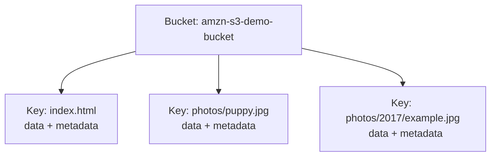

> **In one sentence:** Object storage keeps each piece of data as an object in a flat container called a bucket, where each object has a name, called a key, that no other object in that bucket has.

## Why should I care?

Wikipedia says object storage is used for "storing objects like videos and photos on Facebook, songs on Spotify". AWS (Amazon Web Services), the cloud company you met in [[cloud-computing]], lists storing "rich media files such as videos, digital images, and music" as one use.

Your own website's pictures and pages could live there too. Amazon S3, AWS's object storage, lists "websites" and "backup and restore" among its uses.

## Analogy

Think of the **cloakroom** (or coat check) at a theatre or a museum. The coats hang on one long row of numbered hooks. No hook is inside another. You hand over your coat and get a ticket with a number. Later you show the ticket, and the staff bring back your coat.

Object storage is similar. All the data sits on one level, and you get each piece back by its name.

**Where the analogy breaks down:** at a cloakroom, the staff choose the number. In Amazon S3, you choose the name yourself, and it can be long, like `photos/2017/example.jpg`. Also, a coat is in one place. In Amazon S3, your data is kept on several devices.

## How it actually works

### Objects, keys and buckets

In [[files-and-folders]], folders are lists of names that form a tree. Wikipedia says object storage manages data as "objects", while file systems "manage data as a file hierarchy": a tree of levels.

An **object** is one piece of stored data, such as a photo, with information about it. Information about data is called **metadata**. Each object also has a name, called its **key**.

Objects are kept in a container called a **bucket**. In a bucket, each key belongs to only one object. AWS says objects "are kept in a single bucket and are not files inside of folders". **Flat** means there is only one level: one long list of keys.

The key `photos/puppy.jpg` looks like a path to a file in a folder. But the whole text is one name. The beginning of a key, such as `photos/`, is called a **prefix**. Programs can show keys that share a prefix as a "folder".

### Why flat?

AWS says a flat structure, with metadata and a unique name for each object, "makes it easier to find among potentially billions of other objects". It says that file storage, because of its hierarchy, "hits scaling constraints": it cannot grow as large.

### Getting an object by its URL

You get an object back by asking for its key. You ask Amazon S3 with [[http]] requests, the same kind your browser sends for web pages. AWS says: "You can even use a browser to fetch objects, as long as they are anonymously readable." **Anonymously readable** means anyone may read them without signing in.

So each object can have a [[url]]. AWS gives this example: `https://amzn-s3-demo-bucket.s3.us-west-2.amazonaws.com/photos/puppy.jpg`. Here `amzn-s3-demo-bucket` is the bucket, and `photos/puppy.jpg` is the key.

## How AWS does it

Other providers have the same idea. For example, Google Cloud's Cloud Storage also keeps objects in buckets.

**Amazon S3** (Amazon Simple Storage Service) is AWS's object storage. AWS calls an object "a file and any metadata that describes the file". The metadata includes "the date last modified".

This page is about **general purpose buckets**, which AWS calls "the original S3 bucket type". (S3 has other kinds too: directory buckets do keep a real hierarchy.)

- **Folders in the console.** The S3 console is AWS's website for managing buckets. It shows folders by using a shared prefix. For example, a key `photos/2017/example.jpg` shows as a folder `photos`, holding a folder `2017`, holding `example.jpg`.
- **Unique bucket names.** An **AWS account** is what you get when you sign up for AWS. By default, each bucket name "must be unique across all AWS accounts in all the AWS Regions within a partition". A **partition** is a group of AWS Regions. AWS warns that the bucket name "is visible in the URLs".
- **Private by default.** AWS says: "By default, S3 buckets and the objects in them are private." Settings called **Block Public Access** are turned on for buckets by default. They can stop other settings from making things public.
- **Copies in several places.** S3 offers several "storage classes" for different uses. AWS says one, S3 Standard, stores objects "on multiple devices across a minimum of three Availability Zones in an AWS Region". An **Availability Zone** is "one or more discrete data centers" (separate buildings of servers) inside one Region.

## How it came to be

Wikipedia's history of object storage mentions research in 1995, led by Garth Gibson, on "Network-Attached Secure Disks". In 1996, object storage was proposed as a research project at Gibson's lab at Carnegie Mellon University. Later, Amazon S3 offered object storage as a cloud service.

## 🧪 Try it in your browser

NOAA (the National Oceanic and Atmospheric Administration) is a US agency. One of its climate data sets is kept in an S3 bucket that anyone may read. You will look at its list of keys. This changes nothing.

1. In Chrome, Edge or Firefox, open `https://registry.opendata.aws/noaa-ghcn/`. Under "Resources on AWS", find the bucket name `noaa-ghcn-pds` (it may be part of a longer line) and the words "No AWS account required".
2. Open `https://noaa-ghcn-pds.s3.amazonaws.com/?max-keys=5`. The part after `?` is a parameter: extra information for the server. This one asks S3 to list at most five keys in the bucket.
3. **What you should see:** text with names such as `Name`, `Contents` and `Key`. The page may look different in each browser, and it may show a note above the list. You can ignore the note. `Name` is the bucket name. Each `Key` is one object's full name, such as `csv.gz/1763.csv.gz`. `Size` is the object's size in bytes. In a key like that, `csv.gz/` is not a folder: it is the start of one long name.
4. Now open `https://noaa-ghcn-pds.s3.amazonaws.com/?delimiter=/`. This parameter asks S3 to group keys at the first `/`.
5. **What you should see:** keys without a slash, such as `readme.txt`, and entries marked `CommonPrefixes`, such as `csv.gz/`. AWS says these list "keys that act like subdirectories". This grouping is what a "folder" is in S3.

Do not open the objects themselves: this exercise only looks at the lists. Close the tabs when you are done.

## Common misunderstandings

- **"A folder made in the S3 console is a real folder."** No. AWS says the console "creates a 0-byte object" with a key such as `photos/`. It is a normal, empty object whose key ends with `/`. The console makes it "to support the idea of folders".
- **"Anything I put in S3 is on the public web."** No. AWS says buckets and objects "are private and can be accessed only if you explicitly grant access permissions". **Permissions** say who is allowed to do what.

## Recap

- An object is data plus metadata, with a key that is unique in its bucket. Objects are kept in buckets.
- A general purpose S3 bucket is flat: "folders" are key prefixes like `photos/`, shown as folders.
- You can get an object by its URL over HTTP, if you are allowed to. New S3 buckets are private by default.

## Sources

- Wikipedia, Object storage (general background reference): https://en.wikipedia.org/wiki/Object_storage
- AWS, What is Object Storage?: https://aws.amazon.com/what-is/object-storage/
- Amazon S3 User Guide, What is Amazon S3?: https://docs.aws.amazon.com/AmazonS3/latest/userguide/Welcome.html
- Amazon S3 User Guide, Organizing objects in the Amazon S3 console by using folders: https://docs.aws.amazon.com/AmazonS3/latest/userguide/using-folders.html
- Amazon S3 User Guide, General purpose bucket naming rules: https://docs.aws.amazon.com/AmazonS3/latest/userguide/bucketnamingrules.html
- Amazon S3 User Guide, Blocking public access to your Amazon S3 storage: https://docs.aws.amazon.com/AmazonS3/latest/userguide/access-control-block-public-access.html
- Amazon S3 User Guide, Data protection in Amazon S3: https://docs.aws.amazon.com/AmazonS3/latest/userguide/DataDurability.html
- Amazon S3 API Reference, ListObjects: https://docs.aws.amazon.com/AmazonS3/latest/API/API_ListObjects.html
- Amazon S3 API Reference, Object: https://docs.aws.amazon.com/AmazonS3/latest/API/API_Object.html
- Google Cloud documentation, About Cloud Storage objects: https://docs.cloud.google.com/storage/docs/objects
- Registry of Open Data on AWS, NOAA GHCN-D: https://registry.opendata.aws/noaa-ghcn/
- NOAA, About our agency: https://www.noaa.gov/about-our-agency
