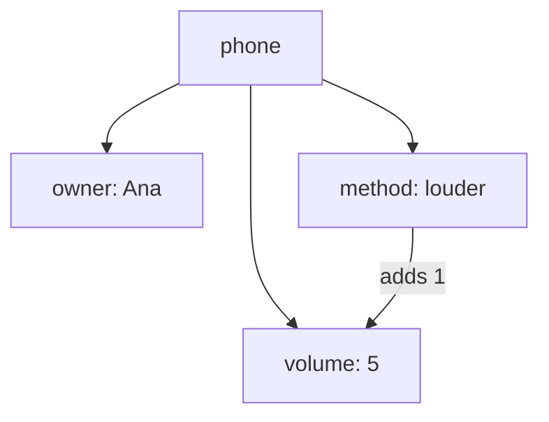

> **In one sentence:** An object keeps related values and the functions that work on them together, as one thing.

## Why should I care?

In [[lists-and-dictionaries|Lists and Dictionaries]], you kept many values under one name. In [[functions|Functions]], you gave a block of code a name.

Think of a player in a game. The player has values: a name and a score. The player also has actions: "add points" changes the score. An object keeps those values and those actions together.

## Analogy

Think of a mobile phone. It has settings, such as its owner's name and its volume level. It also has buttons that act on those settings: the "louder" button raises the volume of this phone, and no other phone.

In an object, the settings are values with names, and the buttons are functions that belong to the object.

**Where the analogy breaks down:** a real phone changes by itself: its battery runs down even when nobody touches it. The objects on this page change only when your code changes them.

## How it actually works

### Values and functions in one place

An **object** is one value that groups related values and the functions that work on them.

- Each value inside an object has a name. JavaScript calls it a **property**, Python an **attribute**, and Go a **field**.
- A function that belongs to an object is a **method**.

You use a dot for both. Write the object, a dot, then the name, to read a value. To call a method, add round brackets after its name, as with any function call. With a dot and `=`, you can also change a named value.

### Which object?

Many objects can have the same method. Two phones can both have a "louder" button. So when a method runs, it needs to know which object to work on: the one it was called on.

Each language gives that object a name inside the method. JavaScript calls it `this`. In Python, it is the method's first parameter, usually named `self`. Go calls it the **receiver**.

This page does not teach classes. Some languages use a class to make many objects of the same kind. That is the topic of a later page, Classes. The Python example uses a small class, and explains only what it needs.

The examples are in [[javascript|JavaScript]], [[python|Python]] and [[go-language|Go]]. You only need to read one tab.

<!-- tabs -->

### JavaScript

In JavaScript, you can write an object directly, with curly brackets. This is an **object literal**. It holds two properties and one method.

```js
// An object with two properties and one method.
const phone = {
  owner: "Ana",
  volume: 5,
  // A method: a function that belongs to this object.
  louder() {
    // this is the object the method was called on.
    this.volume = this.volume + 1;
  },
};

// Read properties with a dot.
console.log(phone.owner);  // Shows: Ana
console.log(phone.volume); // Shows: 5

// Call the method: a dot, its name, and round brackets.
phone.louder();
console.log(phone.volume); // Shows: 6

// Change a property with a dot and =.
phone.volume = 10;
console.log(phone.volume); // Shows: 10
```

`louder() { ... }` is a shorter way to write a function inside an object. It has a name, round brackets and a body, but no word `function`.

Inside a method, `this` is the object the method was called on. In `phone.louder()`, the object before the dot is `phone`, so `this.volume` is `phone.volume`. (This is simplified: in other places, `this` can mean something else. It depends on how a function is called.)

**An object or a dictionary?** In JavaScript, they are the same kind of value. In Lists and Dictionaries, `ages` was an object too. MDN Web Docs, a website that documents web technologies, says objects "are sometimes called associative arrays". Associative array is another name for a dictionary. The difference is in how you use it. In `ages`, each key is a person's name, and you can add more names. In `phone`, each property describes the phone, and a method works on them.

So `phone["owner"]`, with square brackets, also gives `"Ana"`. JavaScript also has a separate kind of value, `Map`, which holds key-value pairs. This page does not use it.

### Python

Python's documentation says: "All data in a Python program is represented by objects". So every value you have met is an object: a number, a string, a list, a dictionary. An **attribute** is any name that follows a dot. Some attributes are named values, and some are methods.

To make your own kind of object in Python, you write a class. The Classes topic explains classes. For now, read `class Phone:` as "a new kind of object, called Phone".

```python
# class makes a new kind of object, called Phone.
# The Classes topic explains this part.
class Phone:
    # __init__ runs when a new Phone is made.
    # It gives the new phone its two attributes.
    def __init__(self, owner, volume):
        self.owner = owner
        self.volume = volume

    # A method: a function that belongs to every Phone.
    # self is the phone the method was called on.
    def louder(self):
        self.volume = self.volume + 1

# Make one Phone object.
phone = Phone("Ana", 5)

# Read attributes with a dot.
print(phone.owner)   # Shows: Ana
print(phone.volume)  # Shows: 5

# Call the method: a dot, its name, and round brackets.
phone.louder()
print(phone.volume)  # Shows: 6

# Change an attribute with a dot and =.
phone.volume = 10
print(phone.volume)  # Shows: 10

# A string is an object too, with its own methods.
print(phone.owner.upper())  # Shows: ANA
```

Writing the class name with round brackets, as in `Phone("Ana", 5)`, makes a new Phone object. `__init__` has two underscores on each side of `init`. It is a special name: Python looks for it, and runs it each time a new object is made. Python passes the new phone in as `self`, then `"Ana"` and `5` as `owner` and `volume`. That is why `Phone("Ana", 5)` has two values for three parameters.

In `self.owner = owner`, the `owner` after `self.` is the new phone's attribute. The `owner` on the right is the parameter, which holds `"Ana"`.

`self` is the phone the method was called on. In `phone.louder()`, the object before the dot is `phone`. Python passes it in as `self` for you, so the round brackets stay empty. The name `self` has no special meaning to Python: it is only a habit.

`phone.owner.upper()` has two dots. First, `phone.owner` gives the string `"Ana"`. Then `.upper()` gives back a copy of that string in capital letters.

**An object or a dictionary?** A dictionary is an object too, with its own methods. But its keys are not attributes. You read a key with square brackets, as in `ages["Mira"]`. `ages.Mira` stops with an error message that names `AttributeError`.

### Go

Go has no classes. A Tour of Go, a tutorial on Go's website, says: "Go does not have classes. However, you can define methods on types." A **type** is a kind of value. A **struct** is a type that holds named values, called **fields**. Each field has a name and its own type.

```go
package main

import "fmt"

// Phone is a new type: a struct with two fields.
type Phone struct {
	owner  string
	volume int
}

// louder is a method. (p *Phone) is its receiver:
// the phone that the method works on.
func (p *Phone) louder() {
	p.volume = p.volume + 1
}

func main() {
	// Make a Phone, and give each field a value.
	phone := Phone{owner: "Ana", volume: 5}

	// Read fields with a dot.
	fmt.Println(phone.owner)  // Shows: Ana
	fmt.Println(phone.volume) // Shows: 5

	// Call the method: a dot, its name, and round brackets.
	phone.louder()
	fmt.Println(phone.volume) // Shows: 6

	// Change a field with a dot and =.
	phone.volume = 10
	fmt.Println(phone.volume) // Shows: 10
}
```

`type Phone struct { ... }` makes a new type named `Phone`. `Phone`, with a capital P, is the type. `phone`, with a small p, is a variable that holds one Phone value. Go's FAQ (common questions) uses the word "objects" for Go values too. On this page, that struct value is the object. `string` is the type for text, and `int` the type for whole numbers. `Phone{owner: "Ana", volume: 5}` makes one Phone value. `:=` creates a new variable, `phone`, and gives it that value.

A method is a function with a **receiver**. The receiver sits in round brackets between `func` and the method's name: `(p *Phone)`. In `phone.louder()`, `p` is `phone`. The `*` lets the method change the phone itself. Without the `*`, the method gets a copy: a second phone with the same values. It changes the copy, and `phone` keeps its old volume. (This is simplified: `*` is part of a Go idea called pointers, which this page leaves out.)

**An object or a map?** A struct and a map are different types. A map can get new keys while the program runs, and all its values have one type. A struct has a fixed set of fields, and each has its own type. Ask for a field the type does not have, such as `phone.color`, and the compiler reports an error. Then the program does not run.

<!-- /tabs -->

This diagram shows the phone from the examples:



## How it came to be

Simula is the name of two programming languages, Simula I and Simula 67. Wikipedia reports that they were developed "in the 1960s at the Norwegian Computing Center in Oslo, by Ole-Johan Dahl and Kristen Nygaard". It credits Simula 67 with introducing objects, along with classes and other ideas.

Dahl and Nygaard shared the 2001 A. M. Turing Award, a yearly prize given by the ACM, a computing association. They received it "for ideas fundamental to the emergence of object oriented programming, through their design of the programming languages Simula I and Simula 67." In plain words: their ideas helped object-oriented programming begin. That is a way of programming in which data is kept inside objects, and code works on each object as a whole.

## 🧪 Try it in your browser

These steps use JavaScript, because the browser's console runs JavaScript. You need a computer with Chrome, Edge or Firefox.

- `const` creates a variable that cannot be given a new value. The variable keeps the same object, but the object's properties can change.
- `{ owner: "Ana", volume: 5 }` creates an object with two properties.
- `louder() { ... }` adds a method to the object. In JavaScript, a method can be written without the word `function`. Inside it, `this` is the object the method was called on.
- In JavaScript, you can also read an object like a dictionary, with the name in square brackets and quote marks.

**Safety rule:** only type code in the console that you understand or that comes from a source you trust. Never paste anything a stranger sends you. The lines below create one object, read and change its properties, and call its method.

1. Open [example.com](https://example.com).
   **What you should see:** a short page. It says the domain is for use in documentation examples.
2. Open the **console**:
   - **Windows:** press `Ctrl` + `Shift` + `J` (in Firefox: `Ctrl` + `Shift` + `K`)
   - **Mac:** press `Cmd` + `Option` + `J` (in Firefox: `Cmd` + `Option` + `K`)
3. Click the line where you can type, below any messages. In each step below, **type** the line yourself (some browsers may block pasting at first), then press `Enter`. The browser may show suggestions, and the line may look different while you type. Keep typing.

   ```
   const phone = { owner: "Ana", volume: 5, louder() { this.volume = this.volume + 1 } }
   ```

   **What you should see:** no result of its own. The console may also show `undefined`. That is normal: the line created a variable, and there is no result to show.
4. Read a property:

   ```
   phone.owner
   ```

   **What you should see:** the name Ana.
5. Read the volume:

   ```
   phone.volume
   ```

   **What you should see:** `5`.
6. Call the method:

   ```
   phone.louder()
   ```

   **What you should see:** no result of its own. The console may also show `undefined`, because `louder` gives back no value.
7. Read the volume again:

   ```
   phone.volume
   ```

   **What you should see:** `6`. The method changed the object.
8. Change the volume yourself:

   ```
   phone.volume = 10
   ```

   **What you should see:** `10`. An assignment has a result: the value that was assigned.
9. Read a property with square brackets, as in a dictionary:

   ```
   phone["owner"]
   ```

   **What you should see:** the name Ana again.

If you see an error message at any step, reload the page, delete anything left on the typing line, and start again from step 3.

## Common misunderstandings

<!-- tabs -->

### JavaScript

- **"An object and a dictionary are different kinds of value."** No. In JavaScript, both are objects. The difference is in how you use them.
- **"`this` always means the same object."** No. In a call like `phone.louder()`, it is the object before the dot. The value of `this` depends on how a function is called.

### Python

- **"Only some Python values are objects."** No. Python's documentation says that each value is an object.
- **"`self` is a special word in Python."** No. It is the usual name for a method's first parameter, and Python gives the name no special meaning.
- **"`phone.louder()` needs the phone in its brackets."** No. Python passes the object before the dot as `self` for you.

### Go

- **"Go has classes."** No. Go has types, such as structs, and you can define methods on them.
- **"A method without `*` in its receiver can change the struct."** No. It works on a copy, so the change is lost.

<!-- /tabs -->

## Recap

- An object groups related values and the methods that work on them into one thing.
- A dot reads or changes a value, and a dot with round brackets calls a method.
- Inside a method, the object it was called on has a name: `this` in JavaScript, usually `self` in Python, the receiver in Go.

## Sources

- MDN Web Docs, JavaScript object basics: https://developer.mozilla.org/en-US/docs/Learn_web_development/Core/Scripting/Object_basics
- MDN Web Docs, Working with objects: https://developer.mozilla.org/en-US/docs/Web/JavaScript/Guide/Working_with_objects
- MDN Web Docs, Method definitions: https://developer.mozilla.org/en-US/docs/Web/JavaScript/Reference/Functions/Method_definitions
- MDN Web Docs, this: https://developer.mozilla.org/en-US/docs/Web/JavaScript/Reference/Operators/this
- MDN Web Docs, Map: https://developer.mozilla.org/en-US/docs/Web/JavaScript/Reference/Global_Objects/Map
- MDN Web Docs, About MDN: https://developer.mozilla.org/en-US/about
- Wikipedia, Associative array: https://en.wikipedia.org/wiki/Associative_array
- MDN Web Docs, OOP (glossary): https://developer.mozilla.org/en-US/docs/Glossary/OOP
- MDN Web Docs, Assignment (=): https://developer.mozilla.org/en-US/docs/Web/JavaScript/Reference/Operators/Assignment
- MDN Web Docs, const: https://developer.mozilla.org/en-US/docs/Web/JavaScript/Reference/Statements/const
- Heidelberg Laureate Forum, Kristen Nygaard: https://www.heidelberg-laureate-forum.org/laureate/kristen-nygaard.html
- MDN Web Docs, eval(): https://developer.mozilla.org/en-US/docs/Web/JavaScript/Reference/Global_Objects/eval
- Python Language Reference, Data model: https://docs.python.org/3/reference/datamodel.html
- Python Tutorial, Classes: https://docs.python.org/3/tutorial/classes.html
- Python documentation, Glossary: https://docs.python.org/3/glossary.html
- Python documentation, Built-in Types: https://docs.python.org/3/library/stdtypes.html
- Python Tutorial, Data Structures: https://docs.python.org/3/tutorial/datastructures.html
- Python documentation, Built-in Exceptions: https://docs.python.org/3/library/exceptions.html
- The Go Programming Language Specification: https://go.dev/ref/spec
- A Tour of Go, Methods (source text): https://github.com/golang/website/blob/master/_content/tour/methods.article
- Go, Frequently Asked Questions (FAQ): https://go.dev/doc/faq
- Wikipedia, Simula: https://en.wikipedia.org/wiki/Simula
- Wikipedia, Turing Award: https://en.wikipedia.org/wiki/Turing_Award
- Microsoft Edge DevTools, Run JavaScript in the Console: https://learn.microsoft.com/en-us/microsoft-edge/devtools/console/console-javascript
- Chrome for Developers, Open Chrome DevTools: https://developer.chrome.com/docs/devtools/open
- Microsoft Edge DevTools, Keyboard shortcuts: https://learn.microsoft.com/en-us/microsoft-edge/devtools/shortcuts/
- Firefox DevTools User Docs, Web Console: https://firefox-source-docs.mozilla.org/devtools-user/web_console/index.html
- Chrome for Developers, What are self-XSS attacks?: https://developer.chrome.com/blog/self-xss
- Example Domain: https://example.com
