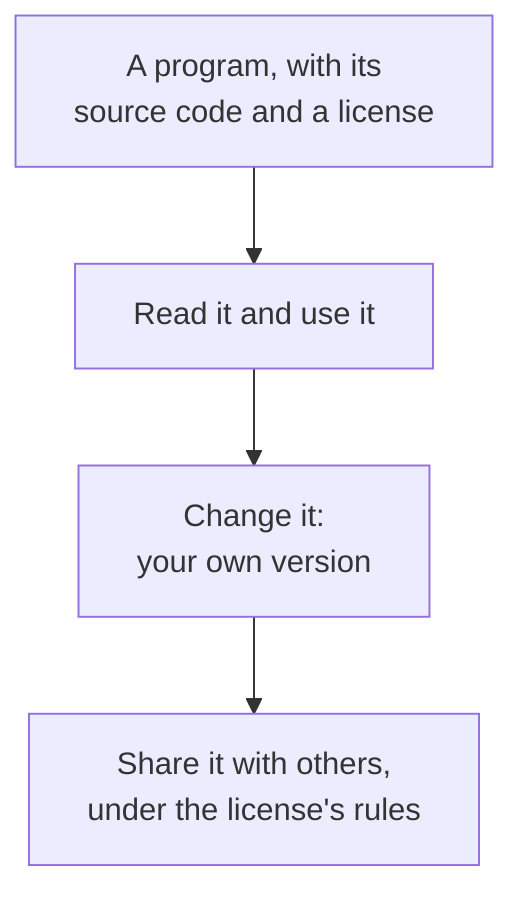

> **In one sentence:** Open source software is software that comes with its source code and a license that lets anyone use it, change it and share it.

## Why should I care?

You may already use open source software. Mozilla, which makes the Firefox web browser, says: "All Mozilla software is open source and free software". The Linux kernel, one part of the Linux operating system, is open source too.

This website's code is open source as well (see below). As a programmer, you will read, use and maybe improve code that other people have shared this way.

## Analogy

Think of a **recipe** that a cook writes down and shares. You can cook the dish and read how it is made. You can change it, for example with less salt, and give your new version to a friend.

Other programs are more like a cake from a shop. You can eat it, but you cannot see the recipe.

**Where the analogy breaks down:** a shared recipe usually comes with no rules at all. With software, permission matters a lot. The law protects code, so seeing the code is not enough. You need a written **license** that says what you may do. Different licenses give different permissions and set different rules.

## How it actually works

### Source code you can read

In [[programming-languages]], you met **source code**: a program as it is written in a programming language. In [[software]], you saw that a finished program file, such as Firefox's, is mostly machine code.

With open source software, you can get the source code too. The Open Source Definition, published by the **Open Source Initiative (OSI)**, says: "The program must include source code". If the source code does not come with the program, there must be a well-known way to get it.

### A license gives permission

**Copyright** is a set of rights given by law. The World Intellectual Property Organization (WIPO) describes it as "the rights that creators have over their literary and artistic works". It lists "computer programs" among the works that copyright protects.

So being able to read code does not mean you may copy it. GitHub is a website where people often share open source code. Its documentation says that "without a license, the default copyright laws apply". Then "no one may reproduce, distribute, or create derivative works" from the code. (To distribute means to give out copies. A derivative work is a new work made from an old one.)

A **license** is a legal text in which the owner gives permission to do certain things. Open source licenses give it to everyone. The OSI definition has 10 rules for a license. For example:

- It must not stop anyone from selling or giving away the software as part of a bundle of programs.
- It "must allow modifications and derived works", which means changed versions.
- It must not stop people from using the program in a business.

### "Free" means freedom, not price

A related idea is **free software**, described by the Free Software Foundation's GNU Project. It means that users have "the freedom to run, copy, distribute, study, change and improve the software". The GNU Project says this is "a matter of liberty, not price". You may even "sell copies".

The OSI says the people who chose the label "open source" wanted it to be different from "free software". But one program can be both, as Mozilla's software is.

### Two kinds of license

Some licenses use **copyleft**. The GNU Project describes copyleft as "requiring all modified and extended versions of the program to be free as well". So if you share a changed version, it must be free software too. The **GNU General Public License (GPL)** is a copyleft license. The OSI approves its version 2 (GPL-2.0) as an open source license. The Linux kernel uses GPL-2.0, with one exception.

Other licenses ask for less. The **MIT License** is approved by the OSI. It gives the right to use, copy, change, publish, distribute and sell copies. Its main condition is that you keep its copyright line and permission text in all copies.

### How people work together

Many open source projects accept help. A piece of help is called a **contribution**. GitHub's Open Source Guides describe some places where it happens. Two of them: an **issue tracker** is where people discuss problems and ideas for the project. A **pull request** is where "people discuss and review changes that are in progress".

The guide also says: "You don't have to contribute code". Fixing a typing mistake (a typo), writing a translation or reporting an error all help.

### This website's own licenses

This website's code uses the **MIT License**. Its text uses **CC BY-SA 4.0**, a Creative Commons license. (Photos by other people keep their own licenses, shown under each photo.)

CC BY-SA is an open license for content, not an open source software license. Creative Commons itself says: "We recommend against using Creative Commons licenses for software."

## How it came to be

On September 27, 1983, Richard Stallman posted the first announcement of the **GNU Project**. He planned to write a complete software system and "give it away free to everyone who can use it". GNU later called this wording "careless": the aim was that nobody would have to pay for permission to use it.

The label "open source" came later. The OSI says it was created at a meeting on February 3, 1998, in Palo Alto, California. This was shortly after Netscape announced that it would release its web browser's source code. The term was "originally suggested by Christine Peterson".

## 🧪 Try it in your browser

You will look at two real open source licensing pages. This also works on a phone.

1. Copy this address into your browser's address bar, and open it: `https://github.com/adityaokke/programmersbible/blob/main/LICENSE`
2. Read the first paragraph of the text.

**What you should see:** the title **MIT License**, a copyright line (it starts with "Copyright" and a year), then "Permission is hereby granted, free of charge". The same paragraph lists the permissions: "use, copy, modify" and more.

3. Now open the Linux kernel's licensing page in the same way: `https://www.kernel.org/doc/html/latest/process/license-rules.html`
4. Read the first paragraph.

**What you should see:** a page titled **Linux kernel licensing rules**. Its first sentence says that the Linux kernel is provided under the GNU General Public License version 2 only (GPL-2.0).

**What happened:** you saw a short license that asks for little (MIT), and a project that uses a copyleft license (GPL).

## Common misunderstandings

- **"Open source means it costs nothing."** Not always. The MIT License allows selling copies, and the GNU Project says you may sell copies of free software. "Free" is about freedom, not price.
- **"If I can see the code on a website, I may copy it."** Usually not. Without a license, copyright law generally means you may not copy or share it. Check the license first.

## Recap

- Open source software comes with its source code and a license that lets anyone use it, change it and share it.
- The license matters: without one, you generally may not copy or share code, even if you can see it.
- "Free software" is a related idea: free as in freedom, not price.

## Sources

- Open Source Initiative, The Open Source Definition: https://opensource.org/osd
- Open Source Initiative, History of the OSI: https://opensource.org/history
- Open Source Initiative, GNU General Public License version 2: https://opensource.org/license/gpl-2-0
- Open Source Initiative, The MIT License: https://opensource.org/license/mit
- GNU Project (Free Software Foundation), What is Free Software?: https://www.gnu.org/philosophy/free-sw.html
- GNU Project, What is Copyleft?: https://www.gnu.org/licenses/copyleft.html
- GNU Project, Initial Announcement (Richard Stallman, 1983): https://www.gnu.org/gnu/initial-announcement.html
- Stanford CS101, Running and Operating Systems (Software): https://web.stanford.edu/class/cs101/software-1.html
- WIPO, Copyright: https://www.wipo.int/en/web/copyright
- GitHub Docs, Licensing a repository: https://docs.github.com/en/repositories/managing-your-repositorys-settings-and-features/customizing-your-repository/licensing-a-repository
- Open Source Guides (GitHub), How to Contribute to Open Source: https://opensource.guide/how-to-contribute/
- Mozilla, Mozilla Licensing Policies: https://www.mozilla.org/en-US/foundation/licensing/
- Mozilla, Mozilla Public License: https://www.mozilla.org/en-US/MPL/
- The Linux Kernel documentation, Linux kernel licensing rules: https://www.kernel.org/doc/html/latest/process/license-rules.html
- The Linux Kernel documentation, Linux kernel release README: https://www.kernel.org/doc/html/latest/admin-guide/README.html
- kernel.org, What is Linux?: https://www.kernel.org/linux.html
- Creative Commons, CC BY-SA 4.0 deed: https://creativecommons.org/licenses/by-sa/4.0/
- Programmer's Bible, Writing Guide: https://github.com/adityaokke/programmersbible/blob/main/docs/WRITING_GUIDE.md
- Creative Commons, Frequently Asked Questions: https://creativecommons.org/faq/
- Programmer's Bible, LICENSE: https://github.com/adityaokke/programmersbible/blob/main/LICENSE
- Programmer's Bible, LICENSE-CONTENT: https://github.com/adityaokke/programmersbible/blob/main/LICENSE-CONTENT
