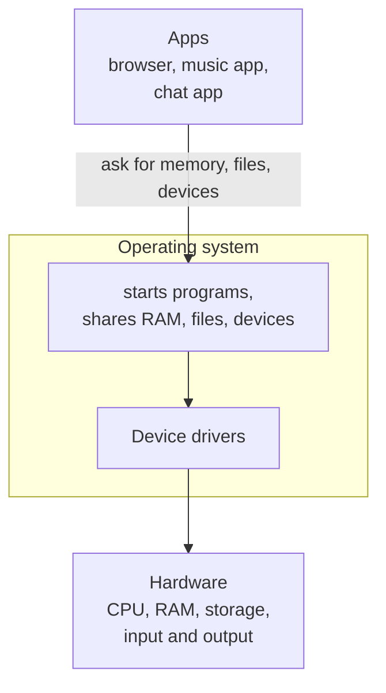

> **In one sentence:** An operating system is the main program that starts when a computer is switched on; it starts and stops the other programs, gives each one its own memory, and lets them share the CPU, storage and devices.

## Why should I care?

You use an operating system every day. Stanford's introductory computer course gives these examples of operating systems: Windows, Linux, Android and iOS.

When a laptop or phone starts up, Stanford's course says, the operating system gets things organized. Then it starts a program that shows you your apps and files. When you open an app, the operating system starts it. When you close it, the operating system takes back the memory it used.

## Analogy

Go back to the **kitchen** from [[how-computer-parts-work-together|How the Parts Work Together]]. The cook is the CPU, the table is memory (RAM), and the fridge is storage.

Now add a **kitchen manager**. The manager decides which order the cook works on next. The manager gives each order its own part of the table, so two dishes never get mixed up. The manager also keeps the fridge in order and handles the window where orders come in.

**Where the analogy breaks down:** a kitchen manager is a second person who works next to the cook. A computer has no second worker. The operating system is itself a [[software|program]], and the same CPU runs it, taking turns with the other programs. Also, the manager understands food. The operating system only follows its instructions.

## How it actually works

Stanford's course calls the operating system a "set of supervisory programs that manage the computer": programs that watch over and manage everything else. Here are its main jobs.

### 1. Starting the computer

So who starts the operating system? Stanford's course explains: "When first powered on, computer runs a special 'bootstrap' program". That program looks in storage for an operating system and starts it. This is called **booting**, or "booting up".

### 2. Starting and stopping programs

When you open an app, the operating system **launches** (starts) it. Stanford's course lists the steps:

1. It sets aside an area of RAM for the program.
2. It copies the program's machine code instructions from storage into that area.
3. It directs the CPU to start running the program's first instruction.

When a program ends, or gets stuck and must be stopped, the operating system takes its area of RAM back, to be used again.

### 3. Sharing memory, and keeping programs apart

Stanford's course says the operating system "gives each program its own area of memory". A program with an error, or a harmful program, should not be able to change another program's memory.

### 4. Running many programs at once

Running many programs at the same time is called **multitasking**. Stanford's course describes a "round robin" (taking turns in a circle): the CPU "runs a few instructions from each program", so they all appear to run at the same time.

### 5. Talking to devices

The operating system uses a **device driver** for each kind of device: software that lets the operating system and a device communicate. Microsoft says a driver is often made by the device's manufacturer.

For example, an app asks the operating system for data from a device. The operating system asks the driver. The driver gets the data from the device and gives it back to the operating system, which gives it to the app.

Input works this way too. Remember the key press: the operating system had put the key-handling instructions in memory.

The operating system also keeps track of where each file is in storage. You will meet that in [[files-and-folders|Files and Folders]].



(This picture is simplified. The CPU also runs each app's own instructions directly, when the operating system gives that app its turn.)

## How it came to be

The first computers, in the late 1940s and early 1950s, had no operating system. People programmed them directly: for example, with machine code fed in on punch cards (cards with holes punched in them).

In the summer of 1969, says the Computer History Museum, computer scientists at Bell Telephone Laboratories began building an operating system. The museum names Ken Thompson and Dennis Ritchie as the most central people. It became **Unix**. The museum lists some of its "many descendants" (later systems built from it or modelled on it): Linux, Android, BSD Unix, MacOS and iOS.

In 1981, the museum says, **MS-DOS** (Microsoft Disk Operating System) became "the basic software" for IBM's new [[personal-computer|personal computer]]. The museum also says MS-DOS was "eventually supplanted" (replaced) by Microsoft's Windows.

## 🧪 Try it in your browser

Your browser can tell you which operating system it runs on. You need a computer with a keyboard.

**Safety rule:** only type instructions in the console that you understand or that come from a source you trust. Never paste anything a stranger sends you. The line below only reads some text.

1. In Chrome, Edge or Firefox, open `https://example.com` in a **new** tab.
2. Open the console:
   - **Windows:** press `Ctrl` + `Shift` + `J` (in Firefox: `Ctrl` + `Shift` + `K`)
   - **Mac:** press `Cmd` + `Option` + `J` (in Firefox: `Cmd` + `Option` + `K`)
3. Click the empty line at the bottom. **Type** this line yourself (some browsers block pasting in the console), then press `Enter`:

   ```
   navigator.userAgent
   ```

**What you should see:** one long line of text that starts with `Mozilla/5.0`, in every one of these browsers. Inside the first round brackets `( )`, look for the name of your operating system, such as `Windows`, `Macintosh` (an Apple Mac computer), `Linux` or another name.

The numbers in this text may not match your exact system. MDN says some browsers show fixed values in it.

**What happened:** the browser is an app that runs on your operating system, and it wrote the operating system's name into this text. Close the tab when you are done.

**On a phone:** think of a time you listened to music while using another app. Which job of the operating system lets two programs run at the same time? Check your answer in section 4.

## Common misunderstandings

- **"The operating system is one of my apps."** Not quite. It is a program, but it starts first, before any app. It starts and stops the apps, and shares the computer among them.
- **"All programs share the same memory."** Normally, no. The operating system gives each program its own area of RAM, and tries to block a program that reaches outside it.

## Recap

- The operating system is the main program that starts when the computer starts up (boots), and it starts and stops the other programs.
- It gives each program its own area of RAM, and switches the CPU between programs so they all seem to run at once.
- Through device drivers, it lets apps use storage and devices such as the keyboard and screen.

## Sources

- Stanford CS101, Running and Operating Systems: https://web.stanford.edu/class/cs101/software-1.html
- Microsoft Learn, What is a Driver?: https://learn.microsoft.com/en-us/windows-hardware/drivers/gettingstarted/what-is-a-driver-
- Wikipedia, Operating system (general background reference): https://en.wikipedia.org/wiki/Operating_system
- Computer History Museum, The Earliest Unix Code: An Anniversary Source Code Release: https://computerhistory.org/blog/the-earliest-unix-code-an-anniversary-source-code-release/
- Computer History Museum, Timeline of Computer History, Software & Languages: https://www.computerhistory.org/timeline/software-languages/
- MDN Web Docs, Navigator.userAgent: https://developer.mozilla.org/en-US/docs/Web/API/Navigator/userAgent
- MDN Web Docs, User-Agent header: https://developer.mozilla.org/en-US/docs/Web/HTTP/Reference/Headers/User-Agent
- Chrome for Developers, Open Chrome DevTools: https://developer.chrome.com/docs/devtools/open
- Microsoft Edge DevTools, Keyboard shortcuts: https://learn.microsoft.com/en-us/microsoft-edge/devtools/shortcuts/
- Firefox DevTools User Docs, Web Console: https://firefox-source-docs.mozilla.org/devtools-user/web_console/index.html
- Chrome for Developers, Self-XSS protection: https://developer.chrome.com/blog/self-xss
